# G1 · Comunicación de los mandos (periférico `0x0047`)

Este documento recorre el flujo de diseño de la guía `uart.pdf` (A1 a A9) y la integración al SoC RISC-V de la guía `uart-riscv.pdf`, capítulos 12 a 14 (B1 a B8). Todo se refiere al **diseño acordado**: la trama de 8 bytes que usan G5 y G6, recibida por `peripheral_mandos` en la región `0x0047` del SoC del G2.

> **Qué cambió respecto a la entrega anterior.** La trama de pares (dirección, valor) de 2 bytes se reemplazó por la trama de 8 bytes del G5. El RTL es el de Cesar Jaramillo (`uart_8n1`, `desempaquetador`) adaptado a esa trama, más el adaptador de bus `perip_mandos.v`. La documentación de la versión de 4 bytes quedó en [`anterior_trama_4bytes/`](anterior_trama_4bytes/README.md) solo como historial.

## Lista de comprobación de la rúbrica

| Ítem | Qué pide el informe | Dónde está | Evidencia |
|---|---|---|---|
| A1 | Caja negra + características | [§A1](#a1-caja-negra-y-características), `diagramas/A1_caja_negra.svg` | Bus del SoC, región, parámetros `CLK_HZ` y `BAUD` |
| A2 | Bloques + tabla de señales | [§A2](#a2-diagrama-de-bloques-y-tabla-de-señales), `A2a_sistema.png`, `A2b_bloques.png` | Datapath **del periférico con el bus del procesador** (`cs`, `rd`, `addr`, `d_out`), anchos |
| A3 | Diagrama de tiempos | [§A3](#a3-diagramas-de-tiempos), `03a…03d_*.svg` | Sacados del VCD. La línea serie se dibuja **como 10 bits 8N1** (byte `0x11`) |
| A4 | Diagrama de flujo | [§A4](#a4-diagrama-de-flujo), `A4_flujo.png` | Recepción, trama, errores y lectura del CPU |
| A5 | Clasificación control/datapath | [§A5](#a5-clasificación-control--datapath) | Tabla por elemento |
| A6 | ASMD + tabla de transferencias | [§A6](#a6-asmd-y-tabla-de-transferencias), `A6a/b/c_*.png` | 34 filas R0–R11, D0–D11, B0–B9, con nombre en cada óvalo |
| A7 | Arquitectura control/datapath | [§A7](#a7-arquitectura-control--datapath), `A7_arquitectura.svg` | FSM en rojo, datapath en azul, bus en amarillo |
| A8 | FSM | [§A8](#a8-máquinas-de-estados), `A8a/b_*.png` | Transiciones marcadas con la fila que ejecutan |
| A9 | Testbench desde los diagramas | [§A9](#a9-testbench-y-simulación), `sim/tb_perip_mandos_filas.v` | Cada comprobación cita su fila, **cuenta de ejecuciones por fila**, 5 fallas inyectadas detectadas |
| B1 | Región del mapa y `cs` | [§B1](#b1-región-del-mapa-y-chip-select), `B1_mapa_chip_select.png` | `0x0047_xxxx` → `cs[7]` en `chip_select.v` |
| B2 | Mapa de registros MMIO | [§B2](#b2-mapa-de-registros-mmio) | Dirección completa, bits, acceso, reset |
| B3 | Decodificador local | [§B3](#b3-decodificador-local), `B3_decodificador_local.png` | `addr[3:0]` dibujado, offsets reservados |
| B4 | Diagrama del adaptador de bus | [§B4](#b4-adaptador-de-bus), `B4_adaptador_bus.svg` | CPU → chip_select → adaptador → mux de lectura |
| B5 | START/BUSY/DONE | [§B5](#b5-semántica-startbusydone) | Justificación de por qué no existen y qué los reemplaza |
| B6 | Tiempos del handshake bus ↔ core | [§B6](#b6-tiempos-del-handshake-bus--core), `B6_handshake_bus.svg` | Tomado de la simulación del SoC con el FemtoRV32 |
| B7 | Verificación de registros y SoC | [§B7](#b7-verificación-de-registros-y-del-soc) | Banco por el bus (23/23) + SoC con el CPU ejecutando un programa (6/6) |
| B8 | Pines y restricciones | [§B8](#b8-pines-y-restricciones) | Tabla de pines; pin y reloj por acordar con G4 |
| — | Autoría y uso de IA | [§Autoría](#autoría-y-declaración-de-uso-de-ia) | Declaración explícita |

## Estructura de la carpeta

```
documentacion/
├── README.md                      este documento
├── diagramas/                     figuras (PNG/SVG) y sus fuentes editables en fuentes/ (.mmd Mermaid, .dot Graphviz)
├── rtl/
│   ├── uart_8n1.v                 UART 8N1 (se usa solo RX)            · autor: Cesar Jaramillo, adaptado
│   ├── desempaquetador.v          trama de 8 bytes del G5               · autor: Cesar Jaramillo, adaptado
│   └── perip_mandos.v             adaptador de bus para el SoC (nuevo)
├── sim/
│   ├── tb_perip_mandos_filas.v    banco del periférico por el bus, con cobertura por fila
│   ├── tb_soc_mandos_tiempos.v    SoC completo con el FemtoRV32 (copia de tb_soc_mandos.v + VCD)
│   ├── mutantes.sh                5 fallas inyectadas a propósito
│   ├── tiempos_mandos.gtkw        señales de los diagramas de tiempos para GTKWave
│   └── Makefile                   make filas | filas25 | mutantes | soc | wave
└── anterior_trama_4bytes/         versión anterior (historial)
```

---

# Parte A · Flujo de diseño (guía `uart.pdf`)

## A1. Caja negra y características

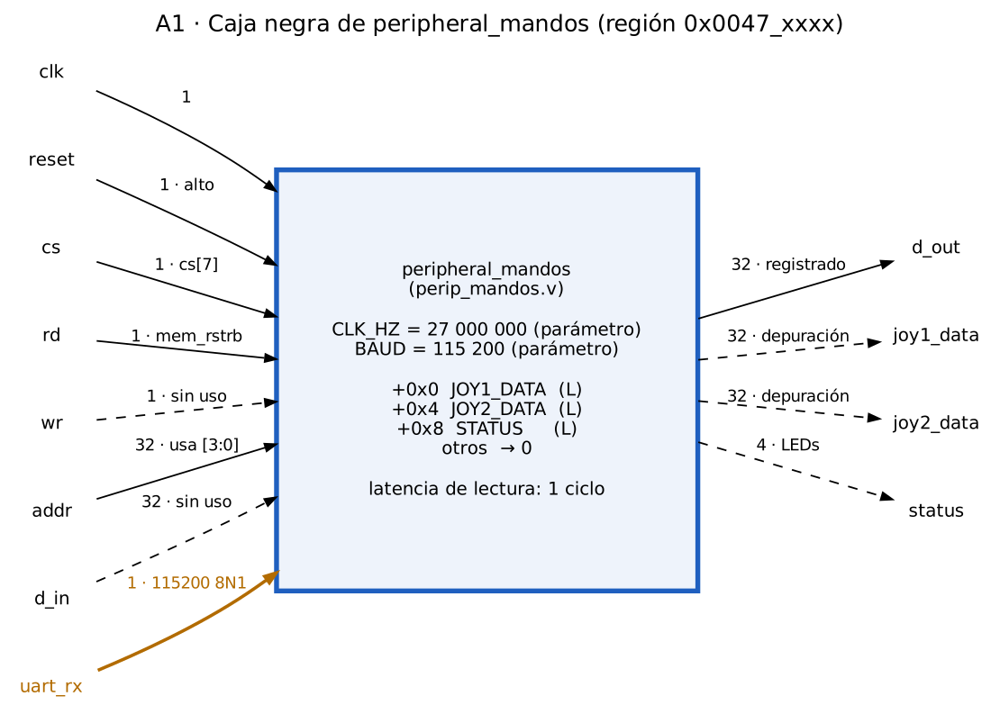

**Función.** Recibe por un pin la trama de 8 bytes que reenvía la ESP32 de la consola, la valida (cabecera, jugador, checksum) y deja la última muestra válida de cada jugador en registros que el FemtoRV32 lee en `0x0047_0000`.

| Característica | Valor |
|---|---|
| Placa | Tang Nano 9K (GW1NR-9) |
| Reloj | Parámetro `CLK_HZ`. 27 MHz en la Tang Nano 9K. El banco también pasa a 25 MHz (`make filas25`), que es el reloj que menciona el G4 |
| UART | 115200 baudios, 8N1, LSB primero. `CPB = CLK_HZ / BAUD` = 234 ciclos por bit (27 MHz) o 217 (25 MHz) |
| Muestreo | Start verificado a `HALF = CPB/2` = 117 ciclos y datos en la mitad de cada bit. Tolera ±2 % de error de reloj en la ESP32 (caso C11) |
| Trama | 8 bytes: `0xAA` · jugador (1/2) · secuencia · X (con signo) · Y (con signo) · shield (bit 0) · punch (bit 0) · checksum = XOR de los bytes 1 a 6 |
| Tasa | Unas 30 tramas/s por mando. Una trama dura 8 × 86,8 µs = 694 µs |
| Resincronización | Plazo de 1 ms (`T_MAX_CICLOS = CLK_HZ/1000`) sin bytes con trama a medias, o un byte con stop = 0 |
| Bus | El del SoC del curso: `clk`, `reset` (alto, síncrono), `cs`, `rd`, `wr`, `addr[31:0]`, `d_in`, `d_out` registrado. Latencia de lectura: 1 ciclo |
| Registros | `JOY1_DATA` (+0x0), `JOY2_DATA` (+0x4), `STATUS` (+0x8). Solo lectura |
| Coherencia | Los 5 campos de un jugador se copian en el mismo flanco. El CPU nunca lee una X nueva con una Y vieja |

## A2. Diagrama de bloques y tabla de señales

**Sistema** (de dónde viene el dato):

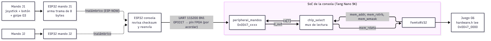

**Periférico con el bus del procesador** (lo que se diseña):

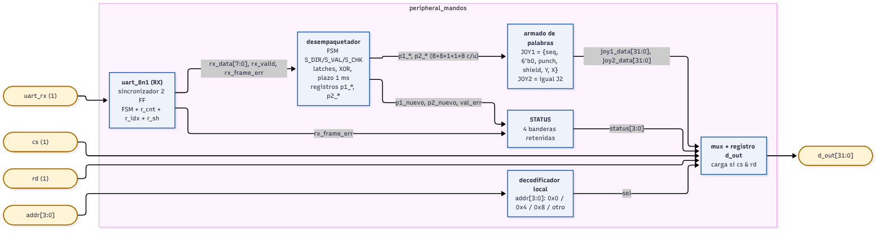

| Señal | Dir. | Ancho | Origen → destino | Descripción |
|---|---|---|---|---|
| `clk` | in | 1 | SoC | Reloj del sistema (`CLK_HZ`) |
| `reset` | in | 1 | SoC (`!resetn`) | Reset síncrono, activo en alto. Dentro se usa `rst_n = ~reset` |
| `cs` | in | 1 | `chip_select` → `cs[7]` | 1 si `mem_addr[31:16] = 0x0047` |
| `rd` | in | 1 | `mem_rstrb` | Pulso de lectura del FemtoRV32 |
| `wr` | in | 1 | `\|mem_wmask` | Escritura. **No se usa**: registros de solo lectura |
| `addr` | in | 32 | `mem_addr` | Solo se decodifica `addr[3:0]` |
| `d_in` | in | 32 | `mem_wdata` | No se usa |
| `d_out` | out | 32 | → `chip7_dout` | Dato leído, registrado |
| `uart_rx` | in | 1 | pin ← GPIO17 ESP32 | Línea serie, reposo en 1 |
| `rx_in` | int | 1 | sincronizador → FSM RX | `uart_rx` tras 2 FF |
| `rx_data` | int | 8 | uart_8n1 → desempaquetador | Byte recibido |
| `rx_valid` | int | 1 | uart_8n1 → desempaquetador | Pulso: byte con stop = 1 |
| `rx_frame_err` | int | 1 | uart_8n1 → desempaquetador, STATUS | Pulso: stop = 0 |
| `p1_x`, `p1_y`, `p1_seq` | int | 8 c/u | desempaquetador → JOY1 | Última muestra válida J1 |
| `p1_shield`, `p1_punch` | int | 1 c/u | desempaquetador → JOY1 | Botón y golpe J1 |
| `p2_*` | int | igual | desempaquetador → JOY2 | Jugador 2 |
| `p1_nuevo`, `p2_nuevo` | int | 1 | desempaquetador → STATUS | Pulso: trama válida publicada |
| `val_err`, `dir_err` | int | 1 | desempaquetador → STATUS | Pulso: checksum malo / jugador inválido |
| `joy1_data`, `joy2_data` | out | 32 | → mux, LEDs | Palabras armadas |
| `status` | out | 4 | → mux, LEDs | Banderas retenidas |

## A3. Diagramas de tiempos

Los cuatro se generaron leyendo `tb_perip_mandos_filas.vcd` (Icarus Verilog 12, 27 MHz). Se pueden comprobar abriendo el mismo VCD en GTKWave con `make wave` (ver [cómo verificarlo](#cómo-comprobar-los-diagramas-de-tiempos-en-gtkwave)).

**A3a · Un byte en la línea como trama 8N1 de 10 bits.** Es el byte `0x11` (secuencia de la trama C1), que pidió el profesor. Se ven start = 0, b0…b7 = `1 0 0 0 1 0 0 0` (LSB primero) y stop = 1. `rx_in` va 2 ciclos detrás. `r_sh` se llena por la izquierda (`80, 40, 20, 10, 88, 44, 22, 11`). Con el stop en 1 sale `rx_valid` y `rx_data = 0x11`.

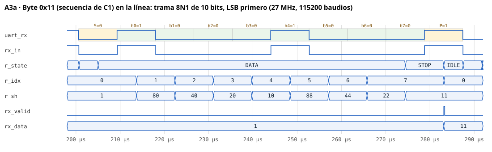

**A3b · Trama completa C1** (`AA 01 11 9C 32 01 00 BF`). Los 8 bytes de 10 bits cada uno. `xor_l` acumula los bytes 1 a 6: `01 → 10 → 8C → BE → BF → BF`. En `S_CHK` llega `BF = xor_l`, así que se publica J1: `JOY1_DATA = 0x1101329C` y `STATUS = 1`.

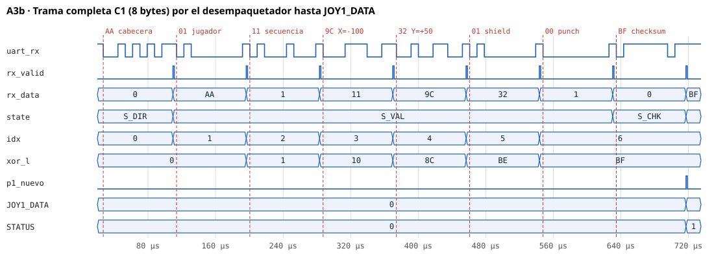

**A3c · Trama cortada y plazo (C7).** Llegan 3 bytes y la línea queda en reposo. 1 ms después del último byte, la FSM vuelve a `S_DIR` sin publicar (D11). La trama siguiente se recibe bien.

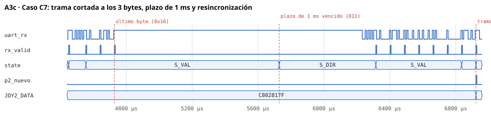

**A3d · Bit de parada en 0 (C8).** El tercer byte llega con stop = 0. La UART levanta `rx_frame_err` (R10), pasa a `ESPERA` hasta que la línea vuelve a 1 (R11) y la trama se descarta (D1). `UART_ERROR` queda en 1 (B3).

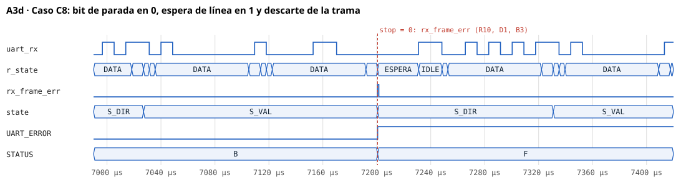

## A4. Diagrama de flujo

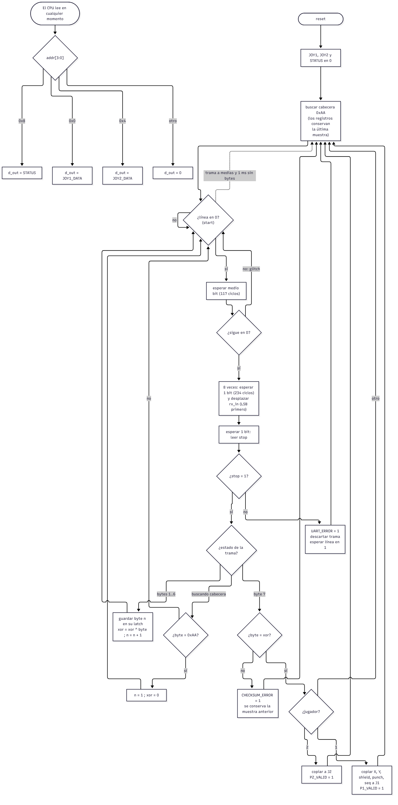

## A5. Clasificación control / datapath

| Elemento | Tipo | Archivo | Justificación |
|---|---|---|---|
| `rx_sync[1:0]` | Datapath | uart_8n1.v | Registro del dato de entrada |
| `r_cnt` y comparadores `= HALF−1`, `= CPB−1` | Datapath | uart_8n1.v | Contador y banderas de tiempo |
| `r_idx` y `= 7` | Datapath | uart_8n1.v | Contador de bits y bandera |
| `r_sh`, `rx_data` | Datapath | uart_8n1.v | Almacenan el byte |
| FSM `IDLE/START/DATA/STOP/ESPERA` | **Control** | uart_8n1.v | Decide cuándo muestrear y si el byte es válido |
| Latches `jug_l, seq_l, x_l, y_l, shield_l, punch_l` | Datapath | desempaquetador.v | Trama en curso |
| `xor_l` | Datapath | desempaquetador.v | Acumulador del checksum |
| `idx`, `espera` y sus comparadores | Datapath | desempaquetador.v | Posición en la trama y plazo |
| Comparadores `= 0xAA`, `= xor_l`, `jug_l = 1/2` | Datapath | desempaquetador.v | Banderas para el control |
| `p1_*`, `p2_*` | Datapath | desempaquetador.v | Muestra publicada |
| FSM `S_DIR/S_VAL/S_CHK` | **Control** | desempaquetador.v | Recorre la trama, valida y publica |
| `STATUS[3:0]` | Datapath | perip_mandos.v | Banderas retenidas |
| Decodificador `addr[3:0]`, mux, `d_out` | Datapath | perip_mandos.v | Adaptador de bus. No necesita FSM: responde en un ciclo |

**Del datapath al control:** `rx_in`, `r_cnt = HALF−1`, `r_cnt = CPB−1`, `r_idx = 7`, `rx_valid`, `rx_frame_err`, `rx_data = 0xAA`, `rx_data = xor_l`, `jug_l`, `idx = 6`, `espera = T_MAX−1`.
**Del control al datapath:** limpiar o incrementar `r_cnt` y `r_idx`, desplazar `r_sh`, cargar `rx_data`, cargar latch, acumular `xor_l`, publicar J1 o J2, `p1_nuevo`, `p2_nuevo`, `val_err`.

## A6. ASMD y tabla de transferencias

Convención: rectángulo azul = estado, rombo = decisión, óvalo verde = transferencias condicionales, con **el nombre de su fila**. Todo registro que no aparece en una fila conserva su valor.

**A6a · Receptor UART (`uart_8n1`, RX)**

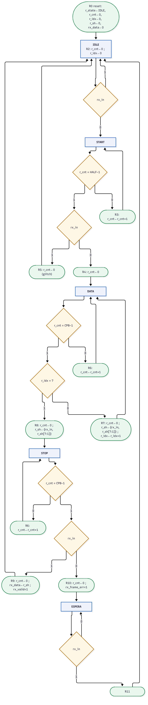

**A6b · Desempaquetador**

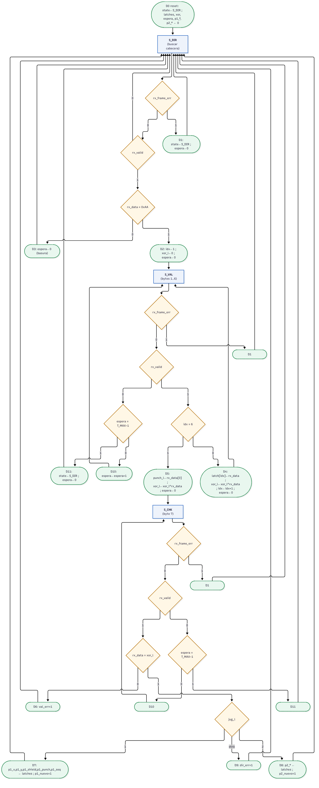

**A6c · Adaptador de bus y STATUS** (un solo estado: actúa en cada ciclo)

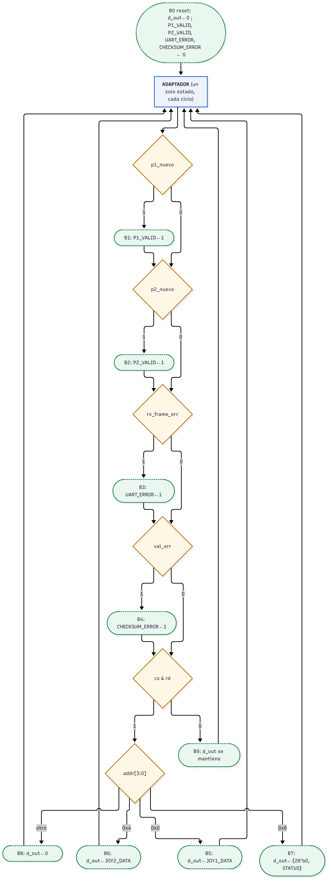

### Tabla de transferencias

La última columna es cuántas veces ejecutó cada fila el banco `tb_perip_mandos_filas.v` a 27 MHz (§A9).

| Fila | Estado | Condición | Transferencias | Veces |
|---|---|---|---|---|
| R0 | — | reset | `r_state←IDLE, r_cnt←0, r_idx←0, r_sh←0, rx_data←0, rx_sync←11` | 25 |
| R1 | todos | cada ciclo | `rx_sync←{rx_sync[0], rx}`, `rx_valid←0`, `rx_frame_err←0` | 299 548 |
| R2 | IDLE | — | `r_cnt←0, r_idx←0`. Si `rx_in=0` → START | 62 969 |
| R3 | START | `r_cnt ≠ HALF−1` | `r_cnt←r_cnt+1` | 12 412 |
| R4 | START | `r_cnt = HALF−1`, `rx_in=0` | `r_cnt←0` → DATA | 106 |
| R5 | START | `r_cnt = HALF−1`, `rx_in=1` | `r_cnt←0` → IDLE (glitch) | 1 |
| R6 | DATA, STOP | `r_cnt ≠ CPB−1` | `r_cnt←r_cnt+1` | 222 282 |
| R7 | DATA | `r_cnt = CPB−1`, `r_idx≠7` | `r_cnt←0, r_sh←{rx_in, r_sh[7:1]}, r_idx←r_idx+1` | 742 |
| R8 | DATA | `r_cnt = CPB−1`, `r_idx=7` | `r_cnt←0, r_sh←{rx_in, r_sh[7:1]}` → STOP | 106 |
| R9 | STOP | `r_cnt = CPB−1`, `rx_in=1` | `r_cnt←0, rx_data←r_sh, rx_valid←1` → IDLE | 105 |
| R10 | STOP | `r_cnt = CPB−1`, `rx_in=0` | `r_cnt←0, rx_frame_err←1` → ESPERA | 1 |
| R11 | ESPERA | `rx_in=1` | → IDLE | 1 |
| D0 | — | reset | `state←S_DIR`; latches, `xor_l`, `espera`, `p1_*`, `p2_*` ← 0 | 25 |
| D1 | todos | `rx_frame_err` | `state←S_DIR, espera←0` | 1 |
| D2 | S_DIR | `rx_valid`, `rx_data=0xAA` | `idx←1, xor_l←0, espera←0` → S_VAL | 15 |
| D3 | S_DIR | `rx_valid`, `rx_data≠0xAA` | `espera←0` (basura ignorada) | 2 |
| D4 | S_VAL | `rx_valid`, `idx≠6` | `latch[idx]←rx_data, xor_l←xor_l⊕rx_data, idx←idx+1, espera←0` | 64 |
| D5 | S_VAL | `rx_valid`, `idx=6` | `punch_l←rx_data[0], xor_l←xor_l⊕rx_data, espera←0` → S_CHK | 12 |
| D6 | S_CHK | `rx_valid`, `rx_data≠xor_l` | `val_err←1` → S_DIR | 1 |
| D7 | S_CHK | `rx_data=xor_l`, `jug_l=1` | `p1_x←x_l, p1_y←y_l, p1_shield←shield_l, p1_punch←punch_l, p1_seq←seq_l, p1_nuevo←1` → S_DIR | 6 |
| D8 | S_CHK | `rx_data=xor_l`, `jug_l=2` | igual con `p2_*`, `p2_nuevo←1` → S_DIR | 4 |
| D9 | S_CHK | `rx_data=xor_l`, otro jugador | `dir_err←1` → S_DIR | 1 |
| D10 | S_VAL, S_CHK | sin byte, `espera≠T_MAX−1` | `espera←espera+1` | 235 617 |
| D11 | S_VAL, S_CHK | sin byte, `espera=T_MAX−1` | `state←S_DIR, espera←0` (plazo de 1 ms) | 1 |
| B0 | — | reset | `d_out←0`, las 4 banderas ← 0 | 25 |
| B1 | — | `p1_nuevo` | `P1_VALID←1` | 6 |
| B2 | — | `p2_nuevo` | `P2_VALID←1` | 4 |
| B3 | — | `rx_frame_err` | `UART_ERROR←1` | 1 |
| B4 | — | `val_err` | `CHECKSUM_ERROR←1` | 1 |
| B5 | — | `cs & rd`, `addr[3:0]=0x0` | `d_out←JOY1_DATA` | 11 |
| B6 | — | `cs & rd`, `addr[3:0]=0x4` | `d_out←JOY2_DATA` | 5 |
| B7 | — | `cs & rd`, `addr[3:0]=0x8` | `d_out←{28'b0, STATUS}` | 6 |
| B8 | — | `cs & rd`, otro offset | `d_out←0` | 1 |
| B9 | — | `!(cs & rd)` | `d_out` se mantiene (incluye escrituras, que se ignoran) | 299 525 |

Notas de temporización: `rx_valid` (R9) llega al desempaquetador en el ciclo siguiente, y `p1_nuevo` (D7) a STATUS (B1) un ciclo después. Por eso, entre el bit de stop del checksum y `P1_VALID = 1` pasan 2 ciclos (74 ns a 27 MHz).

## A7. Arquitectura control / datapath

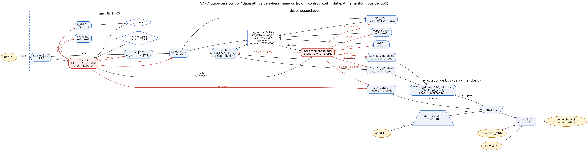

Versión vectorial: [`A7_arquitectura.svg`](diagramas/A7_arquitectura.svg). Fuente: `diagramas/fuentes/A7_arquitectura.dot`.

## A8. Máquinas de estados

**A8a · FSM del receptor UART**, 5 estados, codificación binaria de 3 bits (`IDLE=0, START=1, DATA=2, STOP=3, ESPERA=4`).

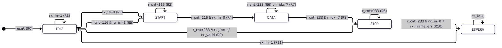

**A8b · FSM del desempaquetador**, 3 estados, 2 bits (`S_DIR=0, S_VAL=1, S_CHK=2`).

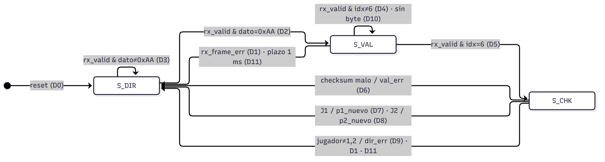

## A9. Testbench y simulación

`sim/tb_perip_mandos_filas.v` maneja el periférico **por el bus**, igual que el FemtoRV32 (`cs` y `rd` un ciclo y lectura de `d_out` en el ciclo siguiente). Además imita a la ESP32 en la línea serie. Cada comprobación lleva entre corchetes la fila que verifica, y al final el banco imprime cuántas veces se ejecutó cada fila. Si alguna queda en 0, la prueba falla.

| Caso | Qué prueba | Filas | Resultado |
|---|---|---|---|
| C0 | Registros y STATUS en 0 tras el reset | R0 D0 B0 B5 B7 | ✅ |
| C1 | Trama J1 (seq `0x11`, X −100, Y +50, shield 1) | R2–R9 D2 D4 D5 D7 B1 B5 B7 | ✅ `JOY1 = 0x1101329C` |
| C2 | Trama J2 (X +127, Y −127, punch 1) | D8 B2 B6 | ✅ `JOY2 = 0xC802817F`, STATUS = 3 |
| C3 | Basura antes de la cabecera | D3 | ✅ |
| C4 | `0xAA` dentro de los datos | D4 | ✅ se toma por posición |
| C5 | Checksum malo | D6 B4 | ✅ JOY1 no cambia, `CHECKSUM_ERROR = 1` |
| C6 | Jugador 3 | D9 | ✅ no cambia nada |
| C7 | Trama cortada + 1,5 ms de silencio | D10 D11 | ✅ resincroniza |
| C8 | Stop = 0 a mitad de trama | R10 R11 D1 B3 | ✅ `UART_ERROR = 1` |
| C9 | Glitch de 1 µs | R5 | ✅ ignorado |
| C10 | Offset reservado `0xC` y escritura a `+0x0` | B8 B9 | ✅ lee 0, la escritura no cambia nada |
| C11 | ESP32 con reloj 2 % lento y 2 % rápido | R7 R8 | ✅ |
| C12 | Reset en mitad de una trama | R0 D0 B0 | ✅ |

```
$ make filas
...
RESULTADO: TODO OK (23 comprobaciones, 34 filas cubiertas)
$ make filas25          # 25 MHz, 217 ciclos por bit
RESULTADO: TODO OK (23 comprobaciones, 34 filas cubiertas)
```

**El banco detecta errores reales.** `make mutantes` mete 5 fallas a propósito en copias del RTL y el banco las reporta todas:

| Falla inyectada | Fila afectada | Resultado del banco |
|---|---|---|
| M1 no se revisa el checksum | D6 | 5 fallas |
| M2 X e Y intercambiados en `JOY1_DATA` | B5 | 4 fallas |
| M3 se recibe MSB primero | R7, R8 | 22 fallas |
| M4 no hay plazo de 1 ms | D11 | 1 falla |
| M5 no se espera la línea en 1 tras stop = 0 | R11 | 2 fallas |

---

# Parte B · Integración al SoC RISC-V (guía `uart-riscv.pdf`, cap. 12–14)

## B1. Región del mapa y chip select

| Región | Bloque | `cs` |
|---|---|---|
| `0x0040_xxxx` | UART del SoC | `cs[0]` |
| `0x0041_xxxx` | GPIO | `cs[1]` |
| `0x0042_xxxx` | Multiplicador | `cs[2]` |
| `0x0043_xxxx` | Audio (G5) | `cs[3]` |
| `0x0044_xxxx` | Pantalla (G4) | `cs[4]` |
| `0x0045_xxxx` | Flash SPI (G2) | `cs[5]` |
| **`0x0047_xxxx`** | **Mandos (G1)** | **`cs[7]`** |
| cualquier otra | RAM | `cs[6]` |

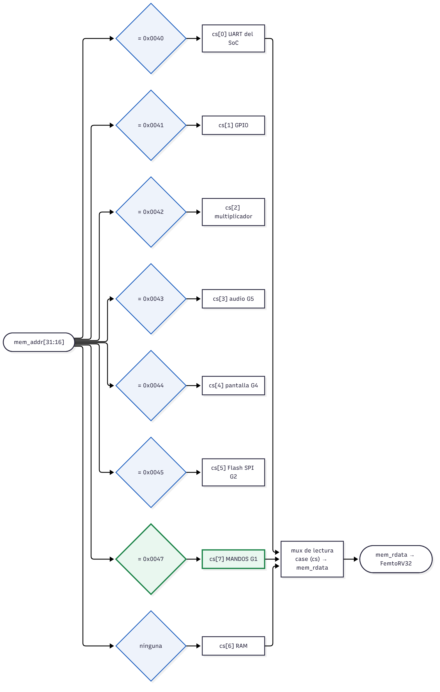

`chip_select.v` (G2) ya decodifica `0x0047` en `cs[7]`. Para que funcione, `SOC.v` debe declarar `wire [7:0] cs` (antes era `[6:0]` y el bit 7 se perdía) y conectar `.chip7_dout(mandos_dout)`. Ese cambio está en `G1_cesar_fix/projecto_consola/rtl/SOC.v`. Así el mando queda en una sola región: se dejan de usar `0x0042` y las palabras 42 a 47 de la RAM.

## B2. Mapa de registros MMIO

| Dirección | Registro | Acceso | Reset | Bits |
|---|---|---|---|---|
| `0x0047_0000` | `JOY1_DATA` | L | `0x0000_0000` | `[7:0]` X (int8) · `[15:8]` Y (int8) · `[16]` shield · `[17]` punch · `[23:18]` 0 · `[31:24]` secuencia |
| `0x0047_0004` | `JOY2_DATA` | L | `0x0000_0000` | igual para el jugador 2 |
| `0x0047_0008` | `STATUS` | L | `0x0` | `[0]` P1_VALID · `[1]` P2_VALID · `[2]` UART_ERROR · `[3]` CHECKSUM_ERROR · `[31:4]` 0 |
| `0x0047_000C` en adelante | reservado | L | — | lee 0 |

Las escrituras se ignoran en todas las direcciones. Las banderas de STATUS quedan en 1 hasta el reset, que es el contrato del G5. Es el mismo mapa que usa el G6 en `firmware/hardware.h`:

```c
uint32_t j1 = *(volatile uint32_t *)0x00470000;
int8_t x = (int8_t)(j1 & 0xFF);   int8_t y = (int8_t)((j1 >> 8) & 0xFF);
int shield = (j1 >> 16) & 1;      int punch = (j1 >> 17) & 1;
```

## B3. Decodificador local

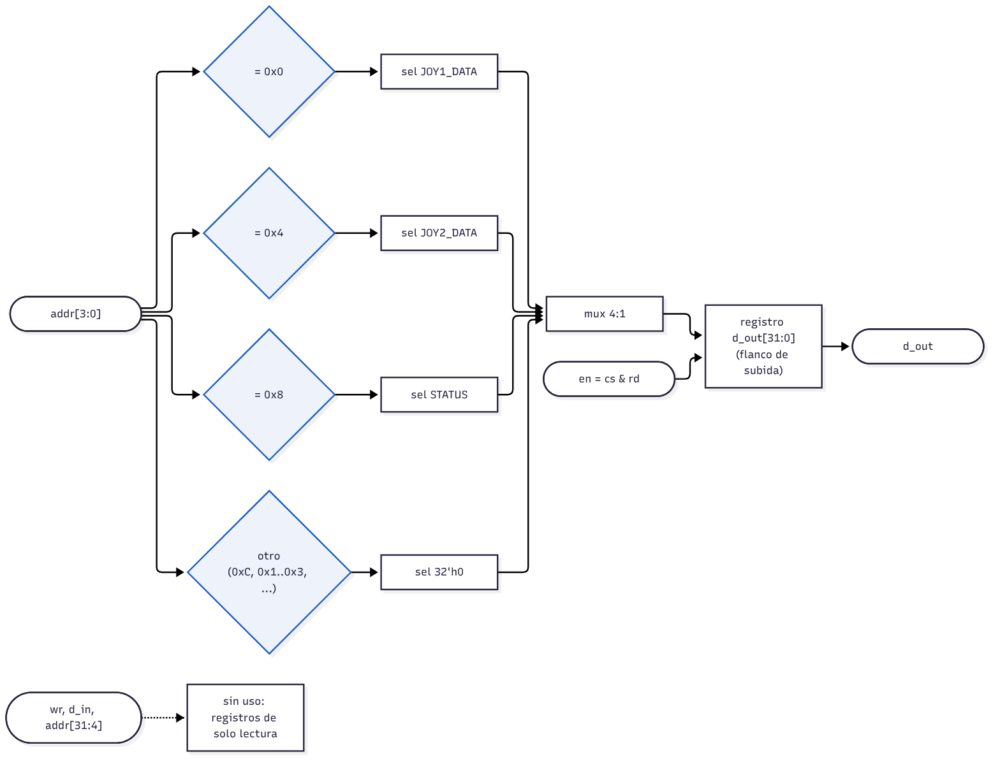

Se decodifica `addr[3:0]` completo, no solo `addr[3:2]`. Por eso una lectura desalineada (por ejemplo `+0x1`) devuelve 0 en vez de repetir JOY1. El caso C10 lee `+0xC` y obtiene 0 (fila B8).

## B4. Adaptador de bus

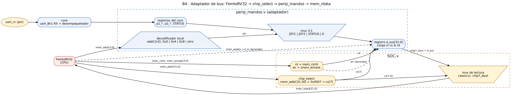

El adaptador es `perip_mandos.v`. Recibe `cs[7]` del `chip_select`, `rd = mem_rstrb` y `addr[3:0]`, elige el registro con el decodificador local y lo deja en el registro `d_out`, que va a `chip7_dout`. `wr`, `d_in` y `addr[31:4]` no se usan. Versión vectorial: [`B4_adaptador_bus.svg`](diagramas/B4_adaptador_bus.svg).

## B5. Semántica START/BUSY/DONE

El periférico de mandos **no tiene START, BUSY ni DONE**, y es a propósito:

- **START:** el CPU no le pide nada al periférico. Las tramas llegan solas, unas 30 por segundo por mando. No hay operación que iniciar, y por eso no hay registros de escritura.
- **BUSY:** la lectura responde siempre en 1 ciclo (B6), haya o no una trama en curso. El CPU nunca tiene que esperar, así que `mem_rbusy` queda en 0.
- **DONE:** lo reemplazan `P1_VALID` y `P2_VALID`. Pasan a 1 con la primera trama válida de cada jugador y quedan retenidos. El juego los usa para saber si el mando está conectado. Si necesita saber si la muestra es nueva, compara el campo `secuencia` (`[31:24]`) con el de la lectura anterior.
- **Coherencia sin BUSY:** los 5 campos de un jugador se copian en el mismo flanco (D7, D8), así que una lectura nunca mezcla dos tramas.

## B6. Tiempos del handshake bus ↔ core

Tomado de `tb_soc_mandos_tiempos.v`: el FemtoRV32 ejecuta un programa en RV32I y lee `0x0047_0000`, `+4` y `+8` a 27 MHz. Esta figura es de después de recibir la trama de J1.

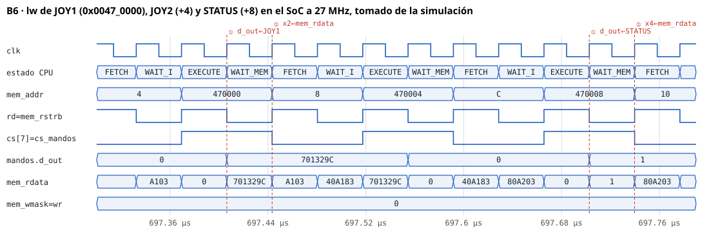

| Ciclo | Estado del CPU | `mem_addr` | `rd` | `cs[7]` | `d_out` | `mem_rdata` | Qué pasa |
|---|---|---|---|---|---|---|---|
| N | EXECUTE (`lw x2, 0(x1)`) | `0x0047_0000` | 1 | 1 | anterior | anterior | El CPU pide el dato |
| flanco ① | | | | | `← JOY1_DATA` | | Fila B5: `cs & rd` carga `d_out` |
| N+1 | WAIT_ALU_OR_MEM | `0x0047_0000` | 0 | 1 | `0x0701329C` | `0x0701329C` | El CPU mantiene la dirección, así que `chip_select` sigue eligiendo `chip7_dout` |
| flanco ② | | | | | | | `x2 ← mem_rdata` |
| N+2 | FETCH (`lw x3, 4(x1)`) | `0x0000_0008` | 1 | 0 | se mantiene (B9) | RAM | Siguiente instrucción |

La lectura funciona con 1 ciclo de latencia, sin `mem_rbusy`, **porque el FemtoRV32 Quark mantiene `mem_addr` durante el estado WAIT_ALU_OR_MEM** y lee `mem_rdata` al final de ese ciclo. JOY2 se lee en 0 porque en ese momento aún no ha llegado la trama de J2.

## B7. Verificación de registros y del SoC

| Nivel | Banco | Qué demuestra | Resultado |
|---|---|---|---|
| Registros (por el bus) | `sim/tb_perip_mandos_filas.v` | Los 3 registros, el offset reservado, la escritura ignorada, el reset, las 4 banderas y la latencia de 1 ciclo | ✅ 23/23, 34 filas cubiertas, a 27 y a 25 MHz |
| SoC con el CPU | `sim/tb_soc_mandos_tiempos.v` (`make soc`) | El FemtoRV32 ejecuta `mandos_prueba.hex` (8 instrucciones), lee `0x0047_0000/4/8` y copia los valores a la RAM. Se manda una trama de J1 y otra de J2 por `RX_MANDOS` | ✅ 6/6: `JOY1 = 0x0701329C`, `JOY2 = 0xC802817F`, `STATUS = 3` |

El banco del SoC necesita la copia de `projecto/consola` con los cambios de `V2/propuesta_corregida/soc_consola` (`SOC.v` con `cs[7:0]` y el puerto `RX_MANDOS`).

## B8. Pines y restricciones

| Puerto (top) | Pin Tang Nano 9K | Estándar | Conexión | Estado |
|---|---|---|---|---|
| `clk` | 52 | LVCMOS33 | Oscilador de 27 MHz | ✅ |
| `resetn` / botón | 3 (S1) o 4 (S2) | LVCMOS33, pull-up | Botón de la placa | ✅ |
| `uart_mandos` (`RX_MANDOS`) | **33** (propuesto) | LVCMOS33, pull-up | GPIO17 (TX2) de la ESP32 de la consola, GND común | 🟡 **por acordar con G4** |

Restricciones y puntos pendientes:

1. **Pin.** `com.cst` y `tangnano9k.cst` usan el pin 33 porque G3 ocupa del 25 al 29 y G5 usa el 28. G4 también usa el 33. Hay que acordar otro pin con G4. Para cambiarlo solo se edita la línea `IO_LOC "uart_mandos" 33;`, sin tocar el RTL.
2. **Reloj.** El RTL toma `CLK_HZ` como parámetro (`SOC #(.CLK_FREQ(...))` lo pasa a `peripheral_mandos`). Si la consola corre a 25 MHz, `CPB` cambia a 217 y el plazo a 25 000 ciclos solos. El banco pasa en los dos casos (`make filas` y `make filas25`).
3. **Niveles.** La ESP32 trabaja a 3,3 V, igual que LVCMOS33, así que no hace falta adaptar niveles.
4. **No probado en la placa todavía.** `propuesta_corregida` reporta síntesis con Yosys (`synth_gowin`) sin errores; aquí no se repitió. Falta place & route con el pin definitivo y la prueba con la ESP32 real.

---

## Cómo comprobar los diagramas de tiempos en GTKWave

```bash
cd Grupos/G1/UART/V2/documentacion/sim
make filas          # genera tb_perip_mandos_filas.vcd
make wave           # abre GTKWave con tiempos_mandos.gtkw
```

En las casillas *From/To* de GTKWave pongan la ventana de cada figura y comparen:

| Figura | From | To | Punto de control |
|---|---|---|---|
| A3a | 198 µs | 292 µs | El start del byte `0x11` baja en 200,61 µs. `rx_valid` sube con `rx_data = 11` |
| A3b | 20 µs | 735 µs | Los 8 `rx_valid`. `p1_nuevo` y `JOY1_DATA = 1101329C` en ≈ 717,2 µs |
| A3c | 4440 µs | 6960 µs | `state` vuelve a 0 en 5728,4 µs sin `p2_nuevo` |
| A3d | 6990 µs | 7420 µs | `rx_frame_err` en 7200,6 µs. `r_state = 4` (ESPERA) |

Una captura de GTKWave junto a cada figura sirve como evidencia de que coinciden.

---

## Autoría y declaración de uso de IA

| Parte | Autor | Uso de IA |
|---|---|---|
| `uart_8n1.v`, `desempaquetador.v` (estructura, FSM, nombres) | Cesar Jaramillo (G1), `Grupos/G1/UART/Propuesta` | La adaptación a la trama de 8 bytes (checksum, jugador, plazo, estado `ESPERA`) se hizo con Claude (Anthropic) |
| `perip_mandos.v`, cambios a `SOC.v`, `tb_soc_mandos.v` | Generados con Claude | Sí |
| Diagramas de este documento, tablas, `tb_perip_mandos_filas.v`, `mutantes.sh` y este README | Generados con Claude a pedido del grupo | Sí. Los diagramas de tiempos se dibujaron por programa a partir del VCD de la simulación, no a mano |
| Revisión, sustentación y pruebas en la placa | Integrantes del G1: _(completar con nombre y qué revisó cada uno)_ | — |

El grupo declara que estas partes se produjeron con ayuda de IA. Cada integrante debe poder explicar sin el documento el ASMD (A6), por qué la lectura tiene 1 ciclo de latencia (B6) y qué pasa con una trama que llega con el checksum malo (D6).
