# G1 · Comunicación UART entre control y consola

Este documento cubre las 9 etapas de diseño de la guía `uart.pdf` para el módulo de comunicación del grupo G1: el receptor UART que usan la **FPGA #1 (control)** y la **FPGA #2 (consola)** para recibir la trama de 32 bits que envían las ESP32.

| Etapa (guía `uart.pdf`) | Dónde está | Estado |
|---|---|---|
| 1. Caja negra + características | [§1](#1-caja-negra-y-características) · `diagramas/01_caja_negra.png` | ✅ |
| 2. Bloques + tabla de señales | [§2](#2-diagrama-de-bloques-y-tabla-de-señales) · `diagramas/02_bloques.png` | ✅ |
| 3. Diagrama de tiempos | [§3](#3-diagramas-de-tiempos) · `diagramas/03a/b/c_*.svg` (salen de la simulación) | ✅ |
| 4. Diagrama de flujo | [§4](#4-diagrama-de-flujo) · `diagramas/04_flujo.png` | ✅ |
| 5. Clasificación control / datapath | [§5](#5-clasificación-control--datapath) | ✅ |
| 6. ASMD + tabla de transferencias | [§6](#6-asmd-y-tabla-de-transferencias) · `diagramas/06a/b_*.png` | ✅ |
| 7. Arquitectura control / datapath | [§7](#7-arquitectura-control--datapath) · `diagramas/07_arquitectura.png` | ✅ |
| 8. FSM | [§8](#8-máquinas-de-estados-fsm) · `diagramas/08a/b_*.png` | ✅ |
| 9. Testbench / simulación desde los diagramas | [§9](#9-testbench-y-simulación) · `sim/uart_rx_g1_TB.v` | ✅ 9/9 casos pasan |

Estructura de la carpeta (igual a la plantilla del curso: `diagramas/`, `rtl/`, testbench `*_TB.v`, `Makefile`, `.gtkw`):

```
documentacion/
├── README.md                 este documento
├── diagramas/                PNG/SVG de cada etapa + fuentes Mermaid (.mmd) editables
├── rtl/
│   ├── uart_rx_g1.v          top (mismos puertos que fpga1_uart_rx.v)
│   ├── uart_rx_ctrl.v        control: FSM del byte
│   ├── uart_rx_dp.v          datapath: sincronizador, contadores, registro de 8 bits
│   ├── trama_ctrl.v          control: FSM de la trama
│   └── trama_dp.v            datapath: registro de 32 bits, timeout, salidas
└── sim/
    ├── uart_rx_g1_TB.v       testbench autoverificable (8 casos, 9 comprobaciones)
    ├── uart_rx_g1_sim.gtkw   señales para GTKWave
    └── Makefile              make sim / make wave
```

> **Diseño corregido.** Los diagramas describen el comportamiento correcto, no el del código original. En `Control/fpga1_uart_rx.v` y `Consola/fpga2_uart_rx_memory.v` había tres problemas: (1) `direccion_y` y `ataque` se sacaban de bits equivocados (`rx_shift_reg[23:12]` y `[24]`; lo correcto con ese registro es `[19:8]` y `[20]`), (2) error de sintaxis `1 me'b1` en el estado `STOP_BIT` de la FPGA #1 y (3) si se pierde un byte, el contador `byte_cnt` queda corrido para siempre porque no hay resincronización. Además, el bit de stop no se verificaba. El nuevo RTL de `rtl/` corrige todo eso. Con el mismo testbench, el código original (con la sintaxis arreglada) **falla los 9 casos** y el corregido **pasa los 9** (ver §9). Los archivos originales no se modificaron.

---

## 1. Caja negra y características

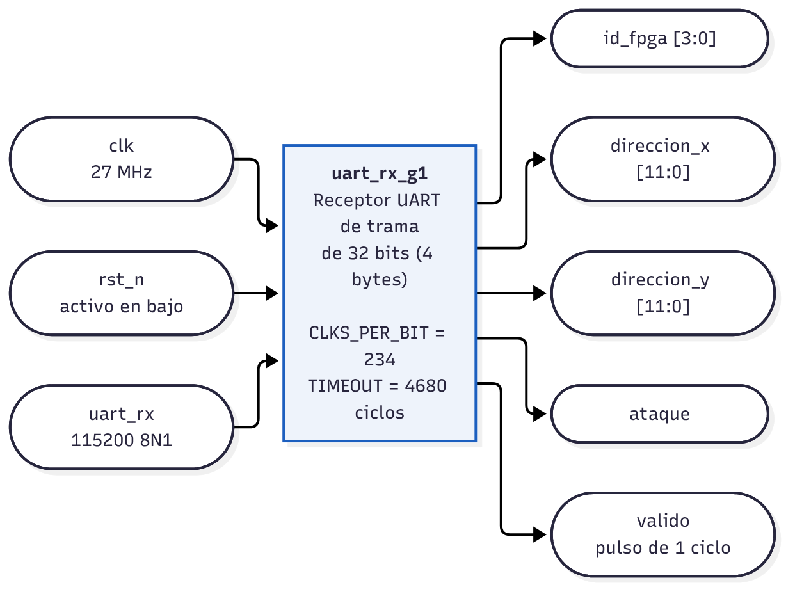

**Función.** Recibe por un solo pin, de forma asíncrona, la trama de 4 bytes que envía la ESP32 y entrega en paralelo los campos del jugador (ID, X, Y, ataque) con un pulso `valido` cuando llega una trama completa y correcta.

| Característica | Valor |
|---|---|
| Placa / FPGA | Sipeed Tang Nano 9K (Gowin GW1NR-9) |
| Reloj | 27 MHz (pin 52) |
| Protocolo | UART 8N1: 1 start, 8 datos LSB primero, sin paridad, 1 stop |
| Velocidad | 115200 baudios → `CLKS_PER_BIT = 27 000 000 / 115 200 = 234,375 ≈ 234` (error 0,16 %) |
| Muestreo | En la mitad de cada bit (start verificado a los 117 ciclos) |
| Tolerancia de reloj | Probada con la ESP32 a ±2 % (caso C7) |
| Trama | 4 bytes, MSB primero: `[31:29]` reservado = 0 · `[28]` ataque · `[27:16]` Y · `[15:4]` X · `[3:0]` ID |
| Duración | 1 byte = 10 bits = 86,8 µs · 1 trama = 347 µs · la ESP32 envía cada 20 ms (50 Hz) |
| Resincronización | Si pasan `TIMEOUT = 2 bytes = 4680 ciclos (173 µs)` sin byte y la trama está a medias, se descarta |
| Errores detectados | Falso start (glitch), stop = 0 (error de trama), trama cortada, bits reservados ≠ 0 |
| Reset | `rst_n` activo en bajo (botón S2, pin 4) |
| Pin RX | `uart_rx`, pin 25, pull-up, conectado a GPIO17 (TX) de la ESP32 |

## 2. Diagrama de bloques y tabla de señales

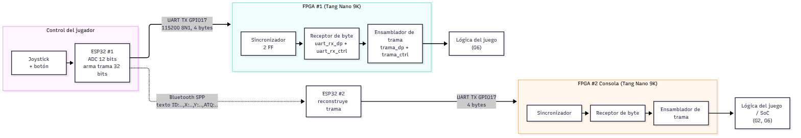

El sistema completo tiene dos caminos: ESP32 #1 → UART → FPGA #1, y ESP32 #1 → Bluetooth → ESP32 #2 → UART → FPGA #2. Las dos FPGA usan **el mismo módulo** `uart_rx_g1`. Dentro de la FPGA hay tres bloques: sincronizador, receptor de byte y ensamblador de trama.

### Señales externas (puertos de `uart_rx_g1`)

| Señal | Dir. | Ancho | Descripción |
|---|---|---|---|
| `clk` | in | 1 | Reloj de 27 MHz |
| `rst_n` | in | 1 | Reset asíncrono, activo en bajo |
| `uart_rx` | in | 1 | Línea serie desde la ESP32 (reposo = 1) |
| `id_fpga` | out | 4 | ID del control que envió la trama (`sr[3:0]`) |
| `direccion_x` | out | 12 | Eje X del joystick, 0..4095 (`sr[15:4]`) |
| `direccion_y` | out | 12 | Eje Y del joystick, 0..4095 (`sr[27:16]`) |
| `ataque` | out | 1 | Botón de ataque (`sr[28]`) |
| `valido` | out | 1 | Pulso de 1 ciclo: campos actualizados |

### Señales internas

| Señal | Origen → destino | Ancho | Descripción |
|---|---|---|---|
| `rx_in` | uart_rx_dp → uart_rx_ctrl | 1 | `uart_rx` pasado por 2 flip-flops |
| `medio_bit` | uart_rx_dp → uart_rx_ctrl | 1 | `cnt == 116` |
| `fin_bit` | uart_rx_dp → uart_rx_ctrl | 1 | `cnt == 233` |
| `ultimo_bit` | uart_rx_dp → uart_rx_ctrl | 1 | `idx == 7` |
| `clr_cnt` | uart_rx_ctrl → uart_rx_dp | 1 | Poner `cnt` en 0 |
| `clr_idx` | uart_rx_ctrl → uart_rx_dp | 1 | Poner `idx` en 0 |
| `desplazar` | uart_rx_ctrl → uart_rx_dp | 1 | Guardar `rx_in` en `rx_byte` y sumar `idx` |
| `rx_byte` | uart_rx_dp → trama_dp | 8 | Byte recibido |
| `byte_listo` | uart_rx_ctrl → trama_ctrl | 1 | Pulso: byte con stop correcto |
| `error_trama` | uart_rx_ctrl → trama_ctrl | 1 | Pulso: stop = 0 |
| `cargar` | trama_ctrl → trama_dp | 1 | `sr ← {sr[23:0], rx_byte}` |
| `clr_tmo` | trama_ctrl → trama_dp | 1 | Poner contador de silencio en 0 |
| `timeout` | trama_dp → trama_ctrl | 1 | `tmo == 4680` |
| `reservado_ok` | trama_dp → trama_ctrl | 1 | `sr[31:29] == 000` |
| `publicar` | trama_ctrl → trama_dp | 1 | Copiar campos a las salidas y activar `valido` |
| `n_bytes` | trama_ctrl | 3 | Bytes recibidos de la trama actual (depuración) |

## 3. Diagramas de tiempos

Los tres diagramas se generaron **a partir del VCD de la simulación** (§9), así que muestran lo que hace el RTL de verdad.

**3a. Un byte (`0x11`, primer byte de la trama C1).** `rx_in` va 2 ciclos detrás de `uart_rx` (sincronizador). En `START` se espera medio bit y se confirma que la línea sigue en 0. Luego, en `DATA`, cada `fin_bit` cae en la mitad de un bit: ahí se activa `desplazar`, entra `rx_in` por la izquierda de `rx_byte` y sube `idx`. Tras el 8.º bit se muestrea el stop; como vale 1, sale `byte_listo`.

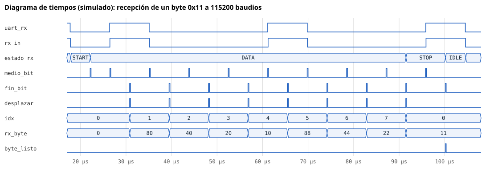

**3b. Una trama completa (C1: ID 1, X 0xABC, Y 0x123, ataque 1 → trama `0x1123ABC1`, bytes `11 23 AB C1`).** Cada `byte_listo` produce `cargar` y la FSM avanza B0→B1→B2→B3→PUB. En PUB, `sr = 0x1123ABC1`, se activa `publicar` y un ciclo después `valido` con los campos ya estables.

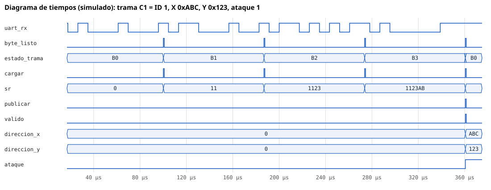

**3c. Resincronización (C4).** Llegan solo 2 bytes. Mientras la trama está a medias, `clr_tmo` = 0 y el contador de silencio corre; al llegar a 4680 ciclos sale `timeout` y la FSM vuelve a B0 sin publicar. La trama buena siguiente se recibe bien (X 100, Y 200). Con el código original, esos 2 bytes dejaban corrido el contador y todas las tramas siguientes se leían mal.

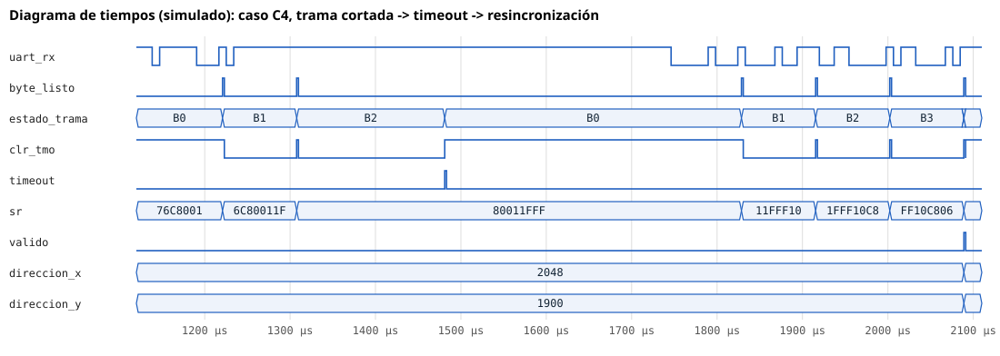

## 4. Diagrama de flujo

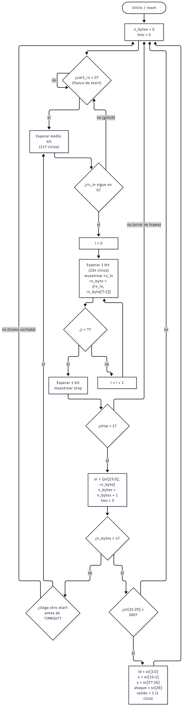

El flujo describe el algoritmo sin hablar todavía de hardware: detectar el start, confirmarlo en la mitad del bit, tomar 8 muestras separadas un bit, verificar el stop, acumular 4 bytes y, si la trama está completa y sus bits reservados son 0, publicar los campos. Cualquier error (stop = 0, silencio largo, reservados ≠ 0) lleva de vuelta al inicio con el contador de bytes en 0.

## 5. Clasificación control / datapath

Se separa lo que **decide** (control: FSM) de lo que **guarda y opera datos** (datapath: registros, contadores, comparadores).

| Elemento | Tipo | Módulo | Por qué |
|---|---|---|---|
| Sincronizador `rx_sync[1:0]` | Datapath | uart_rx_dp | Registro que transporta el dato |
| Contador de ciclos `cnt[7:0]` | Datapath | uart_rx_dp | Operación aritmética (+1, clear) |
| Comparadores `== 116`, `== 233` | Datapath | uart_rx_dp | Generan banderas de estado para el control |
| Contador de bit `idx[2:0]` y `== 7` | Datapath | uart_rx_dp | Operación aritmética + bandera |
| Registro de desplazamiento `rx_byte[7:0]` | Datapath | uart_rx_dp | Almacena el dato |
| FSM IDLE/START/DATA/STOP | **Control** | uart_rx_ctrl | Decide cuándo muestrear y si el byte es válido |
| Registro de desplazamiento `sr[31:0]` | Datapath | trama_dp | Almacena la trama |
| Contador de silencio `tmo[12:0]` y `== 4680` | Datapath | trama_dp | Aritmética + bandera `timeout` |
| Comparador `sr[31:29] == 0` | Datapath | trama_dp | Bandera `reservado_ok` |
| Registros de salida `id, x, y, ataque, valido` | Datapath | trama_dp | Almacenan el resultado |
| FSM B0/B1/B2/B3/PUB | **Control** | trama_ctrl | Cuenta bytes, descarta o publica |

**Entradas de estado al control:** `rx_in, medio_bit, fin_bit, ultimo_bit, byte_listo, error_trama, timeout, reservado_ok`.
**Señales de control al datapath:** `clr_cnt, clr_idx, desplazar, cargar, clr_tmo, publicar`.

## 6. ASMD y tabla de transferencias

Convención: rectángulo azul = estado (operaciones de Moore), rombo = decisión, óvalo verde punteado = salida/transferencia condicional (Mealy).

**6a. Receptor de byte (`uart_rx_ctrl` + `uart_rx_dp`)**

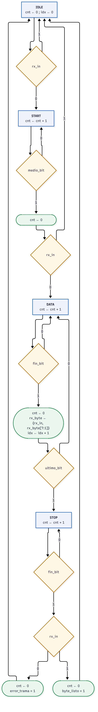

**6b. Ensamblador de trama (`trama_ctrl` + `trama_dp`).** Los estados B1, B2 y B3 tienen el mismo bloque ASM; solo cambia el estado siguiente.

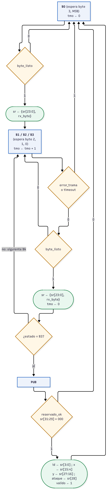

### Tabla de transferencias (RTL)

| Estado | Condición | Transferencias de registro | Señales de control | Siguiente |
|---|---|---|---|---|
| IDLE | `rx_in = 1` | `cnt ← 0`, `idx ← 0` | `clr_cnt, clr_idx` | IDLE |
| IDLE | `rx_in = 0` | `cnt ← 0`, `idx ← 0` | `clr_cnt, clr_idx` | START |
| START | `!medio_bit` | `cnt ← cnt + 1` | — | START |
| START | `medio_bit & rx_in = 0` | `cnt ← 0` | `clr_cnt` | DATA |
| START | `medio_bit & rx_in = 1` | `cnt ← 0` | `clr_cnt` | IDLE |
| DATA | `!fin_bit` | `cnt ← cnt + 1` | — | DATA |
| DATA | `fin_bit & !ultimo_bit` | `cnt ← 0`, `rx_byte ← {rx_in, rx_byte[7:1]}`, `idx ← idx + 1` | `clr_cnt, desplazar` | DATA |
| DATA | `fin_bit & ultimo_bit` | ídem | `clr_cnt, desplazar` | STOP |
| STOP | `!fin_bit` | `cnt ← cnt + 1` | — | STOP |
| STOP | `fin_bit & rx_in = 1` | `cnt ← 0` | `clr_cnt, byte_listo` | IDLE |
| STOP | `fin_bit & rx_in = 0` | `cnt ← 0` | `clr_cnt, error_trama` | IDLE |
| B0 | `!byte_listo` | `tmo ← 0` | `clr_tmo` | B0 |
| B0 | `byte_listo` | `sr ← {sr[23:0], rx_byte}`, `tmo ← 0` | `cargar, clr_tmo` | B1 |
| B1, B2 | `error_trama \| timeout` | — | — | B0 |
| B1, B2 | `byte_listo` | `sr ← {sr[23:0], rx_byte}`, `tmo ← 0` | `cargar, clr_tmo` | B2, B3 |
| B1..B3 | ninguna | `tmo ← tmo + 1` (satura en 4680) | — | igual |
| B3 | `error_trama \| timeout` | — | — | B0 |
| B3 | `byte_listo` | `sr ← {sr[23:0], rx_byte}`, `tmo ← 0` | `cargar, clr_tmo` | PUB |
| PUB | `reservado_ok` | `id ← sr[3:0]`, `x ← sr[15:4]`, `y ← sr[27:16]`, `ataque ← sr[28]`, `valido ← 1` | `publicar` | B0 |
| PUB | `!reservado_ok` | — (trama descartada) | — | B0 |

Fuera de PUB, `valido ← 0` en cada ciclo, así que es un pulso de un solo ciclo.

## 7. Arquitectura control / datapath

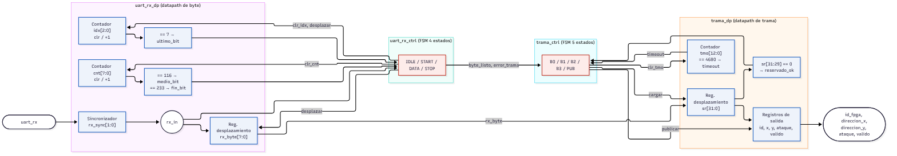

Rojo = unidades de control, azul = datapath. Cada flecha es una señal de la tabla del §2. La arquitectura se traduce 1 a 1 en los archivos de `rtl/`: `uart_rx_g1.v` solo conecta los cuatro submódulos.

## 8. Máquinas de estados (FSM)

**8a. FSM del byte (`uart_rx_ctrl`)**, 4 estados, codificación binaria de 2 bits.

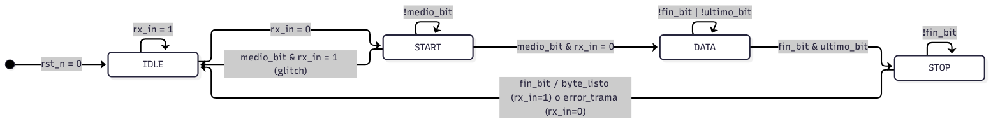

| Estado | Código | Significado |
|---|---|---|
| IDLE | `00` | Línea en reposo, esperando start |
| START | `01` | Esperando la mitad del bit de start para confirmarlo |
| DATA | `10` | Muestreando los 8 bits de datos |
| STOP | `11` | Muestreando el bit de stop |

**8b. FSM de la trama (`trama_ctrl`)**, 5 estados, 3 bits.

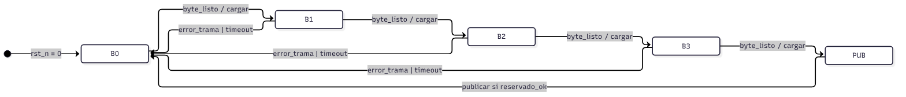

| Estado | Código | Significado |
|---|---|---|
| B0 | `000` | Sin trama en curso; espera el byte 3 (MSB) |
| B1 | `001` | Recibido 1 byte; espera el byte 2 |
| B2 | `010` | Recibidos 2 bytes; espera el byte 1 |
| B3 | `011` | Recibidos 3 bytes; espera el byte 0 (LSB) |
| PUB | `100` | Trama completa: valida y publica (dura 1 ciclo) |

## 9. Testbench y simulación

`sim/uart_rx_g1_TB.v` imita a la ESP32 (misma función de armado de trama que `enviarTramaUART()`, mismo orden de bytes) y comprueba solo los resultados. Cada caso sale de un diagrama:

| Caso | Qué prueba | Diagrama de origen | Corregido | Original* |
|---|---|---|---|---|
| C1 | Trama normal ID 1, X 0xABC, Y 0x123, ataque 1 | Tiempos 3b | ✅ | ❌ Y = 274, ataque = 0 |
| C2 | Extremos del ADC: X 4095, Y 0 | Tiempos 3b | ✅ | ❌ ataque = 1 |
| C3 | Glitch de 1 µs en reposo | Flujo / ASMD 6a (START → IDLE) | ✅ | ❌ |
| C4 | Trama cortada (2 bytes) + silencio | ASMD 6b (timeout), tiempos 3c | ✅ | ❌ queda desalineado |
| C5 | Byte con stop = 0 | ASMD 6a (error_trama) | ✅ | ❌ publica basura |
| C6 | Bits reservados ≠ 0 | ASMD 6b (PUB, reservado_ok) | ✅ | ❌ publica basura |
| C7a / C7b | ESP32 con reloj 2 % lento / 2 % rápido | Características §1 | ✅ ✅ | ❌ ❌ |
| C8 | Ráfaga de 5 tramas seguidas | FSM 8b | ✅ | ❌ |

\* Original = `Control/fpga1_uart_rx.v` con solo el error de sintaxis arreglado, para que compile.

Salida de la simulación del diseño corregido (Icarus Verilog 12):

```
OK    C1 trama normal: id=1 x=2748 y=291 atk=1
OK    C2 extremos ADC: id=2 x=4095 y=0 atk=0
OK    C3 glitch ignorado: id=1 x=2048 y=1900 atk=0
OK    C4 resincronizacion: id=3 x=100 y=200 atk=1
OK    C5 error de stop: id=4 x=7 y=9 atk=0
OK    C6 reservados != 0: id=4 x=7 y=9 atk=0
OK    C7a baud +2%: id=5 x=1445 y=2650 atk=1
OK    C7b baud -2%: id=6 x=240 y=3855 atk=0
OK    C8 rafaga (ultima): id=1 x=1004 y=2996 atk=0
RESULTADO: TODAS LAS PRUEBAS PASARON
```

**Cómo correrlo:**

```bash
cd Grupos/G1/UART/V2/documentacion/sim
make sim      # compila con iverilog y ejecuta
make wave     # abre GTKWave con las señales de uart_rx_g1_sim.gtkw
```

## Cómo usarlo en las FPGA

- **FPGA #1 (control):** `uart_rx_g1` tiene los mismos puertos que `fpga1_uart_rx`, así que basta con cambiar el nombre del módulo instanciado y agregar los 5 archivos de `rtl/` al proyecto. El `.cst` (`clk` 52, `rst_n` 4, `uart_rx` 25) no cambia.
- **FPGA #2 (consola):** se instancia el mismo módulo; las salidas `id_fpga, direccion_x, direccion_y, ataque, valido` reemplazan a `reg_id_origen, reg_dir_x, reg_dir_y, reg_ataque, dato_nuevo`.
- Pendiente: sintetizar en Gowin/Yosys para la Tang Nano 9K y probar en la placa. Hasta ahora solo está verificado en simulación.
