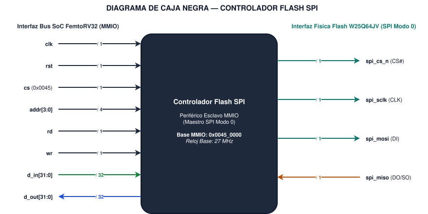
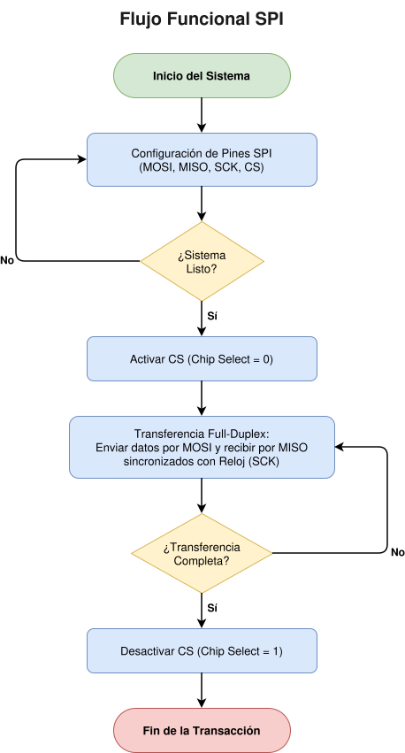
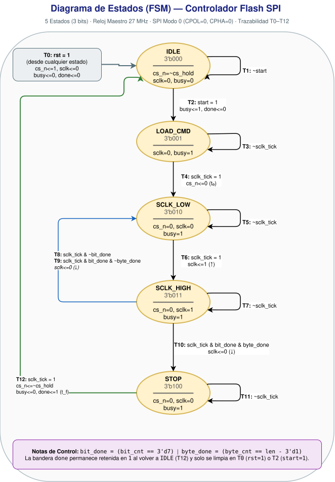

# Arquitectura Hardware y Sistema de Memorias

---

## 1. Delimitación y Selección de Tecnologías de Memoria

Trabajamos sobre la **Sipeed Tang Nano 9K** (FPGA Gowin GW1NR-9), usando el flujo abierto **Yosys + nextpnr** y el procesador **FemtoRV32** (reloj maestro de $27\text{ MHz}$) con arquitectura Von Neumann. Como la memoria interna **BSRAM** de esta FPGA es limitada —en total son $58.5\text{ KB}$ repartidos en $26$ bloques de $18\text{ Kbit}$— y se comparte entre el código del procesador y el video gestionado por G4, dividimos el almacenamiento del sistema en dos niveles:

### 1.1 Comparativa y Justificación de Tecnologías de Memoria

| Tecnología de Memoria | Componente / Modelo | Capacidad | Protocolo e Interfaz | Pines Físicos | Velocidad / Latencia | Rol y Justificación en la Consola |
| :--- | :--- | :---: | :--- | :---: | :--- | :--- |
| **BSRAM Interna** *(Nivel 1 — En uso)* | Bloques `SDPB` del chip Gowin GW1NR-9 | $58.5\text{ KB}$ ($26 \times 18\text{ Kbit}$) | Bus paralelo síncrono ($27\text{ MHz}$) | $0$ externos (interna) | $1$ ciclo de reloj ($37.04\text{ ns}$) | Aloja la memoria principal de programa/datos del CPU ($32\text{ KB}$, incluyendo los $6$ registros reservados para los dos controles). Además, la FPGA aloja internamente el framebuffer ($1.5\text{ KB}$) instanciado directamente dentro del periférico HUB75 de G4. |
| **Flash NOR SPI Externa** *(Nivel 2 — En uso)* | Winbond `W25Q64JV` (en placa o módulo DIP8) | $8\text{ MB}$ ($64\text{ Mbit}$) | SPI síncrono Modo 0 (`CS#`, `SCLK`, `MOSI`, `MISO`), región MMIO `0x0045` | $4$ pines | $f_{\text{SCLK}} = 3.375\text{ MHz}$ ($2.37~\mu\text{s/byte}$) | Almacena de forma no volátil los *sprites* 2D, mapas de nivel, tablas de sonido y puntajes máximos (*High-Scores*) escribiendo directo por sector. |
| **PSRAM / SRAM Externa** *(Descartada)* | `APS6404L` / `IS61WV25616` | $8\text{ MB}$ / $512\text{ KB}$ | QSPI / Bus paralelo asíncrono | $6$ a $38$ pines | Media / Alta | No hace falta: el firmware cabe en los $32\text{ KB}$ de BSRAM interna y el framebuffer de G4 ($1.5\text{ KB}$) también reside en BSRAM sin gastar pines ni introducir latencia al barrido HUB75. |
| **EEPROM $\text{I}^2\text{C}$** *(Descartada)* | Microchip `AT24C256` | $32\text{ KB}$ ($256\text{ Kbit}$) | $\text{I}^2\text{C}$ (`SDA`, `SCL`) | $2$ pines | $100\text{–}400\text{ kHz}$ (lenta) | Redundante teniendo $8\text{ MB}$ libres en la Flash `W25Q64JV`, donde podemos borrar sectores de $4\text{ KB}$ (`0x20`) y grabar páginas (`0x02`) para los *High-Scores*. |

### 1.2 Presupuesto de BSRAM Interna en la Tang Nano 9K

Los $26$ bloques BSRAM ($58.5\text{ KB}$) disponibles en la Gowin GW1NR-9 quedan contabilizados así en el SoC:

1. **`BRAM_PROG_DATA` (`0x0000_0000` – `0x0000_7FFF`) — Gestionada por G2:** $32.0\text{ KB}$ ($15$ bloques BSRAM) para el firmware en C/RISC-V de los juegos arcade (G6), el *stack*, las variables de estado y la zona reservada de **$6$ registros para los dos controles**:
   * **Control 1 (J1):** direcciones `42` (`CTRL1_JOY_X`), `43` (`CTRL1_JOY_Y`) y `44` (`CTRL1_ATAQUE`).
   * **Control 2 (J2):** direcciones `45` (`CTRL2_JOY_X`), `46` (`CTRL2_JOY_Y`) y `47` (`CTRL2_ATAQUE`).
2. **Framebuffer HUB75 (`0x0044_4000`) — Instanciado internamente por G4:** $1.5\text{ KB}$ ($2$ bloques BSRAM en modo *Simple Dual-Port*). *Nota de integración:* G2 ya no instancia ni mapea `FRAMEBUFFER_BRAM` en `0x2000_0000`, pues el subgrupo G4 lo absorbió dentro de su propio periférico (`0x0044`); se incluye aquí únicamente para llevar el balance real de bloques físicos de la FPGA.
3. **Reserva libre:** Quedan $25.0\text{ KB}$ ($9$ bloques BSRAM) disponibles en la FPGA para futuras tablas de audio (G5 I2S) o caché de *sprites* activos en RAM.

---

## 2. Arquitectura del Sistema y Mapa de Memoria MMIO

### 2.1 Acuerdos de Integración entre Subgrupos

Para que todos los módulos del proyecto encajen sin problemas de sincronización ni direcciones cruzadas, se establecieron los siguientes acuerdos:

- **Reloj maestro único ($27\text{ MHz}$):** Todo el SoC dentro de la FPGA corre de forma síncrona con el oscilador base de $27\text{ MHz}$ ($T_{\text{clk}} \approx 37.04\text{ ns}$), evitando cruces de dominios de reloj (CDC) entre el CPU, las memorias y los periféricos.
- **Bus estándar del curso:** Todos los periféricos usan la interfaz síncrona acordada (`clk`, `rst`, `cs`, `addr`, `rd`, `wr`, `d_in`, `d_out`).
- **Alineación con G4 (Pantalla HUB75):** El framebuffer se organiza en **2 bancos de $2048 \times 3$ bits** (RGB de $3$ bits = $8$ colores, $1.5\text{ KB}$ en total) y se sincroniza con la bandera **`FRAME`** del registro `hub75_csr`. Este framebuffer ya no es instanciado por G2 en `0x2000_0000`, sino que reside internamente dentro del periférico HUB75 de G4 en la región `0x0044` (dirección `0x0044_4000`).
- **Alineación con G1, G3 y G5 (Controles y Audio):** Los datos del mando inalámbrico (Joystick analógico + IMU `BMI160` por SPI en la FPGA del mando) llegan por UART $\rightarrow$ Bluetooth (ESP32) hasta el receptor UART de la consola, y su estado procesado para los dos jugadores se almacena en la zona reservada de $6$ registros de la RAM de G2 (direcciones `42` a `47`). El audio se procesa mediante el protocolo I2S hacia un módulo DAC `MAX98357A`.
- **Recursos de juego (G6):** Las memorias guardan activos genéricos para juegos arcade retro simples (*sprites* 2D, mapas, fuentes y puntajes máximos).

### 2.2 Mapa de Memoria Unificado del SoC (FemtoRV32)

Los periféricos se seleccionan mediante los bits superiores de la dirección (`mem_addr[31:16]`), permitiendo un mapeo limpio del `chip_select`.

| Rango de Direcciones | Tamaño | Subgrupo | Periférico / Región | Descripción de Acceso |
| :--- | :---: | :---: | :--- | :--- |
| `0x0000_0000` – `0x0000_7FFF` | $32\text{ KB}$ | **G2 / G6** | `BRAM_PROG_DATA` | Memoria principal de instrucciones y datos del FemtoRV32 (`.text`, `.data`, `.bss`, *stack*) y zona reservada de $6$ registros para los dos controles (direcciones `42`–`47`). |
| `0x0042_0000` – `0x0042_000C` | $16\text{ B}$ | **G1 / G3** | `UART_INPUT_RX` | Receptor de tramas del mando inalámbrico (ejes del joystick, pulsadores y lecturas del `BMI160`). |
| `0x0043_0000` – `0x0043_000C` | $16\text{ B}$ | **G5** | `AUDIO_I2S_CTRL` | Registros `FREQ`, `VOL` y `CONTROL` para el generador de audio I2S (`MAX98357A`). |
| `0x0044_0000` – `0x0044_4FFF` | $20\text{ B}$ (CSR) + $1.5\text{ KB}$ (FB) | **G4** | `HUB75_CTRL` | Registros de control y estado (`0x0044_0000`, incluye bandera `FRAME`) y framebuffer interno (`0x0044_4000`, $4,096$ píxeles en 2 bancos de $2048 \times 3$ bits). |
| `0x0045_0000` – `0x0045_000C` | $16\text{ B}$ | **G2** | `SPI_FLASH_CTRL` | Registros MMIO del controlador Flash SPI `W25Q64JV` (`CTRL_STAT`, `CMD_ADDR`, `TX_DATA`, `RX_DATA`). |

### 2.3 Flujo Completo del Envío de Datos al Juego

En el siguiente diagrama se muestra cómo viajan los datos desde la memoria Flash hasta el panel LED, separando lo que corre en hardware (Verilog) y lo que ejecuta el FemtoRV32 en C:


| Tarea del Sistema | Dominio | Disparo / Sincronización | Flujo de Entrada $\rightarrow$ Salida |
| :--- | :---: | :--- | :--- |
| **Almacenamiento SPI (`Storage`)** | **HW (HDL — G2)** | Escritura en `SPI_CTRL_STAT.start` (`0x0045_0000`) | Flash `W25Q64JV` (`MISO`) $\rightarrow$ Registro `SPI_RX_DATA` hacia el CPU. |
| **Recepción de Controles (`Input`)** | **HW + SW (G1/G3/G2)** | Trama UART recibida | Mando inalámbrico (Joystick + `BMI160`) $\rightarrow$ `UART_INPUT_RX` (`0x0042_0000`) $\rightarrow$ Registros de control en RAM (`42`–`47`). |
| **Lógica de Juego (`Game Logic`)** | **SW (C — G6)** | Bucle principal + bandera `FRAME` | Estado de controles y *sprites* $\rightarrow$ Actualización de coordenadas, colisiones y escritura de píxeles en `0x0044_4000`. |
| **Barrido de Video (`Video`)** | **HW (HDL — G4)** | Continuo a $27\text{ MHz}$ ($T_{\text{fila}} = 46.12~\mu\text{s}$) | Lectura síncrona Puerto B de BSRAM interna de G4 ($2048 \times 3$) $\rightarrow$ $14$ líneas paralelas HUB75 ($\approx 678\text{ Hz}$). |

---

## 3. Diseño del Controlador de Memoria Flash SPI (Metodología FSMD)

Siguiendo la metodología de la guía del curso (`uart.pdf`), diseñamos el controlador maestro SPI en Modo 0 (`spi_flash_controller.v`) separando la lógica de control (FSM) del camino de datos (Datapath).

### 3.1 Diagrama de Caja Negra y Especificación de Interfaz

En lugar de dibujar solo el pinout de la memoria Flash, la caja negra representa el periférico RTL sintetizable dentro de la FPGA, con el bus del procesador a la izquierda y las $4$ señales físicas hacia la `W25Q64JV` a la derecha:



#### Características de la Interfaz

- **Rol:** Esclavo en el bus MMIO del FemtoRV32 y maestro SPI frente a la Flash externa `W25Q64JV`.
- **Protocolo externo:** SPI síncrono **Modo 0** ($\text{CPOL} = 0$, $\text{CPHA} = 0$), envío **MSB-first** (bit más significativo primero) sobre $4$ líneas físicas unidireccionales.
- **Reloj y reinicio:** Síncrono al reloj maestro del SoC (`clk = 27 MHz`) con reset síncrono activo en alto (`rst`).
- **Sincronización con CPU:** Banderas `busy` y `done` en el registro de estado para esperar el fin de cada transferencia o encadenar lecturas en ráfaga con `cs_hold`.

#### Tabla de Señales de la Caja Negra

| Señal | Dirección | Ancho | Interfaz | Descripción Funcional |
| :--- | :---: | :---: | :--- | :--- |
| `clk` | Entrada | $1$ bit | Bus SoC | Reloj maestro del sistema ($27\text{ MHz}$). |
| `rst` | Entrada | $1$ bit | Bus SoC | Reinicio síncrono activo en alto (`1` lleva la FSM y el datapath a `IDLE`). |
| `cs` | Entrada | $1$ bit | Bus SoC | Selección de periférico activada por el decodificador MMIO para la región `0x0045_xxxx`. |
| `addr` | Entrada | $4$ bits | Bus SoC | *Offset* de dirección interna para seleccionar los registros del controlador. |
| `rd` | Entrada | $1$ bit | Bus SoC | Habilitación de lectura desde el procesador FemtoRV32. |
| `wr` | Entrada | $1$ bit | Bus SoC | Habilitación de escritura desde el procesador FemtoRV32. |
| `d_in` | Entrada | $32$ bits | Bus SoC | Bus de datos desde el CPU (comandos SPI, dirección de $24$ bits y dato TX). |
| `d_out` | Salida | $32$ bits | Bus SoC | Bus de datos hacia el CPU (byte leído de Flash y banderas `busy`/`done`). |
| `spi_cs_n` | Salida | $1$ bit | Flash SPI | Selección de chip hacia la `W25Q64JV` (activo en bajo durante la transacción). |
| `spi_sclk` | Salida | $1$ bit | Flash SPI | Reloj serie generado internamente para sincronizar bits en `MOSI` y `MISO`. |
| `spi_mosi` | Salida | $1$ bit | Flash SPI | Salida serie hacia el pin `DI` de la Flash (envía *opcodes*, direcciones y datos). |
| `spi_miso` | Entrada | $1$ bit | Flash SPI | Entrada serie desde el pin `DO/SO` de la Flash (recibe datos y registro de estado). |

---

### 3.2 Diagrama de Bloques Control / Datapath y Condiciones de Diseño

Dividimos el controlador en cuatro bloques síncronos gobernados por el reloj único `clk` ($27\text{ MHz}$): interfaz de registros MMIO (`spi_mmio_regs`), generador de pulsos de habilitación (`spi_tick_gen`), unidad de control (`spi_fsm_control`) y camino de datos (`spi_datapath`):


#### Mapa de Registros Internos (`spi_mmio_regs` — Base `0x0045_0000`)

| Offset | Nombre | Acceso | Campos de Bits | Descripción Funcional |
| :---: | :--- | :---: | :--- | :--- |
| `0x00` | `SPI_CTRL_STAT` | `R/W` | `[0]` `start` (`W1P`)<br>`[1]` `cs_hold` (`R/W`)<br>`[8]` `busy` (`R`)<br>`[9]` `done` (`R`) | Arranca la transacción (`start`), mantiene `spi_cs_n` en bajo para lecturas en ráfaga (`cs_hold`) y reporta el estado al CPU. |
| `0x04` | `SPI_CMD_ADDR` | `R/W` | `[31:24]` `cmd[7:0]`<br>`[23:0]` `addr[23:0]` | Código de operación SPI (`0x03` Read, `0x06` WREN, `0x02` Page Program, `0x20` Sector Erase) y dirección física de $24$ bits. |
| `0x08` | `SPI_TX_DATA` | `R/W` | `[7:0]` `tx_data[7:0]` | Byte de datos a enviar hacia la memoria Flash en operaciones de escritura o configuración. |
| `0x0C` | `SPI_RX_DATA` | `R` | `[7:0]` `rx_data[7:0]` | Último byte capturado desde `spi_miso` cuando se activa la bandera `done`. |

#### Condiciones para el Diseño Interno

1. **Sincronización de entrada asíncrona (`2-FF`):** La señal `spi_miso` pasa por dos flip-flops en cascada (`miso_sync`) muestreados a $27\text{ MHz}$ antes de entrar al registro de desplazamiento, evitando problemas de metaestabilidad.
2. **Pulso de habilitación (`sclk_tick`):** En lugar de crear un reloj derivado con divisores combinacionales, `spi_tick_gen` genera un **pulso de habilitación de 1 ciclo de `clk`** cada $N = 4$ ciclos del oscilador base. Todo el hardware queda en un solo dominio de reloj.
3. **Salidas registradas:** Las líneas `spi_cs_n`, `spi_sclk` y `spi_mosi` salen directo de registros síncronos para evitar *glitches* en los pines físicos hacia la memoria.

---

### 3.3 Diagrama de Tiempos SPI Modo 0 y Análisis Temporal

En el diagrama de tiempos se observa el envío bit a bit en **SPI Modo 0** ($\text{CPOL} = 0$, $\text{CPHA} = 0$), tomando como ejemplo una transacción estándar de lectura de $5$ bytes ($1$ byte `Cmd` + $3$ bytes `Addr` + $1$ byte `Data`) y la opción de lectura continua manteniendo la línea de selección activa (`cs_hold = 1`):


#### Secuencia Temporal Paso a Paso

1. **Reposo (`IDLE`):** `spi_cs_n = 1` (si `cs_hold = 0`), `spi_sclk = 0`, `busy = 0` y `done = 0` (o retiene el `1` de la transacción anterior).
2. **Solicitud MMIO:** El CPU carga `SPI_CMD_ADDR` (`0x04`) y escribe `start = 1`. La FSM pone `busy = 1`, **limpia la bandera `done = 0`** y espera el siguiente pulso `sclk_tick`.
3. **Inicio y establecimiento ($t_0$):** Al llegar `sclk_tick`, `spi_cs_n` baja a `0` y `spi_mosi` coloca de inmediato el bit más significativo `D7`, garantizando un tiempo de establecimiento de $T_{\text{half}}$ antes del primer flanco de subida de `spi_sclk`.
4. **Muestreo y desplazamiento (`D7` $\rightarrow$ `D0`):** En cada **flanco de subida** de `spi_sclk`, el camino de datos captura `miso_sync`; en cada **flanco de bajada**, actualiza `spi_mosi` con el siguiente bit.
5. **Parada y retención ($t_f$):** Después del último flanco de bajada (`D0`), `spi_cs_n` se mantiene en bajo medio período más ($T_{\text{half}}$). En $t_f$, `spi_cs_n` vuelve a `~cs_hold`, `busy` pasa a `0` y **`done` se establece en `1` (bandera retenida en registro hasta que el CPU envíe un nuevo `start`).**

#### Cálculos Temporales y Ancho de Banda ($f_{\text{clk}} = 27\text{ MHz}$, $N = 4$)

- **Período del reloj maestro del sistema ($T_{\text{clk}}$):**

  $$T_{\text{clk}} = \frac{1}{27\text{ MHz}} \approx 37.04\text{ ns}$$

- **Semiperíodo y frecuencia de operación del reloj SPI ($f_{\text{SCLK}}$):**

  $$T_{\text{half}} = 4 \cdot T_{\text{clk}} \approx 148.15\text{ ns}$$

  $$T_{\text{SCLK}} = 2 \cdot T_{\text{half}} = 8 \cdot T_{\text{clk}} \approx 296.30\text{ ns} \implies f_{\text{SCLK}} = \frac{27\text{ MHz}}{8} = 3.375\text{ MHz}$$

- **Latencia del sincronizador `2-FF`:** El doble flip-flop agrega un retardo fijo de $2 \cdot T_{\text{clk}} \approx 74.07\text{ ns}$. Como cada semiperíodo dura $148.15\text{ ns}$, `miso_sync` queda estable al menos $74\text{ ns}$ antes de cada flanco de captura.

- **Tiempos de transferencia hacia el juego:**
  - **Tiempo por byte ($8$ bits):** $T_{\text{byte}} = 8 \cdot T_{\text{SCLK}} \approx 2.37~\mu\text{s}$.
  - **Lectura simple de $1$ byte (`Cmd 0x03 + 24-bit Addr + 1-byte Data = 40 bits`):**

    $$T_{\text{lectura 1B}} = 40 \cdot T_{\text{SCLK}} + 2 \cdot T_{\text{half}} \approx 12.15~\mu\text{s}$$

- **Lectura continua de un gráfico de $16 \times 16$ píxeles ($256$ bytes manteniendo `spi_cs_n = 0` sin liberar el bus con `cs_hold = 1`):**

    $$T_{\text{gráfico } 16\times 16} = (4 + 256) \cdot T_{\text{byte}} \approx 616.3~\mu\text{s}$$

    *(Equivale a menos del $3.7\%$ del presupuesto de cuadro de $16.67\text{ ms}$ a $60\text{ Hz}$).*

---

### 3.4 Diagrama de Flujo Funcional y Clasificación FSMD

En el diagrama de flujo comportamental se clasifica cada operación según el bloque que la ejecuta: **Unidad de Control (amarillo)**, **Camino de Datos (verde)** o **Reinicio Compartido (gris)**:



- **Longitud de trama dinámica (`byte_done`):** Para soportar transacciones de diferente tamaño, el camino de datos no utiliza un límite fijo de bytes. Al arrancar, decodifica el código de operación (`cmd_reg`) para definir la longitud total de la transferencia en un registro interno `len` (por ejemplo, si el comando es `0x06` WREN, `len = 1`; si es `0x20` borrado de sector, `len = 4`; para lectura o escritura simple, `len = 5`). La bandera `byte_done` se activa dinámicamente cuando el contador alcanza esta longitud.
- **Retención de señal (`done` retenido):** Para evitar que el procesador FemtoRV32 (que consulta el estado de forma periódica a una frecuencia distinta) pierda la bandera de finalización, la señal `done` dejó de ser un pulso de un solo ciclo. Ahora opera como una bandera retenida en registro que permanece en `1` tras finalizar el estado `STOP` y solo se limpia (`0`) cuando el procesador inicia una nueva transmisión con `start = 1`.
- **Gestión de transferencias múltiples (`cs_hold`):** El bit `cs_hold` permite mantener `spi_cs_n` en bajo durante una lectura continua en ráfaga. Sin embargo, por especificación de la memoria `W25Q64JV`, **cada vez que se libera `spi_cs_n` (sube a `1`) y se vuelve a bajar, es obligatorio reenviar el comando y la dirección de $24$ bits**; no es posible pausar una lectura soltando el bus y retomarla sin retransmitir la cabecera completa.

---

### 3.5 Carta ASMD, FSM de Control y Tabla de Transferencias RT

Con base en la separación FSMD, definimos una **Máquina de Estados Finitos (FSM)** de $5$ estados codificados en $3$ bits (`state[2:0]`) y su **Carta ASMD** con las transferencias entre registros (RT) en cada flanco de subida de `clk`. Cada fila incluye un identificador (`T0`–`T11`) para trazar directamente los casos de prueba del *testbench*:

#### Diagrama de Estados (FSM)


#### Carta ASMD (Camino de Datos y Transferencias RT)


#### Tabla de Estados y Transferencias RT (`spi_fsm_control` + `spi_datapath`)

| ID | Estado Actual | Código | Condición de Transición | Estado Siguiente | Salidas de Control (`Moore` / `Mealy`) | Transferencias RT en el Camino de Datos |
| :---: | :--- | :---: | :--- | :---: | :--- | :--- |
| **T0** | *Cualquiera* | `---` | `rst = 1` | `IDLE` | `spi_cs_n <= 1`, `spi_sclk <= 0`, `busy <= 0`, `done <= 0` | `bit_cnt <= 0`, `byte_cnt <= 0`, `shift_reg <= 8'h00`, `rx_data <= 8'h00`, `len <= 3'd1` |
| **T1** | **`IDLE`** | `3'b000` | `rst = 0 & start = 0` | `IDLE` | `spi_cs_n = ~cs_hold`, `spi_sclk = 0`, `busy = 0` | Mantiene registros sin cambios (retiene el valor actual de `done`) |
| **T2** | **`IDLE`** | `3'b000` | `rst = 0 & start = 1` | `LOAD_CMD` | `busy <= 1`, `done <= 0` | `cmd_reg <= cmd`, `addr_reg <= addr`, `tx_reg <= tx_data`, `len <= decodificar_len(cmd)` |
| **T3** | **`LOAD_CMD`** | `3'b001` | `sclk_tick = 0` | `LOAD_CMD` | `spi_sclk = 0`, `busy = 1` | Espera sincronización con el siguiente pulso `sclk_tick` |
| **T4** | **`LOAD_CMD`** | `3'b001` | `sclk_tick = 1` | `SCLK_LOW` | `spi_cs_n <= 0` ($t_0$) | `bit_cnt <= 0`, `byte_cnt <= 0`, `shift_reg <= cmd_reg`, `spi_mosi <= cmd_reg[7]` |
| **T5** | **`SCLK_LOW`** | `3'b010` | `sclk_tick = 0` | `SCLK_LOW` | `spi_cs_n = 0`, `spi_sclk = 0`, `busy = 1` | Mantiene `spi_mosi` estable (establecimiento $T_{\text{half}}$) |
| **T6** | **`SCLK_LOW`** | `3'b010` | `sclk_tick = 1` | `SCLK_HIGH` | `spi_sclk <= 1` (Flanco $\uparrow$) | `shift_reg <= {shift_reg[6:0], miso_sync}` (muestrea bit recibido) |
| **T7** | **`SCLK_HIGH`** | `3'b011` | `sclk_tick = 0` | `SCLK_HIGH` | `spi_cs_n = 0`, `spi_sclk = 1`, `busy = 1` | Mantiene nivel alto de `spi_sclk` |
| **T8** | **`SCLK_HIGH`** | `3'b011` | `sclk_tick & ~bit_done` | `SCLK_LOW` | `spi_sclk <= 0` (Flanco $\downarrow$) | `bit_cnt <= bit_cnt + 1`, `spi_mosi <= shift_reg[7]` |
| **T9** | **`SCLK_HIGH`** | `3'b011` | `sclk_tick & bit_done & ~byte_done` | `SCLK_LOW` | `spi_sclk <= 0` (Flanco $\downarrow$) | `rx_data <= shift_reg`, `byte_cnt <= byte_cnt + 1`, `bit_cnt <= 0`, `shift_reg <= next_byte`, `spi_mosi <= next_byte[7]` |
| **T10** | **`SCLK_HIGH`** | `3'b011` | `sclk_tick & bit_done & byte_done` | `STOP` | `spi_sclk <= 0` (Flanco $\downarrow$) | `rx_data <= shift_reg` (captura del último byte de la trama) |
| **T11** | **`STOP`** | `3'b100` | `sclk_tick = 0` | `STOP` | `spi_cs_n = 0`, `spi_sclk = 0`, `busy = 1` | Retiene `spi_cs_n = 0` (retención $T_{\text{half}}$) |
| **T12** | **`STOP`** | `3'b100` | `sclk_tick = 1` | `IDLE` | `spi_cs_n <= ~cs_hold`, `busy <= 0`, `done <= 1` ($t_f$) | Activa `done` como bandera síncrona retenida en registro hasta el próximo `start = 1` o `rst = 1` |

#### Definición de Condiciones y Señales Auxiliares del Camino de Datos

- **Banderas de conteo:**
  - `bit_done = (bit_cnt == 3'd7)`
  - `byte_done = (byte_cnt == len - 3'd1)`
- **Decodificación dinámica de longitud (`len` según `cmd`):**
  - `0x06` (*Write Enable*) $\rightarrow$ `len = 1` ($1$ byte).
  - `0x20` (*Sector Erase*) $\rightarrow$ `len = 4` ($1$ byte comando + $3$ bytes dirección).
  - `0x03` (*Read Data*) / `0x02` (*Page Program*) $\rightarrow$ `len = 5` ($1$ byte comando + $3$ bytes dirección + $1$ byte dato).
- **Multiplexor de siguiente byte (`next_byte` según `byte_cnt`):**
  - `byte_cnt == 0` $\rightarrow$ `addr_reg[23:16]`
  - `byte_cnt == 1` $\rightarrow$ `addr_reg[15:8]`
  - `byte_cnt == 2` $\rightarrow$ `addr_reg[7:0]`
  - `byte_cnt >= 3` $\rightarrow$ `tx_reg` (en lectura `0x03` envía `8'h00` como byte de relleno).

---
## 4. Inferencia y Manejo de BRAM Dual-Port

Como el FemtoRV32 escribe píxeles mientras el controlador de video (G4) barre continuamente el panel LED $64 \times 64$ en modo $1/32$ *scan*, se requiere acceso simultáneo de escritura y lectura sin colisiones. Para ello se instancian **dos bancos independientes de BSRAM *Simple Dual-Port*** (`SDPB`) de $2048 \times 3$ bits ($1.5\text{ KB}$ útiles en total, mapeados en 2 bloques BSRAM físicos).


### 4.1 Partición Física de Bancos (`0x2000_0000` – `0x2000_3FFF`)

El espacio MMIO asignado abarca $16\text{ KB}$ ($4096$ palabras de 32 bits, 1 píxel por palabra alineada), usando `addr_a[13:2]` como índice lineal de píxel y almacenando únicamente los 3 bits de color `{R, G, B}`.

| Rango MMIO | Banco Físico BSRAM | Filas del Panel $64 \times 64$ | Geometría | Puerto A (Escritura CPU) | Puerto B (Lectura HUB75 G4) |
| :--- | :---: | :---: | :---: | :--- | :--- |
| `0x2000_0000` – `0x2000_1FFF` | `fb_upper_ram` | Filas `0` a `31` (Superior) | $2048 \times 3$ bits ($768\text{ B}$) | `we_upper = cs_fb & wr & ~addr_a[13]`<br>`wr_addr = addr_a[12:2]`, `din = din_a[2:0]` | `rd_addr_b = {row_idx[4:0], col_idx[5:0]}`<br>Salida `rgb1_out[2:0]` → `{R1, G1, B1}` |
| `0x2000_2000` – `0x2000_3FFF` | `fb_lower_ram` | Filas `32` a `63` (Inferior) | $2048 \times 3$ bits ($768\text{ B}$) | `we_lower = cs_fb & wr & addr_a[13]`<br>`wr_addr = addr_a[12:2]`, `din = din_a[2:0]` | `rd_addr_b = {row_idx[4:0], col_idx[5:0]}`<br>Salida `rgb2_out[2:0]` → `{R2, G2, B2}` |

### 4.2 Plantilla de Inferencia Síncrona en Verilog (Yosys / Gowin `SDPB`)

Este módulo sigue el patrón síncrono estándar que reconoce **Yosys** para inferir bloques **BSRAM** físicos en Gowin sin instanciar primitivas propietarias ni consumir LUTs:

```verilog
module framebuffer_dual_port (
    input  wire        clk,        // Reloj maestro unificado del SoC (27 MHz)
    // Puerto A: Interfaz de escritura MMIO desde FemtoRV32
    input  wire        cs_fb,      // Selección región 0x2000_0000
    input  wire        wr,         // Habilitación de escritura bus CPU
    input  wire [13:2] addr_a,     // Índice lineal de píxel (0..4095)
    input  wire [2:0]  din_a,      // Color RGB de 3 bits {R, G, B}
    // Puerto B: Interfaz de lectura simultánea hacia Controlador HUB75 (G4)
    input  wire [10:0] rd_addr_b,  // {row_idx[4:0], col_idx[5:0]} (0..2047)
    output reg  [2:0]  rgb1_out,   // Píxel mitad superior -> {R1, G1, B1}
    output reg  [2:0]  rgb2_out    // Píxel mitad inferior -> {R2, G2, B2}
);

    // Dos bloques BSRAM independientes de 2048 x 3 bits (1.5 KB útiles)
    (* ram_style = "block" *) reg [2:0] fb_upper_ram [0:2047];
    (* ram_style = "block" *) reg [2:0] fb_lower_ram [0:2047];

    wire we_upper = cs_fb & wr & ~addr_a[13];
    wire we_lower = cs_fb & wr &  addr_a[13];

    // Puerto A: Escritura síncrona desde el procesador FemtoRV32
    always @(posedge clk) begin
        if (we_upper)
            fb_upper_ram[addr_a[12:2]] <= din_a;
        if (we_lower)
            fb_lower_ram[addr_a[12:2]] <= din_a;
    end

    // Puerto B: Lectura síncrona dual-row para el barrido HUB75 (latencia = 1 ciclo)
    always @(posedge clk) begin
        rgb1_out <= fb_upper_ram[rd_addr_b];
        rgb2_out <= fb_lower_ram[rd_addr_b];
    end

endmodule


----

## 5. Protocolos

### 5.1 Lista de Protocolos Técnicos

1. **SPI Maestro Modo 0 ($\text{CPOL} = 0$, $\text{CPHA} = 0$):** Muestreo de datos en flanco de subida y desplazamiento en flanco de bajada de `SCLK`; comandos estándar JEDEC para Flash NOR (`0x03` *Read Data*, `0x06` *Write Enable*, `0x02` *Page Program*, `0x20` *Sector Erase* de $4\text{ KB}$, `0x05` *Read Status Register-1* para consulta del bit `BUSY`) y lectura continua en ráfaga manteniendo `CS#` en bajo.
2. **Bus Periférico Síncrono MMIO:** Decodificación de direcciones de $32$ bits, pulsos de disparo de un ciclo (`W1P`) y sincronización por consulta de estado (*polling* de `busy` y `done`).
3. **Inferencia de Memoria BSRAM Dual-Port (`SDPB`):** Reglas de descripción síncrona en Verilog (`(* ram_style = "block" *)`) para síntesis abierta en Yosys sobre la familia Gowin GW1N.

### 5.2 Preguntas Guía

- **¿Qué pasa al encender y cómo se cargan los activos del juego?** Al liberar el reset síncrono (`rst`), el FemtoRV32 comienza a ejecutar el programa principal desde `BRAM_PROG_DATA` (`0x0000_0000`), configura los registros de video (`hub75_csr`) y lee los *sprites* o mapas almacenados en direcciones fijas de la Flash SPI `W25Q64JV` a través del controlador MMIO (`0x1000_0100`).
- **¿Cómo persisten los *High-Scores* sin sistema de archivos?** Se reserva un sector de $4\text{ KB}$ en la zona alta de la Flash `W25Q64JV` (por ejemplo, en `0x7F_0000`). Cuando se bate un récord, el programa en C ejecuta la secuencia `0x06` (*Write Enable*) → `0x20` (*Sector Erase*) → *polling* con `0x05` hasta `BUSY = 0` → `0x06` (*Write Enable*) → `0x02` (*Page Program*) → *polling* con `0x05` hasta `BUSY = 0`, grabando los puntajes en binario directo dentro de la memoria no volátil.
