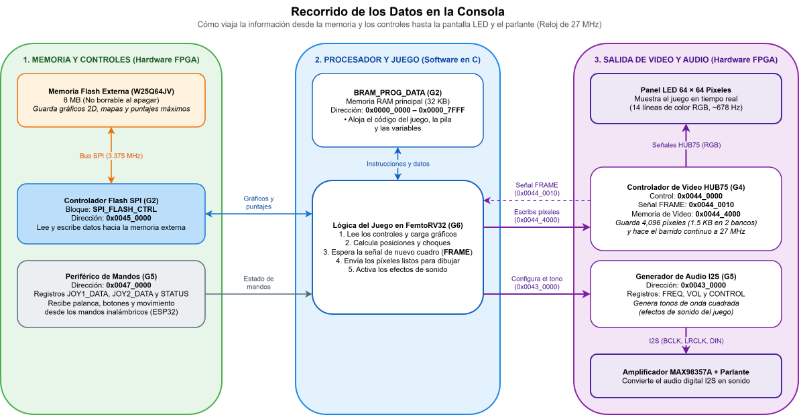
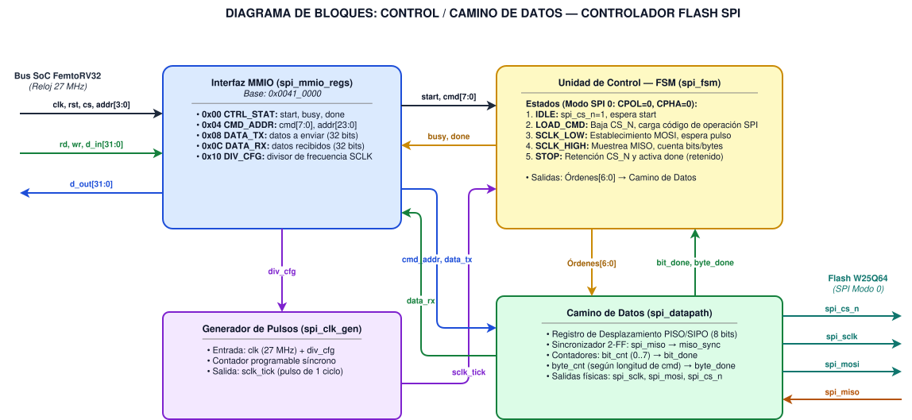
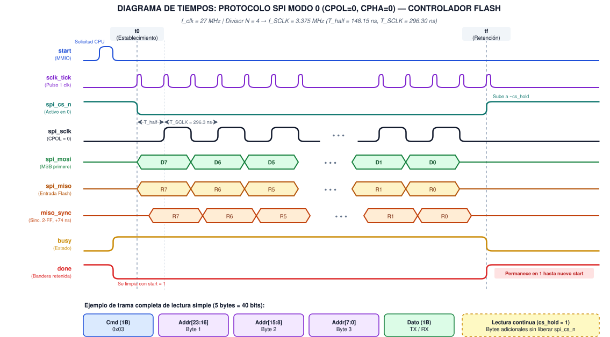
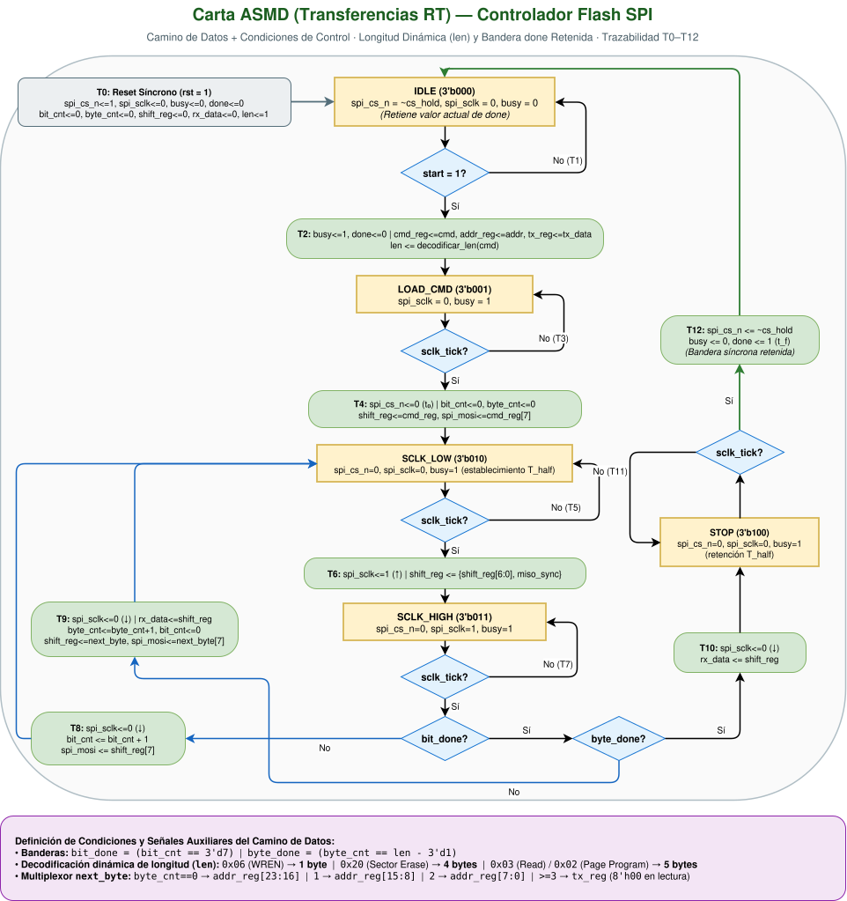
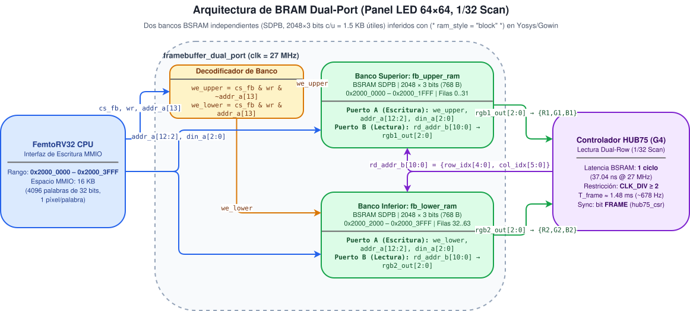

# Arquitectura Hardware y Sistema de Memorias

##  Plan de Trabajo y Tareas Pendientes del grupo G2

| Estado | Categoría / Entregable | Descripción de la Tarea Técnica | Asignado a |
| :---: | :--- | :--- | :--- |
| - [ ] | **Verificación SVG (ASMD/FSM)** | Revisar que `asmd_fsm_spi_g2.svg` refleje la condición de `len` dinámico y el flag `done` retenido (*latch*). | Sofía Michelle Torres |
| - [ ] | **Verificación SVG (Tiempos)** | Confirmar que `diagrama_tiempos_spi_g2.svg` mantenga la señal `done` en alto (`1`) tras completar la transferencia. | Sofía Michelle Torres |
| - [ ] | **Verificación SVG (Flujo/Caja Negra)** | Revisar que `caja_negra_sistema.svg` y `flujo_datos_g2.svg` muestren la base `0x0045` y la interfaz I2S sin componentes obsoletos. | Ramón Santiago Castro C. |
| - [ ] | **Código RTL (Controlador SPI)** | Escribir `Grupos/G2/rtl/spi_flash_controller.v` en Verilog síncrono bajo FSMD con trama dinámica y `done` retenido. | Juan Sebastián Vásquez |
| - [ ] | **Código RTL (Adaptador MMIO)** | Crear `Grupos/G2/rtl/peripheral_spi_flash.v` para decodificar el bus de 32 bits en la región `0x0045_0000` - `0x0045_000C`. | Juan Sebastián Vásquez |
| - [ ] | **Banco de Pruebas (Testbench)** | Diseñar `Grupos/G2/rtl/tb/tb_spi_flash.v` y `Makefile` para simulación autoverificada con Icarus Verilog que valide WREN (`0x06`) y Read (`0x03`). | Juan Sebastián Vásquez |
| - [ ] | **Restricciones Físicas** | Crear `Grupos/G2/rtl/g2_flash.cst` asignando los pines físicos de la Flash SPI en la tarjeta Sipeed Tang Nano 9K. | Ramón Santiago Castro C. |
| - [ ] | **Integración de Memoria SoC** | Publicar y acordar la tabla unificada del mapa MMIO en el `README.md` raíz en coordinación con los demás subgrupos. | Sofía Michelle Torres |


---

## 1. Delimitación y Selección de Tecnologías de Memoria

Para diseñar el subsistema de memorias de la consola partí de las restricciones físicas de la tarjeta **Sipeed Tang Nano 9K** (FPGA Gowin GW1NR-9), trabajando con el flujo abierto **Yosys + nextpnr** y el procesador **FemtoRV32** a una frecuencia única de $27\text{ MHz}$.

El FemtoRV32 usa arquitectura **Von Neumann**, lo que significa que las instrucciones del programa y los datos del juego comparten el mismo espacio de direcciones y el mismo bus. Esto simplifica mucho la conexión con los periféricos, pero me obliga a administrar con cuidado la memoria interna disponible. La FPGA cuenta con $26$ bloques de memoria **BSRAM** de $18\text{ Kbit}$ cada uno, lo que da un total bruto de $58.5\text{ KB}$. Sin embargo, en la práctica, cuando el procesador accede a palabras de $8$, $16$ o $32$ bits sin usar bits de paridad, cada bloque aporta $2\text{ KB}$ útiles ($16\text{ Kbit}$), dejándonos unos $52\text{ KB}$ aprovechables en toda la FPGA.

Como en ese espacio interno no caben todos los gráficos, mapas y puntajes de varios juegos arcade, decidí dividir el almacenamiento en una **jerarquía de dos niveles**:

- **Nivel 1 (BSRAM interna de la FPGA):** para lo que necesita respuesta inmediata en $1$ solo ciclo de reloj ($37.04\text{ ns}$), es decir, el código del juego que ejecuta el CPU, las variables activas y el acceso rápido al video.
- **Nivel 2 (Flash NOR SPI externa):** para almacenamiento masivo y no volátil ($8\text{ MB}$), donde guardo los gráficos 2D, mapas de niveles y puntajes máximos que no se pierden al apagar la consola.

### 1.1 Comparativa y Justificación de Tecnologías de Memoria

Antes de definir la arquitectura final, comparé las opciones de memoria viables para la Tang Nano 9K teniendo en cuenta tres criterios: cantidad de pines físicos disponibles, latencia de acceso y facilidad de síntesis en Verilog sin depender de bloques propietarios.

| Tecnología de Memoria | Componente / Modelo | Capacidad | Protocolo e Interfaz | Pines Físicos | Velocidad / Latencia | Rol y Justificación en mi Diseño |
| :--- | :--- | :---: | :--- | :---: | :--- | :--- |
| **BSRAM Interna** *(Nivel 1 - En uso)* | Bloques `SDPB` del chip Gowin GW1NR-9 | $58.5\text{ KB}$ brutos ($26 \times 18\text{ Kbit}$) | Bus paralelo síncrono ($27\text{ MHz}$) | $0$ externos (interna) | $1$ ciclo de reloj ($37.04\text{ ns}$) | La elegí como memoria principal de programa y datos del CPU ($32\text{ KB}$), incluyendo los $6$ registros reservados para los dos controles. También es la memoria que usa G4 internamente para su memoria de video ($1.5\text{ KB}$). |
| **Flash NOR SPI Externa** *(Nivel 2 - En uso)* | Winbond `W25Q64JV` (integrada en placa o módulo DIP8) | $8\text{ MB}$ ($64\text{ Mbit}$) | SPI síncrono Modo 0 (`CS#`, `SCLK`, `MOSI`, `MISO`), región MMIO `0x0045` | $4$ pines | $f_{\text{SCLK}} = 3.375\text{ MHz}$ ($2.37~\mu\text{s/byte}$) | La seleccioné porque ofrece $8\text{ MB}$ no volátiles gastando solo $4$ pines. Permite leer gráficos y mapas al arrancar el juego y guardar puntajes máximos borrando sectores de $4\text{ KB}$ y escribiendo por página. |
| **PSRAM / SRAM Externa** *(Descartada)* | `APS6404L` / `IS61WV25616` | $8\text{ MB}$ / $512\text{ KB}$ | QSPI / Bus paralelo asíncrono | $6$ a $38$ pines | Media / Alta (requiere estados de espera) | La descarté porque complica el controlador del bus sin necesidad. El firmware del juego cabe en $32\text{ KB}$ de BSRAM interna y la pantalla solo necesita $1.5\text{ KB}$, así que agregar RAM externa solo gastaría pines y metería latencia extra. |
| **EEPROM $\text{I}^2\text{C}$** *(Descartada)* | Microchip `AT24C256` | $32\text{ KB}$ ($256\text{ Kbit}$) | $\text{I}^2\text{C}$ (`SDA`, `SCL`) | $2$ pines | $100\text{–}400\text{ kHz}$ (lenta) | La descarté por redundante y lenta. Teniendo $8\text{ MB}$ disponibles en la Flash `W25Q64JV` (donde puedo apartar un sector de $4\text{ KB}$ solo para puntajes), no tiene sentido diseñar otro controlador periférico adicional en $\text{I}^2\text{C}$. |

**¿Por qué elegí SPI Modo 0 y no QSPI para la Flash?**
Aunque la `W25Q64JV` soporta QSPI (4 líneas de datos simultáneas), elegí **SPI estándar en Modo 0** ($\text{CPOL} = 0$, $\text{CPHA} = 0$) porque las líneas `MOSI` y `MISO` son unidireccionales. Eso evita tener que manejar pines bidireccionales de alta impedancia (`tri-state`) en la FPGA, reduce el uso de pines físicos a $4$ y simplifica la máquina de estados del controlador. A $3.375\text{ MHz}$, cargar un gráfico completo de $16 \times 16$ píxeles toma menos de $0.62\text{ ms}$, tiempo suficiente para una consola arcade.

### 1.2 Presupuesto de BSRAM Interna en la Tang Nano 9K

Para asegurarme de que el proyecto sintetice sin quedarse sin memoria interna, hice el reparto de los $26$ bloques BSRAM físicos de la Gowin GW1NR-9 contemplando tanto mi módulo como el video de G4:

1. **`BRAM_PROG_DATA` (`0x0000_0000` – `0x0000_7FFF`) - Gestionada por G2:**
   Asigné **$32\text{ KB}$** para el programa en C compilado para RISC-V (G6), la pila (*stack*) y las variables del juego. Elegí $32\text{ KB}$ porque es potencia de dos (facilita decodificar las direcciones usando los bits `[14:2]` sin comparadores complejos) y da margen de sobra para la lógica de un juego retro.
   - *Bloques físicos usados:* $16$ bloques BSRAM en mapeo estándar de $2\text{ KB}$ útiles por bloque ($16 \times 16\text{ Kbit} = 32\text{ KB}$).
   - *Reserva fija para los dos controles:* Dentro de esta RAM dejé $6$ direcciones reservadas específicamente para almacenar el estado de los dos mandos ($3$ registros por jugador: eje X, eje Y y botón de ataque). Decidí ubicarlos en direcciones fijas consecutivas para que el código del juego pueda leer ambos controles en $1$ ciclo de reloj sin depender de los tiempos de llegada de la UART:
     - **Control 1 (Jugador 1):** dirección `42` (`CTRL1_JOY_X`), dirección `43` (`CTRL1_JOY_Y`) y dirección `44` (`CTRL1_ATAQUE`).
     - **Control 2 (Jugador 2):** dirección `45` (`CTRL2_JOY_X`), dirección `46` (`CTRL2_JOY_Y`) y dirección `47` (`CTRL2_ATAQUE`).

2. **Memoria de video HUB75 (`0x0044_4000`) - Instanciada internamente por G4:**
   Ocupa **$1.5\text{ KB}$ útiles**, pero consume **$2$ bloques BSRAM físicos** en modo *Simple Dual-Port*. Aunque $1.5\text{ KB}$ cabrían teóricamente en un solo bloque de $2\text{ KB}$, el panel LED $64 \times 64$ hace barrido doble (lee una fila de la mitad superior y otra de la mitad inferior al mismo tiempo), por lo que requiere dos bancos separados para entregar ambos píxeles en paralelo en el mismo ciclo de reloj.
   - *Aclaración de integración:* Inicialmente yo tenía planeado mapear esta memoria desde G2 en `0x2000_0000`, pero acordé con G4 que ellos la instanciaran directamente dentro de su periférico en `0x0044_4000`. La cuento aquí únicamente para llevar el balance real de bloques ocupados en la FPGA.

3. **Reserva libre en la FPGA:**
   Restando los $16$ bloques de `BRAM_PROG_DATA` y los $2$ bloques del video de G4, me quedan **$8$ bloques BSRAM libres** ($16\text{ KB}$ útiles / $18\text{ KB}$ brutos). Este margen queda disponible por si G5 necesita tablas de ondas para el audio I2S o si G6 requiere espacio extra para variables en RAM.
---

## 2. Arquitectura del Sistema y Mapa de Memoria MMIO

Para que mi subsistema de memorias encaje sin conflictos con el video, el audio, los controles y el código del juego, primero tuve que definir las reglas de integración con los demás subgrupos y estructurar un mapa de direcciones único para todo el SoC.

### 2.1 Acuerdos de Integración entre Subgrupos

Antes de escribir código en Verilog, acordé con el resto del equipo cinco reglas base para evitar problemas al unir los módulos en la FPGA:

- **Reloj maestro único ($27\text{ MHz}$):** Todo el SoC corre con el mismo oscilador base de $27\text{ MHz}$ ($T_{\text{clk}} \approx 37.04\text{ ns}$). Elegimos trabajar en un solo dominio de reloj porque, si el procesador y los periféricos corrieran a frecuencias distintas, tendríamos que diseñar circuitos de cruce de dominios de reloj (*Clock Domain Crossing* o CDC) y FIFOs asíncronas para evitar metaestabilidad. Con un solo reloj, cualquier lectura o escritura entre módulos queda sincronizada en el mismo flanco.
- **Bus estándar del curso:** Todos los periféricos implementan exactamente la misma interfaz síncrona (`clk`, `rst`, `cs`, `addr`, `rd`, `wr`, `d_in`, `d_out`). Así puedo conectar mi controlador Flash SPI al decodificador principal del FemtoRV32 de la misma forma que G3, G4 o G5 conectan los suyos.
- **Alineación con G4 (Pantalla HUB75):** La memoria de video se organiza en **2 bancos de $2048 \times 3$ bits** (RGB de $3$ bits = $8$ colores, $1.5\text{ KB}$ en total) y se sincroniza con la bandera **`FRAME`** del registro `hub75_csr` para evitar que el juego dibuje un cuadro nuevo a mitad de un barrido (*tearing*). Como mencioné en la sección anterior, acordé con G4 que esta memoria viva dentro de su propio periférico (`0x0044_4000`) en lugar de duplicarla desde G2 en `0x2000_0000`.
- **Alineación con G1, G3 y G5 (Controles y Audio):** Los datos del mando inalámbrico (Joystick analógico + IMU `BMI160` leído por SPI en la FPGA del mando) viajan por UART hacia un puente Bluetooth (ESP32) y llegan al receptor UART de la consola (`0x0042_0000`). Una vez decodificados, su estado para los dos jugadores se guarda en los $6$ registros que reservé en la RAM principal de G2 (direcciones `42` a `47`). Por su parte, el audio se genera por hardware mediante el protocolo I2S hacia el DAC `MAX98357A`.
- **Recursos de juego (G6):** El almacenamiento está pensado para activos genéricos de juegos arcade retro (*sprites* 2D, mapas de nivel, fuentes y puntajes máximos), de modo que el hardware de memoria no dependa de un solo juego específico.

### 2.2 Mapa de Memoria Unificado del SoC (FemtoRV32)

En una arquitectura con **E/S mapeada en memoria (MMIO)**, el procesador no necesita instrucciones especiales para hablar con la Flash, el audio o la pantalla; simplemente lee y escribe direcciones de memoria como si fueran variables en RAM.

Para que la decodificación de direcciones consuma la menor cantidad posible de lógica (LUTs) en la FPGA, seleccionamos cada periférico mirando únicamente los $16$ bits superiores de la dirección (`mem_addr[31:16]`). Esto divide el espacio en bloques limpios de $64\text{ KB}$: al decodificador le basta comparar un prefijo fijo (por ejemplo, `0x0045` para mi controlador SPI) para activar la señal `cs` (*chip select*) correspondiente.

| Rango de Direcciones | Tamaño | Subgrupo | Periférico / Región | Descripción de Acceso |
| :--- | :---: | :---: | :--- | :--- |
| `0x0000_0000` – `0x0000_7FFF` | $32\text{ KB}$ | **G2 / G6** | `BRAM_PROG_DATA` | Memoria principal de instrucciones y datos del FemtoRV32 (`.text`, `.data`, `.bss`, *stack*) y zona reservada de $6$ registros para los dos controles (direcciones `42`–`47`). |
| `0x0042_0000` – `0x0042_000C` | $16\text{ B}$ | **G1 / G3** | `UART_INPUT_RX` | Receptor de tramas del mando inalámbrico (ejes del joystick, pulsadores y lecturas del `BMI160`). |
| `0x0043_0000` – `0x0043_000C` | $16\text{ B}$ | **G5** | `AUDIO_I2S_CTRL` | Registros `FREQ`, `VOL` y `CONTROL` para el generador de audio I2S (`MAX98357A`). |
| `0x0044_0000` – `0x0044_4FFF` | $20\text{ B}$ (CSR) + $1.5\text{ KB}$ (FB) | **G4** | `HUB75_CTRL` | Registros de control y estado (`0x0044_0000`, incluye bandera `FRAME`) y memoria de video interna (`0x0044_4000`, $4,096$ píxeles en 2 bancos de $2048 \times 3$ bits). |
| `0x0045_0000` – `0x0045_000C` | $16\text{ B}$ | **G2** | `SPI_FLASH_CTRL` | Registros MMIO de mi controlador Flash SPI `W25Q64JV` (`CTRL_STAT`, `CMD_ADDR`, `TX_DATA`, `RX_DATA`). |

**¿Por qué los periféricos ocupan $16\text{ B}$ (`0x00` a `0x0C`)?**
El FemtoRV32 es un procesador de $32$ bits, por lo que sus accesos nativos están alineados a palabras de $4$ bytes. Al asignar $16\text{ B}$ por periférico, dispongo exactamente de $4$ registros de $32$ bits (`0x00`, `0x04`, `0x08` y `0x0C`), suficientes para separar control/estado, comandos/direcciones y datos de transmisión/recepción sin desperdiciar lógica en decodificadores internos grandes.

### 2.3 Flujo Completo del Envío de Datos al Juego

En el siguiente diagrama muestro cómo se mueven los datos desde la memoria Flash hasta el panel LED, separando qué tareas corren en hardware (Verilog) y cuáles se ejecutan por software (C en el FemtoRV32):



| Tarea del Sistema | Dominio | Disparo / Sincronización | Flujo de Entrada $\rightarrow$ Salida |
| :--- | :---: | :--- | :--- |
| **Almacenamiento SPI (`Storage`)** | **HW (HDL - G2)** | Escritura en `SPI_CTRL_STAT.start` (`0x0045_0000`) | Flash `W25Q64JV` (`MISO`) $\rightarrow$ Registro `SPI_RX_DATA` hacia el CPU. |
| **Recepción de Controles (`Input`)** | **HW + SW (G1/G3/G2)** | Trama UART recibida | Mando inalámbrico (Joystick + `BMI160`) $\rightarrow$ `UART_INPUT_RX` (`0x0042_0000`) $\rightarrow$ Registros de control en RAM (`42`–`47`). |
| **Lógica de Juego (`Game Logic`)** | **SW (C - G6)** | Bucle principal + bandera `FRAME` | Estado de controles y *sprites* $\rightarrow$ Actualización de coordenadas, colisiones y escritura de píxeles en `0x0044_4000`. |
| **Barrido de Video (`Video`)** | **HW (HDL - G4)** | Continuo a $27\text{ MHz}$ ($T_{\text{fila}} = 46.12~\mu\text{s}$) | Lectura síncrona Puerto B de BSRAM interna de G4 ($2048 \times 3$) $\rightarrow$ $14$ líneas paralelas HUB75 ($\approx 678\text{ Hz}$). |

**¿Por qué dividir el sistema así entre hardware y software?**
Las tareas con tiempos estrictos y repetitivos —como generar el reloj SPI a $3.375\text{ MHz}$ o refrescar las $64 \times 64$ luces del panel HUB75 cientos de veces por segundo— deben ir en **hardware dedicado**. Si el FemtoRV32 intentara hacer ese barrido por software, quedaría bloqueado el $100\%$ del tiempo y no podría ejecutar el juego. Al delegar la transmisión SPI y el refresco de pantalla a bloques en Verilog, el procesador queda libre para dedicarse solo a la lógica del juego en C: leer controles, calcular colisiones, pedir los gráficos necesarios a la Flash y actualizar los píxeles cuando se activa la bandera `FRAME`.

---

## 3. Diseño del Controlador de Memoria Flash SPI (Metodología FSMD)

Para diseñar el controlador maestro SPI en Modo 0 (`spi_flash_controller.v`), apliqué la metodología **FSMD** (*Finite State Machine with Datapath*), dividiendo el hardware en dos partes bien diferenciadas: una **Unidad de Control** (que decide en qué etapa de la transacción nos encontramos) y un **Camino de Datos** (que almacena, desplaza y cuenta los bits y bytes). Elegí esta separación porque evita mezclar contadores y registros de desplazamiento dentro de la máquina de estados; así, si necesito cambiar la longitud de una trama o ajustar la frecuencia del reloj SPI, modifico el camino de datos sin alterar la lógica de estados.

### 3.1 Diagrama de Caja Negra y Especificación de Interfaz

La caja negra representa mi periférico sintetizable dentro de la FPGA, actuando como puente entre el bus interno del procesador **FemtoRV32** (izquierda) y las $4$ líneas físicas que van hacia la memoria externa **Winbond `W25Q64JV`** (derecha):


#### Características de la Interfaz

- **Rol en el sistema:** Funciona como esclavo en el bus MMIO del procesador y como maestro SPI frente a la memoria Flash externa.
- **Protocolo externo:** SPI síncrono **Modo 0** ($\text{CPOL} = 0$, $\text{CPHA} = 0$), transmitiendo siempre el bit más significativo primero sobre $4$ líneas físicas unidireccionales.
- **Reloj y reinicio:** Todo el módulo opera de forma síncrona con el reloj maestro del SoC (`clk = 27 MHz`) y cuenta con un reinicio síncrono activo en alto (`rst`).
- **Sincronización con el procesador:** Expone las banderas `busy` y `done` en su registro de estado para que el software sepa cuándo terminó una transferencia o cuándo puede encadenar lecturas continuas usando `cs_hold`.

#### Tabla de Señales de la Caja Negra

| Señal | Dirección | Ancho | Interfaz | Descripción Funcional |
| :--- | :---: | :---: | :--- | :--- |
| `clk` | Entrada | $1$ bit | Bus SoC | Reloj maestro unificado del sistema ($27\text{ MHz}$). |
| `rst` | Entrada | $1$ bit | Bus SoC | Reinicio síncrono activo en alto (`1` lleva tanto la FSM como el camino de datos a `IDLE`). |
| `cs` | Entrada | $1$ bit | Bus SoC | Selección de periférico activada por el decodificador MMIO para la región `0x0045_xxxx`. |
| `addr` | Entrada | $4$ bits | Bus SoC | Desplazamiento de dirección interna para seleccionar uno de los $4$ registros del controlador. |
| `rd` | Entrada | $1$ bit | Bus SoC | Habilitación de lectura desde el procesador FemtoRV32. |
| `wr` | Entrada | $1$ bit | Bus SoC | Habilitación de escritura desde el procesador FemtoRV32. |
| `d_in` | Entrada | $32$ bits | Bus SoC | Bus de datos de entrada desde el CPU (código de operación SPI, dirección de $24$ bits y dato a transmitir). |
| `d_out` | Salida | $32$ bits | Bus SoC | Bus de datos de salida hacia el CPU (último byte leído de la Flash y banderas `busy`/`done`). |
| `spi_cs_n` | Salida | $1$ bit | Flash SPI | Selección de chip hacia la `W25Q64JV` (activo en bajo durante toda la transacción). |
| `spi_sclk` | Salida | $1$ bit | Flash SPI | Reloj serie generado internamente para sincronizar los bits en `MOSI` y `MISO`. |
| `spi_mosi` | Salida | $1$ bit | Flash SPI | Salida serie hacia el pin `DI` de la Flash (envía códigos de operación, direcciones y datos). |
| `spi_miso` | Entrada | $1$ bit | Flash SPI | Entrada serie desde el pin `DO/SO` de la Flash (recibe datos leídos y el registro de estado). |

---

### 3.2 Diagrama de Bloques Control / Camino de Datos y Condiciones de Diseño

Internamente estructuré el controlador en cuatro bloques síncronos gobernados por el reloj único `clk` ($27\text{ MHz}$): la interfaz de registros MMIO (`spi_mmio_regs`), el generador de pulsos de habilitación (`spi_tick_gen`), la unidad de control (`spi_fsm_control`) y el camino de datos (`spi_datapath`):



#### Mapa de Registros Internos (`spi_mmio_regs` — Base `0x0045_0000`)

Decidí distribuir la interfaz hacia el software en cuatro registros de $32$ bits para separar el control de los datos y evitar escrituras accidentales mientras hay una transmisión en curso:

| Desplazamiento | Nombre | Acceso | Campos de Bits | Descripción Funcional |
| :---: | :--- | :---: | :--- | :--- |
| `0x00` | `SPI_CTRL_STAT` | `R/W` | `[0]` `start` (pulso de $1$ ciclo)<br>`[1]` `cs_hold` (`R/W`)<br>`[8]` `busy` (`R`)<br>`[9]` `done` (`R`) | Inicia la transacción (`start`), mantiene `spi_cs_n` en bajo para lecturas continuas (`cs_hold`) y reporta el estado actual al procesador. |
| `0x04` | `SPI_CMD_ADDR` | `R/W` | `[31:24]` `cmd[7:0]`<br>`[23:0]` `addr[23:0]` | Código de operación SPI (`0x03` lectura, `0x06` habilitar escritura, `0x02` programar página, `0x20` borrar sector) y dirección física de $24$ bits. |
| `0x08` | `SPI_TX_DATA` | `R/W` | `[7:0]` `tx_data[7:0]` | Byte de datos a enviar hacia la memoria Flash en operaciones de escritura. |
| `0x0C` | `SPI_RX_DATA` | `R` | `[7:0]` `rx_data[7:0]` | Último byte capturado desde `spi_miso` una vez se activa la bandera `done`. |

#### Condiciones y Justificación del Diseño Interno

1. **Sincronizador de doble flip-flop en `spi_miso` (`2-FF`):** Como `spi_miso` proviene de un chip externo y sufre retardos físicos en las pistas de la tarjeta, no es síncrona con el reloj interno de la FPGA. Por eso la paso por dos flip-flops en cascada (`miso_sync`) muestreados a $27\text{ MHz}$ antes de entrar al registro de desplazamiento, eliminando el riesgo de metaestabilidad.
2. **Pulso de habilitación (`sclk_tick`) en lugar de un reloj dividido:** En diseño sobre FPGA, dividir un reloj usando lógica combinacional genera sesgos (*skew*) y crea un segundo dominio de reloj difícil de analizar en la síntesis. Para evitarlo, `spi_tick_gen` funciona como un contador que genera un **pulso de habilitación de 1 ciclo de `clk`** cada $N = 4$ ciclos del oscilador base. De esta forma, todos los registros siguen trabajando bajo el mismo flanco de `27 MHz`.
3. **Salidas físicas registradas:** Las señales `spi_cs_n`, `spi_sclk` y `spi_mosi` salen directamente de registros síncronos (flip-flops) y no de puertas lógicas combinacionales. Esto garantiza que no aparezcan pulsos espurios (*glitches*) en los pines físicos que puedan confundir a la Flash con un flanco de reloj falso.

---

### 3.3 Diagrama de Tiempos SPI Modo 0 y Análisis Temporal

En el diagrama de tiempos muestro la evolución bit a bit en **SPI Modo 0** ($\text{CPOL} = 0$, $\text{CPHA} = 0$), tomando como referencia una transacción estándar de lectura de $5$ bytes ($1$ byte `Cmd` + $3$ bytes `Addr` + $1$ byte `Data`) y la extensión en ráfaga manteniendo la selección activa (`cs_hold = 1`):



#### Secuencia Temporal Paso a Paso

1. **Reposo (`IDLE`):** `spi_cs_n = 1` (si `cs_hold = 0`), `spi_sclk = 0`, `busy = 0` y `done = 0` (o conserva el `1` de la transacción anterior).
2. **Solicitud MMIO:** El CPU escribe `SPI_CMD_ADDR` (`0x04`) y activa `start = 1`. La FSM pone `busy = 1`, **limpia la bandera `done = 0`** y espera el siguiente pulso `sclk_tick`.
3. **Inicio y establecimiento ($t_0$):** Al llegar `sclk_tick`, `spi_cs_n` baja a `0` y `spi_mosi` coloca de inmediato el bit más significativo `D7`, asegurando un tiempo de establecimiento de $T_{\text{half}}$ antes del primer flanco de subida de `spi_sclk`.
4. **Muestreo y desplazamiento (`D7` $\rightarrow$ `D0`):** En cada **flanco de subida** de `spi_sclk`, el camino de datos captura `miso_sync`; en cada **flanco de bajada**, actualiza `spi_mosi` con el siguiente bit.
5. **Parada y retención ($t_f$):** Tras el último flanco de bajada (`D0`), `spi_cs_n` permanece en bajo medio período adicional ($T_{\text{half}}$) para cumplir el tiempo de retención de la memoria. En $t_f$, `spi_cs_n` regresa a `~cs_hold`, `busy` pasa a `0` y **`done` se fija en `1` (como bandera retenida en registro hasta que el CPU envíe un nuevo `start`).**

#### Cálculos Temporales y Ancho de Banda ($f_{\text{clk}} = 27\text{ MHz}$, $N = 4$)

- **Período del reloj maestro del sistema ($T_{\text{clk}}$):**

  $$T_{\text{clk}} = \frac{1}{27\text{ MHz}} \approx 37.04\text{ ns}$$

- **Semiperíodo y frecuencia de operación del reloj SPI ($f_{\text{SCLK}}$):**

  $$T_{\text{half}} = 4 \cdot T_{\text{clk}} \approx 148.15\text{ ns}$$

  $$T_{\text{SCLK}} = 2 \cdot T_{\text{half}} = 8 \cdot T_{\text{clk}} \approx 296.30\text{ ns} \implies f_{\text{SCLK}} = \frac{27\text{ MHz}}{8} = 3.375\text{ MHz}$$

- **Margen con el sincronizador `2-FF`:** El doble flip-flop introduce un retardo fijo de $2 \cdot T_{\text{clk}} \approx 74.07\text{ ns}$. Como cada semiperíodo dura $148.15\text{ ns}$, la señal `miso_sync` llega estable al menos $74\text{ ns}$ antes de cada flanco de subida de captura.
- **Tiempos de transferencia hacia el juego:**
  - **Tiempo por byte ($8$ bits):** $T_{\text{byte}} = 8 \cdot T_{\text{SCLK}} \approx 2.37~\mu\text{s}$.
  - **Lectura simple de $1$ byte (`Cmd 0x03 + 24-bit Addr + 1-byte Data = 40 bits`):**

    $$T_{\text{lectura 1B}} = 40 \cdot T_{\text{SCLK}} + 2 \cdot T_{\text{half}} \approx 12.15~\mu\text{s}$$

  - **Lectura continua de un gráfico de $16 \times 16$ píxeles ($256$ bytes manteniendo `spi_cs_n = 0` con `cs_hold = 1`):**

    $$T_{\text{gráfico } 16\times 16} = (4 + 256) \cdot T_{\text{byte}} \approx 616.3~\mu\text{s}$$

    *(Esto representa menos del $3.7\%$ del presupuesto de cuadro de $16.67\text{ ms}$ a $60\text{ Hz}$, demostrando que $3.375\text{ MHz}$ es más que suficiente para cargar gráficos sin afectar la fluidez del juego).*

---

### 3.4 Diagrama de Flujo Funcional y Clasificación FSMD

En el diagrama de flujo comportamental clasifiqué cada operación según el bloque físico que la ejecuta: **Unidad de Control (amarillo)**, **Camino de Datos (verde)** o **Reinicio Compartido (gris)**:


Para que el controlador sea realmente práctico desde el software en C, incorporé tres decisiones de diseño clave:

- **Longitud de trama dinámica (`byte_done`):** No todas las operaciones de la Flash miden lo mismo. Si usara un contador fijo de $5$ bytes, no podría enviar comandos de $1$ byte como `0x06` (*Write Enable*) sin enviar $4$ bytes basura adicionales. Por eso, al iniciar la transacción, el camino de datos decodifica el código de operación (`cmd_reg`) y carga la longitud exacta en un registro interno `len` (`1` byte para `0x06`, `4` bytes para `0x20` y `5` bytes para `0x03`/`0x02`). La bandera `byte_done` se activa dinámicamente cuando `byte_cnt` alcanza `len - 1`.
- **Retención de la bandera `done`:** Si `done` fuera un pulso de un solo ciclo de reloj ($37.04\text{ ns}$), el procesador FemtoRV32 —que tarda varios ciclos en ejecutar cada instrucción de lectura por bus— casi nunca alcanzaría a verlo. Por esa razón, diseñé `done` como una bandera síncrona retenida en registro: se pone en `1` al finalizar el estado `STOP` y se mantiene así hasta que el CPU limpia la condición iniciando una nueva transferencia con `start = 1` (o aplicando `rst = 1`).
- **Gestión de transferencias múltiples (`cs_hold`):** El bit `cs_hold` permite mantener `spi_cs_n` en bajo al terminar un byte para seguir leyendo direcciones consecutivas aprovechando el autoincremento interno de la `W25Q64JV`. Sin embargo, hay que tener en cuenta una restricción física del chip: **si se libera `spi_cs_n` (sube a `1`), la memoria reinicia su máquina interna**, por lo que para volver a leer es obligatorio enviar de nuevo el comando `0x03` y los $3$ bytes de dirección.

---

### 3.5 Carta ASMD, FSM de Control y Tabla de Transferencias RT

Con base en la separación FSMD, implementé una **Máquina de Estados Finitos (FSM)** de $5$ estados codificados en $3$ bits (`state[2:0]`) y su **Carta ASMD** con las transferencias entre registros (RT) en cada flanco de subida de `clk`. Numeré cada transición (`T0`–`T12`) para poder verificarlas una por una en el banco de pruebas:

#### Diagrama de Estados (FSM)


#### Carta ASMD (Camino de Datos y Transferencias RT)


#### Tabla de Estados y Transferencias RT (`spi_fsm_control` + `spi_datapath`)

| ID | Estado Actual | Código | Condición de Transición | Estado Siguiente | Salidas de Control (`Moore` / `Mealy`) | Transferencias RT en el Camino de Datos |
| :---: | :--- | :---: | :--- | :---: | :--- | :--- |
| **T0** | *Cualquiera* | `---` | `rst = 1` | `IDLE` | `spi_cs_n <= 1`, `spi_sclk <= 0`, `busy <= 0`, `done <= 0` | `bit_cnt <= 0`, `byte_cnt <= 0`, `shift_reg <= 8'h00`, `rx_data <= 8'h00`, `len <= 3'd1` |
| **T1** | **`IDLE`** | `3'b000` | `rst = 0 & start = 0` | `IDLE` | `spi_cs_n = ~cs_hold`, `spi_sclk = 0`, `busy = 0` | Mantiene registros sin cambios (retiene el valor actual de `done`) |
| **T2** | **`IDLE`** | `3'b000` | `rst = 0 & start = 1` | `LOAD_CMD` | `busy <= 1`, `done <= 0` | `cmd_reg <= cmd`, `addr_reg <= addr`, `tx_reg <= tx_data`, `len <= decodificar_len(cmd)` |
| **T3** | **`LOAD_CMD`** | `3'b001` | `sclk_tick = 0` | `LOAD_CMD` | `spi_sclk = 0`, `busy = 1` | Espera sincronización con el siguiente pulso `sclk_tick` |
| **T4** | **`LOAD_CMD`** | `3'b001` | `sclk_tick = 1` | `SCLK_LOW` | `spi_cs_n <= 0` ($t_0$) | `bit_cnt <= 0`, `byte_cnt <= 0`, `shift_reg <= cmd_reg`, `spi_mosi <= cmd_reg[7]` |
| **T5** | **`SCLK_LOW`** | `3'b010` | `sclk_tick = 0` | `SCLK_LOW` | `spi_cs_n = 0`, `spi_sclk = 0`, `busy = 1` | Mantiene `spi_mosi` estable (establecimiento $T_{\text{half}}$) |
| **T6** | **`SCLK_LOW`** | `3'b010` | `sclk_tick = 1` | `SCLK_HIGH` | `spi_sclk <= 1` (Flanco $\uparrow$) | `shift_reg <= {shift_reg[6:0], miso_sync}` (muestrea bit recibido) |
| **T7** | **`SCLK_HIGH`** | `3'b011` | `sclk_tick = 0` | `SCLK_HIGH` | `spi_cs_n = 0`, `spi_sclk = 1`, `busy = 1` | Mantiene nivel alto de `spi_sclk` |
| **T8** | **`SCLK_HIGH`** | `3'b011` | `sclk_tick & ~bit_done` | `SCLK_LOW` | `spi_sclk <= 0` (Flanco $\downarrow$) | `bit_cnt <= bit_cnt + 1`, `spi_mosi <= shift_reg[7]` |
| **T9** | **`SCLK_HIGH`** | `3'b011` | `sclk_tick & bit_done & ~byte_done` | `SCLK_LOW` | `spi_sclk <= 0` (Flanco $\downarrow$) | `rx_data <= shift_reg`, `byte_cnt <= byte_cnt + 1`, `bit_cnt <= 0`, `shift_reg <= next_byte`, `spi_mosi <= next_byte[7]` |
| **T10** | **`SCLK_HIGH`** | `3'b011` | `sclk_tick & bit_done & byte_done` | `STOP` | `spi_sclk <= 0` (Flanco $\downarrow$) | `rx_data <= shift_reg` (captura del último byte de la trama) |
| **T11** | **`STOP`** | `3'b100` | `sclk_tick = 0` | `STOP` | `spi_cs_n = 0`, `spi_sclk = 0`, `busy = 1` | Retiene `spi_cs_n = 0` (retención $T_{\text{half}}$) |
| **T12** | **`STOP`** | `3'b100` | `sclk_tick = 1` | `IDLE` | `spi_cs_n <= ~cs_hold`, `busy <= 0`, `done <= 1` ($t_f$) | Activa `done` como bandera síncrona retenida en registro hasta el próximo `start = 1` o `rst = 1` |

#### Definición de Condiciones y Señales Auxiliares del Camino de Datos

- **Banderas de conteo:**
  - `bit_done = (bit_cnt == 3'd7)`
  - `byte_done = (byte_cnt == len - 3'd1)`
- **Decodificación dinámica de longitud (`len` según `cmd`):**
  - `0x06` (*Write Enable*) $\rightarrow$ `len = 1` ($1$ byte).
  - `0x20` (*Sector Erase*) $\rightarrow$ `len = 4` ($1$ byte comando + $3$ bytes dirección).
  - `0x03` (*Read Data*) / `0x02` (*Page Program*) $\rightarrow$ `len = 5` ($1$ byte comando + $3$ bytes dirección + $1$ byte dato).
- **Multiplexor de siguiente byte (`next_byte` según `byte_cnt`):**
  - `byte_cnt == 0` $\rightarrow$ `addr_reg[23:16]`
  - `byte_cnt == 1` $\rightarrow$ `addr_reg[15:8]`
  - `byte_cnt == 2` $\rightarrow$ `addr_reg[7:0]`
  - `byte_cnt >= 3` $\rightarrow$ `tx_reg` (en lectura `0x03` envía `8'h00` como byte de relleno para generar los pulsos de reloj).

----
## 4. Inferencia y Manejo de BRAM de Doble Puerto

Para que el procesador **FemtoRV32** pueda dibujar nuevos píxeles mientras el controlador de video (**G4**) lee continuamente la imagen para refrescar el panel LED $64 \times 64$ en modo de barrido $1/32$, necesito que ambos módulos accedan a la memoria al mismo tiempo sin bloquearse ni generar colisiones.

Si utilizara una memoria de puerto único (*Single-Port*), el procesador y el controlador de pantalla tendrían que turnarse el bus mediante un árbitro, lo que detendría al CPU o provocaría parpadeos en los LEDs. Para evitarlo, diseñé el almacenamiento de video usando **dos bancos independientes de BSRAM de doble puerto simple (`SDPB`)**, cada uno de $2048 \times 3$ bits ($1.5\text{ KB}$ útiles en total, ocupando $2$ bloques físicos de la FPGA). Con esta configuración, el **Puerto A** queda dedicado exclusivamente a las escrituras del procesador y el **Puerto B** a las lecturas del barrido de video.



### 4.1 Partición Física de Bancos (`0x2000_0000` – `0x2000_3FFF`)

Aunque los datos reales de la imagen ocupan $1.5\text{ KB}$, el rango de direcciones asignado en el bus MMIO abarca **$16\text{ KB}$** ($4,096$ palabras de $32$ bits). Tomé esta decisión para que cada píxel tenga su propia dirección alineada a palabra de $32$ bits (`addr_a[13:2]` como índice lineal de $0$ a $4,095$). De esta forma, el código del juego en C puede escribir directamente sobre un arreglo lineal sin gastar ciclos de reloj empaquetando varios píxeles dentro de una misma palabra con desplazamientos y máscaras de bits. En hardware, simplemente conecto los $3$ bits menos significativos del bus de datos (`din_a[2:0]`, correspondientes a `{R, G, B}`) y descarto los $29$ bits superiores sin gastar lógica adicional.

**¿Por qué dividir la memoria en dos bancos si $1.5\text{ KB}$ caben en un solo bloque BSRAM?**
Un bloque físico de la Gowin GW1NR-9 tiene $18\text{ Kbit}$ ($2\text{ KB}$ útiles), por lo que en teoría podría guardar los $4,096$ píxeles de $3$ bits en un único bloque. Sin embargo, el panel LED $64 \times 64$ con barrido $1/32$ actualiza **dos filas al mismo tiempo** en cada ciclo de reloj: una fila de la mitad superior (filas `0` a `31` por `R1, G1, B1`) y su fila paralela de la mitad inferior (filas `32` a `63` por `R2, G2, B2`). Como un bloque `SDPB` solo tiene un puerto de lectura, no puede entregar dos direcciones distintas en el mismo flanco de reloj. Al dividir la memoria en dos bancos independientes (`fb_upper_ram` y `fb_lower_ram`), ambos reciben en paralelo la misma coordenada `rd_addr_b` y entregan los dos píxeles simultáneamente.

*(Nota de integración: este módulo de referencia se diseñó originalmente sobre el rango base `0x2000_0000` – `0x2000_3FFF` y fue adoptado por G4 dentro de su propio periférico bajo la dirección base `0x0044_4000`).*

| Rango MMIO | Banco Físico BSRAM | Filas del Panel $64 \times 64$ | Geometría | Puerto A (Escritura CPU) | Puerto B (Lectura HUB75 G4) |
| :--- | :---: | :---: | :---: | :--- | :--- |
| `0x2000_0000` – `0x2000_1FFF` | `fb_upper_ram` | Filas `0` a `31` (Superior) | $2048 \times 3$ bits ($768\text{ B}$) | `we_upper = cs_fb & wr & ~addr_a[13]`<br>`wr_addr = addr_a[12:2]`, `din = din_a[2:0]` | `rd_addr_b = {row_idx[4:0], col_idx[5:0]}`<br>Salida `rgb1_out[2:0]` → `{R1, G1, B1}` |
| `0x2000_2000` – `0x2000_3FFF` | `fb_lower_ram` | Filas `32` a `63` (Inferior) | $2048 \times 3$ bits ($768\text{ B}$) | `we_lower = cs_fb & wr & addr_a[13]`<br>`wr_addr = addr_a[12:2]`, `din = din_a[2:0]` | `rd_addr_b = {row_idx[4:0], col_idx[5:0]}`<br>Salida `rgb2_out[2:0]` → `{R2, G2, B2}` |

### 4.2 Plantilla de Inferencia Síncrona en Verilog (Yosys / Gowin `SDPB`)

Para no atar el proyecto a primitivas propietarias del fabricante (`Gowin_SDPB`) y mantener la portabilidad en el flujo abierto **Yosys + nextpnr**, describí las memorias en Verilog comportamental siguiendo tres reglas estrictas de inferencia:

1. **Atributo explícito de bloque (`(* ram_style = "block" *)`):** Le indica directamente al sintetizador que mapee los arreglos sobre bloques BSRAM físicos y no sobre celdas lógicas distribuidas (LUTs), que se agotarían rápidamente con $12,288$ bits.
2. **Lectura y escritura síncronas al mismo reloj (`posedge clk`):** Las salidas `rgb1_out` y `rgb2_out` se registran en el flanco de subida de `clk`. Si la lectura fuera combinacional (`assign`), Yosys no podría usar la BSRAM física porque los bloques de memoria de Gowin tienen registros de salida obligatorios.
3. **Sin borrado global por `rst`:** No incluyo un lazo `for` de limpieza dentro del bloque `always`, ya que la memoria BSRAM física no posee una señal de reinicio simultáneo para todas sus celdas; el firmware inicializa la pantalla escribiendo ceros al arrancar.

```verilog
module framebuffer_dual_port (
    input  wire        clk,        // Reloj maestro unificado del SoC (27 MHz)
    // Puerto A: Interfaz de escritura MMIO desde FemtoRV32
    input  wire        cs_fb,      // Selección región de memoria de video
    input  wire        wr,         // Habilitación de escritura bus CPU
    input  wire [13:2] addr_a,     // Índice lineal de píxel (0..4095)
    input  wire [2:0]  din_a,      // Color RGB de 3 bits {R, G, B}
    // Puerto B: Interfaz de lectura simultánea hacia Controlador HUB75 (G4)
    input  wire [10:0] rd_addr_b,  // {row_idx[4:0], col_idx[5:0]} (0..2047)
    output reg  [2:0]  rgb1_out,   // Píxel mitad superior -> {R1, G1, B1}
    output reg  [2:0]  rgb2_out    // Píxel mitad inferior -> {R2, G2, B2}
);

    // Dos bloques BSRAM independientes de 2048 x 3 bits (1.5 KB útiles)
    (* ram_style = "block" *) reg [2:0] fb_upper_ram [0:2047];
    (* ram_style = "block" *) reg [2:0] fb_lower_ram [0:2047];

    // Bit 13 selecciona entre la mitad superior (0) y la mitad inferior (1)
    wire we_upper = cs_fb & wr & ~addr_a[13];
    wire we_lower = cs_fb & wr &  addr_a[13];

    // Puerto A: Escritura síncrona desde el procesador FemtoRV32
    always @(posedge clk) begin
        if (we_upper)
            fb_upper_ram[addr_a[12:2]] <= din_a;
        if (we_lower)
            fb_lower_ram[addr_a[12:2]] <= din_a;
    end

    // Puerto B: Lectura síncrona de doble fila para el barrido HUB75 (latencia = 1 ciclo)
    always @(posedge clk) begin
        rgb1_out <= fb_upper_ram[rd_addr_b];
        rgb2_out <= fb_lower_ram[rd_addr_b];
    end

endmodule
```

### 4.3 Coherencia Temporal con el Controlador HUB75 (G4)

- **Cumplimiento de latencia (`CLK_DIV` $\ge 2$):** Al registrar `rgb1_out` y `rgb2_out` en el flanco de subida de `clk` ($27\text{ MHz}$), el dato queda estable exactamente $1$ ciclo ($37.04\text{ ns}$) después de presentar la dirección `rd_addr_b`. Esto cumple la restricción de temporización de G4 (`CLK_DIV` $\ge 2$), asegurando que el reloj de desplazamiento del panel (`HUB75_CLK`) siempre capture píxeles estables.
- **Prevención de cortes visuales (*tearing*) con la bandera `FRAME`:** El barrido completo de las $32$ filas tarda $T_{\text{frame}} = 32 \times 46.12~\mu\text{s} \approx 1.48\text{ ms}$ ($\approx 678\text{ Hz}$). Gracias a esta alta tasa de refresco y a que el software consulta el bit `FRAME` de `hub75_csr` antes de dibujar el siguiente cuadro, evitamos cortes visuales o parpadeos sin tener que gastar otros $2$ bloques BSRAM en un doble búfer (*double buffering*).
----
## 5. Protocolos

### 5.1 Lista de Protocolos Técnicos

Para integrar el subsistema de memorias con el procesador **FemtoRV32** y los periféricos de los demás subgrupos, definimos e implementamos tres protocolos técnicos fundamentales:

1. **SPI Maestro Modo 0 ($\text{CPOL} = 0$, $\text{CPHA} = 0$):**
   Elegimos el Modo 0 porque es el estándar nativo de la memoria Flash NOR **Winbond `W25Q64JV`** y mantiene la línea de reloj `SCLK` en bajo (`0`) durante el reposo, lo que reduce el consumo estático y evita flancos falsos al activar `CS#`. En este modo, nuestro controlador muestrea los datos entrantes (`MISO`) en cada flanco de subida de `SCLK` y desplaza los bits salientes (`MOSI`) en cada flanco de bajada. Implementamos los comandos estándar JEDEC necesarios para gestionar activos y puntajes: `0x03` (*Read Data*), `0x06` (*Write Enable*), `0x02` (*Page Program*), `0x20` (*Sector Erase* de $4\text{ KB}$) y `0x05` (*Read Status Register-1*, para vigilar el bit `BUSY`). Además, soportamos lectura continua en ráfaga manteniendo `CS#` en bajo mediante el bit `cs_hold`, aprovechando que la `W25Q64JV` autoincrementa su puntero interno de dirección tras cada byte leído.

2. **Bus Periférico Síncrono MMIO:**
   Comunicamos el FemtoRV32 con nuestro controlador Flash a través de una interfaz síncrona mapeada en memoria en la región base `0x0045_0000`, gobernada por el reloj único del SoC ($27\text{ MHz}$). Decidimos usar un pulso de disparo de un solo ciclo (`start`) junto con banderas de estado retenidas (`busy` y `done`) para que el programa en C sincronice las transferencias por consulta de estado (*polling*), evitando añadir controladores de interrupciones en hardware que consumirían celdas lógicas adicionales en la FPGA.

3. **Inferencia de Memoria BSRAM de Doble Puerto (`SDPB`):**
   Aplicamos reglas estrictas de descripción síncrona en Verilog (`(* ram_style = "block" *)`, lectura y escritura registradas en el flanco de subida de `clk` y ausencia de borrado global por `rst`) para que la herramienta abierta **Yosys** infiera bloques físicos **BSRAM** de la familia Gowin GW1N. De este modo evitamos gastar miles de LUTs en memoria distribuida y mantenemos nuestro código independiente de primitivas propietarias del fabricante.

### 5.2 Preguntas Guía

- **¿Qué pasa al encender y cómo se cargan los activos del juego?**
  Al liberar la señal de reinicio síncrono (`rst`), el FemtoRV32 comienza a ejecutar las instrucciones del firmware directamente desde `BRAM_PROG_DATA` (`0x0000_0000`), donde el programa ya reside cargado tras configurar el *bitstream* de la FPGA. En su rutina de inicialización, el código en C configura los registros de control del panel LED (`hub75_csr` en `0x0044_0000`) y solicita los gráficos 2D (*sprites*), fuentes y mapas de nivel almacenados en direcciones fijas de la Flash externa `W25Q64JV`. Para ello, escribe el comando `0x03` junto con la dirección de $24$ bits en `SPI_CMD_ADDR` (`0x0045_0004`), activa `cs_hold = 1` y lee los bytes en ráfaga desde `SPI_RX_DATA` (`0x0045_000C`) para copiarlos hacia la memoria de video (`0x0044_4000`) o hacia las estructuras de datos del juego en RAM.

- **¿Cómo persisten los *High-Scores* sin sistema de archivos?**
  Descartamos implementar un sistema de archivos como FAT32 porque su código ocuparía varios kilobytes dentro de nuestros $32\text{ KB}$ de `BRAM_PROG_DATA` sin aportar beneficios reales para guardar apenas unos pocos bytes de puntajes. En su lugar, reservamos un sector dedicado de $4\text{ KB}$ en la zona alta de la Flash `W25Q64JV` (por ejemplo, en `0x7F_0000` – `0x7F_0FFF`), completamente separado de los activos gráficos del juego. Como en una memoria Flash NOR los bits solo pueden programarse pasando de `1` a `0`, antes de escribir un nuevo récord es obligatorio borrar el sector completo para devolver todas sus celdas a `0xFF`. Por ello, cuando se supera un puntaje máximo, nuestro software ejecuta la siguiente secuencia exacta:
  1. Envía `0x06` (*Write Enable*) para habilitar el *latch* interno de escritura (`WEL = 1`).
  2. Envía `0x20` (*Sector Erase*) con la dirección `0x7F_0000` para borrar los $4\text{ KB}$.
  3. Consulta periódicamente el registro de estado con `0x05` (*polling*) hasta verificar que el bit `BUSY` regrese a `0` (indicando que el borrado físico terminó).
  4. Envía nuevamente `0x06` (*Write Enable*), ya que la memoria desactiva automáticamente la protección de escritura tras completar el borrado.
  5. Envía `0x02` (*Page Program*) con la dirección `0x7F_0000` y los bytes del puntaje en formato binario directo, seguido de una última consulta con `0x05` hasta que `BUSY = 0`.
