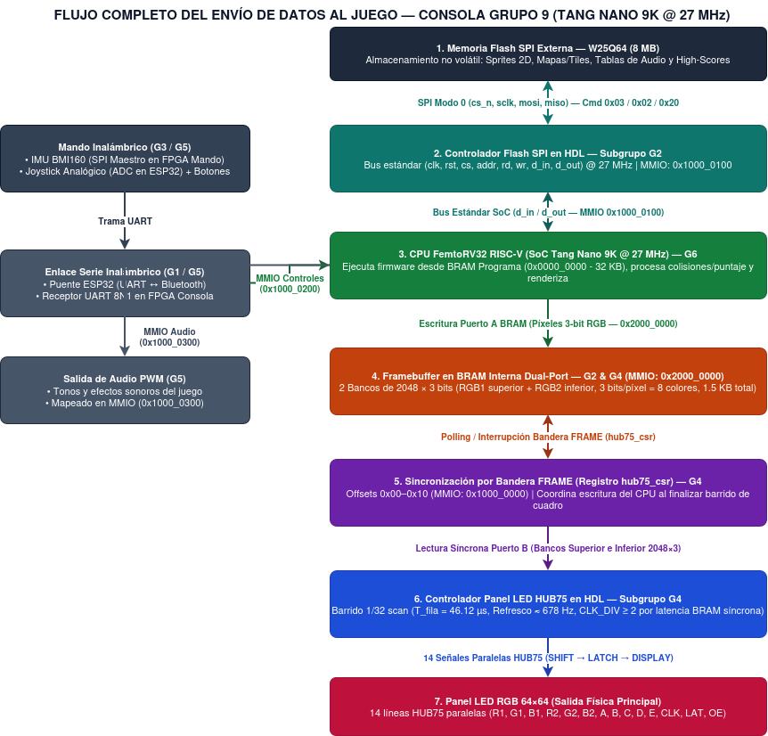
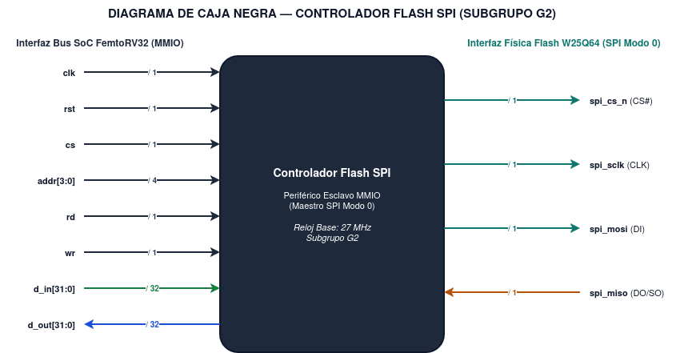
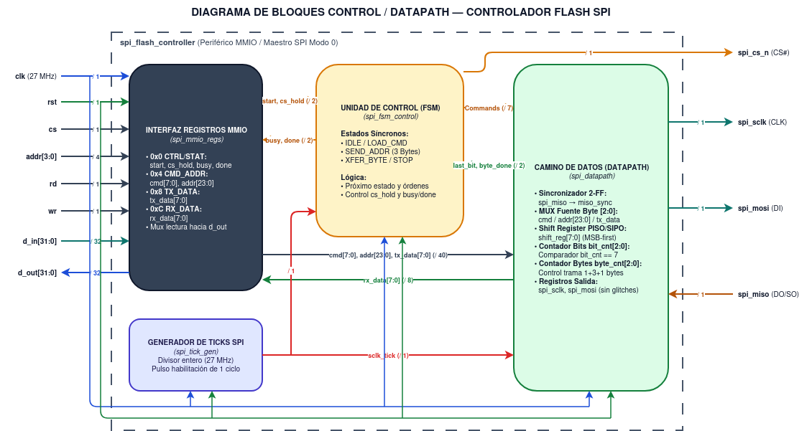
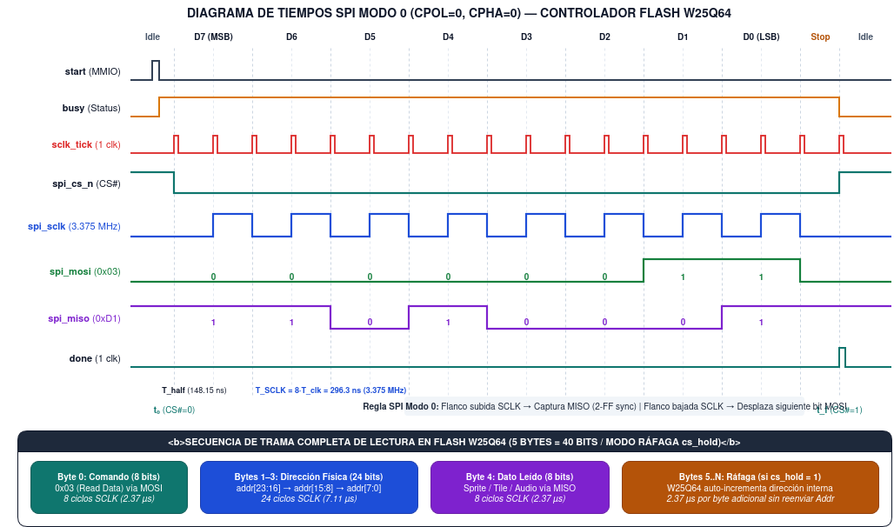
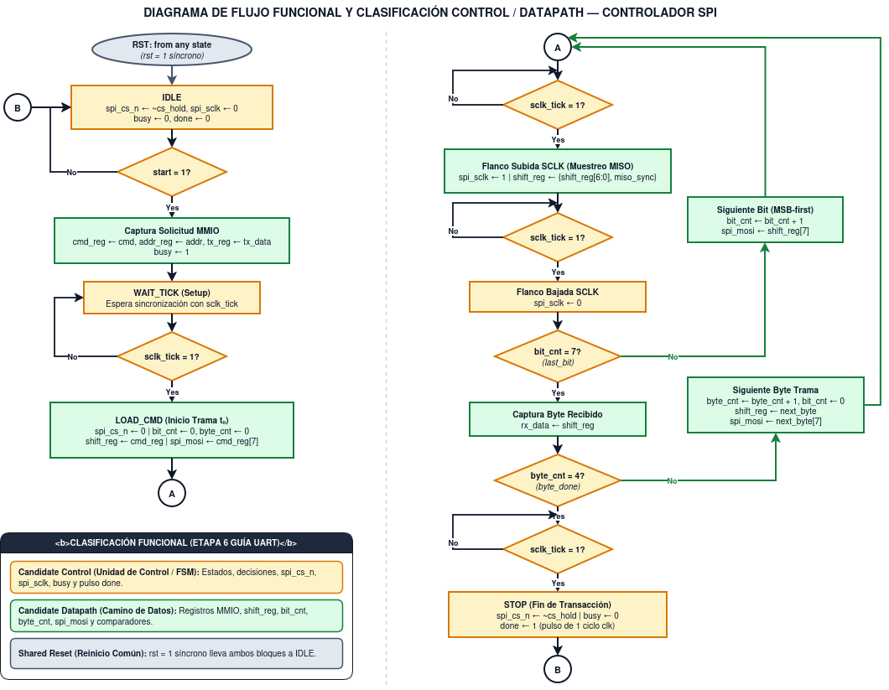
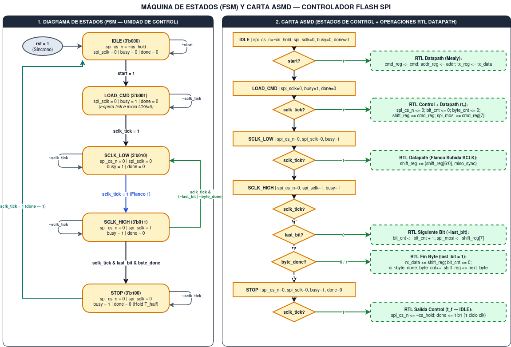
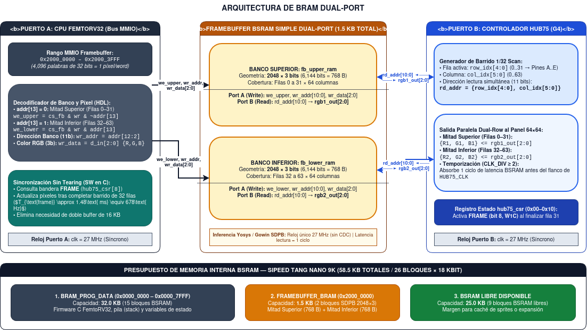

# Arquitectura Hardware y Sistema de Memorias

---

## 1. Delimitación y Selección de Tecnologías de Memoria 

De acuerdo con las restricciones de la plataforma (**Sipeed Tang Nano 9K** con FPGA **Gowin GW1NR-9**, compatible con flujo abierto **Yosys + nextpnr** y núcleo procesador **FemtoRV32 RISC-V** de arquitectura Von Neumann), la memoria interna **BSRAM** constituye un recurso escaso ($58.5\text{ KB}$ totales distribuidos en $26$ bloques de $18\text{ Kbit}$) que debe compartirse entre el firmware del procesador y el búfer de video.

Para evitar agotar la memoria interna y garantizar almacenamiento persistente sin depender de sistemas de archivos ni *IP cores* propietarios, se define una **arquitectura jerárquica de dos niveles**:

### 1.1 Comparativa y Justificación de Tecnologías de Memoria

| Tecnología de Memoria | Componente / Modelo | Capacidad | Protocolo e Interfaz | Pines Físicos | Velocidad / Latencia | Rol y Justificación en la Consola |
| :--- | :--- | :---: | :--- | :---: | :--- | :--- |
| **BSRAM Interna** *(Seleccionada — Nivel 1)* | Bloques `SDPB` integrados en Gowin GW1NR-9 | $58.5\text{ KB}$ ($26 \times 18\text{ Kbit}$) | Bus paralelo síncrono Dual-Port ($27\text{ MHz}$) | $0$ externos (interna) | $1\text{ ciclo}$ de reloj ($37.04\text{ ns}$) | **Memoria de programa/datos** ($32\text{ KB}$) y **Framebuffer Dual-Port** ($1.5\text{ KB}$) alineado con G4. Permite lectura simultánea de video sin bloquear el CPU. |
| **Flash NOR SPI Externa** *(Seleccionada — Nivel 2)* | Winbond `W25Q64JV` (integrada en placa / módulo DIP8) | $8\text{ MB}$ ($64\text{ Mbit}$) | SPI síncrono Modo 0 (`CS#`, `SCLK`, `MOSI`, `MISO`) | $4\text{ pines}$ | $f_{\text{SCLK}} = 3.375\text{ MHz}$ ($2.37\,\mu\text{s/byte}$) | **Almacenamiento no volátil** de *sprites* 2D, mapas/*tiles* de nivel, tablas de efectos sonoros y persistencia de puntajes máximos (*High-Scores*) mediante escritura directa por sector. |
| **PSRAM / SRAM Externa** *(Descartada)* | `APS6404L` / `IS61WV25616` | $8\text{ MB}$ / $512\text{ KB}$ | QSPI / Bus paralelo asíncrono | $6$ a $38\text{ pines}$ | Media / Alta | **Descartada:** El framebuffer de G4 solo ocupa $1.5\text{ KB}$, por lo que cabe íntegramente en BSRAM interna sin gastar pines adicionales ni añadir latencia externa al barrido HUB75. |
| **EEPROM $\text{I}^2\text{C}$** *(Descartada)* | Microchip `AT24C256` | $32\text{ KB}$ ($256\text{ Kbit}$) | $\text{I}^2\text{C}$ (`SDA`, `SCL`) | $2\text{ pines}$ | $100\text{–}400\text{ kHz}$ (lenta) | **Descartada:** Redundante al disponer de $8\text{ MB}$ en la Flash SPI `W25Q64JV`, la cual permite borrar sectores de $4\text{ KB}$ (comando `0x20`) y grabar páginas (comando `0x02`) para guardar los *High-Scores*. |

### 1.2 Presupuesto de BSRAM Interna en la Tang Nano 9K

El reparto físico de los $26$ bloques BSRAM ($58.5\text{ KB}$) del chip Gowin GW1NR-9 queda distribuido de la siguiente forma:

1. **`BRAM_PROG_DATA` (`0x0000_0000` – `0x0000_7FFF`):** **$32.0\text{ KB}$** ($15$ bloques BSRAM) destinados al código ejecutable en C/RISC-V de los juegos arcade retro (definidos por G6), la pila (*stack*) y variables de estado.
2. **`FRAMEBUFFER_BRAM` (`0x2000_0000` – `0x2000_3FFF`):** **$1.5\text{ KB}$** ($2$ bloques BSRAM configurados como *Simple Dual-Port* de $2048 \times 3\text{ bits}$), siguiendo exactamente la especificación del Subgrupo G4.
3. **Reserva Libre Disponible:** **$25.0\text{ KB}$** ($9$ bloques BSRAM) disponibles como margen para tablas de sonido o caché de *sprites* activos en RAM.

---

## 2. Arquitectura del Sistema y Mapa de Memoria MMIO 

### 2.1 Acuerdos de Integración entre Subgrupos

Para garantizar la coherencia estructural de toda la consola, el Subgrupo G2 adopta los siguientes parámetros acordados con los demás equipos:

* **Reloj Maestro Unificado ($27\text{ MHz}$):** Todo el SoC dentro de la FPGA de la consola opera de forma síncrona con el oscilador base de $27\text{ MHz}$ ($T_{\text{clk}} \approx 37.04\text{ ns}$), evitando cruces de dominios de reloj (CDC) entre CPU, memorias y periféricos.
* **Contrato de Bus Estándar del Curso:** Todos los controladores periféricos implementan la interfaz síncrona estándar (`clk`, `rst`, `cs`, `addr`, `rd`, `wr`, `d_in`, `d_out`).
* **Alineación con G4 (Pantalla HUB75):** El framebuffer utiliza **2 bancos de $2048 \times 3\text{ bits}$** (profundidad de color RGB de $3\text{ bits}$ = $8$ colores, $1.5\text{ KB}$ totales) y sincronización mediante la bandera de estado **`FRAME`** del registro `hub75_csr`, eliminando el doble búfer de $16\text{ KB}$ propuesto inicialmente.
* **Alineación con G1, G3 y G5 (Controles Inalámbricos y Audio):** Las entradas del mando (Joystick analógico + IMU `BMI160` por SPI en la FPGA del mando) viajan por enlace serie UART $\rightarrow$ Bluetooth (ESP32) hacia el receptor UART de la consola, mientras que el audio se expone mediante un periférico PWM mapeado en memoria.
* **Recursos de Juego (G6):** Las memorias almacenan activos genéricos para juegos arcade retro simples (*sprites* 2D, mapas de nivel, fuentes y puntajes máximos), sin asumir mecánicas ni títulos no definidos por G6.

### 2.2 Mapa de Memoria Unificado del SoC (FemtoRV32)

| Rango de Direcciones | Tamaño | Subgrupo | Periférico / Región | Descripción de Acceso |
| :--- | :---: | :---: | :--- | :--- |
| `0x0000_0000` – `0x0000_7FFF` | $32\text{ KB}$ | **G2 / G6** | `BRAM_PROG_DATA` | Memoria principal de instrucciones y datos del FemtoRV32 (`.text`, `.data`, `.bss`, *stack*). |
| `0x1000_0000` – `0x1000_0010` | $20\text{ B}$ | **G4** | `HUB75_CSR` | Registros de control y estado del panel LED $64 \times 64$ (incluye bandera `FRAME` para sincronismo). |
| `0x1000_0100` – `0x1000_010C` | $16\text{ B}$ | **G2** | `SPI_FLASH_CTRL` | Registros MMIO del controlador Flash SPI `W25Q64JV` (`CTRL_STAT`, `CMD_ADDR`, `TX_DATA`, `RX_DATA`). |
| `0x1000_0200` – `0x1000_020C` | $16\text{ B}$ | **G1 / G3 / G5** | `UART_INPUT_RX` | Receptor de tramas del mando inalámbrico (ejes del joystick, pulsadores y lecturas del `BMI160`). |
| `0x1000_0300` – `0x1000_0304` | $8\text{ B}$ | **G5** | `AUDIO_PWM` | Control de frecuencia y ciclo útil del generador de efectos sonoros por PWM. |
| `0x2000_0000` – `0x2000_3FFF` | $16\text{ KB}$ (espacio) / $1.5\text{ KB}$ (físico) | **G2 / G4** | `FRAMEBUFFER_BRAM` | Escritura lineal de $4,096$ píxeles ($1\text{ palabra/píxel}$, `d_in[2:0] = {R,G,B}`) repartidos en dos bancos de $2048 \times 3\text{ bits}$. |

### 2.3 Flujo Completo del Envío de Datos al Juego 

El siguiente diagrama ilustra la interacción comportamental y estructural entre las tareas en Hardware (HDL) y Software (C sobre FemtoRV32), desde la lectura de activos en la Flash SPI hasta el despliegue óptico en la matriz LED HUB75:



| Tarea del Sistema | Dominio | Disparo / Sincronización | Flujo de Entrada $\rightarrow$ Salida |
| :--- | :---: | :--- | :--- |
| **Almacenamiento SPI (`Storage`)** | **HW (HDL — G2)** | Escritura en `SPI_CTRL_STAT.start` | Flash `W25Q64` (`MISO`) $\rightarrow$ Registro `SPI_RX_DATA` hacia el CPU. |
| **Recepción de Controles (`Input`)** | **HW + SW (G1/G3/G5)** | Trama UART recibida | Mando inalámbrico (Joystick + `BMI160`) $\rightarrow$ Registro MMIO `0x1000_0200`. |
| **Lógica de Juego (`Game Logic`)** | **SW (C — G6)** | Bucle principal + bandera `FRAME` | Estado de controles y *sprites* $\rightarrow$ Actualización de coordenadas, colisiones y escritura de píxeles en `0x2000_0000`. |
| **Barrido de Video (`Video`)** | **HW (HDL — G4/G2)** | Continuo a $27\text{ MHz}$ ($T_{\text{fila}} = 46.12\,\mu\text{s}$) | Lectura síncrona Puerto B de BSRAM ($2048 \times 3$) $\rightarrow$ $14$ líneas paralelas HUB75 ($\approx 678\text{ Hz}$). |

---

## 3. Diseño del Controlador de Memoria Flash SPI (Metodología FSMD)

Siguiendo el flujo de diseño estructural de la guía del curso (`uart.pdf`), se presenta el diseño completo en hardware del **Controlador Maestro SPI Modo 0** (`spi_flash_controller.v`), separado estrictamente en **Unidad de Control (FSM)** y **Camino de Datos (Datapath)**.

### 3.1 Diagrama de Caja Negra y Especificación de Interfaz

A diferencia de un esquema centrado en el encapsulado del chip de memoria, la caja negra modela el **periférico RTL sintetizable en la FPGA**, exponiendo el bus estándar del procesador a la izquierda y las $4$ líneas físicas del bus SPI a la derecha:



#### Características de la Interfaz
* **Rol:** Periférico esclavo en el bus MMIO del FemtoRV32 y maestro SPI hacia la memoria Flash externa `W25Q64JV`.
* **Protocolo externo:** SPI síncrono **Modo 0** ($\text{CPOL} = 0$, $\text{CPHA} = 0$), transmisión **MSB-first** (bit más significativo primero) sobre $4$ líneas físicas unidireccionales.
* **Reloj y reinicio:** Operación síncrona al reloj maestro del SoC (`clk = 27 MHz`) con reinicio síncrono activo en alto (`rst`).
* **Sincronización con CPU:** Consulta de banderas (`busy` y `done`) en el registro de estado MMIO para gestionar ciclos de espera y encadenar lecturas en ráfaga mediante `cs_hold`.

#### Tabla de Señales de la Caja Negra

| Señal | Dirección | Ancho | Interfaz | Descripción Funcional |
| :--- | :---: | :---: | :---: | :--- |
| `clk` | Entrada | $1\text{ bit}$ | Bus SoC | Reloj maestro del sistema ($27\text{ MHz}$). |
| `rst` | Entrada | $1\text{ bit}$ | Bus SoC | Reinicio síncrono activo en alto (`1` lleva la FSM y el datapath a `IDLE`). |
| `cs` | Entrada | $1\text{ bit}$ | Bus SoC | Selección de periférico activada por el decodificador MMIO (`0x1000_0100`). |
| `addr` | Entrada | $4\text{ bits}$ | Bus SoC | *Offset* de dirección interna para seleccionar los registros del controlador. |
| `rd` | Entrada | $1\text{ bit}$ | Bus SoC | Habilitación de lectura desde el procesador FemtoRV32. |
| `wr` | Entrada | $1\text{ bit}$ | Bus SoC | Habilitación de escritura desde el procesador FemtoRV32. |
| `d_in` | Entrada | $32\text{ bits}$ | Bus SoC | Bus de datos de entrada desde el CPU (comandos SPI, dirección de $24\text{ bits}$ y dato TX). |
| `d_out` | Salida | $32\text{ bits}$ | Bus SoC | Bus de datos de salida hacia el CPU (byte leído de Flash y banderas `busy`/`done`). |
| `spi_cs_n` | Salida | $1\text{ bit}$ | Flash SPI | Selección de chip hacia la `W25Q64JV` (activo en bajo durante la transacción). |
| `spi_sclk` | Salida | $1\text{ bit}$ | Flash SPI | Reloj serie generado por divisor interno para sincronizar bits en `MOSI` y `MISO`. |
| `spi_mosi` | Salida | $1\text{ bit}$ | Flash SPI | Línea serie de salida hacia el pin `DI` de la Flash (envía *opcodes*, direcciones y datos). |
| `spi_miso` | Entrada | $1\text{ bit}$ | Flash SPI | Línea serie de entrada desde el pin `DO/SO` de la Flash (recibe datos y registro de estado). |

---

### 3.2 Diagrama de Bloques Control / Datapath y Condiciones de Diseño

El controlador se descompone en cuatro submódulos síncronos gobernados por el reloj único `clk` ($27\text{ MHz}$): interfaz de registros MMIO (`spi_mmio_regs`), generador de pulsos de habilitación (`spi_tick_gen`), unidad de control (`spi_fsm_control`) y camino de datos (`spi_datapath`):



#### Mapa de Registros Internos (`spi_mmio_regs` — Base `0x1000_0100`)

| Offset | Nombre | Acceso | Campos de Bits | Descripción Funcional |
| :---: | :--- | :---: | :--- | :--- |
| `0x00` | `SPI_CTRL_STAT` | `R/W` | `[0]` `start` (`W1P`)<br>`[1]` `cs_hold` (`R/W`)<br>`[8]` `busy` (`R`)<br>`[9]` `done` (`R`) | Inicia la transacción (`start`), retiene `spi_cs_n` en bajo para lecturas continuas en ráfaga (`cs_hold`) y reporta estado al CPU. |
| `0x04` | `SPI_CMD_ADDR` | `R/W` | `[31:24]` `cmd[7:0]`<br>`[23:0]` `addr[23:0]` | Código de operación SPI (`0x03` Read, `0x06` WREN, `0x02` Page Program, `0x20` Sector Erase) y dirección física de $24\text{ bits}$. |
| `0x08` | `SPI_TX_DATA` | `R/W` | `[7:0]` `tx_data[7:0]` | Byte de datos a transmitir hacia la memoria Flash durante operaciones de escritura o configuración. |
| `0x0C` | `SPI_RX_DATA` | `R` | `[7:0]` `rx_data[7:0]` | Último byte capturado desde `spi_miso` una vez activada la bandera `done`. |

#### Condiciones para el Diseño Interno 
1. **Sincronización de entrada asíncrona (`2-FF`):** La línea `spi_miso` atraviesa una cadena de **dos flip-flops** (`miso_sync`) muestreados a $27\text{ MHz}$ antes de ingresar al registro de desplazamiento, eliminando riesgos de metaestabilidad.
2. **Habilitación síncrona (`sclk_tick`):** El bloque `spi_tick_gen` no genera un reloj derivado, sino un **pulso de habilitación de 1 ciclo de `clk`** cada $N = 4$ ciclos del oscilador principal, manteniendo todo el diseño en un único dominio de reloj.
3. **Salidas registradas sin glitcheo:** Las señales físicas `spi_cs_n`, `spi_sclk` y `spi_mosi` provienen directamente de registros síncronos, evitando transitorios combinacionales (*glitches*) en los pines de la FPGA.

---

### 3.3 Diagrama de Tiempos SPI Modo 0 y Análisis Temporal

El siguiente diagrama detalla la temporización a nivel de ciclo de la transmisión de un byte en **SPI Modo 0** ($\text{CPOL} = 0$, $\text{CPHA} = 0$) junto con la estructura completa de trama de $5\text{ bytes}$ ($1\text{ byte Cmd} + 3\text{ bytes Addr} + 1\text{ byte Data}$) y extensión por ráfaga (`cs_hold = 1`):



#### Secuencia Temporal Paso a Paso
1. **Reposo (`IDLE`):** `spi_cs_n = 1` (si `cs_hold = 0`), `spi_sclk = 0`, `busy = 0` y `done = 0`.
2. **Solicitud MMIO:** El CPU escribe `SPI_CMD_ADDR` (`0x04`) y activa `start = 1` durante un ciclo de `clk`. La FSM sube `busy = 1` y aguarda el siguiente pulso `sclk_tick`.
3. **Inicio y *Setup* ($t_0$):** Al activarse `sclk_tick`, `spi_cs_n` cae a `0` y `spi_mosi` presenta de inmediato el bit más significativo `D7`, asegurando un tiempo de establecimiento de $T_{\text{half}}$ antes del primer flanco de subida de `spi_sclk`.
4. **Muestreo y desplazamiento (`D7` $\rightarrow$ `D0`):** En cada **flanco de subida** de `spi_sclk`, el datapath captura `miso_sync`; en cada **flanco de bajada**, actualiza `spi_mosi` con el siguiente bit.
5. **Parada y *Hold* ($t_f$):** Tras el último flanco de bajada (`D0`), `spi_cs_n` se retiene en bajo durante un semiperíodo adicional ($T_{\text{half}}$). En $t_f$, `spi_cs_n` retorna a `~cs_hold`, `busy` baja a `0` y `done` emite un pulso de **1 ciclo de `clk`**.

#### Cálculos Temporales y Ancho de Banda ($f_{\text{clk}} = 27\text{ MHz}$, $N = 4$)

* **Período del reloj maestro del sistema ($T_{\text{clk}}$):**
  $$T_{\text{clk}} = \frac{1}{27\text{ MHz}} \approx 37.04\text{ ns}$$

* **Semiperíodo y frecuencia de operación del reloj SPI ($f_{\text{SCLK}}$):**
  $$T_{\text{half}} = 4 \cdot T_{\text{clk}} \approx 148.15\text{ ns}$$
  $$T_{\text{SCLK}} = 2 \cdot T_{\text{half}} = 8 \cdot T_{\text{clk}} \approx 296.30\text{ ns} \implies f_{\text{SCLK}} = \frac{27\text{ MHz}}{8} = 3.375\text{ MHz}$$

* **Latencia del sincronizador `2-FF`:** El doble flip-flop introduce un retardo fijo de $2 \cdot T_{\text{clk}} \approx 74.07\text{ ns}$. Dado que cada semiperíodo dura $148.15\text{ ns}$, el dato `miso_sync` queda estable al menos $74\text{ ns}$ antes de cada flanco de captura.

* **Tiempos de transferencia hacia el juego:**
  * **Tiempo por byte ($8\text{ bits}$):** $T_{\text{byte}} = 8 \cdot T_{\text{SCLK}} \approx 2.37\,\mu\text{s}$.
  * **Lectura simple de $1\text{ byte}$ (`Cmd 0x03 + 24-bit Addr + 1-byte Data = 40 bits`):**
    $$T_{\text{lectura\_1B}} = 40 \cdot T_{\text{SCLK}} + 2 \cdot T_{\text{half}} \approx 12.15\,\mu\text{s}$$
  * **Carga en ráfaga de un *sprite* de $16 \times 16\text{ píxeles}$ ($256\text{ bytes}$ con `cs_hold = 1`):**
    $$T_{\text{sprite } 16\times 16} = (4 + 256) \cdot T_{\text{byte}} \approx 616.3\,\mu\text{s} \quad (< 3.7\% \text{ del presupuesto de } 16.67\text{ ms a } 60\text{ Hz})$$

---

### 3.4  Diagrama de Flujo Funcional y Clasificación FSMD

El flujo comportamental síncrono del controlador clasifica cada operación según su pertenencia a la **Unidad de Control (`Candidate Control` en amarillo)**, al **Camino de Datos (`Candidate Datapath` en verde)** o al **Reinicio Compartido (`Shared Reset` en gris)**:



* **Multiplexación automática de trama (`next_byte`):** Al completarse cada byte (`bit_cnt == 7`), el datapath incrementa `byte_cnt` ($0$ a $4$) y precarga secuencialmente `addr_reg[23:16]`, `addr_reg[15:8]`, `addr_reg[7:0]` y `tx_reg[7:0]` sin insertar ciclos muertos entre bytes.
* **Encadenamiento en ráfaga (`cs_hold`):** Cuando el procesador mantiene `cs_hold = 1`, la señal `spi_cs_n` permanece en bajo al regresar a `IDLE`, permitiendo leer bloques continuos de memoria aprovechando el autoincremento interno de direcciones de la `W25Q64JV`.

---

### 3.5 Carta ASMD, FSM de Control y Tabla de Transiciones RT

A partir de la clasificación funcional se obtiene la **Máquina de Estados Finitos (FSM)** de $5$ estados codificados en $3\text{ bits}$ (`state[2:0]`) y su **Carta ASMD** con las transferencias entre registros (RTL) condicionales en cada flanco de subida de `clk`:



#### Tabla de Estados y Transferencias RTL (`spi_fsm_control` + `spi_datapath`)

| Estado Actual | Código | Condición de Transición | Estado Siguiente | Salidas de Control (`Moore` / `Mealy`) | Transferencias RTL en Datapath |
| :--- | :---: | :--- | :---: | :--- | :--- |
| **`IDLE`** | `3'b000` | `rst = 1` $\lor$ `start = 0` | `IDLE` | `spi_cs_n = ~cs_hold`, `spi_sclk = 0`, `busy = 0`, `done = 0` | Mantiene registros sin cambios |
| **`IDLE`** | `3'b000` | `start = 1` | `LOAD_CMD` | `busy <= 1` | `cmd_reg <= cmd`, `addr_reg <= addr`, `tx_reg <= tx_data` |
| **`LOAD_CMD`** | `3'b001` | `sclk_tick = 0` | `LOAD_CMD` | `spi_sclk = 0`, `busy = 1`, `done = 0` | Espera sincronización con frontera de `sclk_tick` |
| **`LOAD_CMD`** | `3'b001` | `sclk_tick = 1` | `SCLK_LOW` | `spi_cs_n <= 0` ($t_0$) | `bit_cnt <= 0`, `byte_cnt <= 0`, `shift_reg <= cmd_reg`, `spi_mosi <= cmd_reg[7]` |
| **`SCLK_LOW`** | `3'b010` | `sclk_tick = 0` | `SCLK_LOW` | `spi_cs_n = 0`, `spi_sclk = 0`, `busy = 1` | Mantiene `spi_mosi` estable (*setup* $T_{\text{half}}$) |
| **`SCLK_LOW`** | `3'b010` | `sclk_tick = 1` | `SCLK_HIGH` | `spi_sclk <= 1` (Flanco $\uparrow$) | `shift_reg <= {shift_reg[6:0], miso_sync}` |
| **`SCLK_HIGH`** | `3'b011` | `sclk_tick = 0` | `SCLK_HIGH` | `spi_cs_n = 0`, `spi_sclk = 1`, `busy = 1` | Mantiene nivel alto de `spi_sclk` |
| **`SCLK_HIGH`** | `3'b011` | `sclk_tick & ~last_bit` | `SCLK_LOW` | `spi_sclk <= 0` (Flanco $\downarrow$) | `bit_cnt <= bit_cnt + 1`, `spi_mosi <= shift_reg[7]` |
| **`SCLK_HIGH`** | `3'b011` | `sclk_tick & last_bit & ~byte_done` | `SCLK_LOW` | `spi_sclk <= 0` (Flanco $\downarrow$) | `rx_data <= shift_reg`, `byte_cnt <= byte_cnt + 1`, `bit_cnt <= 0`, `shift_reg <= next_byte`, `spi_mosi <= next_byte[7]` |
| **`SCLK_HIGH`** | `3'b011` | `sclk_tick & last_bit & byte_done` | `STOP` | `spi_sclk <= 0` (Flanco $\downarrow$) | `rx_data <= shift_reg` (captura byte final) |
| **`STOP`** | `3'b100` | `sclk_tick = 0` | `STOP` | `spi_cs_n = 0`, `spi_sclk = 0`, `busy = 1` | Retiene `spi_cs_n = 0` (*hold* $T_{\text{half}}$) |
| **`STOP`** | `3'b100` | `sclk_tick = 1` | `IDLE` | `spi_cs_n <= ~cs_hold`, `done <= 1` ($t_f$) | Pulso `done` activo durante $1$ ciclo de `clk` |

---

## 4. Inferencia y Manejo de BRAM Dual-Port 

Para resolver el acceso concurrente entre la escritura de píxeles por software (FemtoRV32) y la lectura continua de barrido multiplexado $1/32\text{ scan}$ del panel LED $64 \times 64$ (Subgrupo G4), la memoria de video se implementa mediante **dos bancos independientes de BSRAM *Simple Dual-Port*** de $2048 \times 3\text{ bits}$ ($1.5\text{ KB}$ totales):



### 4.1 Partición Física de Bancos (`0x2000_0000` – `0x2000_3FFF`)

| Rango MMIO | Banco Físico BSRAM | Filas del Panel $64 \times 64$ | Geometría | Puerto A (Escritura CPU) | Puerto B (Lectura HUB75 G4) |
| :--- | :---: | :---: | :---: | :--- | :--- |
| `0x2000_0000` – `0x2000_1FFF` | `fb_upper_ram` | Filas `0` a `31` (Superior) | $2048 \times 3\text{ bits}$ ($768\text{ B}$) | `we_upper = cs_fb & wr & ~addr[13]`<br>`wr_addr = addr[12:2]`, `din = d_in[2:0]` | `rd_addr = {row_idx[4:0], col_idx[5:0]}`<br>Salida `rgb1_out[2:0]` $\rightarrow$ `{R1, G1, B1}` |
| `0x2000_2000` – `0x2000_3FFF` | `fb_lower_ram` | Filas `32` a `63` (Inferior) | $2048 \times 3\text{ bits}$ ($768\text{ B}$) | `we_lower = cs_fb & wr & addr[13]`<br>`wr_addr = addr[12:2]`, `din = d_in[2:0]` | `rd_addr = {row_idx[4:0], col_idx[5:0]}`<br>Salida `rgb2_out[2:0]` $\rightarrow$ `{R2, G2, B2}` |

### 4.2 Plantilla de Inferencia Síncrona en Verilog (Yosys / Gowin `SDPB`)

El siguiente bloque utiliza patrones síncronos estándar reconocidos nativamente por **Yosys** para inferir bloques físicos **BSRAM** de Gowin sin recurrir a primitivas propietarias ni lógica distribuida:

```verilog
module framebuffer_dual_port (
    input  wire        clk,        // Reloj maestro unificado del SoC (27 MHz)
    // Puerto A: Interfaz de escritura MMIO desde FemtoRV32
    input  wire        cs_fb,      // Selección región 0x2000_0000
    input  wire        wr,         // Habilitación de escritura bus CPU
    input  wire [13:2] addr_a,     // Índice lineal de píxel (0..4095)
    input  wire [2:0]  din_a,      // Color RGB de 3 bits {R, G, B}
    // Puerto B: Interfaz de lectura simultánea hacia Controlador HUB75 (G4)
    input  wire [10:0] rd_addr_b,  // {row_idx[4:0], col_idx[5:0]} (0..2047)
    output reg  [2:0]  rgb1_out,   // Píxel mitad superior -> {R1, G1, B1}
    output reg  [2:0]  rgb2_out    // Píxel mitad inferior -> {R2, G2, B2}
);

    // Dos bloques BSRAM independientes de 2048 x 3 bits (1.5 KB totales)
    reg [2:0] fb_upper_ram [0:2047];
    reg [2:0] fb_lower_ram [0:2047];

    wire we_upper = cs_fb & wr & ~addr_a[13];
    wire we_lower = cs_fb & wr &  addr_a[13];

    // Puerto A: Escritura síncrona desde el procesador FemtoRV32
    always @(posedge clk) begin
        if (we_upper)
            fb_upper_ram[addr_a[12:2]] <= din_a;
        if (we_lower)
            fb_lower_ram[addr_a[12:2]] <= din_a;
    end

    // Puerto B: Lectura síncrona dual-row para el barrido HUB75 (latencia = 1 ciclo)
    always @(posedge clk) begin
        rgb1_out <= fb_upper_ram[rd_addr_b];
        rgb2_out <= fb_lower_ram[rd_addr_b];
    end

endmodule
```

### 4.3 Coherencia Temporal con el Controlador HUB75 (G4)

* **Cumplimiento de latencia (`CLK_DIV` $\ge 2$):** Como `rgb1_out` y `rgb2_out` se registran en el flanco de subida de `clk` ($27\text{ MHz}$), el dato queda válido exactamente $1\text{ ciclo}$ ($37.04\text{ ns}$) después de presentar `rd_addr_b`, satisfaciendo la condición de diseño de G4 (`CLK_DIV` $\ge 2$) para que `HUB75_CLK` siempre desplace píxeles estables.
* **Prevención de *tearing* mediante bandera `FRAME`:** Dado que el barrido completo de las $32$ filas tarda $T_{\text{frame}} = 32 \times 46.12\,\mu\text{s} \approx 1.48\text{ ms}$ ($\approx 678\text{ Hz}$), el software consulta el bit `FRAME` de `hub75_csr` antes de escribir el siguiente cuadro, logrando actualizaciones limpias sin duplicar la memoria de video.

---

## 5. Protocolos

### 5.1 Lista de Protocolos Técnicos 

1. **SPI Maestro Modo 0 ($\text{CPOL} = 0$, $\text{CPHA} = 0$):** Temporización de muestreo/desplazamiento, juego de instrucciones estándar JEDEC para memorias Flash NOR (`0x03` Read Data, `0x06` Write Enable, `0x02` Page Program, `0x20` Sector Erase $4\text{ KB}$, `0x05` Read Status Register) y modo ráfaga continuo con `CS#` retenido.
2. **Bus Periférico Síncrono MMIO:** Decodificación de direcciones de $32\text{ bits}$, generación de pulsos de disparo de un ciclo (`W1P`) y sincronización por consulta de estado (`polling` de `busy`/`done`).
3. **Inferencia de Memoria BSRAM Dual-Port (`SDPB`):** Reglas de descripción en Verilog síncrono para síntesis abierta en Yosys sobre arquitectura Gowin GW1N.

### 5.2 Preguntas

* **¿Qué pasa al encender y cómo se cargan los activos del juego?** Tras el reinicio síncrono (`rst`), el FemtoRV32 arranca ejecutando el gestor principal desde `BRAM_PROG_DATA` (`0x0000_0000`), inicializa los registros de video (`hub75_csr`) y consulta los *sprites* o tablas almacenados en sectores fijos de la Flash SPI `W25Q64JV` mediante el controlador MMIO (`0x1000_0100`).
* **¿Cómo persisten los *High-Scores* sin sistema de archivos?** Se reserva un sector dedicado de $4\text{ KB}$ en la parte alta de la Flash `W25Q64JV` (por ejemplo, dirección física `0x7F_0000`). Cuando se supera un récord, el firmware envía la secuencia `0x06` (*Write Enable*) $\rightarrow$ `0x20` (*Sector Erase*) $\rightarrow$ `0x06` $\rightarrow$ `0x02` (*Page Program*) escribiendo la estructura binaria de puntajes directamente en memoria no volátil.
