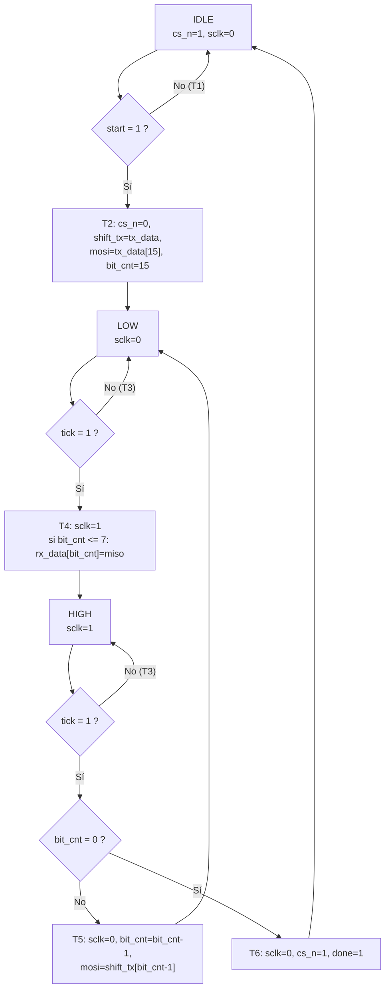

 
Valor por defecto en cada flanco: `done <= 0`. Lo que no aparece mantiene su valor.
 
| ID | Estado y condición | Transferencias en el flanco | Próximo estado |
|---|---|---|---|
| T0 | `rst_n = 0` | `state=0, cs_n=1, sclk=0, mosi=0, done=0, bit_cnt=0, rx_data=0, clk_cnt=0` | IDLE |
| T1 | IDLE, `start = 0` | `cs_n=1, sclk=0` | IDLE |
| T2 | IDLE, `start = 1` | `cs_n=0, shift_tx=tx_data, mosi=tx_data[15], bit_cnt=15, state=1` | LOW |
| T3 | LOW/HIGH, `tick = 0` | `clk_cnt=clk_cnt+1` | mismo |
| T4 | LOW, `tick = 1` | `sclk=1`; si `bit_cnt<=7`: `rx_data[bit_cnt]=miso`; `clk_cnt=0` | HIGH |
| T5 | HIGH, `tick = 1`, `bit_cnt != 0` | `sclk=0, bit_cnt=bit_cnt-1, mosi=shift_tx[bit_cnt-1]`; `clk_cnt=0` | LOW |
| T6 | HIGH, `tick = 1`, `bit_cnt = 0` | `sclk=0, cs_n=1, state=0, done=1`; `clk_cnt=0` | IDLE |
| D1 | `cs_n = 1` | `clk_cnt=0` | — |
 
Notas de temporización:
- `bit_cnt` es el índice del bit que está en la línea. En la subida se muestrea con ese índice; en la bajada se decrementa. Por eso `rx_data[bit_cnt] <= miso` captura el bit correcto.
- En T2 `cs_n` baja en el mismo flanco que acepta `start`; el divisor empieza a contar al flanco siguiente, así que la primera subida de SCLK llega 14 ciclos después.
- En T5 `mosi` usa el valor anterior de `bit_cnt`.
