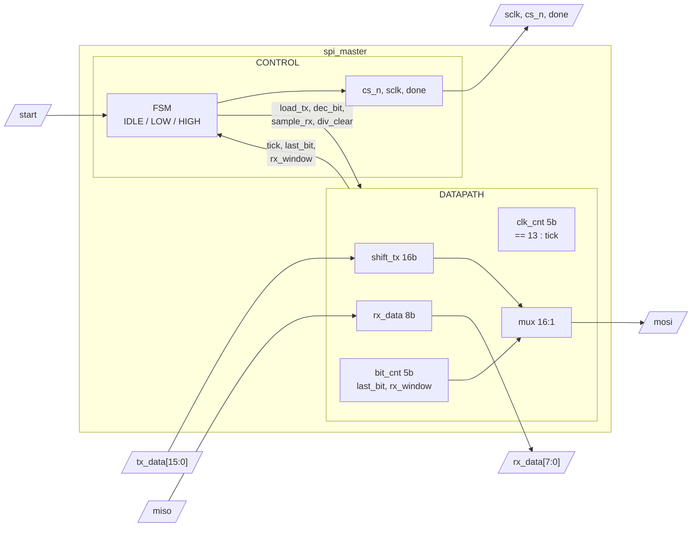

| Elemento | Clase | Función |
|---|---|---|
| `state` (1 bit) + fase de `sclk` | Control | Selecciona la transferencia |
| `cs_n`, `done`, `sclk` | Control | Salidas generadas por el controlador |
| `clk_cnt` (5 b) + comparador `== 13` | Datapath | Divisor: genera `tick` cada 14 ciclos |
| `shift_tx` (16 b) | Datapath | Trama a enviar |
| `bit_cnt` (5 b) + comparadores `== 0` y `<= 7` | Datapath | Índice de bit; condiciones `last_bit` y `rx_window` |
| Mux 16:1 `shift_tx[bit_cnt-1]` | Datapath | Siguiente bit hacia `mosi` |
| `rx_data` (8 b) | Datapath | Registro de recepción |
 
Órdenes control → datapath: `load_tx`, `dec_bit`, `sample_rx`, `div_clear`.
Condiciones datapath → control: `tick`, `last_bit`, `rx_window`.

