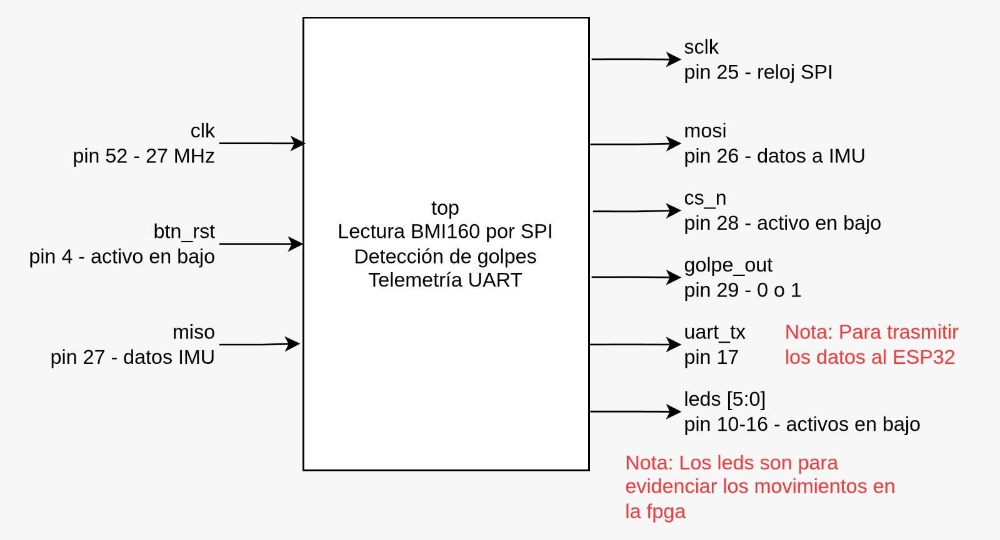
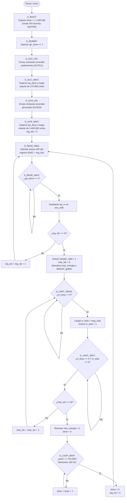
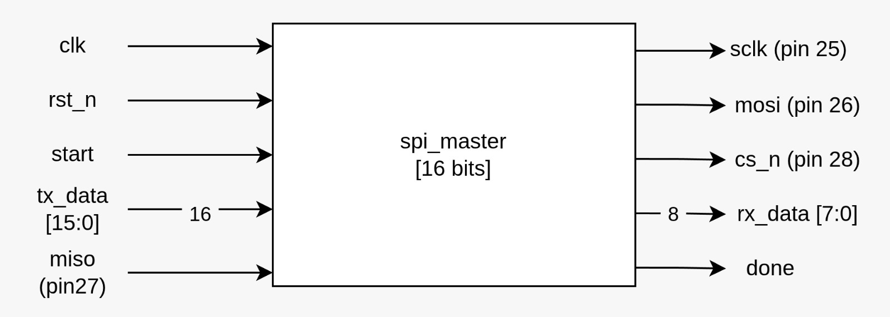
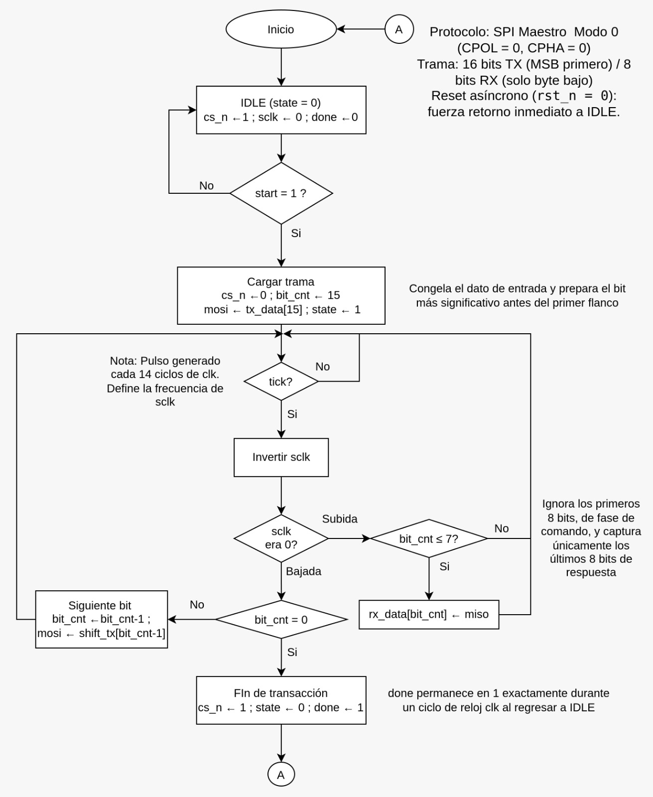
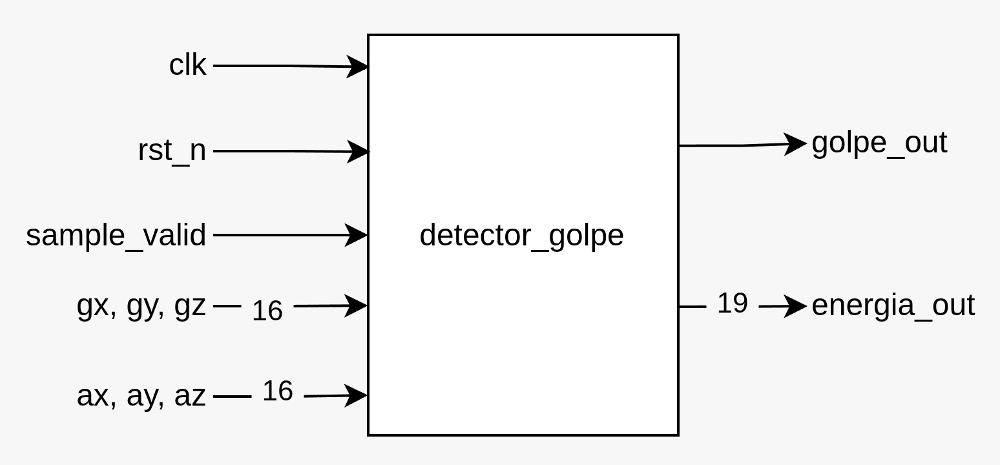
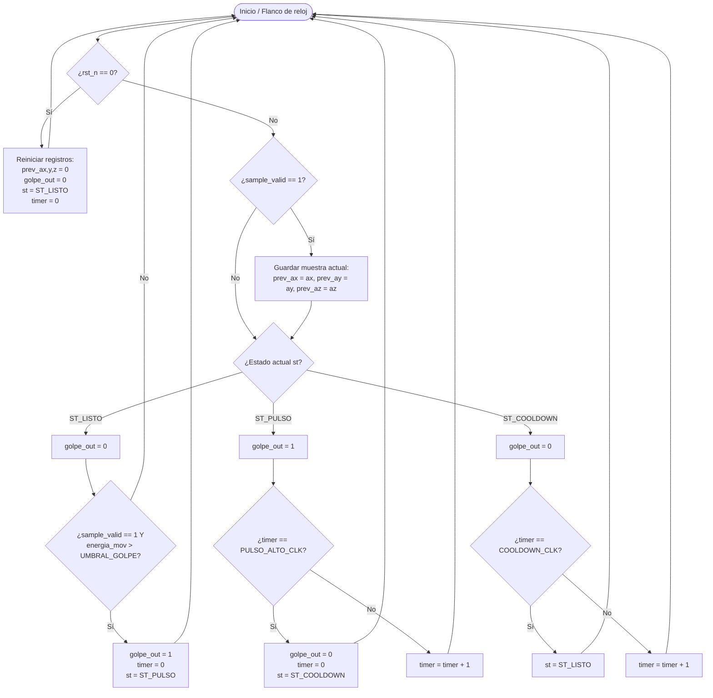
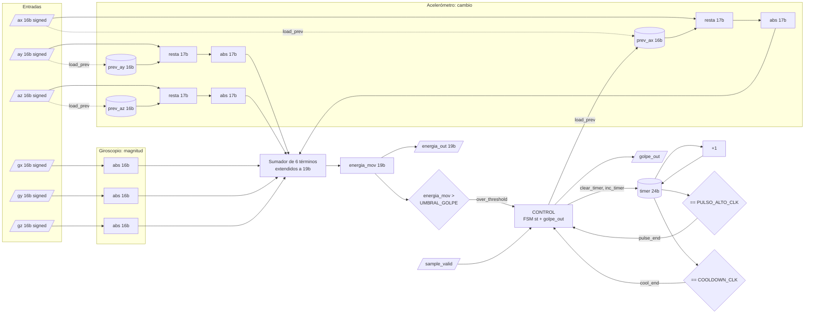
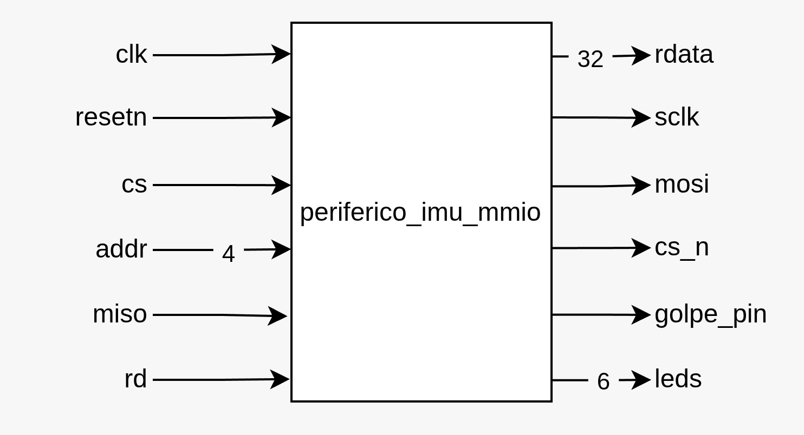
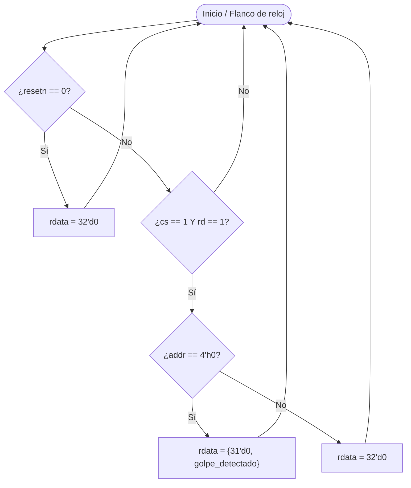

# Desarrollo de los módulos – IMU BMI160

## Índice
- [top.v](#topv)
- [spi_master.v](#spi_masterv)
- [detector_golpe.v](#detector_golpev)
- [periferico_imu_mmio.v](#periferico_imu_mmiov)

---

## top.v
### Descripción
El archivo `top.v` es el módulo principal del sistema. Conecta la IMU BMI160 con la FPGA
Tang Nano 9K y decide si ocurrió un golpe o giro brusco. Para eso:

1. Configura la IMU por SPI (modo 0): enciende el acelerómetro y el giroscopio.
2. Lee de forma periódica los 6 ejes (gx, gy, gz, ax, ay, az), recorriendo los
   registros `0x0C` a `0x17` con 12 lecturas de un byte.
3. Entrega las muestras al módulo `detector_golpe`, que calcula la energía del
   movimiento y activa `golpe_out` cuando supera el umbral.
4. Envía por UART (115200 baudios) un mensaje con la energía máxima y el estado
   del golpe, con el formato `E:XXXXX GOLPE:x`. Este canal sirve para transmitir
   los datos al ESP32.
5. Enciende los 6 LEDs de la placa mientras hay un golpe, para evidenciar
   visualmente los movimientos en la FPGA.
   
El módulo instancia tres bloques: `spi_master` (comunicación con la IMU),
`uart_tx` (telemetría) y `detector_golpe` (decisión), y los coordina con una
máquina de estados.

### Caja negra

| Señal | Dirección | Ancho | Pin | Descripción |
| :--- | :--- | :---: | :---: | :--- |
| `clk` | Entrada | 1 | 52 | Reloj del sistema, 27 MHz |
| `btn_rst` | Entrada | 1 | 4 | Reset asíncrono, activo en bajo |
| `miso` | Entrada | 1 | 27 | Datos de la IMU hacia la FPGA |
| `sclk` | Salida | 1 | 25 | Reloj SPI (~964 kHz) |
| `mosi` | Salida | 1 | 26 | Datos de la FPGA hacia la IMU |
| `cs_n` | Salida | 1 | 28 | Chip select de la IMU, activo en bajo |
| `golpe_out` | Salida | 1 | 29 | 1 durante 150 ms al detectar un golpe, 0 en reposo |
| `uart_tx` | Salida | 1 | 17 | Serial a 115200 baudios hacia el ESP32 |
| `leds[5:0]` | Salida | 6 | 10 a 16 | LEDs de la placa, activos en bajo |

### Diagrama de flujo / FSM

### Datapath

### Observaciones

## spi_master.v
### Descripción
`spi_master.v` es el controlador físico del protocolo SPI en modo 0 (CPOL=0,
CPHA=0). Se encarga de comunicarse con la IMU BMI160 enviando y recibiendo una
trama de 16 bits por cada transacción:

- **Primer byte (bits 15 a 8):** comando. El bit 15 indica lectura (1) o
  escritura (0) y los otros 7 bits son la dirección del registro.
- **Segundo byte (bits 7 a 0):** en una escritura es el dato a escribir; en una
  lectura es un relleno (`00`) mientras la IMU responde por `miso`.

Funcionamiento:

1. En reposo mantiene `cs_n = 1` y `sclk = 0`.
2. Al recibir un pulso en `start`, baja `cs_n`, carga `tx_data` y coloca en
   `mosi` el bit más significativo.
3. Un divisor de reloj genera un tick cada 14 ciclos de `clk`, y en cada tick
   `sclk` cambia de nivel. Esto da un reloj SPI de 27 MHz / 28 ≈ 964 kHz.
4. En cada flanco de subida de `sclk` captura `miso`, pero solo guarda los
   últimos 8 bits, que corresponden a la respuesta de la IMU, en `rx_data`
   (primero el bit más significativo).
5. En cada flanco de bajada de `sclk` desplaza el siguiente bit hacia `mosi`.
6. Al terminar los 16 bits sube `cs_n` y genera un pulso de un ciclo en `done`.
   En ese momento `rx_data` tiene el byte recibido.

Una transacción completa dura 16 × 28 = 448 ciclos de reloj, unos 16,6 µs.

### Caja negra

| Señal | Dirección | Ancho | Descripción |
| :--- | :--- | :---: | :--- |
| `clk` | Entrada | 1 | Reloj del sistema, 27 MHz |
| `rst_n` | Entrada | 1 | Reset asíncrono, activo en bajo |
| `start` | Entrada | 1 | Pulso que inicia una transacción |
| `tx_data` | Entrada | 16 | Trama a enviar: comando (8 bits) + dato (8 bits) |
| `miso` | Entrada | 1 | Datos de la IMU hacia la FPGA (pin 27) |
| `sclk` | Salida | 1 | Reloj SPI, ~964 kHz (pin 25) |
| `mosi` | Salida | 1 | Datos de la FPGA hacia la IMU (pin 26) |
| `cs_n` | Salida | 1 | Chip select, activo en bajo (pin 28) |
| `rx_data` | Salida | 8 | Byte recibido de la IMU, válido cuando `done = 1` |
| `done` | Salida | 1 | Pulso de un ciclo al terminar la transacción |

Los números de pin se asignan en `top.v` y en el archivo `tangnano9k.cst`.

### Diagrama de flujo / FSM

### Datapath

### Observaciones

## detector_golpe.v
### Descripción
`detector_golpe.v` decide si hubo un golpe o giro brusco a partir de las
muestras del giroscopio y del acelerómetro. No le importa la dirección del
movimiento, solo su intensidad.

**Cálculo de la energía del movimiento**
Cada vez que llega una muestra nueva (`sample_valid = 1`) calcula:

    energia = |gx| + |gy| + |gz| + |ax - ax_prev| + |ay - ay_prev| + |az - az_prev|

- Del giroscopio usa el valor absoluto de cada eje, porque la velocidad angular
  ya es cero en reposo.
- Del acelerómetro usa el valor absoluto del cambio respecto a la muestra
  anterior. Así la aceleración constante (como la gravedad) se cancela y solo
  se mide la variación.
- El resultado sale por `energia_out` (19 bits), que `top.v` usa para reportar
  la energía máxima por UART.

**Máquina de estados**
| Estado | Salida `golpe_out` | Qué hace |
| :--- | :---: | :--- |
| `ST_LISTO` | 0 | Espera una muestra válida con `energia > UMBRAL_GOLPE`. Al detectarla, sube `golpe_out` y pasa a `ST_PULSO`. |
| `ST_PULSO` | 1 | Mantiene `golpe_out` en alto durante `PULSO_ALTO_CLK` ciclos (150 ms) y pasa a `ST_COOLDOWN`. |
| `ST_COOLDOWN` | 0 | Ignora nuevas detecciones durante `COOLDOWN_CLK` ciclos (100 ms) y vuelve a `ST_LISTO`. |

El pulso largo y el tiempo de enfriamiento actúan como filtro anti-rebote: un
solo golpe físico genera un único pulso, aunque la energía se mantenga alta
varias muestras seguidas.

### Caja negra

| Señal | Dirección | Ancho | Descripción |
| :--- | :--- | :---: | :--- |
| `clk` | Entrada | 1 | Reloj del sistema, 27 MHz |
| `rst_n` | Entrada | 1 | Reset asíncrono, activo en bajo |
| `sample_valid` | Entrada | 1 | Pulso que indica que hay una muestra nueva de los 6 ejes |
| `gx`, `gy`, `gz` | Entrada | 16 c/u | Velocidad angular en cada eje, con signo (complemento a 2) |
| `ax`, `ay`, `az` | Entrada | 16 c/u | Aceleración en cada eje, con signo (complemento a 2) |
| `golpe_out` | Salida | 1 | 1 mientras hay un golpe detectado, 0 en reposo |
| `energia_out` | Salida | 19 | Energía del movimiento de la muestra actual |

### Parámetros
| Parámetro | Valor | Equivale a | Función |
| :--- | :---: | :---: | :--- |
| `UMBRAL_GOLPE` | 65000 | - | Energía mínima para considerar un golpe. Subirlo exige golpes más fuertes. |
| `PULSO_ALTO_CLK` | 4 050 000 | 150 ms | Duración de `golpe_out` en alto |
| `COOLDOWN_CLK` | 2 700 000 | 100 ms | Tiempo en que se ignoran nuevas detecciones |

### Diagrama de flujo / FSM

### Datapath

### Observaciones

## periferico_imu_mmio.v
### Descripción
`periferico_imu_mmio.v` es la interfaz que permite conectar el sistema de
detección de golpes al procesador RISC-V (FemtoRV) mediante Memory-Mapped I/O
(MMIO). Desde el punto de vista del procesador, el detector pasa a ser un
registro que se lee con una instrucción de carga, como cualquier otro periférico
del SoC.

Funcionamiento:

1. Instancia internamente el módulo `top` (que a su vez contiene `spi_master`,
   `detector_golpe` y `uart_tx`). Le pasa `clk` y `resetn`, y saca hacia afuera
   los pines SPI (`sclk`, `mosi`, `miso`, `cs_n`) y los LEDs.
2. La señal `golpe_out` de `top` se expone como `golpe_pin`, para tener la
   salida digital directa en un pin físico.
3. El procesador lee el estado del golpe con un acceso de lectura al periférico.
   La lectura es síncrona y registrada: cuando `cs = 1` y `rd = 1`, en el
   siguiente flanco de `clk` se actualiza `rdata`.

**Mapa de registros**
| Offset (`addr`) | Acceso | Contenido de `rdata` |
| :---: | :---: | :--- |
| `4'h0` | Lectura | Bit 0 = `golpe_detectado` (1 = golpe activo, 0 = reposo). Bits 31 a 1 en 0. |
| Otros | Lectura | `32'd0` |

El módulo no tiene registros de escritura. Mientras no haya una lectura,
`rdata` conserva el último valor leído.

**Conexión con el bus**
- `cs` es el selector de la región de memoria del periférico. Se genera en el
  decodificador de direcciones del SoC (por ejemplo, `mem_addr[31:16] == 16'h0044`).
- `addr` es el desplazamiento dentro de la región, tomado de `mem_addr[5:2]`.
- `rd` es el pulso de lectura del procesador.

### Caja negra

| Señal | Dirección | Ancho | Descripción |
| :--- | :--- | :---: | :--- |
| `clk` | Entrada | 1 | Reloj del sistema, 27 MHz |
| `resetn` | Entrada | 1 | Reset asíncrono, activo en bajo |
| `cs` | Entrada | 1 | Selección de la región del periférico en el bus |
| `addr` | Entrada | 4 | Desplazamiento local del registro (`mem_addr[5:2]`) |
| `rd` | Entrada | 1 | Pulso de lectura del procesador |
| `miso` | Entrada | 1 | Datos de la IMU hacia la FPGA |
| `rdata` | Salida | 32 | Dato leído por el procesador (bit 0 = golpe) |
| `sclk` | Salida | 1 | Reloj SPI hacia la IMU |
| `mosi` | Salida | 1 | Datos de la FPGA hacia la IMU |
| `cs_n` | Salida | 1 | Chip select de la IMU, activo en bajo |
| `golpe_pin` | Salida | 1 | Salida digital directa del golpe detectado |
| `leds[5:0]` | Salida | 6 | LEDs de la placa, activos en bajo |

### Diagrama de flujo / FSM

### Observaciones
