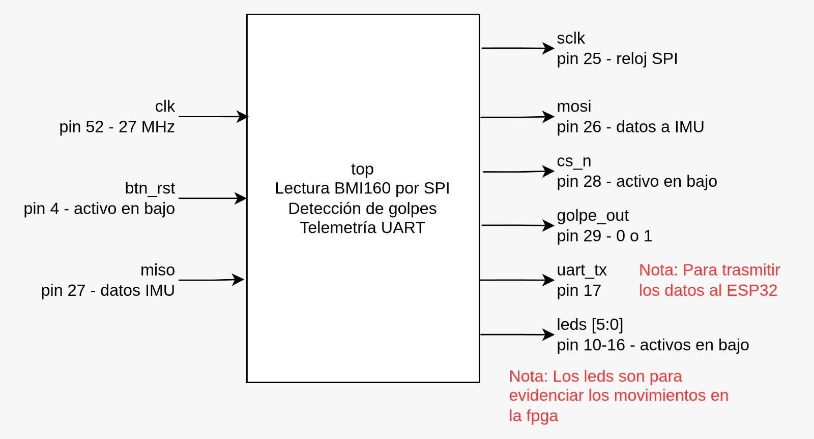

# Desarrollo de los módulos – IMU BMI160 (Grupo 3)

## Índice
- [top.v](#topv)
- [spi_master.v](#spi_masterv)
- [detector_golpe.v](#detector_golpev)
- [periferico_imu_mmio.v](#periferico_imu_mmiov)

---

## top.v
### Descripción
El archivo `top.v` es el módulo principal del sistema. Conecta la IMU BMI160 con la FPGA
Tang Nano 9K y decide si ocurrió un golpe o giro brusco. Para eso:

1. Configura la IMU por SPI (modo 0): enciende el acelerómetro y el giroscopio.
2. Lee de forma periódica los 6 ejes (gx, gy, gz, ax, ay, az), recorriendo los
   registros `0x0C` a `0x17` con 12 lecturas de un byte.
3. Entrega las muestras al módulo `detector_golpe`, que calcula la energía del
   movimiento y activa `golpe_out` cuando supera el umbral.
4. Envía por UART (115200 baudios) un mensaje con la energía máxima y el estado
   del golpe, con el formato `E:XXXXX GOLPE:x`. Este canal sirve para transmitir
   los datos al ESP32.
5. Enciende los 6 LEDs de la placa mientras hay un golpe, para evidenciar
   visualmente los movimientos en la FPGA.
   
El módulo instancia tres bloques: `spi_master` (comunicación con la IMU),
`uart_tx` (telemetría) y `detector_golpe` (decisión), y los coordina con una
máquina de estados.

### Caja negra

| Señal | Dirección | Ancho | Pin | Descripción |
| :--- | :--- | :---: | :---: | :--- |
| `clk` | Entrada | 1 | 52 | Reloj del sistema, 27 MHz |
| `btn_rst` | Entrada | 1 | 4 | Reset asíncrono, activo en bajo |
| `miso` | Entrada | 1 | 27 | Datos de la IMU hacia la FPGA |
| `sclk` | Salida | 1 | 25 | Reloj SPI (~964 kHz) |
| `mosi` | Salida | 1 | 26 | Datos de la FPGA hacia la IMU |
| `cs_n` | Salida | 1 | 28 | Chip select de la IMU, activo en bajo |
| `golpe_out` | Salida | 1 | 29 | 1 durante 150 ms al detectar un golpe, 0 en reposo |
| `uart_tx` | Salida | 1 | 17 | Serial a 115200 baudios hacia el ESP32 |
| `leds[5:0]` | Salida | 6 | 10 a 16 | LEDs de la placa, activos en bajo |

### Diagrama de flujo / FSM

### Datapath

### Observaciones

## spi_master.v
### Descripción
Qué hace el módulo, en 2 o 3 líneas.

### Caja negra

### Diagrama de flujo / FSM

### Datapath

### Observaciones

## detector_golpe.v
### Descripción
Qué hace el módulo, en 2 o 3 líneas.

### Caja negra

### Diagrama de flujo / FSM

### Datapath

### Observaciones

## periferico_imu_mmio.v
### Descripción
Qué hace el módulo, en 2 o 3 líneas.

### Caja negra

### Diagrama de flujo / FSM

### Datapath

### Observaciones
