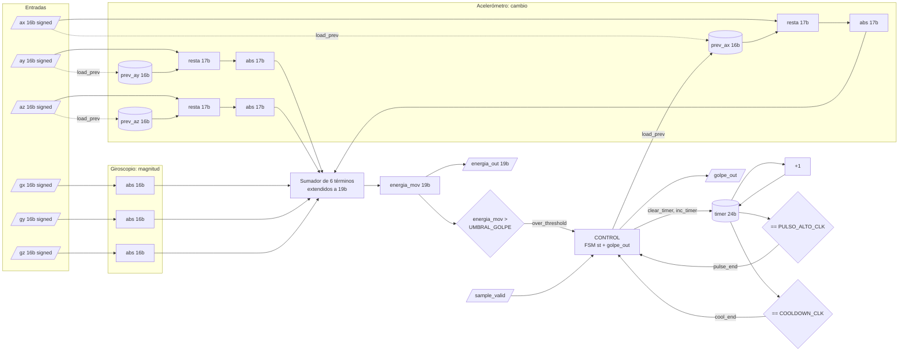
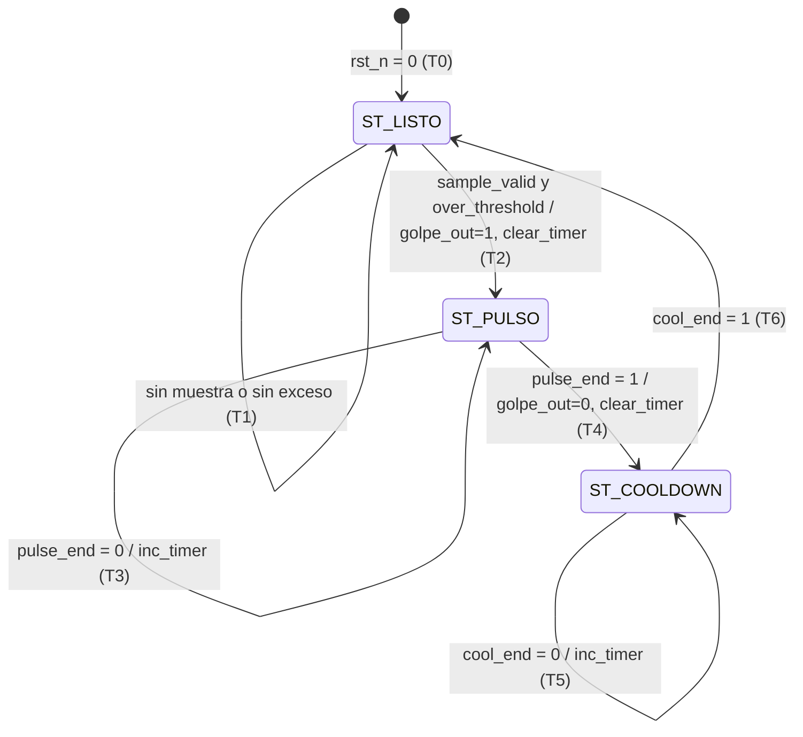

# Datapath y control de `detector_golpe.v`

Reloj `clk` = 27 MHz, reset asíncrono activo en bajo (`rst_n`). Parámetros: `UMBRAL_GOLPE = 65000`, `PULSO_ALTO_CLK = 4 050 000` (150 ms), `COOLDOWN_CLK = 2 700 000` (100 ms).

> Este diagrama se derivó de `detector_golpe.v` ya implementado. El diagrama de flujo está en `../diagrama_detector_golpe.md`.

## 1. Clasificación control / datapath

| Elemento | Clase | Función |
|---|---|---|
| `st` (2 bits) | Control | Estado: `ST_LISTO`, `ST_PULSO`, `ST_COOLDOWN` |
| `golpe_out` | Control | Salida registrada del controlador |
| `sample_valid` | Entrada de control | Pulso de muestra nueva |
| Valor absoluto de `gx`, `gy`, `gz` (3 × 16 b) | Datapath | Complemento a 2 si el bit de signo es 1 |
| `prev_ax`, `prev_ay`, `prev_az` (3 × 16 b) | Datapath | Muestra anterior del acelerómetro |
| Restadores `ax - prev_ax`, etc. (3 × 17 b) | Datapath | Cambio de aceleración |
| Valor absoluto de las 3 diferencias (3 × 17 b) | Datapath | Magnitud del cambio |
| Sumador de 6 términos | Datapath | `energia_mov` (19 b) |
| Comparador `energia_mov > UMBRAL_GOLPE` | Datapath | Condición `over_threshold` |
| `timer` (24 b) + incrementador | Datapath | Cuenta ciclos de pulso y de enfriamiento |
| Comparadores `timer == PULSO_ALTO_CLK` y `timer == COOLDOWN_CLK` | Datapath | Condiciones `pulse_end` y `cool_end` |

Órdenes control → datapath: `load_prev` (`sample_valid`), `clear_timer`, `inc_timer`.
Condiciones datapath → control: `over_threshold`, `pulse_end`, `cool_end`.

## 2. Datapath

Notas del datapath:

- **Anchos:** el máximo teórico es 3 · 32 768 + 3 · 65 535 = 294 909, que cabe en 19 bits (máximo 524 287). No hay desbordamiento.
- **`prev_*` se actualiza con `sample_valid` en cualquier estado.** La energía de la muestra actual usa el `prev` anterior al flanco, porque la carga es no bloqueante. Por eso la resta mide el cambio entre dos muestras consecutivas.
- **Primera muestra tras el reset:** `prev_* = 0`, así que la diferencia es la aceleración absoluta (≈ 16 384 por 1 g). Queda por debajo del umbral (65 000) en reposo, por lo que no genera un golpe falso.

## 3. FSM

## 4. Tabla de transferencias

Transferencia concurrente en cualquier estado: si `sample_valid = 1`, `prev_ax=ax, prev_ay=ay, prev_az=az` (`load_prev`). Lo que no aparece mantiene su valor.

| ID | Estado y condición | Transferencias en el flanco | Próximo estado |
|---|---|---|---|
| T0 | `rst_n = 0` | `prev_*=0, golpe_out=0, timer=0` | ST_LISTO |
| T1 | ST_LISTO, `!(sample_valid ∧ over_threshold)` | `golpe_out=0` | ST_LISTO |
| T2 | ST_LISTO, `sample_valid ∧ over_threshold` | `golpe_out=1, timer=0` | ST_PULSO |
| T3 | ST_PULSO, `timer != PULSO_ALTO_CLK` | `golpe_out=1, timer=timer+1` | ST_PULSO |
| T4 | ST_PULSO, `timer == PULSO_ALTO_CLK` | `golpe_out=0, timer=0` | ST_COOLDOWN |
| T5 | ST_COOLDOWN, `timer != COOLDOWN_CLK` | `golpe_out=0, timer=timer+1` | ST_COOLDOWN |
| T6 | ST_COOLDOWN, `timer == COOLDOWN_CLK` | `golpe_out=0` | ST_LISTO |

## 5. Observaciones

- En `ST_PULSO` y `ST_COOLDOWN` las muestras nuevas se ignoran para la decisión, aunque `prev_*` se siga actualizando. Eso actúa como antirrebote: un golpe físico produce un solo pulso.
- El contador llega hasta el valor del parámetro inclusive, así que el pulso dura `PULSO_ALTO_CLK + 1` ciclos (≈ 150 ms).
- `energia_out` se usa en `top.v` para guardar la energía máxima entre envíos UART.
