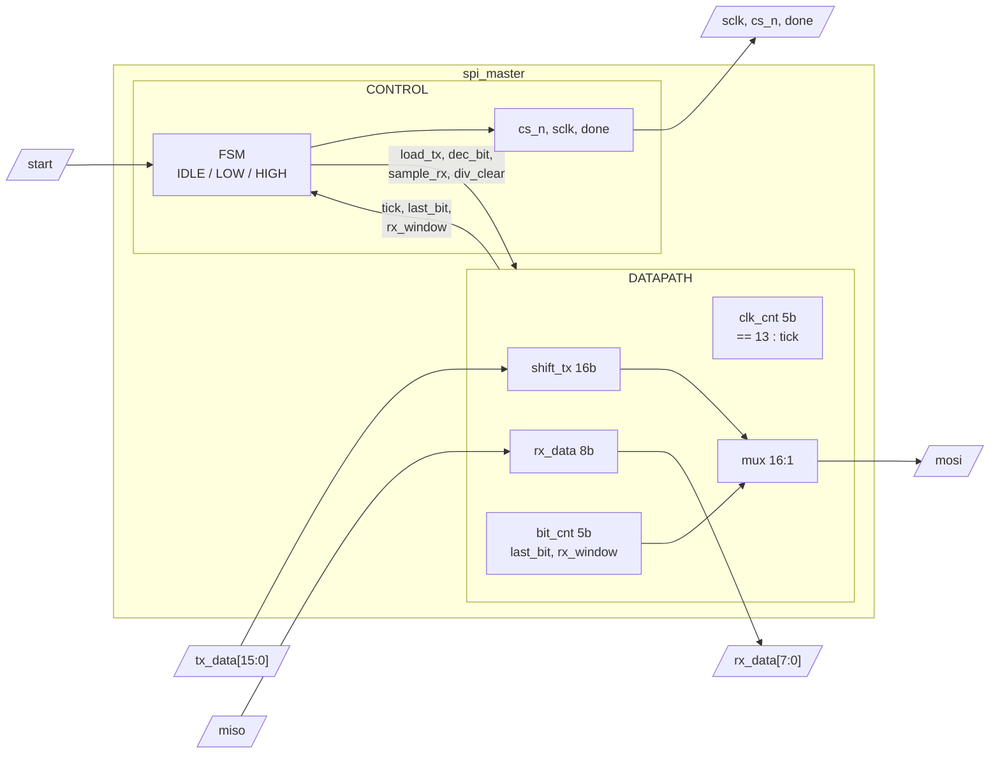
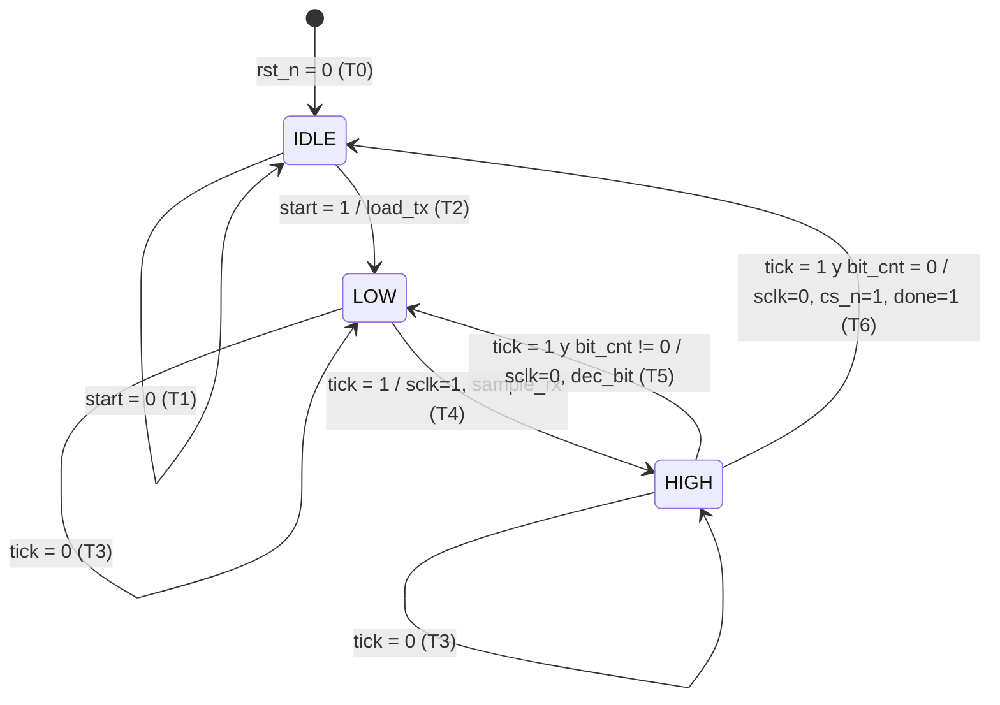
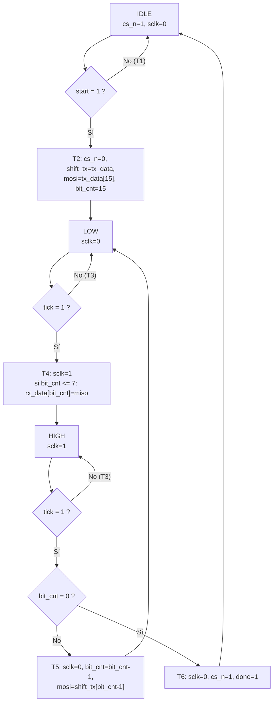
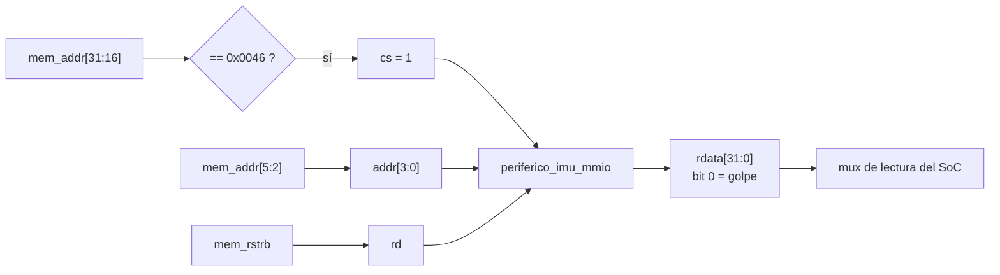
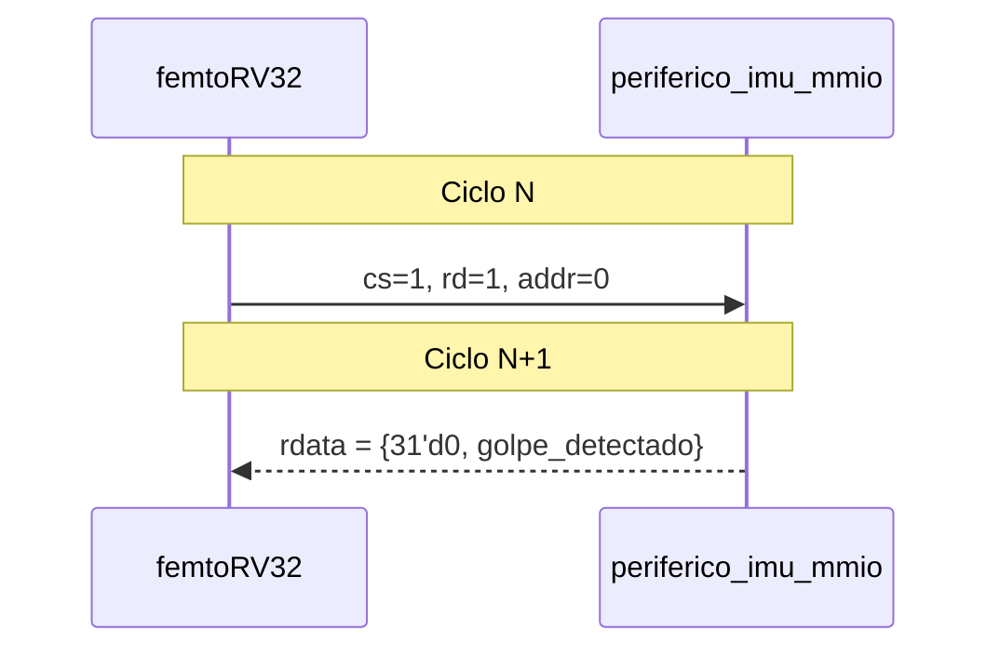

# Diseño del `spi_master` y del periférico MMIO (G3 — IMU BMI160)
 
Reloj `clk` = 27 MHz. SPI modo 0 (CPOL=0, CPHA=0), trama de 16 bits, reset asíncrono activo en bajo.
 
> Los diagramas de este documento se derivaron de `spi_master.v` ya implementado y probado en la Tang Nano 9K. El testbench `tb_spi_master_tabla.v` se escribió a partir de la tabla de transferencias de la sección 4.
 
## 1. Clasificación control / datapath
 
| Elemento | Clase | Función |
|---|---|---|
| `state` (1 bit) + fase de `sclk` | Control | Selecciona la transferencia |
| `cs_n`, `done`, `sclk` | Control | Salidas generadas por el controlador |
| `clk_cnt` (5 b) + comparador `== 13` | Datapath | Divisor: genera `tick` cada 14 ciclos |
| `shift_tx` (16 b) | Datapath | Trama a enviar |
| `bit_cnt` (5 b) + comparadores `== 0` y `<= 7` | Datapath | Índice de bit; condiciones `last_bit` y `rx_window` |
| Mux 16:1 `shift_tx[bit_cnt-1]` | Datapath | Siguiente bit hacia `mosi` |
| `rx_data` (8 b) | Datapath | Registro de recepción |
 
Órdenes control → datapath: `load_tx`, `dec_bit`, `sample_rx`, `div_clear`.
Condiciones datapath → control: `tick`, `last_bit`, `rx_window`.
 
## 2. Arquitectura control / datapath
 

 
## 3. FSM
 
| Estado | `state` | `sclk` | Salidas |
|---|---|---|---|
| IDLE | 0 | 0 | `cs_n = 1` |
| LOW (espera subida) | 1 | 0 | `cs_n = 0` |
| HIGH (espera bajada) | 1 | 1 | `cs_n = 0` |
 

 
## 4. ASMD y tabla de transferencias
 

 
Valor por defecto en cada flanco: `done <= 0`. Lo que no aparece mantiene su valor.
 
| ID | Estado y condición | Transferencias en el flanco | Próximo estado |
|---|---|---|---|
| T0 | `rst_n = 0` | `state=0, cs_n=1, sclk=0, mosi=0, done=0, bit_cnt=0, rx_data=0, clk_cnt=0` | IDLE |
| T1 | IDLE, `start = 0` | `cs_n=1, sclk=0` | IDLE |
| T2 | IDLE, `start = 1` | `cs_n=0, shift_tx=tx_data, mosi=tx_data[15], bit_cnt=15, state=1` | LOW |
| T3 | LOW/HIGH, `tick = 0` | `clk_cnt=clk_cnt+1` | mismo |
| T4 | LOW, `tick = 1` | `sclk=1`; si `bit_cnt<=7`: `rx_data[bit_cnt]=miso`; `clk_cnt=0` | HIGH |
| T5 | HIGH, `tick = 1`, `bit_cnt != 0` | `sclk=0, bit_cnt=bit_cnt-1, mosi=shift_tx[bit_cnt-1]`; `clk_cnt=0` | LOW |
| T6 | HIGH, `tick = 1`, `bit_cnt = 0` | `sclk=0, cs_n=1, state=0, done=1`; `clk_cnt=0` | IDLE |
| D1 | `cs_n = 1` | `clk_cnt=0` | — |
 
Notas de temporización:
- `bit_cnt` es el índice del bit que está en la línea. En la subida se muestrea con ese índice; en la bajada se decrementa. Por eso `rx_data[bit_cnt] <= miso` captura el bit correcto.
- En T2 `cs_n` baja en el mismo flanco que acepta `start`; el divisor empieza a contar al flanco siguiente, así que la primera subida de SCLK llega 14 ciclos después.
- En T5 `mosi` usa el valor anterior de `bit_cnt`.
## 5. Tiempos (de `ondas_spi.vcd`)
 
| Evento | Ciclos desde la aceptación de `start` | Tiempo |
|---|---|---|
| `cs_n` baja, `mosi` = bit 15 | 0 | 0 |
| 1.ª subida de SCLK | 14 | 518 ns |
| 1.ª bajada de SCLK | 28 | 1,04 µs |
| Subida del bit 7 (empieza a guardarse `rx_data`) | 238 | 8,8 µs |
| `cs_n` sube, `done` = 1 durante 1 ciclo | 448 | 16,6 µs |
 
SCLK = 27 MHz / 28 ≈ 964 kHz.

```mermaid
gantt
    title Transacción SPI de 16 bits (ciclos de clk desde start)
    dateFormat  X
    axisFormat  %s
    section cs_n en bajo
    cs_n = 0 (448 ciclos)        :0, 448
    section SCLK
    Medio período inicial (14)   :0, 14
    Bit 15 y bit 14 (ignorados)  :14, 56
    Bits 13 a 8 (ignorados)      :56, 224
    Bits 7 a 0 (se guardan)      :224, 448
    section done
    done = 1 (1 ciclo)           :crit, 448, 449
```
 

 
## 6. Periférico MMIO (`periferico_imu_mmio.v`)
 
El IMU corre solo; el procesador solo consulta el estado. Por eso **no hay START/BUSY/DONE** visibles.
 
| Señal | Dir. | Ancho | Descripción |
|---|---|---|---|
| `clk`, `resetn` | E | 1 | 27 MHz, activo en bajo |
| `cs` | E | 1 | Región del periférico |
| `addr` | E | 4 | `mem_addr[5:2]` |
| `rd` | E | 1 | Lectura |
| `rdata` | S | 32 | Dato leído |
| `miso` | E | 1 | Desde el BMI160 |
| `sclk`, `mosi`, `cs_n` | S | 1 | Hacia el BMI160 |
| `golpe_pin` | S | 1 | Salida directa de golpe |
| `leds[5:0]` | S | 6 | LEDs testigo |
 
Mapa de registros (región tentativa `0x0046`, sujeta al acuerdo con G5 y G6):
 
| Dirección | `addr` | Acceso | Contenido |
|---|---|---|---|
| `0x0046_0000` | `4'h0` | R | bit 0 = `golpe_detectado`; bits 31..1 = 0 |
| resto | otros | R | `32'd0` |
 
Decodificador: `cs = (mem_addr[31:16] == 16'h0046)`.
 

 
Tiempos del handshake de lectura:
 

 
`golpe_out` dura 150 ms (4 050 000 ciclos), por lo que el sondeo no pierde el evento.
 
Alternativa pendiente de acuerdo con G1, G5 y G6: enviar el bit de golpe dentro de la trama del mando hacia `JOY*_DATA[17]`, sin región propia.
 
