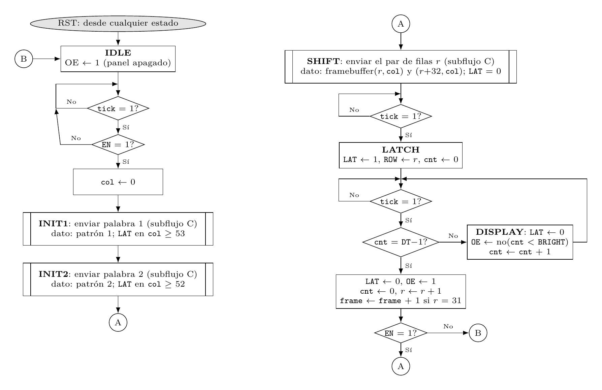
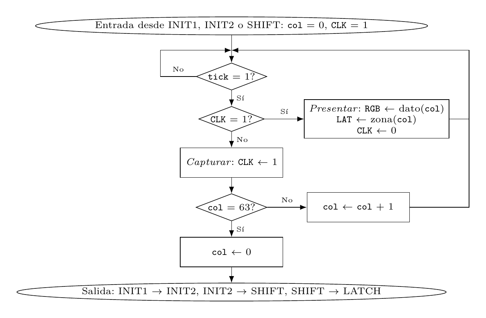
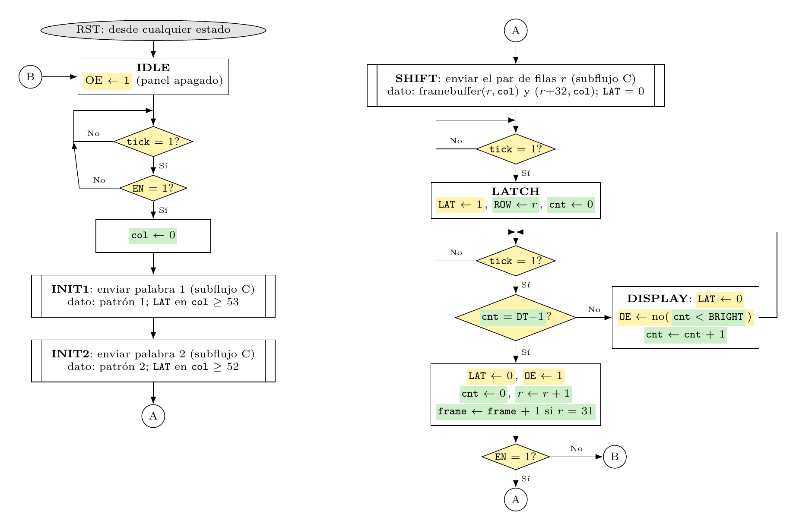
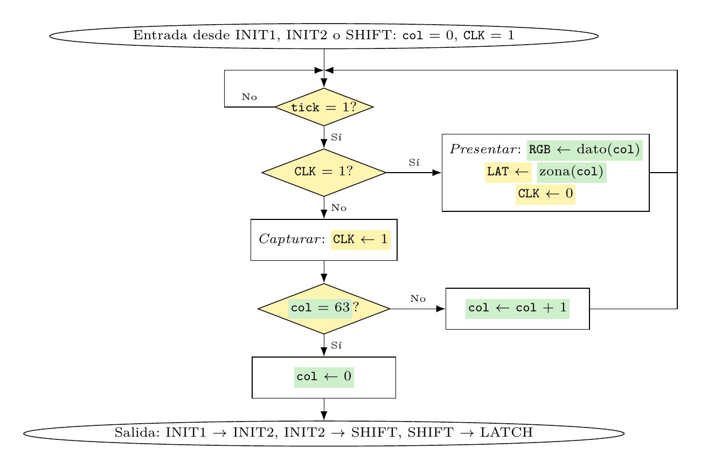
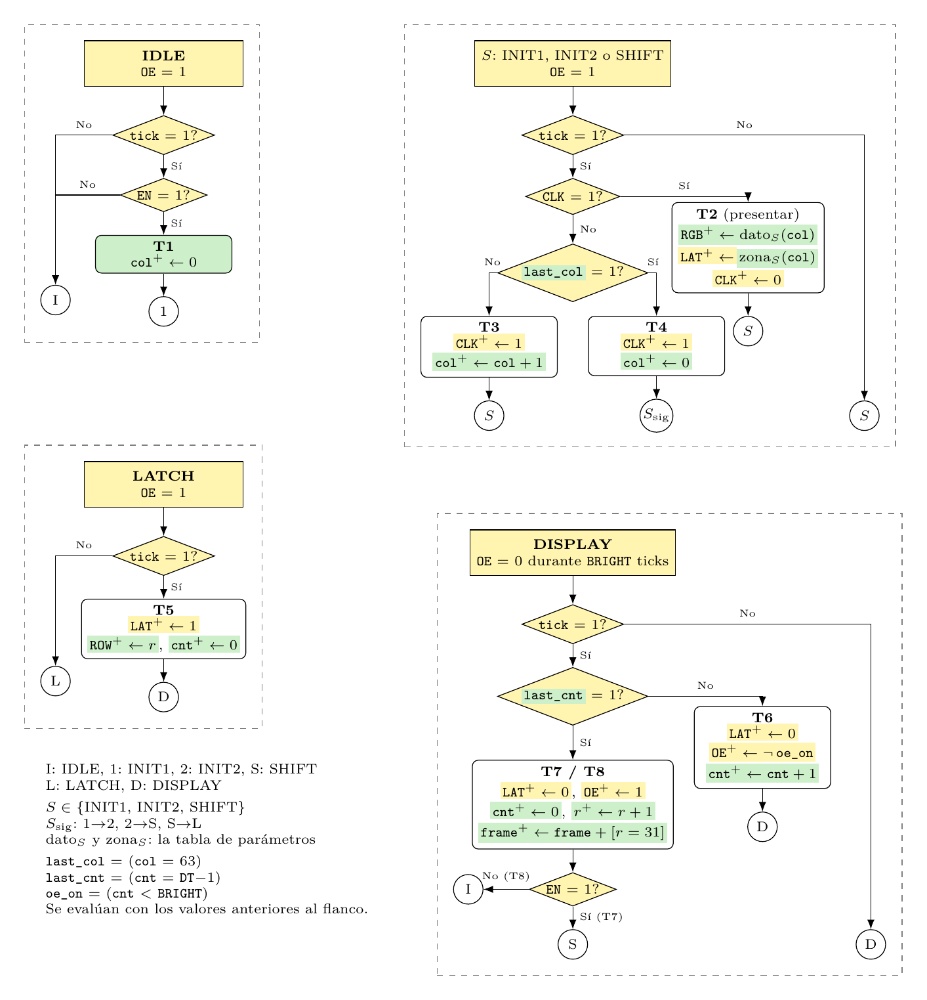
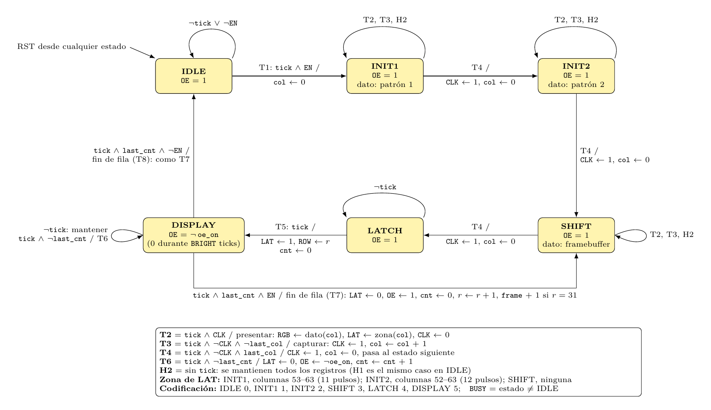
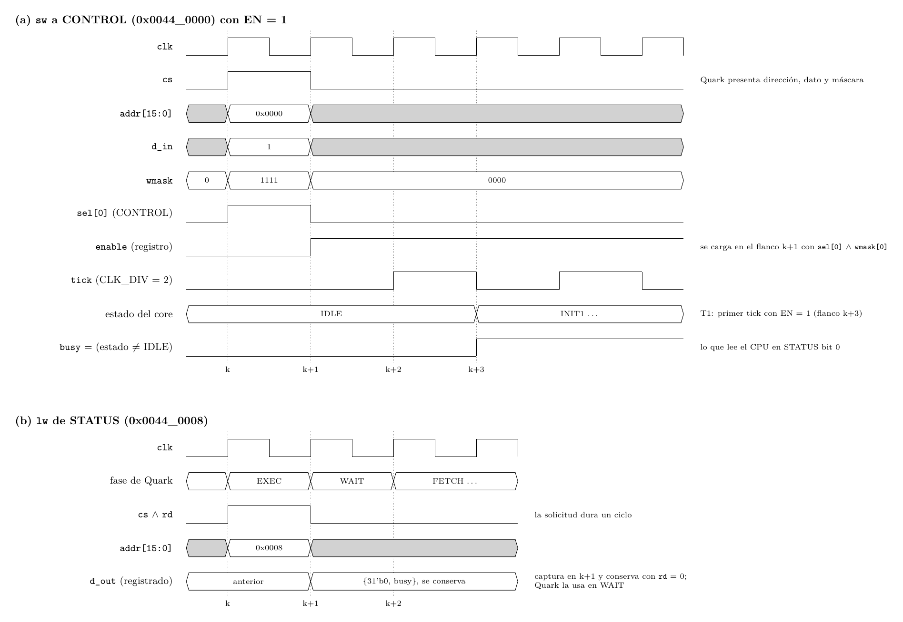

# Periférico: Pantalla RGB Matrix

## Controlador HUB75
### 1. Diagrama de caja negra

El periférico controla la matriz **Seengreat RGB Matrix P3.0-64 × 64** desde la FPGA de la consola (pruebas en la Tang Nano 9K, GW1NR-9). El panel tiene 4096 píxeles con un LED rojo, uno verde y uno azul cada uno, se conecta por la interfaz paralela **HUB75** y usa barrido 1/32: solo hay dos filas encendidas a la vez, la fila r y la fila r + 32. El panel no guarda la imagen; la debe refrescar continuamente el controlador, cientos de veces por segundo. 

Para el resto de la consola el controlador es un periférico del SoC: el procesador le escribe registros por el bus estándar del curso y el periférico genera solo las señales del panel.


Figura 1: Vista externa del controlador. A la izquierda, las entradas del bus del procesador; a la derecha, la salida de lectura hacia el bus y las líneas del conector **HUB75** hacia el panel. Cada línea lleva una marca diagonal y un número que indica su ancho en bits.

#### Características de la interfaz
- Un panel de 64×64 píxeles RGB (1R1G1B), barrido 1/32.
- Seis líneas de color en paralelo: `R1` `G1` `B1` para las filas 0–31 y `R2` `G2` `B2` para las filas 32–63.
- Cinco líneas de dirección de fila `A B C D E` (32 pares de filas).
- Tres líneas de control: `CLK` (desplazamiento), `LAT` (latch) y `OE` (encendido, activo en bajo).
- Las 14 líneas son salidas: la placa no permite leer nada del panel.
- Color de un bit por canal (RGB111): ocho colores.
- La imagen se guarda dentro del periférico (4096 píxeles); el procesador escribe píxeles y el periférico refresca el panel por su cuenta.
- Interfaz con el procesador según el contrato del curso: `clk`, `rst`, `d_in[31:0]`, `cs`, `addr`, `rd`, `wr` y `d_out[31:0]`.
- Configuración del chip driver del panel al habilitar el periférico.
- Brillo ajustable y contador de cuadros mostrados.

Los 64 píxeles de cada fila se envían secuencialmente, uno por pulso de `CLK` y por seis líneas a la vez; no existe un bus de 64 líneas hacia el panel.

#### Alcance de la vista externa
La vista de caja negra muestra únicamente las líneas externas. En la siguiente sección se propone la división interna. Quedan pendientes la frecuencia de `CLK`, el tiempo de cada fila y la frecuencia de refresco, que se fijan en el análisis temporal. El reloj y el reset los impone el contrato del curso: `clk` del SoC (27 MHz, el mismo de G1, G2 y G3) y `rst` síncrono activo en alto. El orden de colores (variante normal o GBR del panel) y la orientación de la imagen se confirman con el panel real; no cambian el diseño, solo la asignación de pines.

### 2. Diagrama de bloques

La propuesta usa el reloj común `clk` del SoC (27 MHz). Como el generador de `baud_tick` de la UART, un generador de ticks produce pulsos de habilitación de un ciclo para el barrido; no es un reloj nuevo. La imagen vive en un framebuffer con un puerto de escritura para el procesador y uno de lectura para el barrido, de modo que ambos trabajan al mismo tiempo.

#### Señales de la interfaz

| Señal | Descripción |
|---|---|
| `rst` | Entrada común de reinicio de un bit, síncrona y activa en alto (contrato del curso). Lleva el barrido al reposo con el panel apagado; no borra la imagen. |
| `clk` | Reloj común de todos los bloques, 27 MHz en el SoC. |
| `d_in[31:0]`, `addr[4:0]`, `cs`, `rd`, `wr` | Acceso del procesador. `cs` dura un ciclo por acceso; `addr` es el desplazamiento en bytes dentro de la ventana del periférico. |
| `d_out[31:0]` | Dato leído, combinacional mientras `cs` y `rd` estén activos. |
| `enable` | Bit `EN` del registro `CONTROL`: 1 configura el panel y barre. |
| `brightness[9:0]` | Ticks de cada fila con el panel encendido. |
| `fb_we`, `fb_waddr[11:0]`, `fb_wdata[2:0]` | Escritura de un píxel: dirección `{y[5:0], x[5:0]}` y color `{R, G, B}`. Ocurre en el mismo flanco del acceso a `PIXEL_DATA`. |
| `fb_raddr[10:0]` | Dirección de lectura `{fila[4:0], columna[5:0]}`. |
| `top_q[2:0]`, `bot_q[2:0]` | Píxel de la fila r y de la fila r + 32 en esa columna, leídos al mismo tiempo. |
| `tick` | Habilitación de un ciclo de `clk` cada `CLK_DIV` ciclos. |
| `frame_count[31:0]` | Cuadros completos mostrados; el juego lo usa para sincronizar. |
| `hub75_rgb0[2:0]`, `hub75_rgb1[2:0]` | Líneas R1 G1 B1 y R2 G2 B2. |
| `hub75_row[4:0]` | Líneas EDCBA (bit 0 = A). |
| `hub75_clk`, `hub75_lat`, `hub75_oe` | CLK, LAT y OE del panel; OE es activo en bajo. |


Figura 2: Diagrama de bloques con entradas a la izquierda, salidas a la derecha, `rst` por arriba y `clk` por debajo. El contorno punteado agrupa los bloques del periférico. Las señales con el mismo nombre representan una conexión común. Las señales del bus y del panel cruzan el contorno. `tick` (en rojo) es una habilitación, no un reloj. Cada línea lleva una marca diagonal y un número que indica su ancho en bits.

#### Mapa de registros propuesto

| Offset | Acceso | Registro | Función |
|---|---|---|---|
| 0x00 | RW | `CONTROL` | Bit 0 EN: 1 configura el panel y barre; 0 apaga al terminar la fila |
| 0x04 | RW | `BRIGHT` | `[9:0]` ticks con OE activo por fila (reset 512) |
| 0x08 | RW | `PIXEL_ADDR` | `[5:0] = x`, `[11:6] = y` del próximo píxel |
| 0x0C | W | `PIXEL_DATA` | `[2:0] = {R,G,B}` escribe el píxel e incrementa `PIXEL_ADDR` |
| 0x10 | R | `FRAME` | Cuadros completos mostrados |

#### Temporización y aspectos pendientes
Todos los bloques usan `clk`. A diferencia de la UART, aquí la división del reloj puede ser entera: con `CLK_DIV = 2` se obtiene un tick cada 74,07 ns sin error de frecuencia, porque el panel no exige una velocidad exacta.

El framebuffer se divide en dos memorias de 2048 × 3 bits, una por mitad del panel, porque en cada pulso de `CLK` el panel necesita un píxel de cada mitad. Para que la síntesis use los bloques de RAM de la ECP5, la lectura será síncrona: el dato llega un ciclo después de la dirección. El análisis temporal debe garantizar que esté listo antes de enviarlo al panel.

El procesador puede escribir mientras se barre. Si cambia la imagen a mitad de un barrido se verá un cuadro mezclado; se decidirá si basta con sincronizar el dibujo con `FRAME` o si hace falta un segundo framebuffer.

### 3. Análisis temporal del barrido

Antes de definir los bloques internos del barrido se describe el envío de un par de filas. Como ejemplo se usa la fila r = 1 (y su pareja, la fila 33) de la imagen de prueba: borde blanco, diagonal roja y cuadros de colores. El envío empieza por la columna 0.

| Columna | c0 | c1 | c2 | ... | c62 | c63 |
|---|---|---|---|---|---|---|
| **Fila 1** (R1 G1 B1) | 111 blanco | 100 rojo | 000 negro | ... | 111 blanco | 111 blanco |
| **Fila 33** (R2 G2 B2) | 111 blanco | 100 rojo | 100 rojo | ... | 011 cian | 111 blanco |

Cada par de filas pasa por tres fases: desplazar las 64 columnas (SHIFT), copiarlas a las salidas del panel (LATCH) y mostrarlas (DISPLAY). La unidad de tiempo es el tick: con `clk = 27 MHz` y `CLK_DIV = 2`, un tick ocurre cada 74,07 ns.


Figura 3: Secuencia funcional del barrido del par de filas 1/33, con `BRIGHT = 4` para que se vea. Los pulsos de tick se ensanchan para hacerlos visibles; en realidad duran un ciclo de `clk`. Las marcas oblicuas indican tiempo omitido (columnas c3 a c61 y parte de DISPLAY). L = LATCH.

#### Secuencia de envío
1. **Punto de partida.** Termina la visualización de la fila anterior (fila 0): `OE = 1` (apagado), `CLK = 1`, `LAT = 0`, `ROW = 0`. En t_s empieza el desplazamiento de la fila 1.
2. **Desplazamiento.** Cada columna usa dos ticks. El primero presenta en `hub75_rgb0` el color de (1, c) y en `hub75_rgb1` el de (33, c), y baja `CLK`. El segundo sube `CLK`: en ese flanco el panel captura las seis líneas. Para el ejemplo: c0 = 111/111, c1 = 100/100, c2 = 000/100, c63 = 111/111. Dos columnas seguidas del mismo color no producen transición en esas líneas. Tras 64 pulsos, 128 ticks después de t_s, el panel tiene la fila completa en sus registros internos, pero todavía no la muestra.
3. **Latch.** En t_L, con el panel apagado, un tick sube `LAT` y cambia `ROW` a 1. El panel copia las 64 columnas a sus salidas.
4. **Visualización.** En t_on, el tick siguiente baja `LAT` y activa `OE`. El panel queda encendido durante `BRIGHT` ticks y apagado el resto de la fase, que dura siempre `DISPLAY_TICKS` ticks.
5. **Siguiente fila.** En t_s + T_fila empieza el desplazamiento de la fila 2 con `OE = 1`. Después de mostrar la fila 31 se vuelve a la 0 y se cuenta un cuadro en `FRAME`.

#### Configuración del driver al habilitar
Los ejemplos del fabricante (rutina `Reginit()` para Arduino y Raspberry Pi Pico) escriben dos registros del chip driver antes de mostrar imágenes. El driver distingue un latch de datos de una escritura de registro por el número de pulsos de `CLK` que recibe con `LAT` alto: 0 para datos, 11 para el registro 1 y 12 para el registro 2. Las seis líneas de color llevan el mismo bit.

| Registro | Bit enviado en la columna c | LAT alto en | Pulsos con LAT |
|---|---|---|---|
| 1 | C12[c mod 16] = 0, 1, 1, ..., 1 | c = 53 ... 63 | 11 |
| 2 | C13[c mod 16]: solo c mód 16 = 9 vale 1 | c = 52 ... 63 | 12 |


Figura 4: Configuración del driver: dos palabras de 64 pulsos antes del primer barrido. `LAT` sube con el dato de la columna 53 (registro 1) o 52 (registro 2) y baja con el primer dato de la palabra siguiente.

#### Relación entre tiempos
Con `clk = 27 MHz`, `CLK_DIV = 2` y `DISPLAY_TICKS = 1024`:
- T_clk = 1 / 27 MHz = 37,04 ns
- T_tick = CLK_DIV * T_clk = 2 * 37,04 ns = 74,07 ns
- T_shift = 64 * 2 * T_tick = 128 * T_tick = 9,48 µs
- T_display = DISPLAY_TICKS * T_tick = 1024 * 74,07 ns = 75,85 µs
- f_CLK = 1 / (2 * T_tick) = 6,75 MHz
- T_latch = T_tick = 74,07 ns
- T_fila = (128 + 1 + 1024) * T_tick = 1153 * 74,07 ns = 85,41 µs
- T_cuadro = 32 * T_fila = 2,733 ms => f_refresco ≈ 366 Hz
- T_config = 2 * 128 * T_tick = 18,96 µs (una sola vez)
- Fracción encendida = BRIGHT / 1153 (0 a 88,7 %)

Los pulsos de tick duran un ciclo de `clk` (37,04 ns), no un tick completo; los diagramas son funcionales y no representan esa escala. `tick` se comprueba como nivel alto en un flanco de subida de `clk`; no se usa su flanco como reloj. El generador funciona siempre: habilitar el periférico no lo reinicia.

Criterios: por encima de unos 100-200 Hz no se percibe parpadeo, y 366 Hz deja margen. Un `CLK` de 6,75 MHz es moderado para el cable plano hacia el panel. Si el panel real muestra ruido, se sube `CLK_DIV`: con 4, `CLK` baja a 3,375 MHz y el refresco a ≈ 183 Hz; reduciendo además `DISPLAY_TICKS` a 512 vuelve a ≈ 329 Hz. El brillo no cambia el refresco: DISPLAY siempre dura lo mismo. El refresco del panel no es la velocidad del juego: el juego cambia la imagen a 30-60 FPS, sincronizado con `FRAME`. Si la consola final usa otro reloj, solo cambia la duración del tick.

La figura 5 muestra una columna a escala de `clk`: entre el cambio de columna y el tick que presenta el dato pasan `CLK_DIV` ciclos, y la memoria entrega el dato un ciclo después de recibir la dirección.


Figura 5: Detalle de tres columnas con `CLK_DIV = 2`. La columna avanza cuando sube `hub75_clk`; el dato leído llega un ciclo después y el siguiente tick lo presenta.

#### Condiciones para el diseño interno
- La imagen se lee del framebuffer con la dirección `{fila, columna}` y el dato llega un ciclo después. Por eso `CLK_DIV >= 2`; con 1 se presentaría el dato de la columna anterior.
- `hub75_clk` descansa en 1. En cada columna, el tick con `CLK = 1` presenta el dato y baja el reloj; el tick con `CLK = 0` lo sube y avanza la columna. El propio nivel de `CLK` indica la fase, sin un registro adicional.
- `OE` debe estar inactivo mientras sube `CLK`, mientras `LAT = 1` y cuando cambia `ROW`; solo se activa en DISPLAY.
- Las 14 salidas al panel salen directamente de registros, para evitar pulsos espurios por retardos combinacionales, y cambian en el mismo flanco que la transición, sin un ciclo de retraso.
- La configuración del driver ocurre cada vez que el periférico sale del reposo; así se puede reconfigurar el panel si se alimentó después de la FPGA.
- Si `EN` baja, se termina la fila en curso y se apaga; no se corta un pulso a la mitad.
- El reset (síncrono, activo en alto) deja `OE = 1`, `CLK = 1`, `LAT = 0` y la fila en 0, y no borra la imagen.
- El procesador puede escribir píxeles en cualquier ciclo; para no mezclar cuadros, el juego espera a que cambie `FRAME`. No se presupone doble framebuffer.

Estas reglas se formalizan en el diagrama de flujo, el ASMD y la máquina de estados de los pasos siguientes.


### 4. Diagrama de flujo del barrido

El flujo desarrolla la secuencia del análisis temporal sin cambiar su temporización. Se lee primero la columna izquierda y después la derecha, siguiendo los conectores A; el conector B devuelve al reposo. Las tres operaciones de envío por columnas (dos palabras de configuración y una fila de datos) comparten el mismo procedimiento, que se dibuja una sola vez como subflujo C.



Figura 6: Flujo funcional del barrido. Los rectángulos con barras laterales llaman al subflujo C. Las ramas No de las pruebas de tick esperan al siguiente ciclo de `clk`. RST conduce al reposo desde cualquier punto.



Figura 7: Subflujo C, envío de 64 columnas. dato(`col`) y zona(`col`) dependen del estado que lo usa (INIT1, INIT2 o SHIFT). Cada columna consume dos ticks: uno presenta el dato y baja `CLK`; el otro sube `CLK`, momento en que el panel captura.

#### Interpretación síncrona del flujo
El diagrama no es un programa que ejecuta una caja por ciclo. Las decisiones y acciones de un recorrido pertenecen al mismo flanco de subida de `clk` con `tick = 1`:
- En IDLE, el tick que encuentra `EN = 1` pone `col` en cero y comienza INIT1 en el mismo flanco. Ese tick no envía nada al panel.
- En el subflujo C, presentar el dato, poner `LAT` según la zona y bajar `CLK` ocurren juntos. En el tick siguiente se sube `CLK` y, en el mismo flanco, se avanza la columna o, si era la 63, se pone en cero y se pasa al estado siguiente.
- La comparación `col = 63` usa el valor de `col` antes del flanco. Lo mismo ocurre con `cnt = DT − 1` y con `cnt < BRIGHT` en DISPLAY.
- El tick de LATCH sube `LAT` y carga `ROW` con r; el primer tick de DISPLAY baja `LAT` y enciende `OE`. Entre ambos no hay pulsos de `CLK`: el panel lo interpreta como latch de datos.
- El último tick de DISPLAY apaga el panel, avanza r y decide entre seguir barriendo (SHIFT) o volver al reposo (IDLE). Cuando r pasa de 31 a 0 se cuenta un cuadro.
- Las ramas No de las pruebas de tick conservan todos los registros. La siguiente prueba ocurre en el próximo flanco de `clk`, no al detectar un flanco de `tick`.

#### Lectura previa a la arquitectura
- **Decisiones** (candidatas al controlador): ¿hay tick?, ¿`EN`?, ¿en qué fase de la columna estamos (nivel de `CLK`)?, ¿última columna?, ¿qué se está enviando (configuración o datos)?, ¿último tick de la fila?
- **Operaciones sobre datos** (candidatas al datapath): poner a cero e incrementar `col`, `cnt` y r; elegir el dato (patrón 1, patrón 2 o framebuffer) y cargarlo en `RGB`; cargar `ROW`; comparar `col` con 63, 53 y 52; comparar `cnt` con `DT − 1` y con `BRIGHT`; contar cuadros.
- **Qué hay que recordar:** la columna, el par de filas, los ticks de DISPLAY, los seis bits de color y la fila mostrada (salidas registradas), el número de cuadros y la fase del proceso. La fase de la columna no necesita otro registro: la guarda el propio nivel de `CLK`.

### 6. Clasificación del flujo: control y datapath

Las figuras repiten el flujo y el subflujo C con colores: verde para operaciones del datapath y amarillo para funciones del controlador.



Figura 8: Flujo del barrido clasificado por responsabilidad. Las cajas mixtas distinguen operaciones de datos y acciones de control. Los resultados `cnt = DT − 1` y `cnt < BRIGHT` se calculan en el datapath (verde), pero la decisión de qué rama seguir pertenece al controlador (rombo amarillo).



Figura 9: Subflujo C clasificado. La zona de `LAT` la calcula el datapath con comparadores; el controlador decide cargarla en el registro `LAT`.

#### Cómo interpretar los colores
- **Columna, par de filas y contador de ticks.** Los registros `col`, r y `cnt`, su puesta a cero y su incremento son del datapath. El controlador los habilita, pero solo recibe condiciones de un bit: `last_col`, `last_cnt`, `oe_on` y las zonas.
- **Dato de color.** Elegir entre patrón 1, patrón 2 y framebuffer, y cargar `RGB`, es del datapath. La FSM solo indica la fuente (`rgb_sel`) y cuándo cargar (`load_rgb`).
- **Fila mostrada.** Cargar `ROW` con r es una transferencia del datapath ordenada en LATCH.
- **Líneas de control del panel.** `CLK`, `LAT` y `OE` son salidas registradas del controlador, como `tx_done` en la UART.
- **Espera y secuencia.** Las pruebas de tick, de `EN`, de fase y los cambios de estado pertenecen al controlador. El generador de ticks es un bloque independiente.
- **Cuadros.** El contador `frame` es del datapath; se incrementa con la misma orden que avanza r, solo cuando r = 31.
- **Reset y conectores.** RST va en gris porque afecta a ambos bloques. A, B y C son elementos de lectura, no componentes.

> Uso de IA: el texto y las figuras 6 a 9 de las secciones 4 y 6 se elaboraron con ayuda de un asistente de IA (Claude) a partir del diseño del grupo.


### 7. ASMD: del flujo a las transferencias por ciclo




Figura 10: ASMD del barrido. Cada recinto punteado es un bloque ASM asociado a un estado. Los rectángulos amarillos son estados con sus salidas; los rombos evalúan condiciones; las cajas redondeadas son transferencias condicionales, con fondo verde para operaciones de datos y amarillo para acciones de control. Los conectores (I, 1, 2, S, L, D) nombran el próximo estado. El superíndice ⁺ denota el valor que se carga en el próximo flanco de subida. T1 a T8 corresponden a las filas de la tabla de transferencias.

Lectura de la figura:
- Los tres estados que envían columnas (INIT1, INIT2 y SHIFT) comparten el bloque **S**; solo cambian el dato, la zona de `LAT` y el estado siguiente, según la tabla de parámetros.
- Cada recorrido desde la caja de estado hasta un conector ocurre en un solo ciclo: los rombos y las cajas no agregan ciclos.
- `last_col = (col = 63)`, `last_cnt = (cnt = DT − 1)` y `oe_on = (cnt < BRIGHT)` se calculan en el datapath con los valores anteriores al flanco. La decisión de qué rama seguir es del controlador.
- En DISPLAY, T7 y T8 hacen las mismas transferencias; solo cambia el próximo estado según `EN`.

La caja de DISPLAY indica que `OE` vale 0 durante los primeros `BRIGHT` ticks de la fila (corrección pedida en la Entrega 3).

> Uso de IA: la figura 10 se generó con ayuda de un asistente de IA (Claude) a partir del diseño del grupo y se comprobó contra la tabla de transferencias.


El ASMD organiza el barrido en bloques asociados a los estados y fija qué se carga en el próximo flanco de subida de `clk`. Los estados que envían columnas (INIT1, INIT2 y SHIFT) tienen el mismo bloque, que se llama *S*, y solo cambian tres parámetros:

| Estado | dato(`col`) en las 6 líneas | zona(`col`) = `LAT` al presentar | Al terminar pasa a |
|---|---|---|---|
| INIT1 | patrón 1: `16'hFFFE[col mod 16]` replicado | `col >= 53` (11 pulsos) | INIT2 |
| INIT2 | patrón 2: `16'h0200[col mod 16]` replicado | `col >= 52` (12 pulsos) | SHIFT |
| SHIFT | {framebuffer(r, col), framebuffer(r+32, col)} | 0 | LATCH |

#### Reglas comunes a todos los bloques

Cada recorrido desde una caja de estado hasta un conector se evalúa durante un ciclo; las transferencias del recorrido se ejecutan en el flanco siguiente, junto con el cambio de estado. Rombos, cajas y conectores no añaden ciclos.

- **Valores por defecto:** todos los registros conservan su valor (`col`, `r`, `cnt`, `RGB`, `ROW`, `frame`, `CLK`, `LAT`, `OE`). A diferencia de `tx_done` en la UART, aquí ninguna salida vuelve a cero sola.
- **Reset prioritario (síncrono, activo alto):** IDLE, `col = r = cnt = 0`, `RGB = 0`, `ROW = 0`, `CLK = 1`, `LAT = 0`, `OE = 1`, `frame = 0`. No borra el framebuffer.
- **Al entrar en S:** `CLK = 1` y `col = 0`, así el primer tick siempre presenta un dato. **Al entrar en DISPLAY:** `LAT = 1` y `cnt = 0`.

#### Tabla de transferencias por flanco

Q es el estado actual y Q⁺ el próximo. Las condiciones usan los valores anteriores al flanco. `rst = 1` tiene prioridad; las demás filas suponen `rst = 0`. Los registros no mencionados se mantienen.

| ID | Estado y condición | Q⁺ | Datos en el flanco | Control en el flanco |
|---|---|---|---|---|
| R | Cualquiera, `rst = 1` | IDLE | `col, r, cnt, RGB, ROW, frame ← 0` | `CLK ← 1`, `LAT ← 0`, `OE ← 1` |
| H1 | IDLE, `tick = 0` o `EN = 0` | IDLE | Mantener | Mantener (`OE = 1`) |
| H2 | Otro estado, `tick = 0` | Q | Mantener | Mantener |
| T1 | IDLE, `tick ∧ EN` | INIT1 | `col ← 0` | — |
| T2 | S, `tick ∧ CLK = 1` | S | `RGB ← dato_S(col)` | `LAT ← zona_S(col)`, `CLK ← 0` |
| T3 | S, `tick ∧ CLK = 0 ∧ col < 63` | S | `col ← col + 1` | `CLK ← 1` |
| T4 | S, `tick ∧ CLK = 0 ∧ col = 63` | S siguiente | `col ← 0` | `CLK ← 1` |
| T5 | LATCH, `tick` | DISPLAY | `ROW ← r`, `cnt ← 0` | `LAT ← 1` |
| T6 | DISPLAY, `tick ∧ cnt < DT−1` | DISPLAY | `cnt ← cnt + 1` | `LAT ← 0`, `OE ← ¬(cnt < BRIGHT)` |
| T7 | DISPLAY, `tick ∧ cnt = DT−1 ∧ EN` | SHIFT | `cnt ← 0`, `r ← r + 1`, `frame ← frame + 1` si `r = 31` | `LAT ← 0`, `OE ← 1` |
| T8 | DISPLAY, `tick ∧ cnt = DT−1 ∧ ¬EN` | IDLE | Igual que T7 | Igual que T7 |

Observaciones:
- En T2, el dato del framebuffer es la salida registrada de la memoria para `{r, col}`. Llega un ciclo después de cambiar `col`; con `CLK_DIV >= 2` ya está listo cuando llega el tick de T2.
- En T4 al salir de INIT1 o INIT2, `LAT` sigue en 1 y baja en el primer T2 del estado siguiente (la columna 0 está fuera de la zona). Así el driver cuenta 11 o 12 pulsos.
- En T6, si `BRIGHT >= DT`, el panel queda encendido `DT − 1` ticks: el último tick (T7 o T8) siempre lo apaga.
- Si `EN` baja y vuelve a subir antes del último tick de una fila, se sigue barriendo sin reconfigurar el panel. La configuración solo se repite al salir de IDLE.

### 8. Bloques del barrido: control y datapath

A partir de la tabla de transferencias, el barrido se separa en un controlador y un datapath. El generador de ticks, el framebuffer y los registros del bus quedan fuera de estos dos bloques.

#### Recursos del datapath
- Contador `col[5:0]`: mantener, poner a cero o incrementar. Junto con r forma la dirección de lectura `fb_raddr[10:0] = {r, col}`.
- Contador `r[4:0]`: mantener o incrementar; pasa de 31 a 0 por desborde natural.
- Contador `cnt`: mantener, poner a cero o incrementar; ancho ⌈log₂ DT⌉ (10 bits para DT = 1024).
- Comparadores: `last_col` (`col = 63`), `lat_zone1` (`col ≥ 53`), `lat_zone2` (`col ≥ 52`), `last_cnt` (`cnt = DT − 1`) y `oe_on` (`cnt < BRIGHT`).
- Multiplexor 3:1 de 6 bits: patrón 1 replicado, patrón 2 replicado o `{top_q, bot_q}` del framebuffer. Los patrones usan `col[3:0]`, es decir, `col mod 16`, sin divisor.
- Registros `RGB[5:0]` (carga con `load_rgb`) y `ROW[4:0]` (carga con `load_row`).
- Contador `frame[31:0]`: se incrementa con `inc_row` cuando r = 31.

#### Órdenes y condiciones entre bloques

| Señal | Bits | Efecto en el próximo flanco | Transferencia |
|---|---|---|---|
| `clear_col` | 1 | `col ← 0` (prioridad sobre `inc_col`) | T1, T4 |
| `inc_col` | 1 | `col ← col + 1` | T3 |
| `load_rgb` | 1 | `RGB ← dato seleccionado` | T2 |
| `rgb_sel` | 2 | 00 framebuffer, 01 patrón 1, 10 patrón 2 (se decodifica del estado) | T2 |
| `load_row` | 1 | `ROW ← r` | T5 |
| `clear_cnt` | 1 | `cnt ← 0` (prioridad sobre `inc_cnt`) | T5, T7, T8 |
| `inc_cnt` | 1 | `cnt ← cnt + 1` | T6 |
| `inc_row` | 1 | `r ← r + 1`; `frame + 1` si r = 31 | T7, T8 |
| `last_col` | 1 | Retorno: la columna actual es la 63 | T3/T4 |
| `lat_zone1`, `lat_zone2` | 1 | Retorno: la columna está en la zona de `LAT` | T2 |
| `last_cnt` | 1 | Retorno: último tick de DISPLAY | T6/T7/T8 |
| `oe_on` | 1 | Retorno: en este tick el panel debe encenderse | T6 |

Las órdenes se calculan combinacionalmente a partir del estado, `tick`, `enable`, `CLK` y las condiciones, de modo que estén estables antes del flanco que ejecuta la operación. El datapath no recibe `tick` ni `enable`: recibe órdenes ya decodificadas. `CLK`, `LAT` y `OE` son registros del controlador, no del datapath.


### 9. Máquina de estados del controlador



Figura 12: Control del barrido con seis estados. Todas las transiciones ocurren en flancos de subida de `clk`; `tick` se comprueba como habilitación en nivel alto. Las etiquetas siguen la convención *condición / acción* y usan los nombres de la tabla de transferencias (T1 a T8, H1, H2). El ASMD agrupa INIT1, INIT2 y SHIFT en un bloque parametrizado; aquí se separan porque el registro de estado necesita distinguirlos.

| Estado | `OE` | Función | Sale con |
|---|---|---|---|
| IDLE | 1 | Panel apagado; espera `tick ∧ EN` | T1 → INIT1 |
| INIT1 | 1 | Palabra del registro 1 del driver: 64 pulsos, `LAT` en los 11 últimos | T4 → INIT2 |
| INIT2 | 1 | Palabra del registro 2: 64 pulsos, `LAT` en los 12 últimos | T4 → SHIFT |
| SHIFT | 1 | 64 columnas del par de filas r y r + 32 desde el framebuffer | T4 → LATCH |
| LATCH | 1 | Un tick: sube `LAT` y carga `ROW` con r | T5 → DISPLAY |
| DISPLAY | 0 durante `BRIGHT` ticks | Muestra la fila `DT` ticks; el último apaga el panel y avanza r | T7 → SHIFT, T8 → IDLE |

Codificación: 3 bits (IDLE = 0, INIT1 = 1, INIT2 = 2, SHIFT = 3, LATCH = 4, DISPLAY = 5). `BUSY` del registro `STATUS` es `estado ≠ IDLE`.

#### Reglas del control
- `OE` solo vale 0 en DISPLAY: nunca hay pulsos de `CLK`, `LAT` alto ni cambio de `ROW` con el panel encendido.
- `CLK`, `LAT` y `OE` son salidas registradas: cambian justo después del flanco de la transición, sin ciclo extra y sin transitorios en los pines.
- El nivel de `CLK` indica la fase de la columna (presentar o capturar); no hace falta otro estado ni una bandera.
- Bajar `EN` no corta la fila en curso: la decisión se toma en el último tick de DISPLAY (T7 o T8). Subir `EN` desde IDLE repite la configuración del driver.
- El barrido es autónomo: el procesador solo escribe registros y el framebuffer.


### 10. Integración al SoC con FemtoRV32 Quark

La guía `uart-riscv.pdf` conecta los periféricos al procesador con un `chip_select` que decodifica `mem_addr[31:16]`: cada periférico ocupa una región `0x00XX`. Las direcciones `0x1000_0000` y `0x2000_0000` que se habían acordado con G2 no se pueden decodificar con ese esquema, por eso G4 pasa a una región propia.

#### 10.1 Región y mapa de registros

El periférico ocupa la región `0x0044` (`0x0044_0000` a `0x0044_FFFF`), que está libre en el SoC de la guía (`CHIP4ADDR`, `cs[4]`). G5 audio usa `0x0043`. Dentro de la región solo se usa `addr[15:0]`.

| Dirección | Acceso | Registro | Contenido |
|---|---|---|---|
| `0x0044_0000` | RW | `CONTROL` | bit 0 `EN`: 1 configura el panel y barre; 0 apaga al terminar la fila en curso |
| `0x0044_0004` | RW | `BRIGHT` | `[9:0]` ticks con `OE` activo en cada fila (reset 512) |
| `0x0044_0008` | R | `STATUS` | bit 0 `BUSY`: el barrido está activo (estado ≠ IDLE) |
| `0x0044_000C` | — | reservado | se lee 0 |
| `0x0044_0010` | R | `FRAME` | cuadros completos mostrados (32 bits) |
| `0x0044_4000` a `0x0044_7FFC` | W | `FB` | píxel (x, y) en `0x0044_4000 + 4·(64·y + x)`; `d_in[2:0] = {R, G, B}`; se lee 0 |

Reglas:
- Todos los accesos son de palabra (`sw`, `lw`). Una escritura solo tiene efecto si `wmask[0] = 1`; los bits de `d_in` que no usa el registro se ignoran.
- Escribir en `STATUS`, `FRAME` o un offset reservado no tiene efecto; leer un offset reservado o la ventana del framebuffer devuelve 0.
- `rst` deja `EN = 0`, `BRIGHT = 512` y `FRAME = 0`. No borra la imagen.
- En la ventana, `addr[13:2] = {y[5:0], x[5:0]}` es la dirección del píxel; `y[5]` (bit 13) elige la memoria de las filas 32 a 63. Ejemplo: el píxel (10, 40) está en `0x0044_4000 + 4·(64·40 + 10) = 0x0044_6828`.

Cambios respecto al mapa de la Entrega 1:
- `PIXEL_ADDR` y `PIXEL_DATA` se reemplazan por la ventana `FB`. Cada píxel tiene su propia dirección y se escribe con un solo `sw`. Antes había que escribir la dirección y después el dato, y el autoincremento hacía que el resultado dependiera de los accesos anteriores.
- Se agrega `STATUS.BUSY` para que el programa sepa si el barrido está activo.
- El framebuffer vuelve a estar dentro del periférico. G2 ya no tiene que implementar `FRAMEBUFFER_BRAM`.

Uso desde C:

    #define HUB75_BASE    0x00440000u
    #define HUB75_CONTROL (*(volatile uint32_t *)(HUB75_BASE + 0x00))
    #define HUB75_BRIGHT  (*(volatile uint32_t *)(HUB75_BASE + 0x04))
    #define HUB75_STATUS  (*(volatile uint32_t *)(HUB75_BASE + 0x08))
    #define HUB75_FRAME   (*(volatile uint32_t *)(HUB75_BASE + 0x10))
    #define HUB75_FB      ((volatile uint32_t *)(HUB75_BASE + 0x4000))

    HUB75_FB[64 * y + x] = color;   // color = {R,G,B} en los bits 2..0
    HUB75_CONTROL = 1;              // configurar el panel y barrer

#### 10.2 Semántica de EN, BUSY y FRAME

La guía usa `START`, `BUSY` y `DONE` para periféricos que hacen una operación y terminan, como el transmisor UART. El barrido HUB75 no termina: una vez habilitado, refresca el panel sin parar. Por eso:

| Guía | En G4 | Comportamiento |
|---|---|---|
| `START` | `CONTROL.EN` (nivel) | Escribir `EN = 1` en reposo arranca la configuración del driver (INIT1, INIT2) en el siguiente tick y después barre sin fin. Escribir `EN = 0` apaga el panel al terminar la fila en curso. No es un pulso: se lee de vuelta. |
| `BUSY` | `STATUS.BUSY` = estado ≠ IDLE | Sube en el primer tick después de `EN = 1`. Con `EN = 0` baja al terminar la fila en curso (como mucho 85,41 µs). No bloquea nada: se pueden escribir píxeles con `BUSY = 1`. |
| `DONE` | `FRAME` (contador retenido) | No hay fin de operación. El evento útil es "terminó un cuadro": `FRAME` aumenta en 1 al terminar la fila 31 y se conserva. A diferencia de un pulso de un ciclo, el CPU no pierde el evento aunque lea tarde: compara con el valor que leyó antes. |

Escribir píxeles durante el barrido: la escritura usa un puerto de la memoria y el barrido el otro, en el mismo ciclo y sin espera. Copiar una imagen completa son 4096 `sw`; con un lazo de unas 4 instrucciones por píxel y del orden de 4 ciclos por instrucción en Quark serían unos 65 000 ciclos, ≈ 2,4 ms a 27 MHz, dentro de los 16,7 ms de un cuadro a 60 FPS. Esta cifra es una estimación y se debe medir en la integración.


#### 10.4 Tiempos del handshake entre el bus y el core



Figura 14: (a) Escritura de `EN = 1`: Quark pone dirección, dato y máscara durante un ciclo; `enable` se carga en el flanco k+1; el core pasa de IDLE a INIT1 en el primer tick con `EN = 1` (aquí k+3; según la fase del tick, uno o dos ciclos después de k+1) y desde ese flanco `BUSY = 1`. (b) Lectura de `STATUS`: la solicitud `cs ∧ rd` dura un ciclo (EXEC); el periférico captura la respuesta en k+1 y la conserva; Quark la usa en la fase WAIT.

- Escritura de un píxel: igual que (a) hasta k+1; en ese flanco el píxel queda en la memoria. El barrido lo muestra la próxima vez que pase por esa fila.
- Ninguna operación necesita esperar al core: no hay señales de espera (`mem_rbusy = mem_wbusy = 0`, como en la guía).
- Latencias: `enable` 1 ciclo; `BUSY` de 1 a `CLK_DIV` ciclos más; apagado (`BUSY = 0` tras `EN = 0`) hasta una fila, 85,41 µs.


### 11. RTL y verificación

El RTL sigue la división de las secciones 7 a 9: un módulo por bloque, con los mismos nombres de señales del ASMD y de la tabla de transferencias.

| Archivo | Contenido |
|---|---|
| `rtl/hub75_core.v` | `hub75_core`: framebuffer (2 × 2048 × 3 bits, lectura síncrona), generador de ticks, control (`hub75_ctrl`, FSM de la sección 9) y datapath (`hub75_datapath`, recursos de la sección 8) |
| `rtl/peripheral_hub75.v` | Adaptador MMIO para FemtoRV32 Quark (sección 10.3) |
| `rtl/tb/tb_hub75_core.v` | Banco del core derivado de la tabla de transferencias (sección 11.1) |
| `rtl/tb/tb_peripheral_hub75.v` | Banco de registros MMIO (sección 11.2) |
| `board/` | Prueba en la Tang Nano 9K sin procesador y pines (sección 12) |
| `sim/` | Vistas de GTKWave |

Parámetros: `CLK_DIV` (ciclos de `clk` por tick, ≥ 2 por la latencia de la memoria) y `DISPLAY_TICKS` (DT). Valores del diseño: 2 y 1024.

Cómo simular (Icarus Verilog y GTKWave), desde `Grupos/G4/`:

    make sim-core     # banco del core
    make sim-regs     # banco de registros
    make wave-core    # abre la simulación del core en GTKWave
    make clean
```
---
### Referencias
- Guía del curso: UART 8N1, control combinacional y actualización conjunta en subida, e integración con FemtoRV32 Quark (uart-riscv.pdf).
- Seengreat, RGB-Matrix-P3.0-64x64 (y variante GBR), repositorio en GitHub, organización seengreat.
- Sipeed, Tang Nano 9K: esquemático y documentación de la placa (wiki.sipeed.com).
- Pong P. Chu, FPGA Prototyping by VHDL Examples, capítulo 6 (FSMD y ASMD).
- C. Ababei, FSM, ASM, FSMD, ASMD, Lecture 4, Marquette University.
