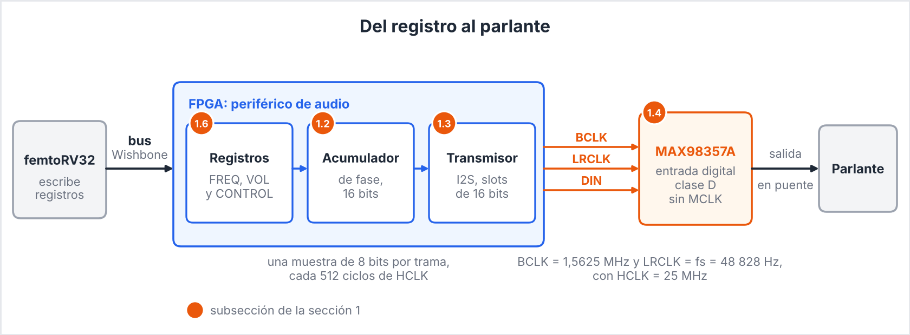
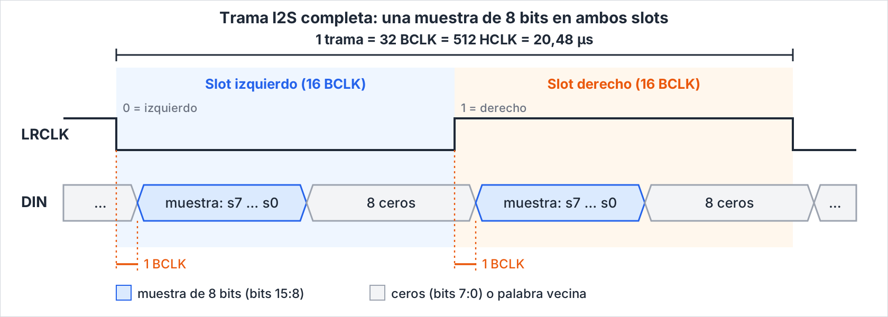
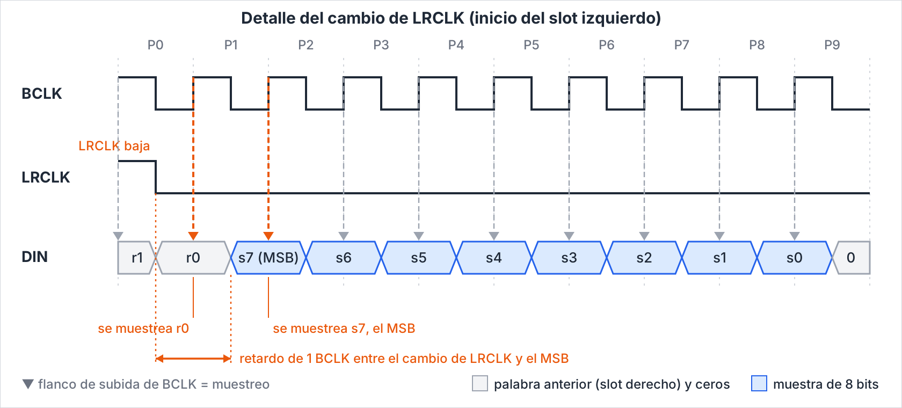
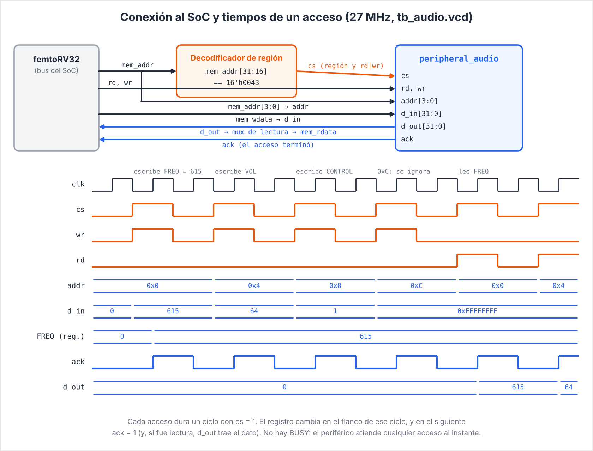
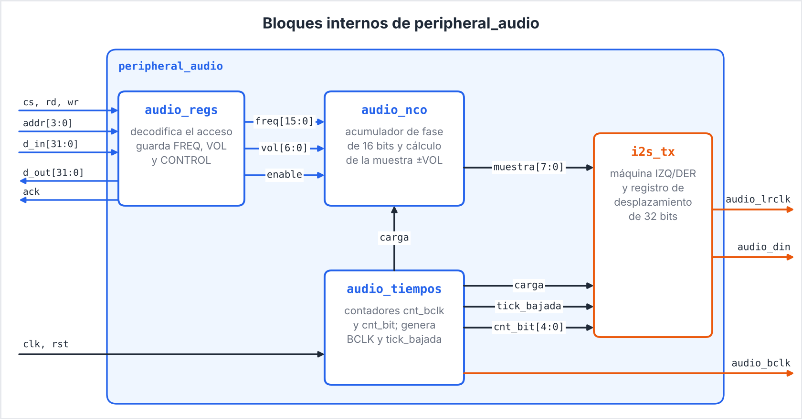
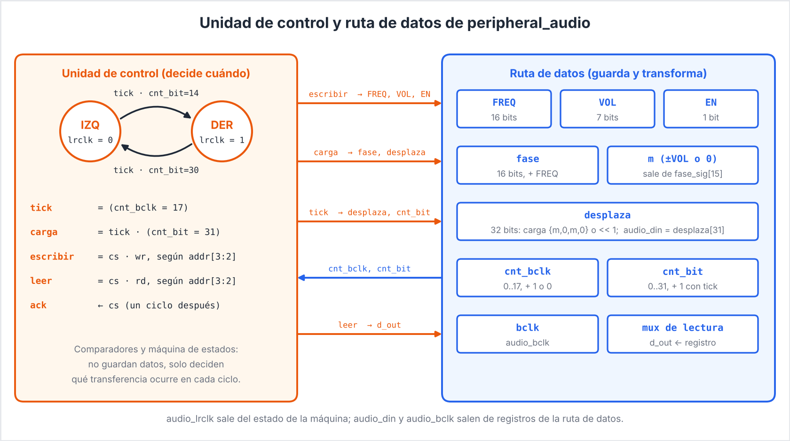
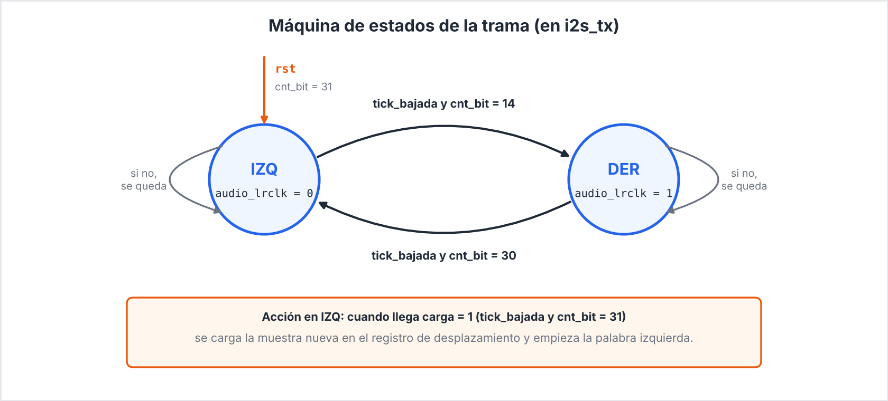
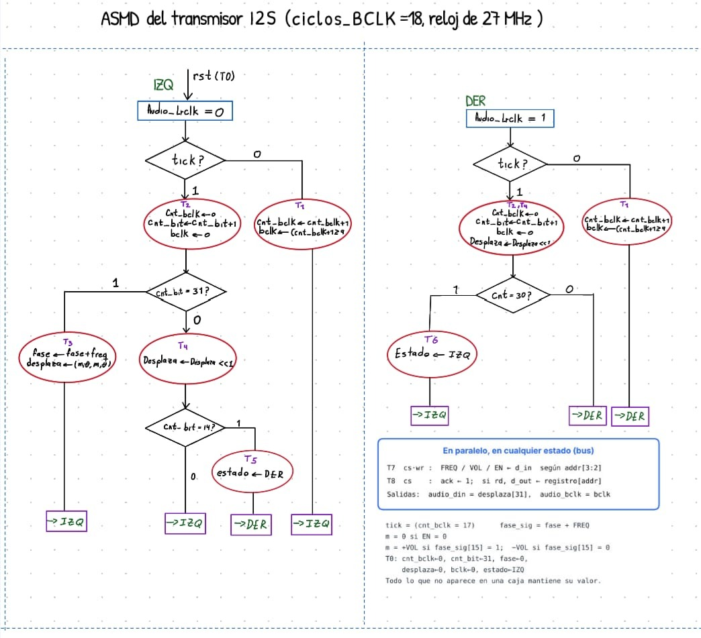
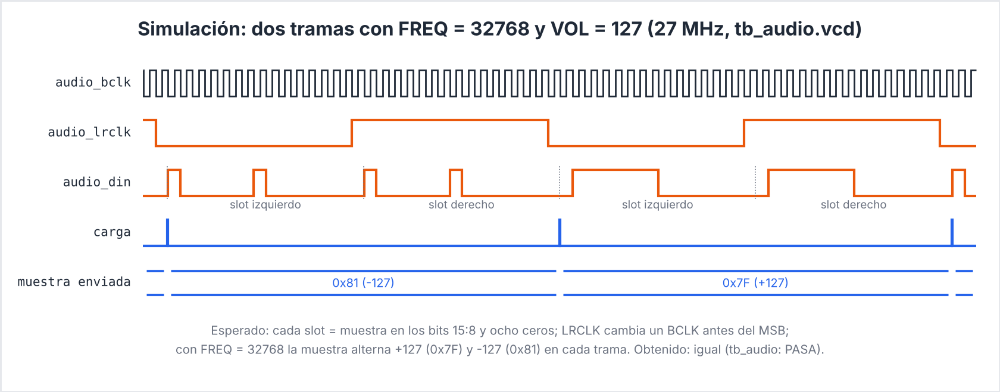

# Periférico: Audio

El procesador femtoRV32 escribe en registros mapeados en memoria qué sonido generar, y el periférico produce la señal que llega al parlante. El periférico genera tonos de onda cuadrada con muestras de 8 bits y las envía por I2S al amplificador MAX98357A, que maneja el parlante.



*Figura 1. Recorrido de la señal. Cada número indica la subsección de la sección 1 que explica esa parte.*

El documento sigue el diseño descendente: teoría (1), funcionamiento (2), diseño (3), Verilog (4), simulación (5) e implementación en placa (6). El estado de cada sección está en el [README del equipo](../README.md).

## 1. Marco teórico

> **Estado:** Hecho.

Esta sección sigue el camino del sonido, como en la figura 1: cómo se digitaliza (1.1), cómo un circuito genera un tono (1.2), cómo la muestra viaja por I2S (1.3) hasta el amplificador (1.4), cómo se ajusta a 8 bits y a la memoria disponible (1.5) y cómo el procesador controla el periférico (1.6). La 1.7 explica por qué se eligió I2S y no el PWM que propone el curso, y la 1.8 reúne las decisiones. Lo que lleva un número entre corchetes viene de la fuente con ese número en las referencias; las demás cifras las calculamos nosotros con los datos del texto, y se pueden repetir.

### 1.1 Muestreo y cuantización

Un sonido digital es una secuencia de muestras tomadas a una frecuencia fs. Por el teorema de Nyquist solo se representan frecuencias menores que fs/2; si la señal tiene componentes por encima de ese límite hay aliasing, y esas componentes aparecen como una frecuencia más baja [1].

Cada muestra se cuantiza con N bits; con N = 8 hay 256 niveles. La relación señal-ruido ideal de un convertidor de N bits, con una senoidal de escala completa, es [2]:

$$
\mathrm{SNR} = 6{,}02\,N + 1{,}76\ \mathrm{dB}
$$

Con 8 bits resultan 49,9 dB y con 16 bits, 98,1 dB. Para tonos y efectos de un juego alcanza; para música de alta fidelidad, no.

### 1.2 Generación de tonos: acumulador de fase

Un registro de fase de 16 bits aumenta en `FREQ` en cada muestra, y la muestra de salida depende de su bit más significativo:

$$
\mathrm{fase}[n+1] = \left(\mathrm{fase}[n] + \mathrm{FREQ}\right) \bmod 2^{16}
$$

$$
\mathrm{muestra}[n] =
\begin{cases}
{+}\mathrm{VOL} & \text{si } \mathrm{fase}_{15}[n] = 1 \\
{-}\mathrm{VOL} & \text{si } \mathrm{fase}_{15}[n] = 0
\end{cases}
$$

El registro da una vuelta completa cada 2<sup>16</sup>/FREQ muestras, y en cada vuelta el bit 15 completa un ciclo. La frecuencia de salida es entonces:

$$
f_{\mathrm{salida}} = \frac{\mathrm{FREQ} \cdot f_s}{2^{16}}
$$

Como la amplitud ±VOL es simétrica, la salida no tiene componente continua. Además, el MAX98357A incluye un bloqueador de DC con corte de −3 dB en 3,7 Hz [5, p. 16]. La figura 2 lo muestra con un ejemplo.


*Figura 2. Con FREQ = 8192 el registro da una vuelta cada 8 muestras, y el bit 15 forma la onda cuadrada de ±VOL.*

La resolución en frecuencia es lo que cambia la salida por cada unidad de `FREQ`, es decir fs/2<sup>16</sup>: con fs = 46 875 Hz, unos 0,72 Hz. Como `FREQ` es entero, el error máximo de una nota es la mitad, unos 0,36 Hz. Cada bit más en el registro de fase reduce la resolución a la mitad, y cuanto mayor es fs, más grueso es cada paso.

Para una nota de número MIDI m, con A4 (m = 69) fijada por convención en 440 Hz [3], la frecuencia en afinación temperada es:

$$
f_m = 440 \cdot 2^{\frac{m-69}{12}}\ \mathrm{Hz}
$$

y el valor que se escribe en `FREQ` es el entero más cercano a:

$$
\mathrm{FREQ} = \mathrm{round}\left(\frac{f_m \cdot 2^{16}}{f_s}\right)
$$

Con fs = 46 875 Hz (HCLK = 27 MHz y 576 ciclos por trama), A4 da `FREQ` = 615 (439,88 Hz) y el do central, C4 (m = 60, 261,63 Hz), da `FREQ` = 366 (261,78 Hz). Con 25 MHz y 512 ciclos (fs = 48 828 Hz) los mismos tonos son 591 y 351. Con cualquier otro reloj cambia fs (1.4) y `FREQ` se recalcula con la misma fórmula.

Una onda cuadrada tiene armónicos impares que no están limitados en banda. Los que superan fs/2 se pliegan (aliasing, 1.1) dentro de la FPGA, antes de llegar al amplificador, y su filtro digital no puede quitarlos. Es un efecto propio de este generador simple y se nota sobre todo en las notas agudas.

### 1.3 El bus I2S

I2S transmite audio con tres líneas. La especificación original las llama SCK, WS y SD [4]; el datasheet del MAX98357A las llama BCLK, LRCLK y DIN [5], que son los nombres de este documento. BCLK es el reloj de bit, con un pulso por cada bit de dato. LRCLK elige el canal (0 izquierdo, 1 derecho) y marca el comienzo de cada palabra. DIN lleva los datos en serie, con el bit más significativo (MSB) primero y en complemento a dos [4].

La especificación deja libre el flanco en el que el transmisor cambia las señales y pide que el receptor capture DIN en el flanco de subida de BCLK [4]. Aquí el transmisor cambia DIN y LRCLK en el flanco de bajada, de modo que DIN llega estable al flanco de subida. El MSB de cada palabra aparece un período de BCLK después del cambio de LRCLK [4], y esa es la característica del modo I2S. Cada trama contiene un slot izquierdo y uno derecho, y dura 1/fs.

Con dos slots de N<sub>slot</sub> bits por trama, el reloj de bit debe valer:

$$
f_{\mathrm{BCLK}} = 2 \cdot N_{\mathrm{slot}} \cdot f_s
$$

Con N<sub>slot</sub> = 16, BCLK vale 32 veces fs, una de las relaciones que admite el amplificador (1.4).

### 1.4 El amplificador MAX98357A

El MAX98357A es un amplificador clase D con entrada digital PCM [5]. Recibe LRCLK, BCLK y DIN sin necesitar MCLK y no requiere filtro de salida [5], así que la FPGA no necesita conversor ni filtro externos. Acepta datos de 16, 24 o 32 bits por slot en modo I2S; la variante A espera I2S estándar y la B, datos justificados a la izquierda [5]. El canal se elige con el pin SD_MODE, que también lo apaga, y la ganancia, de 3 a 15 dB, con el pin GAIN_SLOT. Los dos son pines de configuración física, no registros, y sus valores están en 2.2 [5, 6].

Lo que más condiciona el diseño es que el amplificador no acepta cualquier frecuencia de muestreo. El datasheet indica que LRCLK solo admite 8, 16, 32, 44,1, 48, 88,2 y 96 kHz, y que 11,025, 12, 22,05 y 24 kHz no están soportadas [5]. Su tabla de características eléctricas da cuatro intervalos de LRCLK: de 7,6 a 8,4 kHz, de 15,2 a 16,8 kHz, de 30,4 a 50,4 kHz y de 83,8 a 100,8 kHz [5]. Además, BCLK debe valer 32, 48 o 64 veces LRCLK y estar entre 0,2432 y 25,804 MHz [5].

Con BCLK igual a 32 veces LRCLK y k ciclos de HCLK por cada BCLK, la frecuencia de muestreo es:

$$
f_s = \frac{\mathrm{HCLK}}{32 \cdot k}
$$

La tabla muestra qué ocurre con los dos relojes posibles: 27 MHz, el de la Tang Nano 9K que usa el grupo, y 25 MHz, el de la guía del curso:

| HCLK | Ciclos por trama | k | fs | Intervalo del datasheet |
|---|---|---|---|---|
| 25 MHz | 512 | 16 | 48 828 Hz | fS3 (1,7 % sobre 48 kHz): elegido |
| 25 MHz | 1024 | 32 | 24 414 Hz | ninguno |
| 27 MHz | 576 | 18 | 46 875 Hz | fS3 (2,3 % bajo 48 kHz): elegido |
| 27 MHz | 512 | 16 | 52 734 Hz | ninguno, supera 50,4 kHz |
| 27 MHz | 1024 | 32 | 26 367 Hz | ninguno |

Por eso el diseño tiene un parámetro, `CICLOS_BCLK`, que vale 18 con HCLK = 27 MHz y 16 con 25 MHz. La trama dura 32 × `CICLOS_BCLK` ciclos (576 o 512) y la cuentan dos contadores encadenados (2.3.3). Para cualquier otro reloj se elige el k entero que deje fs dentro de un intervalo. El resto de los requisitos se cumple con el diseño: BCLK de 1,5 MHz con 27 MHz y de 1,5625 MHz con 25 MHz, 16 bits por slot, formato I2S y sin MCLK. La ficha solo nombra cuatro frecuencias no soportadas (11,025, 12, 22,05 y 24 kHz) [5, p. 16]. Las fs de este diseño (46 875 y 48 828 Hz) no son frecuencias estándar, pero caen dentro del intervalo fS3 de la tabla eléctrica [5, p. 6]. El fabricante no garantiza expresamente valores intermedios, por eso la fs se valida en la placa (sección 6).

Hay además dos condiciones de la ficha. La primera: con LRCLK de ciclo de trabajo 50 % el formato lo fija el modelo (A: I2S, B: justificado a la izquierda), mientras que un pulso corto de sincronía activa el modo TDM automáticamente [5, p. 16]. Por eso LRCLK vale 0 durante 16 BCLK y 1 durante 16 BCLK. La segunda: en el arranque, LRCLK debe empezar dentro de ½ período de LRCLK desde que empieza BCLK [5, p. 18], y no se debe quitar LRCLK mientras BCLK esté presente [5, p. 16 y 19]. El reset pone ambas señales en 0 y las dos salen de la misma máquina de tiempos. Según las transferencias T0 a T6 (3.6), con 27 MHz el primer flanco de subida de BCLK ocurre en el ciclo 9 tras el reset y el primer cambio de LRCLK en el 288, unos 279 ciclos de los 288 permitidos (cuenta por confirmar en simulación). Se cumple, pero con poco margen.

### 1.5 Muestras de 8 bits y uso de memoria

La interfaz del MAX98357A acepta 16, 24 o 32 bits por slot, no 8 [5]. Por eso se usa un slot de 16 bits con la muestra de 8 bits (con signo, de −128 a 127) en los bits 15:8; el transmisor fuerza a cero los bits 7:0 y esos ocho ceros no se almacenan. Cada muestra se envía en ambos slots, así el sonido es el mismo con SD_MODE en izquierdo, derecho o mezcla. Si el contenido viniera de audio de 8 bits sin signo, como el WAV, bastaría invertir el MSB (`XOR 0x80`) para pasarlo a complemento a dos.

Usar 8 bits busca ocupar poca memoria. La RAM del SoC es de 26 212 bytes y compite con el código y con la pila (1024 B), así que el diseño no almacena audio: genera tonos.

| Método | Memoria de datos | Observación |
|---|---|---|
| Generador de tonos (acumulador de fase) | 0 bytes de RAM | Elegido; solo usa registros (`FREQ`, `VOL`, fase y contador) |
| PCM de 8 bits a fs = 46 875 Hz | 46 875 B por segundo (179 % de la RAM) | No cabe |
| PCM de 8 bits con cada muestra repetida 6 veces (7,8 kHz) | 7 813 B por segundo (30 % de la RAM) | Cabe, pero no se usa |

Con ondas cuadradas la muestra solo toma dos valores, +VOL y −VOL, así que más resolución no mejora el timbre. Con 16 bits la relación señal-ruido ideal sería de 98,1 dB en lugar de 49,9 dB, pero con PCM la memoria se duplicaría: un segundo a 7,8 kHz pasaría de 7 813 B a 15 625 B. Como el transmisor ya envía palabras de 16 bits, pasar a 16 bits más adelante solo exige ensanchar VOL y la muestra y cargar los bits 7:0 en lugar de ceros; el bus y la temporización no cambian.

### 1.6 Periférico mapeado en memoria

El procesador accede al periférico con cargas y almacenamientos a direcciones fijas (MMIO), sin instrucciones especiales. La estructura (decodificador local, control de registros y núcleo) sigue la de UART8N1, descrita en la sección 12 de su guía [7]. A diferencia de la UART, aquí no hay protocolo de aceptación (START/BUSY/DONE): los registros fijan el sonido y el hardware lo mantiene hasta que se cambien.

Esta es la arquitectura del curso: un solo bus de memoria con periféricos mapeados en memoria [8]. El manual de RISC-V explica que unos rangos de direcciones pueden ser memoria principal y otros, dispositivos de E/S, y que un acceso a un dispositivo puede tener efectos secundarios visibles, a diferencia de un acceso a memoria [9]. En el SoC, cuando el firmware escribe en la ventana de un periférico, el adaptador del bus (`WishbonePeripheral`) le entrega durante un ciclo `cs`, `wr`, `addr` (el desplazamiento dentro de la ventana) y `d_in` (el valor escrito), y responde `ack` al bus [10]. Como `d_in` solo es válido ese ciclo, el periférico guarda el valor en un registro propio y genera el sonido por sí mismo a partir de él. Por eso `FREQ`, `VOL` y `CONTROL` son registros, con el mapa de 2.4.

### 1.7 Por qué I2S y no PWM

El documento de la fase de diseño propone dos métodos de salida de audio: PWM a un parlante pequeño («simple, sin DAC») o I2S hacia un DAC externo («más fiel, más pines y más estudio»), y pide justificar «por qué esa y no otra» [8]. Usamos I2S. Para justificar la elección hay que entender primero cómo funciona el PWM.

El PWM es una señal digital de frecuencia fija cuyo ciclo de trabajo D, la fracción del período en alto, se modula. El ciclo de trabajo fija la amplitud de la señal analógica: con 50 % se obtiene la mitad de la tensión de alimentación [11]. El valor medio de la salida es:

$$
\bar{V} = D \cdot V_{DD}, \qquad 0 \le D \le 1
$$

Para recuperar la señal analógica se usa un filtro pasa bajos, por ejemplo un RC pasivo, que elimina la frecuencia base del PWM [11]. Eso exige que el ancho de banda de la señal, F<sub>bw</sub>, sea mucho menor que la frecuencia del PWM, F<sub>PWM</sub> [12]:

$$
F_{bw} \ll F_{PWM}
$$

Si la señal va a una entrada de baja impedancia, como un parlante, hace falta además un buffer entre el filtro y la carga [11]. La frecuencia del PWM depende del reloj y de los bits B del contador: si el contador avanza un paso por ciclo de reloj y un período es una vuelta completa,

$$
F_{PWM} = \frac{f_{clk}}{2^{B}}
$$

Con 27 MHz, 8 bits dan 105,5 kHz y 10 bits, 26,4 kHz. Más bits dan más niveles de amplitud pero bajan la frecuencia del PWM, que debe seguir muy por encima del ancho de banda de la señal [12].

| | PWM | I2S con MAX98357A |
|---|---|---|
| Pines de la FPGA | 1 [8] | 3: BCLK, LRCLK y DIN [4] |
| Conversión a analógico | Filtro pasa bajos y, para un parlante, buffer [11] | La hace el amplificador, sin filtro de salida [5] |
| Qué limita la resolución | Los bits B del contador frente a la frecuencia del PWM | Los bits por slot del amplificador: 16, 24 o 32 [5] |
| Condición del reloj | F<sub>bw</sub> mucho menor que F<sub>PWM</sub> [12] | BCLK de 32, 48 o 64 veces LRCLK y LRCLK dentro de los intervalos de 1.4 [5] |

Elegimos I2S por tres razones. La primera es la integración: el amplificador recibe la muestra digital y entrega la salida para el parlante sin filtro externo [5], mientras que con PWM hay que armar filtro y buffer [11]. La segunda es que resolución y reloj son independientes: en PWM compiten por el mismo reloj, y en I2S los bits por muestra y fs se eligen por separado, con las condiciones de 1.4. La tercera es el crecimiento: la muestra de 8 bits cabe en un slot de 16 y pasar a 16 bits no cambia el bus (1.5). El costo es el que anticipa el curso: tres pines en vez de uno y más estudio, porque hay que diseñar el transmisor I2S y cumplir su temporización [8]. Para una onda cuadrada de dos niveles bastaría un pin que alterne a la frecuencia del tono, pero ese camino cierra la puerta a más niveles de amplitud.

### 1.8 Decisiones de diseño

| Tema | Decisión | Se aplica en |
|---|---|---|
| Salida | I2S hacia el MAX98357A con BCLK, LRCLK y DIN, sin MCLK | 2.2 y 3.2 |
| Frecuencia de muestreo | `CICLOS_BCLK` = 18 con 27 MHz (trama de 576 ciclos) y 16 con 25 MHz (512); BCLK = 32 × LRCLK | 2.3, 3.3 y 3.6 |
| Tono | Acumulador de fase de 16 bits y onda cuadrada de ±VOL | 2.4 y 3.3 |
| Muestra | 8 bits con signo en los bits 15:8 de un slot de 16, repetida en ambos slots; no se almacena audio | 2.1 y 3.3 |
| Registros | `FREQ`, `VOL` y `CONTROL` desde `0x00430000`; los valores se aplican en la siguiente muestra | 2.4 y 3.2 |
| Configuración del módulo | GAIN sin conectar (9 dB); SD queda como viene en el módulo y el silencio se hace con `CONTROL.ENABLE` = 0 | 2.2 |

## 2. Fundamento

> **Estado:** Hecho.

### 2.1 Principio de funcionamiento

El CPU no produce el audio muestra a muestra. Solo escribe `FREQ`, `VOL` y `ENABLE`, y el periférico genera el sonido por sí mismo. Un generador de tonos (acumulador de fase) calcula una muestra de 8 bits con signo una vez por trama, cada 576 ciclos de HCLK (21,33 µs, fs = 46 875 Hz).

Un transmisor I2S coloca esa muestra en los 8 bits altos de una palabra de 16, la repite en los slots izquierdo y derecho y la serializa por DIN. BCLK vale HCLK/18 = 1,5 MHz y LRCLK vale HCLK/576. El MAX98357A recibe la muestra y maneja el parlante con su salida clase D. Todas las salidas son registradas y salen de dos contadores encadenados (2.3.3), de modo que BCLK, LRCLK y DIN quedan alineados.

Las cifras de esta sección son las de HCLK = 27 MHz, el reloj de la Tang Nano 9K, con `CICLOS_BCLK` = 18. Con 25 MHz el parámetro vale 16, la trama dura 512 ciclos y fs = 48 828 Hz.

### 2.2 Conexiones del módulo MAX98357A

El FPGA actúa como maestro I2S: BCLK, LRCLK y DIN son salidas del FPGA y entradas del módulo, y las tres trabajan a 3,3 V. El módulo no devuelve datos. El módulo usado es un amplificador I2S MAX98357A mono de 3 W clase D (genérico). Según su serigrafía, admite Vin de 2,5 a 5,5 V y parlantes de 4 a 8 Ω, trae 9 dB de ganancia por defecto y entrega la mezcla (L+R)/2. Su circuito integrado está marcado AKK NCB: AKK corresponde, en la tabla de pedidos, al MAX98357A en encapsulado TQFN de 16 pines [5, p. 34]; NCB no aparece en la ficha.

```
FPGA (peripheral_audio)              Módulo MAX98357A
audio_bclk   ─────────────────────►  BCLK   reloj de bit, 1,5 MHz
audio_lrclk  ─────────────────────►  LRC    reloj de trama, 46,875 kHz (0 = izq., 1 = der.)
audio_din    ─────────────────────►  DIN    datos en serie, MSB primero
5V           ─────────────────────►  VIN    alimentación (2,5 a 5,5 V)
GND          ─────────────────────►  GND    tierra común
(sin conectar)                       GAIN   ganancia por cableado (9 dB)
(sin conectar)                       SD     apagado y selección de canal
                                     + / −  parlante de 4 a 8 Ω, salida en puente
```

| Pin | Qué representa | Notas |
|---|---|---|
| VIN | Alimentación del módulo (2,5 a 5,5 V) | Es el mismo rango del CI [5, p. 4 y 33]. El clase D toma picos de corriente; con 5 V entrega más potencia (3,2 W en 4 Ω a 5 V [5, p. 5]). |
| GND | Referencia común de tierra | Obligatorio. Sin tierra común, BCLK, LRC y DIN no tienen referencia. |
| BCLK | Reloj de bit | Marca cuándo leer DIN. |
| LRC | Reloj de trama (LRCLK) | 0 = izquierdo, 1 = derecho. Su frecuencia es fs. |
| DIN | Datos de audio | Bits de la muestra, MSB primero. |
| GAIN | Ganancia, fija por cableado | Ver abajo. No la controla el FPGA. |
| SD | Apagado y selección de canal | Ver abajo. |
| + / − | Salida al parlante (4 a 8 Ω) | La salida es en puente: ningún terminal se conecta a GND. |

Sobre los nombres: el módulo rotula LRCLK como LRC, VDD como Vin, SD_MODE como SD y GAIN_SLOT como GAIN (además de BCLK, DIN y GND); en la hoja de datos [5] los nombres son LRCLK, VDD, SD_MODE y GAIN_SLOT.

**GAIN** (pin GAIN_SLOT del CI; Tabla 8 del datasheet [5, p. 28]): GAIN a GND por 100 kΩ → 15 dB; GAIN a GND → 12 dB; sin conectar → 9 dB; GAIN a VDD → 6 dB; GAIN a VDD por 100 kΩ → 3 dB. Se deja sin conectar (9 dB): la serigrafía del módulo indica 9 dB por defecto, igual que en módulos similares [6].

**SD** (pin SD_MODE del CI; Tabla 5 del datasheet [5, p. 17]): por debajo del umbral B0 el amplificador se apaga; entre B0 y B1 sale la mezcla izquierdo/derecho; entre B1 y B2, el canal derecho; sobre B2, el izquierdo. Los valores típicos son B0 = 0,16 V, B1 = 0,77 V y B2 = 1,4 V, con rangos de 0,08 a 0,355 V, de 0,65 a 0,825 V y de 1,245 a 1,5 V [5, p. 7]. El CI tiene un pull-down interno de unos 100 kΩ en SD_MODE (92 a 108 kΩ) [5, p. 7]: en el CI solo, un SD sin conectar equivale a apagado, así que el módulo debe traer una resistencia a Vin en SD. La serigrafía del módulo indica salida (L+R)/2, es decir, SD queda entre B0 y B1 (mezcla, Tabla 5). SD no se conecta al FPGA y queda como viene en el módulo. Como ese voltaje sale de un divisor con Vin, puede cambiar con la tensión de alimentación; se mide con multímetro en la sección 6, y lo importante es que no baje de unos 0,16 V (apagado). Como se envía la misma muestra en ambos slots, cualquier selección suena igual, y para silenciar el parlante se usa `CONTROL.ENABLE` = 0. Con `ENABLE` = 0 el CI sigue encendido (corriente de reposo típica de 2,4 a 2,75 mA [5, p. 4]) y la muestra pasa de ±VOL a 0 de golpe, lo que podría oírse como un clic; la ficha recomienda bajar los datos con una rampa antes de apagar el CI [5, p. 28], y aquí se logra bajando `VOL` por pasos desde el firmware.

Los pines físicos de BCLK, LRCLK y DIN se asignan en 3.2.

### 2.3 Diagrama de tiempos

Parámetros: HCLK = 27 MHz, 18 HCLK por BCLK, 16 BCLK por slot y 32 BCLK por trama.

| Magnitud | Valor |
|---|---|
| Período de BCLK | 18 HCLK = 666,7 ns (1,5 MHz) |
| Período de trama = 1/fs | 576 HCLK = 21,33 µs (fs = 46 875 Hz) |
| Duración de un slot | 16 BCLK = 288 HCLK |
| Frecuencia máxima representable | fs/2 ≈ 23,4 kHz |

Con HCLK = 25 MHz, cada BCLK dura 16 HCLK y la trama, 512 HCLK; la estructura es la misma.

El filtro digital del amplificador, con LRCLK entre 30 y 50 kHz, atenúa 3 dB en 0,47·fs [5, p. 16 (Tabla 4)]. Con fs = 46 875 Hz eso son unos 22 kHz, así que las frecuencias cercanas a fs/2 salen atenuadas.

#### 2.3.1 Trama completa



*Figura 3. LRCLK y DIN en los slots izquierdo y derecho de una trama.*

La figura 3 muestra una trama completa. La misma muestra de 8 bits se envía en el slot izquierdo y en el derecho. En cada slot, los 8 bits de la muestra ocupan los bits 15:8 de la palabra y los bits 7:0 son ceros. Cada palabra de DIN comienza un BCLK después del cambio de LRCLK.

#### 2.3.2 Detalle en el cambio de LRCLK



*Figura 4. BCLK, LRCLK y DIN alrededor del cambio de LRCLK.*

La figura 4 amplía el instante en que cambia LRCLK. LRCLK y DIN cambian en los flancos de bajada de BCLK, y el receptor muestrea en los flancos de subida (flechas). `r1` y `r0` son los dos últimos bits de la palabra anterior (slot derecho). LRCLK baja en la mitad de P0; en el flanco de subida de P1 el receptor todavía lee `r0`, y `s7` (el MSB) se muestrea recién en P2. Después de `s0` siguen ocho ceros hasta completar los 16 bits del slot.

#### 2.3.3 Relación con HCLK

Dos contadores marcan el tiempo. `cnt_bclk` cuenta de 0 a `CICLOS_BCLK` − 1 dentro de cada período de BCLK (18 ciclos con 27 MHz, 16 con 25 MHz), y `cnt_bit` cuenta los 32 períodos de BCLK de la trama (0…31). De ellos salen todas las señales:

| Señal | Cómo se obtiene |
|---|---|
| `audio_bclk` | Vale 0 en la primera mitad de `cnt_bclk` y 1 en la segunda |
| `tick_bajada` | Vale 1 cuando `cnt_bclk` = `CICLOS_BCLK` − 1: el siguiente flanco de HCLK es el de bajada de BCLK |
| `cnt_bit` | Avanza en cada `tick_bajada`; es el índice del bit que se está enviando |

LRCLK y DIN solo se actualizan con `tick_bajada`, por eso cambian siempre en el flanco de bajada de BCLK. Así el mismo diseño sirve con 27 MHz y con 25 MHz, cambiando solo `CICLOS_BCLK`. Los bloques y la máquina de estados que usan estos contadores están en 3.3 y 3.6.

### 2.4 Mapa de registros

Los registros ocupan la región global libre `0x0043` (base `0x00430000`). Al conectar el periférico, `chip_select` y el mux de lectura del SoC incluyen esa región.

| Dirección | Registro | Bits | Función |
|---|---|---|---|
| `0x00430000` | FREQ | 15:0 | Incremento de fase; f = FREQ·fs/65536 |
| `0x00430004` | VOL | 6:0 | Amplitud de la onda cuadrada (0…127) |
| `0x00430008` | CONTROL | 0 | ENABLE: 1 = sonido, 0 = silencio (muestra 0) |

Los valores se aplican en la siguiente muestra. Escribirlos mientras suena es seguro, porque la fase no se reinicia. Los demás bits se leen como cero y las escrituras fuera de estos offsets se ignoran, igual que en UART8N1.

### 2.5 Criterios de comprobación

- BCLK tiene período de `CICLOS_BCLK` HCLK (18 con 27 MHz) y ciclo de trabajo 50 %. Esto vale para `CICLOS_BCLK` par; con un valor impar BCLK no queda exactamente al 50 %, y la ficha solo exige 15 ns en alto y en bajo [5, p. 7].
- LRCLK vale 0 durante 16 BCLK y 1 durante 16 BCLK (ciclo de trabajo 50 %, que mantiene el modo I2S [5, p. 16]); la trama dura 576 HCLK (512 con 25 MHz).
- El MSB aparece un BCLK después del cambio de LRCLK. DIN solo cambia en flancos de bajada de BCLK.
- Tras el reset, el primer cambio de LRCLK ocurre a menos de 16 BCLK (288 HCLK con 27 MHz) del primer flanco de subida de BCLK [5, p. 18].
- Los bits 7:0 de cada slot son cero. Ambos slots llevan la misma muestra.
- Con `FREQ = 615` y `VOL = 64`, la salida alterna ±64 con frecuencia 439,88 Hz ± la resolución de la medición (con 25 MHz, `FREQ = 591` da 440,33 Hz).
- Con `ENABLE = 0`, DIN vale 0 en todos los bits.
- Reset síncrono activo alto: BCLK, LRCLK y DIN quedan en reposo.

## 3. Etapa de diseño

### 3.1 Diagrama de caja negra

> **Estado:** Hecho.

La caja negra muestra el periférico desde afuera. A la izquierda llegan las señales del bus del procesador; a la derecha salen la respuesta al bus y las tres líneas I2S hacia el MAX98357A.


*Figura 5. Entradas y salidas de `peripheral_audio`.*

### 3.2 Características de la interfaz

> **Estado:** Hecho.

**Señales.** Los nombres son los mismos del Verilog.

| Señal | Dirección | Bits | Lado | Descripción |
|---|---|---|---|---|
| `clk` | Entrada | 1 | Bus | Reloj del SoC (HCLK): 27 MHz en la Tang Nano 9K; 25 MHz con el reloj de la guía |
| `rst` | Entrada | 1 | Bus | Reinicio síncrono, activo en alto |
| `cs` | Entrada | 1 | Bus | Selección del periférico, un ciclo por acceso |
| `rd` | Entrada | 1 | Bus | Acceso de lectura |
| `wr` | Entrada | 1 | Bus | Acceso de escritura |
| `addr` | Entrada | 4 | Bus | Desplazamiento en bytes; se usan `addr[3:2]` |
| `d_in` | Entrada | 32 | Bus | Dato que escribe el procesador |
| `d_out` | Salida | 32 | Bus | Registro leído; los bits sin uso valen 0 |
| `ack` | Salida | 1 | Bus | Vale 1 el ciclo siguiente a `cs`: el acceso terminó |
| `audio_bclk` | Salida | 1 | I2S | Reloj de bit: HCLK / `CICLOS_BCLK` |
| `audio_lrclk` | Salida | 1 | I2S | Canal: 0 izquierdo, 1 derecho; su frecuencia es fs |
| `audio_din` | Salida | 1 | I2S | Muestra en serie, MSB primero |

**Parámetro.** `CICLOS_BCLK` vale 18 con 27 MHz y 16 con 25 MHz. La trama dura 32 × `CICLOS_BCLK` ciclos de HCLK (576 o 512), con los valores de 2.3.

**Registros.** Son los de 2.4, y además se pueden leer. Desde el firmware se usan así:

```c
#define AUDIO_FREQ    (*(volatile unsigned int *) 0x00430000)
#define AUDIO_VOL     (*(volatile unsigned int *) 0x00430004)
#define AUDIO_CONTROL (*(volatile unsigned int *) 0x00430008)

AUDIO_FREQ = 615;     /* La4: 439,88 Hz con fs = 46 875 Hz (27 MHz) */
AUDIO_VOL = 64;       /* amplitud ±64 */
AUDIO_CONTROL = 1;    /* ENABLE = 1: suena */
```

**Conexión eléctrica.**

| FPGA | MAX98357A | Nivel |
|---|---|---|
| `audio_bclk` | BCLK | 3,3 V (LVCMOS33) |
| `audio_lrclk` | LRC | 3,3 V (LVCMOS33) |
| `audio_din` | DIN | 3,3 V (LVCMOS33) |
| 5 V de la placa | VIN | Alimentación del amplificador (módulo: 2,5 a 5,5 V) |
| GND | GND | Tierra común |
| Sin conectar | GAIN, SD | 9 dB y salida (L+R)/2 por defecto en el módulo; silencio con `CONTROL.ENABLE` = 0 (2.2) |
| Parlante de 4 a 8 Ω | + / − | Salida en puente, ningún terminal a GND |

Las tres salidas van en un banco de 3,3 V. El MAX98357A reconoce como nivel alto una entrada de al menos 1,3 V y como bajo una de 0,6 V o menos [5, p. 7], así que las salidas LVCMOS33 son compatibles; el máximo absoluto en BCLK, LRCLK y DIN es 6 V [5, p. 4]. El número de pin de cada una queda en el archivo de restricciones de la placa, dentro de `rtl/placas/` (sección 6).

#### Conexión al SoC

El SoC elige el periférico por región, como en la guía del curso: el audio ocupa la región `0x0043`, así que el decodificador de región activa `cs` cuando `mem_addr[31:16]` = `0x0043` y hay una lectura o una escritura. Los 4 bits bajos de `mem_addr` pasan como `addr`. En el femtoRV32, `rd` es `mem_rstrb` y `wr` es cualquier bit de `mem_wmask` en 1. En una lectura, `d_out` entra al multiplexor de lectura del SoC, que lo devuelve como `mem_rdata`.



*Figura 6. Arriba, el decodificador de región entre el bus del SoC y el periférico. Abajo, los primeros accesos del testbench: cuatro escrituras y dos lecturas.*

Cada acceso dura un ciclo. El registro cambia en el flanco del ciclo con `cs` = 1, y en el ciclo siguiente `ack` vale 1; si fue una lectura, `d_out` ya trae el dato en ese ciclo. La figura 6 lo muestra con FREQ: se escribe 615 y, cuando se lee, `d_out` devuelve 615.

**Sobre `ack`.** El contrato del curso no incluye `ack`; el periférico lo agrega a propósito. Como `d_out` es registrado, el dato de una lectura aparece un ciclo después de `cs`, y `ack` marca justo ese ciclo. Cuesta un flip-flop. Si el adaptador del SoC ya espera un ciclo en toda lectura, deja `ack` sin conectar y el periférico funciona igual; si no, `ack` le dice cuándo tomar el dato.

**Sin START, BUSY ni DONE.** La UART de la guía ejecuta operaciones que tardan (enviar un byte), y por eso el procesador necesita START para arrancarlas, y BUSY y DONE para saber cuándo terminan. El audio no ejecuta operaciones: genera sonido todo el tiempo, y los registros solo cambian los parámetros con que lo hace. Por eso el procesador puede escribir en cualquier momento, nunca espera, y el valor nuevo entra en la siguiente muestra (la siguiente `carga`) sin cortar la trama en curso.

### 3.3 Diagrama de bloques

> **Estado:** Hecho.



*Figura 7. Los cuatro bloques del periférico. Azul: lado del procesador; naranja: lado I2S.*

| Bloque (módulo) | Qué hace | Entradas | Salidas |
|---|---|---|---|
| `audio_regs` | Decodifica `addr[3:2]`, guarda FREQ, VOL y CONTROL en las escrituras y entrega el registro pedido en las lecturas | `cs`, `rd`, `wr`, `addr`, `d_in` | `freq[15:0]`, `vol[6:0]`, `enable`, `d_out`, `ack` |
| `audio_tiempos` | Cuenta `cnt_bclk` y `cnt_bit`, genera BCLK y avisa el flanco de bajada y el fin de trama | `clk`, `rst` | `audio_bclk`, `tick_bajada`, `cnt_bit[4:0]`, `carga` |
| `audio_nco` | Suma FREQ a la fase en cada `carga` y calcula la muestra: +VOL si el bit 15 de la fase es 1, −VOL si es 0, y 0 si `enable` = 0 | `freq`, `vol`, `enable`, `carga` | `muestra[7:0]` |
| `i2s_tx` | Máquina IZQ/DER que produce LRCLK, y registro de 32 bits que saca la muestra por DIN | `muestra`, `carga`, `tick_bajada`, `cnt_bit` | `audio_lrclk`, `audio_din` |

`carga` vale 1 durante un ciclo de HCLK, cuando `tick_bajada` = 1 y `cnt_bit` = 31. Ese es el instante en que termina una trama y empieza la siguiente.

### 3.4 Diagrama de flujo

> **Estado:** Hecho.

La figura 8 muestra lo que hace el periférico en cada ciclo de HCLK. Primero atiende una escritura del procesador, si la hay. Después, solo en los flancos de bajada de BCLK, carga una muestra nueva al final de la trama o desplaza un bit, y cambia de canal en los bits 14 y 30.


*Figura 8. Diagrama de flujo con símbolos ISO 5807: terminal, proceso y decisión.*

### 3.5 Clasificación del flujo

> **Estado:** Hecho.

| Ruta de datos (guarda y transforma valores) | Unidad de control (decide cuándo) |
|---|---|
| Registros FREQ, VOL y CONTROL | Órdenes de escritura y lectura: `cs`, `rd`, `wr` y `addr[3:2]` |
| Acumulador de fase de 16 bits y sumador `fase + FREQ` | Condición `tick` = (`cnt_bclk` = 17) |
| Cálculo de la muestra (±VOL o 0) | Condiciones `cnt_bit` = 14, 30 y 31 |
| Registro de desplazamiento de 32 bits | Orden `carga` = `tick` y (`cnt_bit` = 31) |
| Contadores `cnt_bclk` y `cnt_bit`, y registro `bclk` | Máquina de estados IZQ/DER |
| Multiplexor de lectura hacia `d_out` y registro `ack` | |

Los contadores están en la ruta de datos: son registros que cuentan y entregan condiciones (`tick`, `cnt_bit` = 14, 30 o 31). La unidad de control solo usa esas condiciones para decidir qué transferencia ocurre.

La figura 9 lleva esa separación al hardware. A la izquierda, la unidad de control decide qué transferencia ocurre en cada ciclo; a la derecha, la ruta de datos guarda y transforma los valores.



*Figura 9. Unidad de control y ruta de datos. Las flechas naranjas son señales de control; la azul lleva el valor de los contadores, que la unidad de control necesita para decidir.*

El flujo es síncrono, porque todo cambia en el flanco de subida de HCLK, y continuo, porque cada trama se repite sola cada 576 ciclos sin esperar al procesador. El procesador solo cambia los valores con los que trabaja la ruta de datos.

### 3.6 Máquinas de estado

> **Estado:** Hecho.

El periférico tiene una sola máquina de estados, dentro de `i2s_tx`. Sus dos estados son los dos canales de la trama, y la salida de cada estado es directamente LRCLK, así que es una máquina de Moore.



*Figura 10. Máquina de estados de la trama. El reset la deja en IZQ con `cnt_bit` = 31, para que el primer flanco de bajada cargue una muestra.*

| Estado | `audio_lrclk` | Pasa a | Condición | Acción |
|---|---|---|---|---|
| IZQ (reset) | 0 | DER | `tick_bajada` y `cnt_bit` = 14 | Con `carga` = 1 carga la muestra nueva; en cada `tick_bajada` desplaza un bit |
| DER | 1 | IZQ | `tick_bajada` y `cnt_bit` = 30 | En cada `tick_bajada` desplaza un bit |

LRCLK cambia en los bits 14 y 30, un BCLK antes del MSB de cada palabra (bits 0 y 16), como pide I2S (figura 4). El lado del bus no necesita máquina de estados: cada acceso dura un ciclo y `ack` es solo `cs` retrasado un ciclo.

#### ASMD y tabla de transferencias

El ASMD une la máquina de estados con la ruta de datos: para cada estado dice qué registros cambian y bajo qué condición. Una vuelta por el diagrama es un ciclo de HCLK, y está hecho para 27 MHz (`CICLOS_BCLK` = 18).



*Figura 11. ASMD del transmisor I2S, dibujado a mano, con las transferencias T0 a T8.*

Las condiciones usan dos señales que se calculan en el mismo ciclo:

$$
\text{tick} = (\text{cnt\_bclk} = 17) \qquad \text{fase\_sig} = \text{fase} + \text{FREQ}
$$

La muestra `m` sale de `fase_sig`:

$$
m = \begin{cases} 0 & \text{si EN} = 0 \\ +\text{VOL} & \text{si fase\_sig}[15] = 1 \\ -\text{VOL} & \text{si fase\_sig}[15] = 0 \end{cases}
$$

| T | Estado | Condición | Transferencias |
|---|---|---|---|
| T0 | Reset | `rst` = 1 | `cnt_bclk ← 0`, `cnt_bit ← 31`, `fase ← 0`, `desplaza ← 0`, `bclk ← 0`, estado `← IZQ` |
| T1 | IZQ, DER | `tick` = 0 | `cnt_bclk ← cnt_bclk + 1`; `bclk ← (cnt_bclk + 1 ≥ 9)` |
| T2 | IZQ, DER | `tick` = 1 | `cnt_bclk ← 0`; `bclk ← 0`; `cnt_bit ← cnt_bit + 1` |
| T3 | IZQ | `tick` = 1 y `cnt_bit` = 31 | `fase ← fase + FREQ`; `desplaza ← {m, 0x00, m, 0x00}` |
| T4 | IZQ, DER | `tick` = 1 y `cnt_bit` ≠ 31 | `desplaza ← desplaza << 1` |
| T5 | IZQ | `tick` = 1 y `cnt_bit` = 14 | estado `← DER` |
| T6 | DER | `tick` = 1 y `cnt_bit` = 30 | estado `← IZQ` |
| T7 | Cualquiera | `cs` = 1 y `wr` = 1 | `FREQ`, `VOL` o `EN ← d_in`, según `addr[3:2]` |
| T8 | Cualquiera | `cs` = 1 | `ack ← 1`; si `rd` = 1, `d_out ← registro[addr]` |

Todo registro que no aparece en una transferencia mantiene su valor. Las salidas son `audio_lrclk` = estado, `audio_din = desplaza[31]` y `audio_bclk = bclk`. T7 y T8 son del bus y ocurren en paralelo, en cualquier estado.

Tres coincidencias explican por qué el diseño funciona:

1. T2, T3 o T4 y T5 o T6 ocurren en el mismo flanco, y todas usan los valores de antes del flanco. Por eso, con `cnt_bit` = 14 se pasa a DER y el bit 15 ya sale con LRCLK = 1, un BCLK antes del MSB del slot derecho.
2. T3 carga la muestra calculada con `fase + FREQ`, la misma fase que se guarda en ese flanco. Así la muestra no llega con una trama de retraso.
3. BCLK baja (T2) en el mismo flanco en que cambian `desplaza` y el estado. Por eso LRCLK y DIN cambian en la bajada de BCLK, y el MAX98357A los lee en la subida, con medio período de margen. La ficha pide que DIN y LRCLK estén estables al menos 10 ns antes y 10 ns después del flanco de subida de BCLK (tSETUP y tHOLD), y que BCLK dure al menos 15 ns en alto y en bajo [5, p. 7]. Con medio período de BCLK hay unos 333 ns de cada lado con 27 MHz (320 ns con 25 MHz).

## 4. Etapa de descripción en HDL

### 4.1 Organización de módulos e implementación en Verilog

> **Estado:** Hecho.

Cada bloque de la figura 7 es un módulo, y `peripheral_audio` los une. Todos son síncronos, con reset síncrono activo en alto, y las señales se llaman igual que en las figuras 7 a 10.

| Archivo | Bloque | Contenido |
|---|---|---|
| [`peripheral_audio.v`](rtl/peripheral_audio.v) | Módulo superior | Instancia los cuatro bloques y declara el parámetro `CICLOS_BCLK` |
| [`audio_regs.v`](rtl/audio_regs.v) | `audio_regs` | FREQ, VOL y CONTROL; escritura y lectura según `addr[3:2]`; `ack` un ciclo después de `cs` |
| [`audio_tiempos.v`](rtl/audio_tiempos.v) | `audio_tiempos` | Contadores `cnt_bclk` y `cnt_bit`, salida `audio_bclk`, avisos `tick_bajada` y `carga` |
| [`audio_nco.v`](rtl/audio_nco.v) | `audio_nco` | Fase de 16 bits que avanza FREQ en cada `carga`; muestra ±VOL o 0 |
| [`i2s_tx.v`](rtl/i2s_tx.v) | `i2s_tx` | Máquina IZQ/DER (salida `audio_lrclk`) y registro de 32 bits (salida `audio_din`) |

La única diferencia entre placas es el parámetro. En el SoC el periférico se instancia así:

```verilog
peripheral_audio #(.CICLOS_BCLK(18)) audio (   // 18 con clk = 27 MHz; 16 con 25 MHz
    .clk(clk), .rst(rst), .cs(cs_audio), .rd(rd), .wr(wr), .addr(addr[3:0]),
    .d_in(d_in), .d_out(d_out_audio), .ack(ack_audio),
    .audio_bclk(audio_bclk), .audio_lrclk(audio_lrclk), .audio_din(audio_din)
);
```

La muestra se calcula con la fase del mismo ciclo en que se guarda (`fase + FREQ`). Por eso la muestra nueva entra al registro de desplazamiento sin un ciclo de retraso. El testbench que comprueba los criterios de 2.5 está en 5.1.

## 5. Etapa de simulación

### 5.1 Entorno de prueba: testbench, estímulos y observación

> **Estado:** Hecho.

El testbench [`tb_audio.v`](rtl/tb_audio.v) prueba el periférico completo con un reloj de 27 MHz. Cada caso ejercita transferencias del ASMD (3.6) y comprueba los criterios de 2.5. No hace falta mirar las ondas para saber si funciona: incluye un receptor I2S de referencia que lee DIN igual que el MAX98357A, y al final imprime `PASA` o `NO PASA`.

```bash
cd Grupos/G5/audio/rtl
make          # simula con 27 MHz (CICLOS_BCLK = 18)
make sim25    # simula con 25 MHz (CICLOS_BCLK = 16)
make wave     # abre GTKWave con las señales ya ordenadas (audio.gtkw)
```

| # | Caso | Transferencias | Estímulo | Esperado | Obtenido |
|---|---|---|---|---|---|
| 1 | Reset | T0 | `rst` = 1 | BCLK, LRCLK y DIN en 0 | Igual |
| 2 | Registros | T7, T8 | Escribe FREQ = 615, VOL = 64 y CONTROL = 1, y una escritura al offset `0xC` (fuera del mapa, se ignora); lee los tres y el offset `0xC` | Se leen los valores escritos, `0xC` se lee 0 y `ack` llega un ciclo después de `cs` | Igual (figura 6) |
| 3 | Tiempos | T1, T2, T5, T6 | Todos los flancos de la simulación | BCLK de 18 ciclos al 50 %; trama de 576 ciclos; 16 bits por slot; LRCLK y DIN cambian solo en la bajada de BCLK | Igual en todos los flancos |
| 4 | Tono de 440 Hz | T3, T4 | FREQ = 615 y VOL = 64 durante 1200 tramas | Muestras de +64 o −64; f a menos de 1 Hz de 440 Hz | +64 o −64; 10 períodos en 22,719 ms, f = 440,15 Hz |
| 5 | Borde | T3 | VOL = 127 y FREQ = 32768 | La muestra alterna +127 y −127 en cada trama | Igual (figura 12) |
| 6 | Silencio | T7, T3 | CONTROL = 0 | DIN en 0 en todos los bits | Igual |
| 7 | Reset a mitad de trama | T0 | `rst` = 1 con el tono sonando | Las salidas vuelven al reposo | Igual |

Resultado: 93 622 comprobaciones y 0 fallas con 27 MHz. Con `make sim25` (25 MHz, FREQ = 591) el resultado es el mismo.

El tono se mide en segundos de simulación, no en tramas, y se compara con 440 Hz reales. Así el testbench detecta un FREQ calculado para otro reloj: con 27 MHz y FREQ = 591 (el valor de 25 MHz) mide 422,69 Hz y falla. La diferencia entre 440,15 Hz medidos y 439,88 Hz teóricos viene de la medición: el testbench toma el instante de cada trama, y en 10 períodos eso da una resolución cercana a 0,4 Hz.

Además, el testbench cuenta cuántas veces se ejecuta cada transferencia del ASMD y falla si alguna queda en cero:

| T0 | T1 | T2 | T3 | T4 | T5 | T6 | T7 | T8 |
|---|---|---|---|---|---|---|---|---|
| 7 | 661 551 | 38 914 | 1217 | 37 697 | 1216 | 1216 | 7 | 11 |

T0 cuenta ciclos de reset; T7 y T8, accesos al bus. T3, T5 y T6 son una por trama, y T2 son 32 por trama.



*Figura 12. Dos tramas del caso 5, tomadas de `tb_audio.vcd`. Cada `carga` mete una muestra nueva en el registro de desplazamiento: −127 (`0x81`) sale por DIN como `1000 0001` y +127 (`0x7F`) como `0111 1111`, seguidos de ocho ceros. LRCLK cambia un BCLK antes del primer bit de cada slot.*

Para verlo en GTKWave, abre `make wave`, busca la escritura de FREQ = 32768 hacia el final de la simulación y amplía dos tramas. La vista `audio.gtkw` agrupa las señales en cuatro bloques: bus, registros y muestra, tiempos y control, y salida I2S.

## 6. Etapa de implementación

> **Estado:** Pendiente.

Pruebas previstas en la placa:

- Confirmar el marcado del CI del módulo (AKK NCB; AKK = MAX98357A en TQFN de 16 pines [5, p. 34]).
- Medir con multímetro, con el módulo alimentado a 5 V, la tensión en SD y comprobar que queda entre B0 y B1 (mezcla (L+R)/2, como indica el módulo), y que GAIN sin conectar da 9 dB.
- Comprobar que un tono de 440 Hz (`FREQ` = 615 con 27 MHz) suena limpio con fs = 46 875 Hz, que no es una frecuencia estándar del amplificador (1.4).
- Empezar con `VOL` bajo y subir de a poco: una onda cuadrada a plena amplitud entrega más potencia que una senoidal de la misma amplitud pico.
- Tener en cuenta el tiempo de encendido del amplificador (unos 7 ms típicos [5, p. 4]): el comienzo del primer tono puede perderse.
- Anotar el reloj y la tensión de alimentación usados.

## Referencias

[1] W. Kester, «What the Nyquist Criterion Means to Your Sampled Data System Design», Analog Devices, tutorial MT-002. Copia consultada en: https://wcm-cce.cldnet.analog.com/media/en/training-seminars/tutorials/mt-002.pdf (consultado el 12 de noviembre de 2026).

[2] W. Kester, «Taking the Mystery out of the Infamous Formula, "SNR = 6.02N + 1.76dB," and Why You Should Care», Analog Devices, tutorial MT-001, rev. A, octubre de 2008. Copia consultada en: https://forums.parallax.com/discussion/download/130098/MT-001.pdf (consultado el 13 de noviembre de 2026).

[3] J. Wolfe, «Note names, MIDI numbers and frequencies», University of New South Wales. Disponible en: https://newt.phys.unsw.edu.au/jw/notes.html (consultado el 12 de noviembre de 2026).

[4] Philips Semiconductors, «I2S bus specification», 1986, revisada el 5 de junio de 1996. Copia consultada en: https://www.fdi.ucm.es/profesor/mendias/PSyD/docs/I2SBUS.pdf (consultado el 12 de noviembre de 2026).

[5] Analog Devices (antes Maxim Integrated), «MAX98357A/MAX98357B: Tiny, Low-Cost, PCM Class D Amplifier with Class AB Performance», hoja de datos, doc. 19-6779, Rev. 16, febrero de 2026. Página del fabricante: https://www.analog.com/en/MAX98357A/datasheet. Copia consultada: archivo de la hoja de datos que usa el equipo (consultado el 24 de noviembre de 2026). Los números de página citados en este documento son los de esa revisión.

[6] DFRobot, «MAX98357A I2S Digital Amplifier Module (DFR0954)», wiki. Disponible en: https://wiki.dfrobot.com/SKU_DFR0954_MAX98357_I2S_Amplifier_Module (módulo similar al usado; valores por defecto de GAIN y SD).

[7] Guía UART 8N1 del proyecto, secciones 5.4 (método por transferencias entre registros) y 12 (integración MMIO).

[8] Documento de la fase de diseño del curso, «Fase de Diseño. Proyecto: Consola de Videojuegos en FPGA»: apartados «1.2 Núcleo de procesador», «1.5 Salidas» y «Entregable E: Selección y justificación de periféricos» (subsección «Salidas»).

[9] RISC-V International, «The RISC-V Instruction Set Manual», volumen de instrucciones base no privilegiadas, capítulo «Introduction», sección «Memory». Copia del repositorio del manual consultada en: https://mirror.iscas.ac.cn/riscv-toolchains/git/riscv/riscv-isa-manual.git/tree/src/intro.adoc (consultado el 12 de noviembre de 2026).

[10] Plantilla del curso, `template/diagramas/README.md`, sección «Flujo de una operación de firmware sobre un periférico».

[11] Microchip Technology, «AVR131: Using the AVR's High-speed PWM», sección 2.2 «Analog Waveform Generation from PWM Signal», documentación en línea (sin fecha de publicación visible). Disponible en: https://onlinedocs.microchip.com/oxy/GUID-15F56EF1-EBFF-405A-9412-E41CC95BAACF-en-US-2/GUID-34AC5DDB-B9AE-4272-842B-E2A1CEE69B6B.html (consultado el 12 de noviembre de 2026).

[12] A. Palacherla, «Using PWM to Generate Analog Output», Microchip Technology, nota de aplicación AN538 (DS00538C), noviembre de 1999. Copia consultada en: https://rose-hulman.edu/Class/ee/radu/ece333/Labs/an538_pwm.pdf (consultado el 12 de noviembre de 2026).