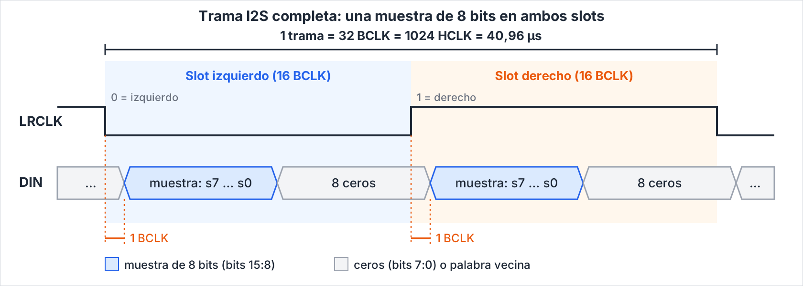
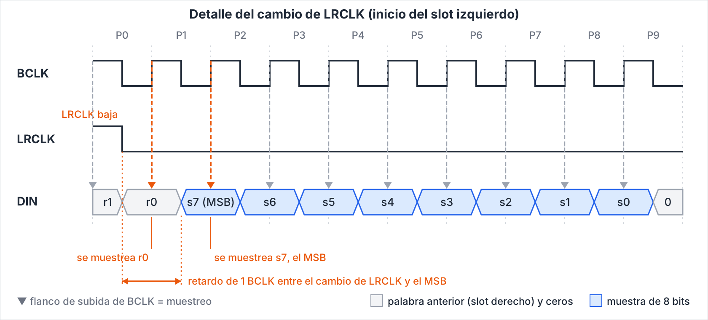

# Periférico: Audio

El procesador femtoRV32 escribe en registros mapeados en memoria qué sonido generar, y el periférico produce la señal que llega al parlante. El periférico genera tonos de onda cuadrada con muestras de 8 bits y las envía por I2S al amplificador MAX98357A, que convierte a analógico y maneja el parlante.

---
 
## 1. Marco teórico
 
> **En progreso.** Listo cuando: los conceptos que el lector necesita (generación digital de tonos, método de salida elegido, periféricos mapeados en memoria) están explicados y con fuentes citadas.

Esta sección sigue el camino del sonido en este diseño: cómo se digitaliza (1.1), cómo un circuito genera un tono (1.2), cómo la muestra viaja por I2S (1.3) hasta el amplificador (1.4), cómo se ajusta a 8 bits y a la memoria disponible (1.5) y cómo el procesador controla el periférico (1.6). La sección 1.7 compara el método elegido con la alternativa que propone el curso, el PWM, y la 1.8 resume qué decisión de diseño condiciona cada concepto. Las cifras tomadas de una fuente llevan su referencia entre corchetes. Lo que calculó o dedujo el equipo se marca como *(cálculo propio)* o *(razonamiento propio)*, y los cálculos se pueden repetir con los datos del texto.

### 1.1 Audio digital: muestreo y cuantización
 
Un sonido digital es una secuencia de muestras tomadas a una frecuencia fs. Por el teorema de Nyquist, solo se representan frecuencias menores que fs/2 [1]. Si la señal tiene componentes por encima de fs/2 ocurre aliasing: esas componentes aparecen como una frecuencia más baja [1].

Cada muestra se cuantiza con N bits; con N = 8 hay 256 niveles. La relación señal-ruido ideal (SNR) de un convertidor de N bits, para una señal sinusoidal de escala completa, es [2]:

$$
\mathrm{SNR} = 6{,}02\,N + 1{,}76\ \mathrm{dB}
$$

Con N = 8 resulta ≈ 49,9 dB *(cálculo propio)*. Es suficiente para efectos y tonos de un juego, no para música de alta fidelidad.
 
### 1.2 Generación digital de tonos: acumulador de fase
 
Un registro de fase de 16 bits aumenta en `FREQ` en cada muestra. Su bit más significativo alterna entre 0 y 1 y forma una onda cuadrada. La fase avanza módulo 2<sup>16</sup> y la muestra de salida depende de su bit 15:

$$
\mathrm{fase}[n+1] = \left(\mathrm{fase}[n] + \mathrm{FREQ}\right) \bmod 2^{16}
$$

$$
\mathrm{muestra}[n] =
\begin{cases}
{+}\mathrm{VOL} & \text{si } \mathrm{fase}_{15}[n] = 1 \\
{-}\mathrm{VOL} & \text{si } \mathrm{fase}_{15}[n] = 0
\end{cases}
$$

Una vuelta completa del registro dura en promedio 2<sup>16</sup>/FREQ muestras, y en cada vuelta el bit 15 completa un ciclo. Por tanto, la frecuencia de salida es *(razonamiento propio)*:

$$
f_{\mathrm{salida}} = \frac{f_s}{2^{16}/\mathrm{FREQ}} = \frac{\mathrm{FREQ} \cdot f_s}{2^{16}}
$$
 
Con fs ≈ 24 414 Hz la resolución de frecuencia es ≈ 0,37 Hz. Ejemplo: La4 (440 Hz) usa FREQ = 1181, que produce 439,96 Hz. La amplitud ±VOL es simétrica, así que no hay componente continua.

Esa resolución es el cambio de frecuencia por cada unidad de `FREQ`, es decir, fs dividida entre 2<sup>16</sup>. Se hace más gruesa cuando fs sube, y cada bit más en el registro de fase la reduce a la mitad *(razonamiento propio)*. Como `FREQ` es entero, el error máximo de una nota es media resolución, ≈ 0,19 Hz con fs = 24 414 Hz *(cálculo propio)*.

**De la nota a `FREQ`.** Para una nota de número MIDI m, con A4 (m = 69) fijada por convención en 440 Hz [3], la frecuencia en afinación temperada es:

$$
f_m = 440 \cdot 2^{\frac{m-69}{12}}\ \mathrm{Hz}
$$

El valor que se escribe en `FREQ` es el entero más cercano a la expresión siguiente *(razonamiento propio)*:

$$
\mathrm{FREQ} = \mathrm{round}\left(\frac{f_m \cdot 2^{16}}{f_s}\right)
$$

Con fs = 24 414,0625 Hz, A4 da `FREQ` = 1181 (439,96 Hz) y el do central, C4 (m = 60, 261,63 Hz), da `FREQ` = 702 (261,52 Hz) *(cálculo propio)*.

**fs no es libre.** Los valores anteriores suponen HCLK = 25 MHz y 1024 ciclos por trama (2.3), y el amplificador solo admite ciertas frecuencias de muestreo (1.4). Si fs cambia, `FREQ` se recalcula: con 512 ciclos por trama (fs = 48 828 Hz, ver 1.4), A4 usa `FREQ` = 591 (440,33 Hz) y la resolución pasa a ≈ 0,75 Hz *(cálculo propio)*.
 
### 1.3 El bus I2S
 
I2S transmite audio con tres líneas. La especificación original las llama SCK, WS y SD [4]; algunas hojas de datos, como la del MAX98357A, las llaman BCLK, LRCLK y DIN [5]. Este documento usa los nombres BCLK, LRCLK y DIN:
 
| Línea | Función |
|---|---|
| BCLK | Reloj de bit; un pulso por cada bit de dato |
| LRCLK | Selección de canal y marca de palabra: 0 = izquierdo, 1 = derecho |
| DIN | Datos en serie, MSB primero, complemento a dos |
 
Reglas de temporización:
 
- El transmisor cambia DIN y LRCLK en el flanco de bajada de BCLK. El receptor muestrea DIN en el flanco de subida [4]. La especificación deja libre el flanco en que cambia el transmisor [4]; el de bajada hace que DIN llegue estable al flanco de subida del receptor *(razonamiento propio)*.
- El MSB aparece un período de BCLK después del cambio de LRCLK [4]. Esa es la característica distintiva del modo I2S.
- Cada trama contiene un slot izquierdo y uno derecho, y dura 1/fs.

Cada receptor define qué relaciones entre BCLK y LRCLK acepta (ver 1.4). Con dos slots de N<sub>slot</sub> bits por trama, el reloj de bit debe valer *(razonamiento propio)*:

$$
f_{\mathrm{BCLK}} = 2 \cdot N_{\mathrm{slot}} \cdot f_s
$$

Con N<sub>slot</sub> = 16, BCLK vale 32 veces fs, la relación de la propuesta de 2.1 *(cálculo propio)*.

### 1.4 El amplificador MAX98357A
 
Es un amplificador clase D con entrada digital [5]. Contiene el DAC, así que el FPGA no necesita filtro ni conversor externo. Se alimenta con LRCLK, BCLK y DIN, sin MCLK [5]. Según el datasheet acepta frecuencias de muestreo de 8 kHz a 96 kHz (con las restricciones que se detallan abajo) y datos de 16, 24 o 32 bits en modo I2S [5]. La variante A espera I2S estándar y la B, datos justificados a la izquierda [5]. El canal se elige con SD_MODE, que también sirve para apagarlo, y la ganancia (3 a 15 dB) se fija con GAIN_SLOT [5]. Ambos son pines de configuración física, no registros. Los valores de cada pin están en 2.2 [5, 6].

El rango de 8 kHz a 96 kHz tiene restricciones: el datasheet indica que LRCLK solo admite 8, 16, 32, 44,1, 48, 88,2 y 96 kHz, y que 11,025, 12, 22,05 y 24 kHz no están soportadas [5]. Su tabla de características eléctricas da cuatro intervalos de LRCLK, de 7,6 a 8,4 kHz, de 15,2 a 16,8 kHz, de 30,4 a 50,4 kHz y de 83,8 a 100,8 kHz, que la tabla rotula fS1, fS2, fS3 y fS4 [5]. La tabla siguiente compara cada requisito del amplificador con la propuesta actual (HCLK = 25 MHz y 1024 ciclos por trama, 2.3) *(cálculo propio)*:

| Requisito del MAX98357A [5] | Valor que exige | Propuesta actual (2.3) | ¿Cumple? |
|---|---|---|---|
| LRCLK, frecuencia de muestreo | Dentro de fS1, fS2, fS3 o fS4 | 24,414 kHz | No |
| BCLK frente a LRCLK | 32, 48 o 64 veces | 32 veces | Sí |
| Frecuencia de BCLK | 0,2432 a 25,804 MHz | 781,25 kHz | Sí |
| Ancho de dato por slot, modo I2S | 16, 24 o 32 bits | 16 bits | Sí |
| MCLK | No se necesita | No se genera | Sí |
| Formato de datos | I2S (variante A) | I2S, MSB un BCLK después del cambio de LRCLK | Sí |

La fs = 24 414 Hz de la propuesta queda entre fS2 y fS3, fuera de todos los intervalos, y cerca de los 24 kHz que el datasheet declara no soportados *(cálculo propio)*. Con BCLK igual a 32 veces LRCLK y k ciclos de HCLK por cada BCLK, la frecuencia de muestreo es *(razonamiento propio)*:

$$
f_s = \frac{\mathrm{HCLK}}{32 \cdot k}
$$

La tabla siguiente muestra qué valores de k dejan fs dentro de un intervalo con los dos relojes que aparecen en el proyecto: 25 MHz (propuesta de 2.3) y 27 MHz (Tang Nano 9K, según el [README del equipo](../README.md)) *(cálculo propio)*:

| HCLK | k | Ciclos por trama | fs | Intervalo del datasheet |
|---|---|---|---|---|
| 25 MHz | 32 | 1024 | 24 414 Hz | Ninguno (propuesta actual) |
| 25 MHz | 16 | 512 | 48 828 Hz | fS3, 1,7 % sobre 48 kHz |
| 25 MHz | 24 | 768 | 32 552 Hz | fS3, 1,7 % sobre 32 kHz |
| 27 MHz | 32 | 1024 | 26 367 Hz | Ninguno |
| 27 MHz | 16 | 512 | 52 734 Hz | Ninguno, supera 50,4 kHz |
| 27 MHz | 18 | 576 | 46 875 Hz | fS3, 2,3 % bajo 48 kHz |
| 27 MHz | 26 | 832 | 32 452 Hz | fS3, 1,4 % sobre 32 kHz |

Con 25 MHz, 512 ciclos por trama es una potencia de 2 y conserva el contador libre de 2.3.3, con 9 bits en lugar de 10. Con 27 MHz ninguna potencia de 2 cae dentro de un intervalo: haría falta un contador que llegue hasta 576 u 832 ciclos, o un PLL que genere un HCLK adecuado, si la placa lo permite. Por ejemplo, 24,576 MHz entre 512 ciclos por trama da exactamente 48 kHz *(cálculo propio)*.

Una LRCLK fuera de los intervalos es una condición que el fabricante declara no soportada, así que conviene elegir un valor dentro de ellos y confirmarlo en la placa. La decisión depende del reloj de la placa final y es del equipo.
 
### 1.5 Muestras de 8 bits y uso de memoria
 
La interfaz del MAX98357A acepta 16, 24 o 32 bits por slot, no 8 [5]. Se usa un slot de 16 bits con la muestra de 8 bits (con signo, −128…127) en los bits 15:8; el hardware fuerza a cero los bits 7:0. Esos ocho ceros se generan en el transmisor y no se almacenan.
 
Si el contenido viene de audio de 8 bits sin signo (como WAV), hay que invertir el MSB (`XOR 0x80`) para pasarlo a complemento a dos. Cada muestra se envía en ambos slots, para que el sonido sea el mismo con SD_MODE en izquierdo, derecho o mezcla.
 
La restricción de 8 bits busca minimizar la memoria que ocupa el sonido. La RAM del SoC es de 26 212 bytes y compite con el código y la pila (1024 B), por lo que se prefiere una arquitectura que no almacene audio:
 
| Método | Memoria de datos | Observación |
|---|---|---|
| Generador de tonos (acumulador de fase) | 0 bytes de RAM; ≈ 40 flip-flops | Método elegido |
| PCM de 8 bits a fs = 24,414 kHz | 24 414 B por segundo (≈ 93 % de la RAM) | Inviable |
| PCM de 8 bits con muestra repetida ×3 (≈ 8,138 kHz) | 8 138 B por segundo (≈ 31 % de la RAM) | Opcional, con contador de repetición |
 
**Por qué no 16 bits.** Con ondas cuadradas la muestra solo toma dos valores (+VOL y −VOL), por lo que más resolución no mejora el timbre. Con el generador de tonos el audio no se guarda, y pasar a 16 bits solo ensancharía unos pocos flip-flops; con PCM duplicaría la memoria (1 s a 8,138 kHz pasaría de 8 138 B a 16 276 B). Como el transmisor I2S ya envía palabras de 16 bits, una ampliación posterior solo requiere ensanchar VOL y la muestra y cargar los bits 7:0 en vez de ceros, sin rediseñar el bus ni la temporización.
 
| | 8 bits | 16 bits |
|---|---|---|
| Relación señal-ruido ideal | ≈ 49,9 dB | ≈ 98 dB |
| Niveles | 256 | 65 536 |
| Memoria del generador de tonos | 0 B | 0 B |
| 1 s de PCM a 8,138 kHz | 8 138 B | 16 276 B |
| Cambios en el transmisor I2S | Ninguno | Ninguno |
 
### 1.6 Periférico mapeado en memoria
 
El CPU accede al periférico con cargas y almacenamientos a direcciones fijas (MMIO), sin instrucciones especiales. La estructura sigue la de UART8N1: decodificador local, control de registros y core, descrita en la sección 12 de la guía de la UART [7]. A diferencia de la UART, aquí no hay protocolo de aceptación (START/BUSY/DONE): los registros fijan el sonido y el hardware lo mantiene hasta que se cambien.

La arquitectura del curso usa un solo bus de memoria con periféricos mapeados en memoria [8]. El manual de RISC-V indica que distintos rangos del espacio de direcciones pueden contener memoria principal o dispositivos de E/S, y que las lecturas y escrituras a dispositivos de E/S pueden tener efectos secundarios visibles, a diferencia de los accesos a memoria principal [9]. En el SoC del curso, cuando el firmware escribe en la ventana de un periférico, el adaptador del bus (`WishbonePeripheral`) le entrega durante un ciclo las señales `cs`, `wr`, `addr` (el desplazamiento dentro de la ventana) y `d_in` (el valor escrito), y responde `ack` al bus [10]. Como `d_in` es válido solo un ciclo, el periférico debe guardar el valor en un registro propio y generar el sonido de forma autónoma a partir de él *(razonamiento propio)*. Por eso `FREQ`, `VOL` y `CONTROL` son registros, con el mapa de 2.4.

### 1.7 PWM como alternativa y por qué se elige I2S

El documento de la fase de diseño propone dos métodos de salida de audio: «Audio por PWM a un parlante pequeño (simple, sin DAC)» y «Audio por I2S hacia un DAC externo (más fiel, más pines y más estudio)». Pide elegir «la más adecuada para su juego» y justificar «por qué esa y no otra» [8]. Este diseño usa I2S, como indica la introducción del documento. Esta subsección explica el PWM, que es la alternativa, y compara los dos métodos.

#### 1.7.1 PWM

La modulación por ancho de pulso (PWM) es una señal digital de frecuencia fija cuyo ciclo de trabajo D, la fracción del período en nivel alto, se modula. El ciclo de trabajo determina la amplitud de la forma de onda analógica: un ciclo del 50 % da una señal analógica con la mitad de la tensión de alimentación [11]. Por definición de valor medio de una señal periódica, el valor medio de la salida es *(razonamiento propio)*:

$$
\bar{V} = D \cdot V_{DD}, \qquad 0 \le D \le 1
$$

donde V<sub>DD</sub> es la tensión del nivel alto. Para obtener la señal analógica se usa un filtro pasa bajos, por ejemplo uno RC pasivo simple, que elimina la frecuencia base del PWM y deja pasar la señal [11]. El ancho de banda de la señal deseada, F<sub>bw</sub>, debe ser mucho menor que la frecuencia del PWM, F<sub>PWM</sub> [12]:

$$
F_{bw} \ll F_{PWM}
$$

Si la señal analógica va a una entrada de baja impedancia, como un parlante, debe conectarse un amplificador buffer entre la salida del filtro y la carga [11].

La frecuencia del PWM depende del reloj y del número de bits B del contador. Si el contador avanza un paso por ciclo de reloj y un período de PWM es una vuelta completa del contador *(razonamiento propio)*:

$$
F_{PWM} = \frac{f_{clk}}{2^{B}}
$$

Con 27 MHz, un contador de 8 bits da 105,5 kHz y uno de 10 bits da 26,4 kHz *(cálculo propio)*. Más bits dan más niveles de amplitud pero una frecuencia de PWM más baja, y esa frecuencia debe seguir muy por encima del ancho de banda de la señal [12].

El documento del curso describe el audio por PWM como un parlante pequeño conectado directamente a un pin, con PWM generado por hardware o por software [8]. Para una onda cuadrada de solo dos niveles, ese pin puede alternar a la frecuencia del tono sin variar el ciclo de trabajo; el PWM con filtro hace falta para formas de onda con más niveles *(razonamiento propio)*.

#### 1.7.2 Comparación

| Criterio | PWM | I2S con MAX98357A |
|---|---|---|
| Descripción en el documento del curso [8] | «simple, sin DAC» | «más fiel, más pines y más estudio» |
| Pines de salida de la FPGA | 1 [8] | 3: BCLK, LRCLK y DIN [4] |
| Conversión a señal analógica | Filtro pasa bajos y, para un parlante, buffer [11] | Dentro del amplificador (entrada digital PCM), sin filtro de salida [5] |
| Qué limita la resolución | Bits B del contador frente a la frecuencia del PWM, ver 1.7.1 *(cálculo propio)* | Bits por slot que admite el amplificador: 16, 24 o 32 [5] |
| Condición del reloj | Ancho de banda de la señal mucho menor que la frecuencia del PWM [12] | BCLK de 32, 48 o 64 veces LRCLK y LRCLK dentro de los intervalos de 1.4 [5] |
| Con un reloj de 27 MHz | PWM de 105,5 kHz con 8 bits o de 26,4 kHz con 10 bits *(cálculo propio)* | fs de 46 875 Hz con k = 18, según 1.4 *(cálculo propio)* |

#### 1.7.3 Justificación de I2S (propuesta)

El documento del curso pide justificar «por qué esa y no otra» [8]. Con lo anterior, estas son las razones para usar I2S con el MAX98357A. Son una propuesta *(razonamiento propio)* que el equipo debe confirmar:

1. **Integración.** El amplificador recibe la muestra digital y entrega la salida para el parlante sin filtro de salida [5]. Con PWM, obtener una señal analógica para un parlante exige filtro pasa bajos y buffer [11].
2. **Resolución y reloj independientes.** En PWM, la resolución y la frecuencia del PWM compiten por el mismo reloj (ecuación de 1.7.1). En I2S, los bits por muestra y la frecuencia de muestreo se eligen por separado, con las condiciones de 1.4.
3. **Crecimiento.** La muestra de 8 bits cabe en un slot de 16 y pasar a 16 bits no cambia el bus (1.5).

El costo es el que anticipa el documento del curso: tres pines en vez de uno y más estudio, porque hay que diseñar el transmisor I2S y cumplir su temporización [8].

### 1.8 De los conceptos a las decisiones de diseño

La tabla indica qué decisión de diseño condiciona cada concepto y en qué parte del documento se usa.

| Concepto | Decisión de diseño que condiciona | Se usa en |
|---|---|---|
| 1.1 Muestreo y cuantización | Frecuencia de muestreo y ancho de la muestra | 2.1 y 2.3 |
| 1.2 Acumulador de fase | Ancho de `FREQ`, resolución de frecuencia y valor de `FREQ` de cada nota | 2.4, 3.2 y 3.3 |
| 1.3 Bus I2S | Temporización de BCLK, LRCLK y DIN | 2.3 y 3.6 |
| 1.4 Amplificador MAX98357A | HCLK, ciclos por trama y configuración de los pines SD y GAIN | 2.2, 2.3 y 3.2 |
| 1.5 Muestras de 8 bits y memoria | Muestra en los bits 15:8 y ningún audio almacenado | 2.1 y 3.3 |
| 1.6 Periférico mapeado en memoria | Mapa de registros y escritura en un ciclo | 2.4, 3.2 y 3.6 |
| 1.7 PWM frente a I2S | Método de salida y número de pines | 3.2 |

## 2. Fundamento
 
### 2.1 Principio de funcionamiento
 
El CPU no produce el audio muestra a muestra. Solo escribe `FREQ`, `VOL` y `ENABLE`, y el periférico genera el sonido por sí mismo. Un generador de tonos (acumulador de fase) calcula una muestra de 8 bits con signo una vez por trama, cada 1024 ciclos de HCLK (40,96 µs, fs ≈ 24,414 kHz).
 
Un transmisor I2S coloca esa muestra en los 8 bits altos de una palabra de 16, la repite en los slots izquierdo y derecho y la serializa por DIN. BCLK vale HCLK/32 = 781,25 kHz y LRCLK vale HCLK/1024. El MAX98357A hace la conversión digital-analógica y la amplificación clase D. Todas las salidas son registradas y salen de un único contador libre, de modo que BCLK, LRCLK y DIN quedan alineados sin generador de ticks separado.
 
### 2.2 Conexiones del módulo MAX98357A
 
El FPGA actúa como maestro I2S: BCLK, LRCLK y DIN son salidas del FPGA y entradas del módulo. El módulo no devuelve datos.
 
```
FPGA (peripheral_audio)              Módulo MAX98357A
audio_bclk   ─────────────────────►  BCLK   reloj de bit, 781,25 kHz
audio_lrclk  ─────────────────────►  LRC    reloj de trama, 24,414 kHz (0 = izq., 1 = der.)
audio_din    ─────────────────────►  DIN    datos en serie, MSB primero
3V3 o 5V     ─────────────────────►  VIN    alimentación (3,3–5 V)
GND          ─────────────────────►  GND    tierra común
(sin conectar o a GND/VIN)           GAIN   ganancia por cableado (3–15 dB)
(sin conectar, 3V3 o GPIO)           SD     apagado y selección de canal
                                     + / −  parlante de 4–8 Ω, salida en puente
```
 
| Pin | Qué representa | Notas |
|---|---|---|
| VIN | Alimentación (3,3–5 V) | Rotulado parcialmente en la esquina de la placa; confirmar en la placa física. El clase D toma picos de corriente; con 5 V suena más fuerte. |
| GND | Referencia común de tierra | Obligatorio. Sin tierra común, BCLK, LRC y DIN no tienen referencia. |
| BCLK | Reloj de bit | Marca cuándo leer DIN. |
| LRC | Reloj de trama (LRCLK) | 0 = izquierdo, 1 = derecho. Su frecuencia es fs. |
| DIN | Datos de audio | Bits de la muestra, MSB primero. |
| GAIN | Ganancia, fija por cableado | Ver abajo. No la controla el FPGA. |
| SD | Apagado y selección de canal | Ver abajo. |
| + / − | Salida al parlante (4–8 Ω) | La salida es en puente: ningún terminal se conecta a GND. |
 
**GAIN** (valores del módulo DFRobot; verificar contra la placa): GAIN a GND por 100 kΩ → 15 dB; GAIN a GND → 12 dB; sin conectar → 9 dB; GAIN a VDD → 6 dB; GAIN a VDD por 100 kΩ → 3 dB. Se recomienda empezar sin conectar (9 dB).
 
**SD:** por debajo de 0,16 V el amplificador se apaga. Con 0,16–0,77 V sale la mezcla izquierdo/derecho; con 0,77–1,4 V el canal derecho; sobre 1,4 V el izquierdo. Muchas placas fijan esto con resistencias; revisar la placa usada. Como se envía la misma muestra en ambos slots, cualquier selección suena igual. SD también puede manejarse con un GPIO para silenciar el parlante.
 
Pendiente: asignación de pines físicos y verificación de las resistencias de SD y GAIN de la placa concreta.
 
### 2.3 Diagrama de tiempos
 
Parámetros **(propuesta)**: HCLK = 25 MHz, 32 HCLK por BCLK, 16 BCLK por slot, 32 BCLK por trama.
 
| Magnitud | Valor |
|---|---|
| Período de BCLK | 32 HCLK = 1,28 µs (781,25 kHz) |
| Período de trama = 1/fs | 1024 HCLK = 40,96 µs (fs = 24 414,0625 Hz) |
| Duración de un slot | 16 BCLK = 512 HCLK |
| Frecuencia máxima representable | fs/2 ≈ 12,2 kHz |
 
#### 2.3.1 Figura 1. Trama completa
 

 
La misma muestra de 8 bits se envía en el slot izquierdo y en el derecho. En cada slot, los 8 bits de la muestra ocupan los bits 15:8 de la palabra y los bits 7:0 son ceros. Cada palabra de DIN comienza un BCLK después del cambio de LRCLK.
 
#### 2.3.2 Figura 2. Detalle en el cambio de LRCLK
 

 
LRCLK y DIN cambian en los flancos de bajada de BCLK, y el receptor muestrea en los flancos de subida (flechas). `r1` y `r0` son los dos últimos bits de la palabra anterior (slot derecho). LRCLK baja en la mitad de P0; en el flanco de subida de P1 el receptor todavía lee `r0`, y `s7` (el MSB) se muestrea recién en P2. Después de `s0` siguen ocho ceros hasta completar los 16 bits del slot.
 
#### 2.3.3 Relación con HCLK
 
Un contador libre `cnt[9:0]` cuenta 0…1023 en HCLK y de él salen todas las señales:
 
| Bits del contador | Significado |
|---|---|
| `cnt[4:0]` | Posición dentro de un período de BCLK (0…31); BCLK = `cnt[4]` |
| `cnt[8:5]` | Índice de bit dentro del slot (0…15) |
| `cnt[9]` | Slot: 0 izquierdo, 1 derecho; LRCLK va desplazado 1 BCLK respecto al MSB |
 
Las salidas BCLK, LRCLK y DIN se cargan en registros en el flanco de HCLK donde `cnt[4:0]` pasa de 31 a 0, que equivale al flanco de bajada de BCLK. El ASMD y las transferencias exactas se definen en el siguiente paso del método.
 
### 2.4 Mapa de registros (propuesta)
 
Región global libre: `0x0043` (base `0x00430000`). Hay que actualizar `chip_select` y el mux de lectura al conectarlo.
 
| Dirección | Registro | Bits | Función |
|---|---|---|---|
| `0x00430000` | FREQ | 15:0 | Incremento de fase; f = FREQ·fs/65536 |
| `0x00430004` | VOL | 6:0 | Amplitud de la onda cuadrada (0…127) |
| `0x00430008` | CONTROL | 0 | ENABLE: 1 = sonido, 0 = silencio (muestra 0) |
 
Los valores se aplican en la siguiente muestra. Escribirlos mientras suena es seguro, porque la fase no se reinicia. Los demás bits se leen como cero y las escrituras fuera de estos offsets se ignoran, igual que en UART8N1.
 
### 2.5 Criterios de comprobación
 
- BCLK tiene período de 32 HCLK y ciclo de trabajo 50 %.
- LRCLK vale 0 durante 16 BCLK y 1 durante 16 BCLK; la trama dura 1024 HCLK.
- El MSB aparece un BCLK después del cambio de LRCLK. DIN solo cambia en flancos de bajada de BCLK.
- Los bits 7:0 de cada slot son cero. Ambos slots llevan la misma muestra.
- Con `FREQ = 1181` y `VOL = 64`, la salida alterna ±64 con frecuencia 439,97 Hz ± la resolución de la medición.
- Con `ENABLE = 0`, DIN vale 0 en todos los bits.
- Reset síncrono activo alto: BCLK, LRCLK y DIN quedan en reposo.

### 2.6 Pendiente
 
- Relación BCLK/LRCLK admitida para 16 bits y límites de temporización del datasheet.
- Asignación de pines BCLK, LRCLK y DIN, y nivel eléctrico (3,3 V).
- Configuración física de SD y GAIN.
- ASMD, tabla de transferencias, bloques (control y datapath) y RTL del transmisor I2S.
 

## 3. Etapa de diseño

### 3.1 Diagrama de caja negra

> **Pendiente.** Listo cuando: todas las entradas y salidas tienen nombre, sin mostrar nada del interior.

### 3.2 Características de la interfaz

> **Pendiente.** Listo cuando: cada señal tiene nombre, dirección y ancho; están el mapa de registros, la salida hacia el parlante, los pines y los voltajes.

### 3.3 Diagrama de bloques

> **Pendiente.** Listo cuando: cada bloque interno tiene su función y las señales usan los mismos nombres que en Verilog.

### 3.4 Diagrama de flujo

> **Pendiente.** Listo cuando: usa símbolos ISO 5807, cada decisión tiene salidas Sí y No, y no hay terminal de Fin en procesos cíclicos.

### 3.5 Clasificación del flujo

> **Pendiente.** Listo cuando: los pasos están separados en ruta de datos y unidad de control (por confirmar con la guía).

### 3.6 Máquinas de estado

> **Pendiente.** Listo cuando: cada máquina tiene estado de reset, transiciones con su condición y las salidas de cada estado.

## 4. Etapa de descripción en HDL

### 4.1 Organización de módulos e implementación en Verilog

> **Pendiente.** Listo cuando: hay un módulo por bloque, un módulo superior que los une, parámetros declarados y nombres iguales a los diagramas. Código en [`rtl/`](rtl/).

## 5. Etapa de simulación

### 5.1 Entorno de prueba: testbench, estímulos y observación

> **Pendiente.** Listo cuando: se prueban casos normales y de borde, y las formas de onda de GTKWave están explicadas con resultado esperado contra obtenido.

## 6. Etapa de implementación

> **Pendiente.** Listo cuando: la síntesis no da errores, hay archivo de asignación de pines, reporte de recursos y prueba en placa con evidencia (foto, video u osciloscopio).

## Referencias

[1] W. Kester, «What the Nyquist Criterion Means to Your Sampled Data System Design», Analog Devices, tutorial MT-002. Copia consultada en: https://wcm-cce.cldnet.analog.com/media/en/training-seminars/tutorials/mt-002.pdf (consultado el 12 de noviembre de 2026).

[2] W. Kester, «Taking the Mystery out of the Infamous Formula, "SNR = 6.02N + 1.76dB," and Why You Should Care», Analog Devices, tutorial MT-001, rev. A, octubre de 2008. Copia consultada en: https://forums.parallax.com/discussion/download/130098/MT-001.pdf (consultado el 13 de noviembre de 2026).

[3] J. Wolfe, «Note names, MIDI numbers and frequencies», University of New South Wales. Disponible en: https://newt.phys.unsw.edu.au/jw/notes.html (consultado el 12 de noviembre de 2026).

[4] Philips Semiconductors, «I2S bus specification», 1986, revisada el 5 de junio de 1996. Copia consultada en: https://www.fdi.ucm.es/profesor/mendias/PSyD/docs/I2SBUS.pdf (consultado el 12 de noviembre de 2026).

[5] Maxim Integrated (hoy Analog Devices), «MAX98357A/MAX98357B: PCM Input Class D Audio Power Amplifiers», hoja de datos, Rev. 13, julio de 2019. Página del fabricante: https://www.analog.com/en/MAX98357A/datasheet. Copia consultada en: https://www.makerguides.com/wp-content/uploads/2026/01/Datasheet_MAX98357A.pdf (consultado el 13 de noviembre de 2026).

[6] DFRobot, «MAX98357A I2S Digital Amplifier Module (DFR0954)», wiki. Disponible en: https://wiki.dfrobot.com/SKU_DFR0954_MAX98357_I2S_Amplifier_Module (valores de GAIN y SD del módulo; verificar contra la placa usada).

[7] Guía UART 8N1 del proyecto, secciones 5.4 (método por transferencias entre registros) y 12 (integración MMIO).

[8] Documento de la fase de diseño del curso, «Fase de Diseño. Proyecto: Consola de Videojuegos en FPGA»: apartados «1.2 Núcleo de procesador», «1.5 Salidas» y «Entregable E: Selección y justificación de periféricos» (subsección «Salidas»).

[9] RISC-V International, «The RISC-V Instruction Set Manual», volumen de instrucciones base no privilegiadas, capítulo «Introduction», sección «Memory». Copia del repositorio del manual consultada en: https://mirror.iscas.ac.cn/riscv-toolchains/git/riscv/riscv-isa-manual.git/tree/src/intro.adoc (consultado el 12 de noviembre de 2026).

[10] Plantilla del curso, `template/diagramas/README.md`, sección «Flujo de una operación de firmware sobre un periférico».

[11] Microchip Technology, «AVR131: Using the AVR's High-speed PWM», sección 2.2 «Analog Waveform Generation from PWM Signal», documentación en línea (sin fecha de publicación visible). Disponible en: https://onlinedocs.microchip.com/oxy/GUID-15F56EF1-EBFF-405A-9412-E41CC95BAACF-en-US-2/GUID-34AC5DDB-B9AE-4272-842B-E2A1CEE69B6B.html (consultado el 12 de noviembre de 2026).

[12] A. Palacherla, «Using PWM to Generate Analog Output», Microchip Technology, nota de aplicación AN538 (DS00538C), noviembre de 1999. Copia consultada en: https://rose-hulman.edu/Class/ee/radu/ece333/Labs/an538_pwm.pdf (consultado el 12 de noviembre de 2026).
