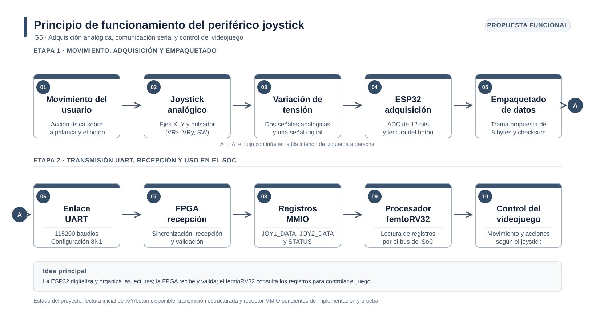
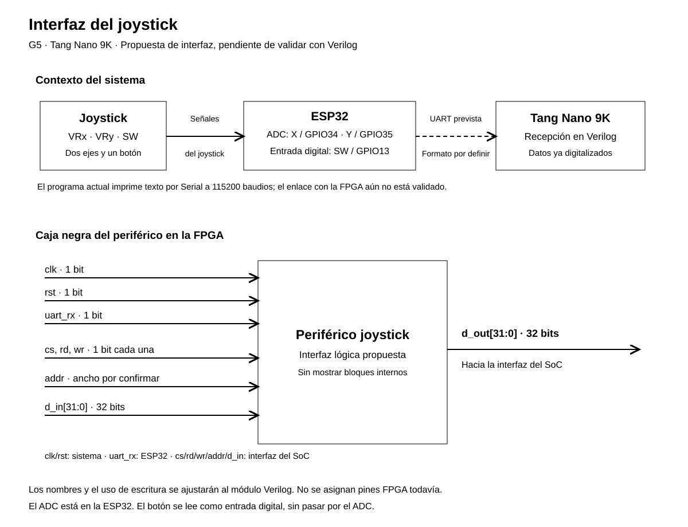
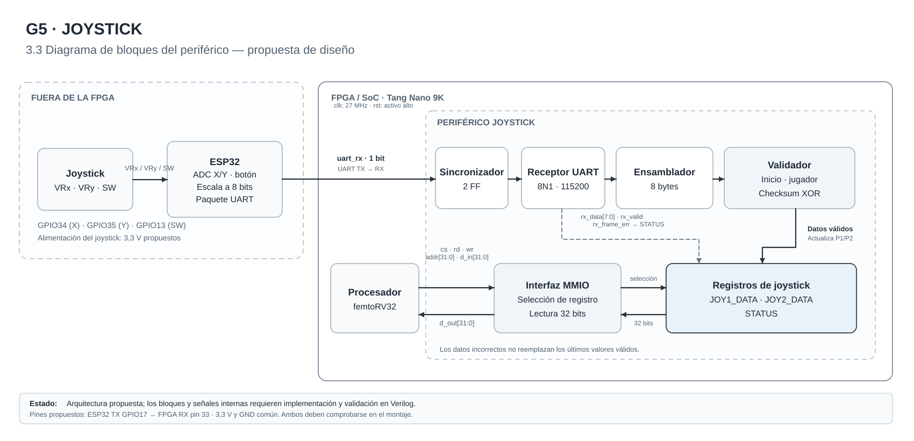
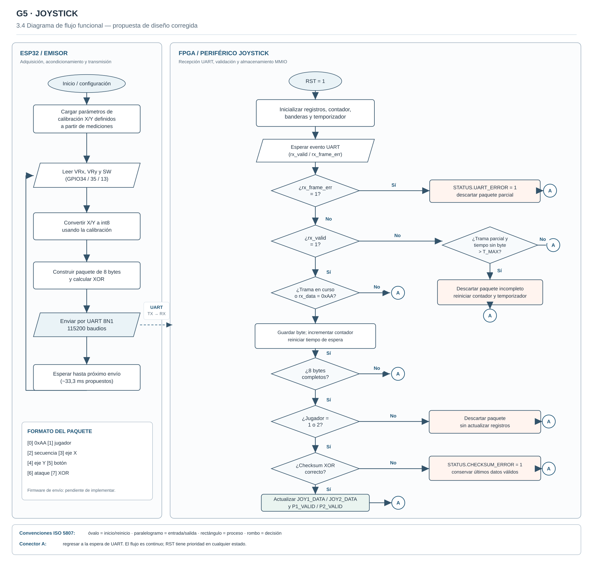
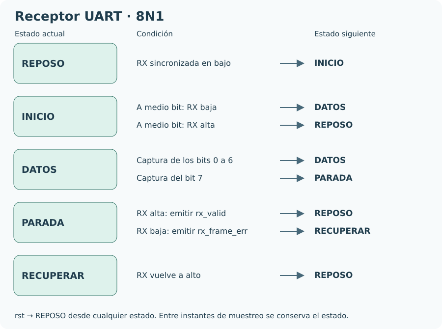
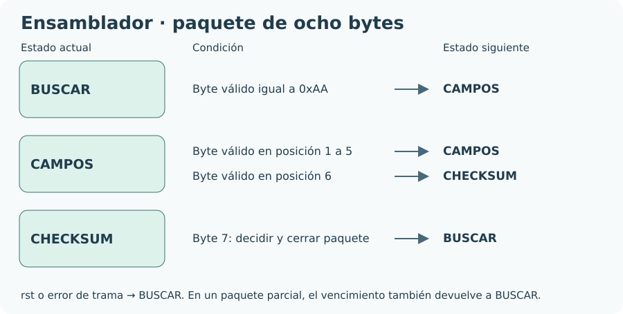

# Periférico: Joystick

Una ESP32 lee un joystick analógico de dos ejes con botón y envía las lecturas por UART a la FPGA. El periférico recibe esos paquetes y guarda los valores en registros mapeados en memoria, que el procesador femtoRV32 lee por el bus del SoC.

> Estado de cada sección y preguntas abiertas: [README del equipo](../README.md).

## 1. Marco teórico

> los conceptos que el lector necesita (UART, periféricos mapeados en memoria, ADC de la ESP32) están explicados y con fuentes citadas.

Esta sección sigue el camino de la información, desde el joystick hasta el procesador: cómo un joystick produce una tensión (1.1), cómo la ESP32 la convierte en un número (1.2), cómo ese número llega a la FPGA por UART (1.3), cómo la FPGA recibe una señal que no está sincronizada con su reloj (1.4) y cómo el procesador lee el resultado (1.5). Las cifras tomadas de una fuente llevan su referencia entre corchetes. Lo que calculó o dedujo el equipo se marca como *(cálculo propio)* o *(razonamiento propio)*, y los cálculos se pueden repetir con los datos del texto.

### 1.1 Joystick analógico: el potenciómetro como divisor de tensión

Un potenciómetro es una resistencia con un cursor (*wiper*) que la divide en dos tramos, R1 y R2. Si sus extremos se conectan a una fuente, la tensión en el pin central depende de la posición del cursor y sigue la relación del divisor de tensión [1]:

$$
V_{out} = V_{in}\,\frac{R_2}{R_1 + R_2}
$$

Con el cursor en el centro del recorrido la salida es la mitad de la entrada [1]. En un extremo la salida tiende a cero y, por la misma relación, en el otro tiende a la tensión de alimentación.

Un joystick analógico de pulgar contiene dos potenciómetros, uno por eje. Por ejemplo, el SparkFun Thumb Joystick tiene dos potenciómetros de 10 kΩ (ejes X e Y), un resorte que devuelve la palanca al centro al soltarla y un interruptor que se activa al presionar el cabezal [2]. El joystick entrega así dos tensiones analógicas continuas y un contacto digital.

El centro ideal es la mitad de la alimentación, pero el valor de reposo real de cada eje no se asume: se mide en el módulo que use el equipo.

### 1.2 Conversión analógica a digital en la ESP32

La FPGA y el procesador solo manejan valores digitales, así que las dos tensiones del joystick deben convertirse en números. De eso se encarga el convertidor analógico a digital (ADC) de la ESP32.

**Principio de funcionamiento (aproximaciones sucesivas, SAR).** Al iniciar una conversión, el circuito de muestreo y retención (*sample-and-hold*) congela la tensión de entrada y el DAC interno se fija a la mitad de la escala. Un comparador decide si la entrada está por encima o por debajo de la salida del DAC; el resultado es el bit más significativo y se guarda en el registro de aproximaciones sucesivas (SAR). El DAC pasa entonces a un cuarto o a tres cuartos de la escala, según ese bit, y el comparador decide el bit siguiente [3]. Una conversión de N bits toma N pasos [3].

**Resolución.** El paso de cuantización q es el cambio de tensión de entrada que corresponde a un código de diferencia. Para un rango de entrada VFS y un ADC de N bits vale:

$$
q = \frac{V_{FS}}{2^{N}}
$$

La ESP32 integra dos ADC de aproximaciones sucesivas, con 18 canales de medición en total, y sus resultados crudos en modo de lectura simple tienen 12 bits [4]: 4096 niveles, con códigos de 0 a 4095 *(cálculo propio)*. Para un rango ilustrativo de 3,3 V, el paso es de unos 0,81 mV *(cálculo propio)*.

**Rango medible y atenuación.** La ESP32 puede atenuar la entrada para ampliar el rango que mide. La documentación indica que los resultados más exactos se obtienen dentro de un *rango sugerido*, que depende de la atenuación [4]:

| Atenuación | Rango sugerido [4] |
|---|---|
| 0 dB | 100 a 950 mV |
| 2,5 dB | 100 a 1250 mV |
| 6 dB | 150 a 1750 mV |
| 12 dB | 150 a 2450 mV |

Para la máxima exactitud, Espressif recomienda usar las funciones de calibración y medir dentro de esos rangos [4]. El nombre de atenuación 11 dB figura como obsoleto y se comporta igual que 12 dB [4].

**Referencia y calibración.** Por diseño, la tensión de referencia del ADC es de 1100 mV, pero la real puede estar entre 1000 mV y 1200 mV según la ESP32 [4]. Por eso el paso de valor crudo a milivoltios se hace con las funciones de calibración de ESP-IDF [4, 5].

**Ruido y linealidad.** El ADC de la ESP32 puede ser sensible al ruido, con grandes discrepancias entre lecturas. Para minimizarlo, la documentación indica que se puede conectar al pad de entrada un condensador de desacople (por ejemplo, cerámico de 100 nF), y que el multimuestreo mitiga aún más sus efectos [4]. Espressif también reporta, para la ESP32 original, error de no linealidad en el rango alto de tensión y un rango limitado al inicio y al final por el error de offset; con la calibración *Line Fitting* de la ESP32, el error calibrado en su medición fue en general menor que 30 mV, salvo por la pérdida de lecturas en esos extremos [6]. La resolución (el paso q) no es lo mismo que la exactitud.

**ADC1 y ADC2.** La unidad ADC2 también la usa el Wi-Fi, y su uso simultáneo puede bloquear la lectura o hacerla fallar [4, 5]. Si el programa de la ESP32 llegara a usar Wi-Fi, los ejes del joystick deberían leerse en canales de ADC1 *(criterio derivado de [4])*.

**Consecuencia para este diseño** *(cálculo propio, a partir de [4] y de 1.1)*. Si el módulo se alimenta a 3,3 V (por confirmar en 3.2), el centro del recorrido queda cerca de 1,65 V, dentro de los rangos sugeridos de 6 dB y de 12 dB, pero el tramo por encima de 2450 mV queda fuera incluso del rango sugerido más amplio. Las lecturas cerca de los extremos son las menos exactas, así que los umbrales de dirección deben definirse con los valores de reposo y de extremos medidos en el módulo.

### 1.3 UART: comunicación serie asíncrona

La UART transmite bytes por una sola línea, sin reloj compartido: ambos extremos deben transmitir a la misma velocidad, pactada de antemano, para tener la misma temporización de bit [7]. Cada byte viaja dentro de una trama:

| Elemento de la trama | Nivel | Descripción [7] |
|---|---|---|
| Reposo | Alto | Sin datos, la línea se mantiene en alto |
| Bit de inicio | Bajo | Transición del reposo (alto) a bajo |
| Bits de datos | Según el dato | De 5 a 9 bits (7 u 8 son lo más común), normalmente con el menos significativo primero |
| Paridad | Opcional | Un bit para detectar errores |
| Bit de parada | Alto | Marca el fin de los datos; un segundo bit de parada es posible pero poco común |

La notación 8N1 significa 8 bits de datos, sin paridad (*none*) y un bit de parada; una trama 8N1 ocupa 10 tiempos de bit *(cálculo propio)*. El tiempo de bit es el inverso de la velocidad:

$$
T_{bit} = \frac{1}{\mathrm{baud}}
$$

A 115200 baudios, una de las velocidades comunes [7], resulta:

$$
T_{bit} = \frac{1}{115\,200\ \mathrm{baud}} \approx 8{,}68\ \mu\mathrm{s}
$$

Una trama 8N1 dura entonces unos 86,8 µs *(cálculo propio)*.

**Recepción.** Sin reloj compartido, el receptor detecta el flanco de bajada del bit de inicio y muestrea cada bit en su punto medio [8]. Maxim describe un receptor con un reloj 16 veces mayor que la velocidad de datos: tras el flanco de bajada espera 8 ciclos para llegar al centro del bit de inicio y luego 16 ciclos para cada punto medio siguiente [8].

**Tolerancia de velocidad.** Un desajuste entre las velocidades del emisor y del receptor desplaza el punto de muestreo a lo largo de la trama. Maxim calcula que el desajuste admisible es de ±3,3 % en un caso normal (el bit se puede muestrear dentro del 75 % central de su duración) y de ±2 % en un caso «nasty» (muestreo confiable solo en el 50 % central, como en un enlace largo y capacitivo) [8]. Ese margen se comparte entre transmisor y receptor, en cualquier proporción [8].

**Velocidad a partir del reloj de la FPGA.** Contar N ciclos de reloj por bit genera la temporización:

$$
N = \frac{f_{clk}}{\mathrm{baud}}
$$

Como N debe ser entero, la velocidad real difiere de la pedida. Con el reloj de 27 MHz de la placa de pruebas y 115200 baudios *(cálculo propio)*:

$$
N = \frac{27\,000\,000}{115\,200} = 234{,}375 \;\Rightarrow\; N = 234
$$

$$
\mathrm{baud}_{real} = \frac{27\,000\,000}{234} \approx 115\,385 \qquad e = \frac{115\,385 - 115\,200}{115\,200} \approx +0{,}16\,\%
$$

Un error de +0,16 % es mucho menor que el margen de ±3,3 % de [8]. El reloj y los baudios son parámetros del diseño (ver el [README del equipo](../README.md)), de modo que este cálculo se repite si cambia la placa.

**Qué transporta la UART.** Solo bytes: el significado de cada byte (el formato del paquete) lo define el equipo en 3.2. El documento de la fase de diseño contempla el joystick analógico con ADC simple y, para un mando propio, pide un protocolo simple (UART, I2C o SPI) documentado byte por byte en ambos extremos [9].

### 1.4 Entradas asíncronas: metaestabilidad y sincronizador de dos flip-flops

La línea RX llega desde la ESP32, que genera la señal con su propio reloj: sus flancos pueden aparecer en cualquier instante respecto del reloj de la FPGA. Es un cruce entre dos dominios de reloj, y el registro que captura la señal puede quedar en un estado metaestable: cualquier estado que no es alto ni bajo, sino intermedio, como durante una transición [10]. Cuanto más cerca del punto medio está ese estado, más tarda en resolverse y menos seguro es su valor final [10].

El circuito estándar para recibir un bit de otro dominio es el sincronizador: una cadena de dos (o más) registros, sin lógica entre ellos, con el reloj del receptor. El primero recibe el bit sincronizado con el reloj del emisor y el segundo entrega una versión sincronizada con el reloj del receptor [10]. Una segunda metaestabilidad «es exponencialmente menos probable que la primera» [10]. Sus propiedades, según [10]:

- La latencia es impredecible desde el reloj emisor y va de 1 a 3 ciclos.
- Solo se puede sincronizar un bit a la vez en un mismo cruce de dominios.
- No elimina el problema: es imposible diseñar circuitos libres de metaestabilidad, porque implicarían transiciones de estado instantáneas. El sincronizador solo reduce la probabilidad de falla.

**Aplicación a este diseño.** RX es un solo bit, así que cumple la condición de un bit a la vez. La variación de latencia de 1 a 3 ciclos son 2 ciclos de incertidumbre; con 234 ciclos por bit, eso es el 0,85 % de un tiempo de bit *(cálculo propio)*, pequeño frente a la zona central del bit en la que se puede muestrear con seguridad [8].

### 1.5 Periféricos mapeados en memoria

En un sistema con periféricos mapeados en memoria, el procesador controla el hardware leyendo y escribiendo direcciones: cada periférico ocupa una ventana del mapa de memoria. El manual de RISC-V indica que distintos rangos del espacio de direcciones pueden contener memoria principal o uno o más dispositivos de E/S, y que las lecturas y escrituras a dispositivos de E/S pueden tener efectos secundarios visibles, mientras que los accesos a memoria principal no [11]. El documento de la fase de diseño fija esta arquitectura para la consola: un solo bus de memoria y periféricos mapeados en memoria (MMIO) [9].

El decodificador del SoC selecciona el periférico y le entrega un desplazamiento en bytes [12]. En el joystick, el bus local usa `addr[3:0]`. El periférico registra el dato leído en `d_out` e indica con `ack` el ciclo de respuesta. La sección 3.2.4 fija los tiempos del acceso.

**Aplicación al joystick.** El procesador solo ve registros: lee la posición de cada eje y el estado del botón con una lectura a la dirección del registro correspondiente. La recepción por UART y la sincronización ocurren en hardware, sin intervención del procesador. Esto plantea dos preguntas de diseño para 3.2 *(razonamiento propio a partir de [11])*:

- Si leer un registro tiene efectos secundarios (por ejemplo, borrar un aviso de dato nuevo), el mapa de registros debe documentarlo.
- El hardware puede actualizar los registros mientras el procesador los lee, así que hay que definir cuándo los valores de un mismo paquete son coherentes entre sí.

### 1.6 De los conceptos a las decisiones de diseño

| Concepto | Decisión de diseño que condiciona | Se usa en |
|---|---|---|
| 1.1 Divisor de tensión | Alimentación del módulo; valores de reposo y de extremos medidos | 3.2 |
| 1.2 ADC de la ESP32 | Atenuación, calibración y canal de ADC; formato del valor dentro del paquete | 3.2 y programa de la ESP32 (`esp32/`) |
| 1.3 UART | Baudios, divisor del reloj, trama 8N1 y muestreo a mitad de bit | 3.2, 3.3, 3.6 y 4.1 |
| 1.4 Sincronizador | Cómo entra la línea RX a la FPGA | 3.3 y 4.1 |
| 1.5 MMIO | Mapa de registros y coherencia de las lecturas | 3.2 |

## 2. Fundamento

El periférico joystick tiene como propósito convertir los movimientos físicos del usuario en información digital que pueda ser interpretada por el sistema basado en FPGA. Su función es proporcionar al procesador femtoRV32 los datos necesarios para controlar los movimientos y las acciones de los jugadores dentro del videojuego.

El joystick analógico dispone de dos ejes de movimiento (X e Y) y un pulsador integrado. Cada eje funciona mediante un potenciómetro que produce una variación de tensión cuando se desplaza la palanca. Estas variaciones permiten identificar la dirección y la magnitud del movimiento. Por su parte, el pulsador genera una señal digital que permite detectar una acción adicional del usuario.

Debido a que la FPGA trabaja con información digital, las señales analógicas del joystick deben convertirse antes de ser procesadas. Para ello, se utiliza una ESP32 que dispone de un conversor analógico-digital (ADC). Este dispositivo recibe las tensiones correspondientes a los ejes X e Y y las transforma en valores numéricos, mientras que el estado del botón se obtiene mediante una entrada digital.

Las lecturas de los ejes se realizan inicialmente con una resolución de 12 bits, lo que permite representar 4096 niveles digitales. Sin embargo, para utilizar estos valores dentro del videojuego es necesario realizar un acondicionamiento de los datos. Por esta razón, el diseño contempla una etapa de calibración que permita identificar la posición central, los desplazamientos máximos y las pequeñas variaciones que puedan producirse durante la lectura. A partir de estos parámetros se propone convertir las mediciones a valores de 8 bits con signo, diferenciando los movimientos positivos y negativos respecto al centro.

Una vez adquirida la información, la ESP32 se encargará de organizar los datos y transmitirlos hacia la FPGA mediante comunicación serial UART. Este protocolo permite el intercambio de información sin necesidad de compartir una señal de reloj entre los dispositivos, siempre que ambos utilicen parámetros de comunicación compatibles. Para el proyecto se propone trabajar a 115200 baudios, con una configuración de 8 bits de datos, sin paridad y un bit de parada (8N1).

La información se organizará en paquetes que incluyan los valores de los ejes, el estado del botón y otros campos necesarios para identificar al jugador y verificar la integridad de la transmisión. También se contempla un campo destinado a incorporar posteriormente una señal de ataque. Esta estructura permitirá transmitir los diferentes datos asociados al control del videojuego de manera organizada.

Dentro de la FPGA, el periférico joystick se encargará de recibir la señal UART, reconstruir los bytes y comprobar que el paquete recibido sea válido. Como la información procede de un dispositivo externo que trabaja con un reloj independiente, la señal de recepción deberá sincronizarse con el reloj del sistema antes de procesarse.

Posteriormente, la lógica de recepción identificará el inicio del paquete, almacenará temporalmente los bytes recibidos y comprobará su integridad mediante un checksum. También se contempla un mecanismo de tiempo máximo de espera para descartar paquetes incompletos. Estas verificaciones permitirán evitar que información incorrecta sea utilizada para controlar el videojuego.

Cuando se reciba un paquete válido, los valores correspondientes a los ejes y al botón se almacenarán en registros internos del periférico. El diseño contempla registros independientes para dos jugadores y un registro adicional para consultar el estado de la recepción. Los datos se actualizarán únicamente después de validar el paquete completo, garantizando que los valores almacenados correspondan a una misma transmisión. Si se detecta un error, se conservarán los últimos datos válidos.

La comunicación entre el periférico y el procesador femtoRV32 se realizará mediante registros mapeados en memoria (MMIO). Bajo este principio, el procesador podrá consultar los valores del joystick utilizando operaciones de lectura sobre direcciones específicas del sistema. De esta manera, no necesitará realizar directamente la conversión analógica ni reconstruir los paquetes UART, ya que estas tareas estarán distribuidas entre la ESP32 y la lógica del periférico en la FPGA.

Esta arquitectura permite separar el funcionamiento del sistema en tres etapas principales: adquisición de las señales mediante la ESP32, recepción y almacenamiento de la información mediante la FPGA, y utilización de los datos por parte del procesador femtoRV32 para ejecutar la lógica del videojuego. Esta distribución facilita el desarrollo y la verificación independiente de cada etapa.

Actualmente se dispone de un programa inicial que permite adquirir las lecturas del joystick mediante la ESP32. La transmisión estructurada de paquetes, la recepción completa en Verilog y la integración definitiva de los registros mapeados en memoria forman parte de las siguientes etapas de implementación y validación del proyecto.

## 3. Etapa de diseño

### 3.1 Diagrama de caja negra

La ESP32 adquiere los ejes mediante su ADC y lee el botón como entrada
digital. La Tang Nano 9K recibe los datos digitalizados. La interfaz
mostrada es una propuesta pendiente de contrastar con el módulo Verilog.

### 3.2 Características de la interfaz

El periférico joystick permite adquirir información de movimiento en dos ejes (X e Y) y detectar la pulsación de un botón. Para ello, se utiliza una ESP32 encargada de convertir las señales analógicas del joystick en valores digitales mediante su conversor analógico-digital (ADC). Posteriormente, estos datos se transmitirán hacia la FPGA mediante comunicación serial UART.

Dentro de la FPGA, el periférico recibirá y procesará los datos, almacenándolos en registros mapeados en memoria para que puedan ser consultados por el procesador femtoRV32.

La interfaz se divide en tres partes: conexión física del joystick con la ESP32, comunicación serial ESP32–FPGA e interfaz de registros con el procesador.

#### 3.2.1 Conexión del joystick con la ESP32

El joystick proporciona dos salidas analógicas correspondientes a sus ejes y una salida digital para el botón. La ESP32 utiliza sus entradas ADC para medir la posición de cada eje y una entrada digital para detectar la pulsación.

Las conexiones definidas en el programa inicial son:

| Señal | Pin ESP32 | Tipo de señal | Función |
|---|---|---|---|
| `VRx` | GPIO34 | Entrada analógica | Lectura de la posición horizontal |
| `VRy` | GPIO35 | Entrada analógica | Lectura de la posición vertical |
| `SW` | GPIO13 | Entrada digital | Detección de pulsación del botón |
| `VCC` | 3,3 V propuestos | Alimentación | Alimentación del joystick |
| `GND` | GND | Referencia | Tierra común |

Los ejes X e Y se leen mediante el ADC de 12 bits de la ESP32, obteniendo valores digitales entre 0 y 4095. El botón se configura con una resistencia pull-up interna, por lo que presenta un nivel lógico bajo cuando está presionado y alto cuando se encuentra liberado.

Los valores obtenidos deberán calibrarse para determinar la posición central y los desplazamientos máximos de cada eje. La configuración del ADC y la alimentación propuesta de 3,3 V requieren comprobación con el joystick físico.

#### 3.2.2 Comunicación UART entre la ESP32 y la FPGA

La transmisión de información se realizará mediante UART (*Universal Asynchronous Receiver-Transmitter*), un protocolo de comunicación serial asíncrona que permite enviar datos sin necesidad de compartir una señal de reloj entre los dispositivos.

La interfaz propuesta presenta las siguientes características:

| Parámetro | Característica |
|---|---|
| Protocolo | UART |
| Velocidad | 115200 baudios |
| Bits de datos | 8 |
| Paridad | Ninguna |
| Bits de parada | 1 |
| Configuración | 8N1 |
| Transmisor | ESP32 |
| Receptor | FPGA |
| Nivel lógico previsto | 3,3 V |
| Frecuencia de transmisión propuesta | 30 paquetes por segundo |

La ESP32 enviará los datos del joystick mediante una línea TX, mientras que la FPGA los recibirá por una entrada RX. Ambos dispositivos deberán compartir GND y utilizar parámetros de comunicación compatibles.

La línea de recepción es asíncrona respecto al reloj de la FPGA, por lo que deberá sincronizarse antes de procesar los bits recibidos.

Para las pruebas se utilizará la Tang Nano 9K, cuyo reloj principal es de 27 MHz. La frecuencia del reloj y la velocidad de comunicación deberán manejarse como parámetros para facilitar la adaptación del diseño a otras placas.

#### 3.2.3 Formato del paquete UART

Para organizar la información transmitida se propone utilizar un paquete de 8 bytes que incluya los valores de los ejes, el botón y la información necesaria para identificar al jugador.

| Byte | Campo | Ancho | Descripción |
|---|---|---|---|
| 0 | Inicio | 8 bits | Valor fijo `0xAA` |
| 1 | Jugador | 8 bits | Identificador del jugador 1 o 2 |
| 2 | Secuencia | 8 bits | Número consecutivo del paquete |
| 3 | Eje X | 8 bits | Posición horizontal del joystick |
| 4 | Eje Y | 8 bits | Posición vertical del joystick |
| 5 | Botón | 8 bits | Bit 0: estado del botón |
| 6 | Ataque | 8 bits | Bit 0: señal de ataque |
| 7 | Checksum | 8 bits | Verificación XOR de los bytes 1 a 6 |

Los valores originales del ADC son de 12 bits, por lo que deberán convertirse a una representación de 8 bits con signo antes de transmitirse. Esta conversión permitirá representar desplazamientos negativos y positivos respecto a la posición central del joystick.

El botón se representará mediante un valor lógico de 1 cuando se encuentre presionado y 0 cuando esté liberado. El campo de ataque se reserva para la integración posterior de la señal correspondiente al sensor de movimiento.

El checksum se calculará mediante la operación XOR entre los bytes 1 y 6. La información recibida solo se considerará válida después de comprobar el paquete completo.

Cada paquete contiene 64 bits de información. Debido a que UART 8N1 utiliza un bit de inicio y uno de parada por byte, su transmisión requiere 80 tiempos de bit. A 115200 baudios, esto corresponde aproximadamente a 0,69 ms por paquete.

Se propone transmitir 30 paquetes por segundo, con un intervalo aproximado de 33,3 ms. Esta frecuencia todavía debe implementarse en el programa de la ESP32, que actualmente realiza una prueba de lectura e impresión de valores cada 100 ms.

#### 3.2.4 Interfaz lógica del periférico con el procesador

El joystick usa la región `0x0047` para mantener separada la UART de consola del SoC, que se comunica con el PC en `0x0040`.

El decodificador del SoC activa `cs` cuando `(mem_addr[31:16] == 16'h0047) && (rd || wr)` y entrega `addr = mem_addr[3:0]` al periférico. Los bits `mem_addr[15:4]` no intervienen en la selección. Por eso los mismos desplazamientos se repiten cada 16 bytes dentro de la región. El firmware usa las direcciones de la tabla 3.2.5.

| Señal | Dirección | Bits | Función |
|---|---|---:|---|
| `clk` | Entrada | 1 | Reloj del SoC, 27 MHz en la Tang Nano 9K. |
| `rst` | Entrada | 1 | Reinicio síncrono, activo en alto. Tiene prioridad y pone `ack` y `d_out` en cero. |
| `cs` | Entrada | 1 | Selección del periférico, un ciclo por acceso. |
| `rd` | Entrada | 1 | Acceso de lectura. En el femtoRV32 corresponde a `mem_rstrb`. |
| `wr` | Entrada | 1 | Acceso de escritura. Se activa si algún bit de `mem_wmask` vale 1. |
| `addr[3:0]` | Entrada | 4 | Desplazamiento local en bytes. |
| `d_in[31:0]` | Entrada | 32 | Dato que escribe el procesador. Los registros del mando son de solo lectura. |
| `d_out[31:0]` | Salida | 32 | Dato de lectura registrado. Conserva su valor entre lecturas. |
| `ack` | Salida | 1 | Vale 1 el ciclo siguiente a `cs` e indica que el acceso terminó. |

`uart_rx` es la entrada serie de la ESP32 y pertenece al enlace físico. El multiplexor de lectura del SoC devuelve `d_out` al procesador como `mem_rdata`.

**Tiempo de lectura.** Durante el ciclo N, el procesador presenta el desplazamiento con `cs=1` y `rd=1`. En el flanco ascendente que inicia N+1, el periférico captura el registro seleccionado en `d_out` y copia `cs` en `ack`. Durante N+1 el dato es válido y `ack=1`. Si los accesos son consecutivos, `ack` permanece alto durante los ciclos de respuesta consecutivos.

**Uso de `ack`.** Como `d_out` es registrado, `ack` marca el ciclo en que el adaptador puede tomar el dato. Si el adaptador del SoC ya espera un ciclo en cada lectura, puede dejar `ack` sin conectar. Una escritura también recibe `ack`; los registros y `d_out` conservan su valor por ese acceso.

#### 3.2.5 Mapa de registros del joystick

| Desplazamiento `addr[3:0]` | Dirección del procesador | Registro | Lectura |
|---|---|---|---|
| `0x0` | `0x0047_0000` | `JOY1_DATA` | Última muestra válida del jugador 1. |
| `0x4` | `0x0047_0004` | `JOY2_DATA` | Última muestra válida del jugador 2. |
| `0x8` | `0x0047_0008` | `STATUS` | Banderas de recepción y error. |
| Otros | Otros desplazamientos locales | Reservado | Devuelve cero con la misma latencia. |

Ambos registros de jugador tienen la misma distribución de bits.

| Bits | Campo | Función |
|---|---|---|
| `[7:0]` | Eje X | Posición horizontal, 8 bits con signo |
| `[15:8]` | Eje Y | Posición vertical, 8 bits con signo |
| `[16]` | Botón | 1 = presionado, 0 = liberado |
| `[17]` | Ataque | 1 = evento de ataque, 0 = sin ataque |
| `[23:18]` | Reservados | Valor cero |
| `[31:24]` | Secuencia | Identificador consecutivo del paquete recibido |

El registro `STATUS` permitirá consultar la validez de la recepción:

| Bit | Campo | Función |
|---|---|---|
| 0 | `P1_VALID` | Se ha recibido al menos un paquete válido del jugador 1 |
| 1 | `P2_VALID` | Se ha recibido al menos un paquete válido del jugador 2 |
| 2 | `UART_ERROR` | Se ha detectado un error de trama UART |
| 3 | `CHECKSUM_ERROR` | Se ha detectado un paquete con checksum incorrecto |
| `[31:4]` | Reservados | Valor cero |

Se propone que las banderas de validez y error permanezcan activas hasta el reinicio del periférico. Los registros de cada jugador solo se actualizarán cuando se reciba y valide un paquete completo, evitando que el procesador consulte una combinación de datos pertenecientes a paquetes diferentes.

Cuando se detecte un error, deberán conservarse los últimos datos válidos. La recuperación y resincronización después de paquetes incompletos o corruptos se definirá en el diseño de la lógica de recepción.

Falta implementar el banco de registros y su interfaz de lectura.

#### 3.2.6 Pines y niveles eléctricos

La conexión entre la ESP32 y la FPGA requiere una línea de transmisión UART y una referencia de tierra común.

| Señal | Conexión propuesta | Nivel eléctrico |
|---|---|---|
| `VRx` | Joystick → ESP32 GPIO34 | Analógica, dependiente de la posición |
| `VRy` | Joystick → ESP32 GPIO35 | Analógica, dependiente de la posición |
| `SW` | Joystick → ESP32 GPIO13 | Digital, 0 V o nivel alto de 3,3 V |
| `VCC` | Alimentación del joystick | 3,3 V propuestos |
| `GND` | Tierra común del sistema | 0 V |
| `uart_tx` | ESP32 GPIO17 (propuesta) → FPGA | Salida UART de 3,3 V |
| `uart_rx` | Tang Nano 9K, pin físico 33 (propuesta) | Entrada UART LVCMOS33 |
| `clk` | Tang Nano 9K, pin físico 52 | Reloj de 27 MHz |

Para la transmisión UART desde la ESP32 se propone utilizar GPIO17 mediante una interfaz serial de hardware. Esta asignación todavía no se encuentra implementada en el programa inicial y deberá comprobarse según el modelo y la disponibilidad de pines de la placa utilizada.

Para la recepción en la Tang Nano 9K se propone el pin físico 33, configurado como entrada lógica de 3,3 V. Esta conexión deberá verificarse mediante el archivo de restricciones de la placa y pruebas eléctricas.

La alimentación del joystick a 3,3 V se plantea para mantener sus salidas dentro de los niveles admitidos por la ESP32. Sin embargo, será necesario comprobar el rango efectivo de medición del ADC y ajustar su configuración para obtener lecturas adecuadas.

#### 3.2.7 Condiciones de funcionamiento y validación

El funcionamiento de la interfaz deberá garantizar la adquisición correcta de los ejes y del botón, la transmisión serial, la validación de paquetes y la disponibilidad de los datos para el procesador.

Se establecen los siguientes criterios de comprobación:

- Verificar que las lecturas de X e Y respondan al desplazamiento del joystick.
- Comprobar que el botón se detecte correctamente al presionarlo y liberarlo.
- Validar la transmisión y recepción UART a 115200 baudios con configuración 8N1.
- Comprobar la recepción y decodificación de paquetes completos de 8 bytes.
- Verificar el identificador del jugador, el número de secuencia y el checksum.
- Confirmar que los registros se actualicen únicamente después de una recepción válida.
- Comprobar que los errores de comunicación no modifiquen los últimos datos correctos.
- Verificar la lectura de los registros desde la interfaz del procesador.
- Confirmar la compatibilidad de los niveles eléctricos y las conexiones físicas.

La arquitectura, el formato de paquete, el mapa de registros y las asignaciones físicas propuestas deberán validarse durante las etapas posteriores de descripción en Verilog, simulación e implementación.

Actualmente se dispone de un programa inicial para la adquisición de los valores del joystick en la ESP32. El receptor completo, la interpretación de paquetes y los registros mapeados en memoria permanecen como elementos propuestos para su desarrollo.

### 3.3 Diagrama de bloques

El diagrama de bloques representa la organización interna propuesta del periférico joystick y el recorrido de los datos desde la ESP32 hasta el procesador femtoRV32.

El diseño se divide en los siguientes bloques funcionales:

| Bloque | Función |
|---|---|
| Sincronizador | Sincroniza la señal `uart_rx` con el reloj `clk` de la FPGA mediante dos flip-flops. |
| Receptor UART | Recibe los datos mediante UART 8N1 a 115200 baudios. Entrega `rx_data[7:0]`, `rx_valid` y `rx_frame_err`. |
| Ensamblador de paquetes | Recibe los bytes y organiza la trama de 8 bytes definida en la sección 3.2. |
| Validador | Comprueba el byte de inicio `0xAA`, el identificador del jugador y el checksum XOR antes de aceptar los datos. |
| Banco de registros | Almacena los datos válidos en `JOY1_DATA` y `JOY2_DATA`, junto con los indicadores del registro `STATUS`. |
| Interfaz MMIO | Selecciona el registro con `addr[3:0]`, captura la lectura en `d_out[31:0]` y devuelve `ack` el ciclo siguiente a `cs`. |

Todos los bloques internos trabajan con el reloj `clk` y el reinicio `rst` del sistema. Para las pruebas en la Tang Nano 9K se contempla una frecuencia de 27 MHz.

La información recibida se almacena únicamente después de validar el paquete completo. Cuando se detecta un error de recepción, se conservan los últimos datos correctos y se actualiza el indicador de error correspondiente.

El procesador femtoRV32 consulta los valores del joystick mediante operaciones de lectura de los registros mapeados en memoria, sin intervenir directamente en la recepción serial.

Esta arquitectura constituye una propuesta de diseño. Los bloques y sus conexiones se implementarán y verificarán durante las etapas de descripción en Verilog y simulación.

### 3.4 Diagrama de flujo

El diagrama de flujo representa el funcionamiento del periférico joystick desde la adquisición de las señales hasta el almacenamiento de los datos en los registros del procesador. El sistema contempla dos procesos continuos: la adquisición y transmisión mediante la ESP32 y la recepción y validación de información en la FPGA.

#### Inicialización del sistema

Al comenzar su funcionamiento, la ESP32 carga los parámetros de calibración previamente establecidos para los ejes X e Y. Estos parámetros permitirán convertir las lecturas del ADC a valores digitales de 8 bits con signo.

Por su parte, al activarse la señal `rst`, el periférico de la FPGA inicializa los registros `JOY1_DATA`, `JOY2_DATA` y `STATUS`, además de los contadores y el temporizador utilizados durante la recepción. El reinicio tiene prioridad sobre las demás operaciones.

#### Adquisición y transmisión en la ESP32

La ESP32 realiza continuamente las siguientes operaciones:

1. Lee las señales de los ejes X e Y mediante el ADC y detecta el estado del botón.
2. Convierte los valores de los ejes a una representación de 8 bits con signo, utilizando los parámetros de calibración establecidos.
3. Construye un paquete de 8 bytes con los datos del joystick, identificador del jugador, número de secuencia, campo de ataque y checksum XOR.
4. Transmite la información mediante UART a 115200 baudios, con configuración 8N1.
5. Espera hasta el siguiente intervalo de transmisión, propuesto en aproximadamente 33,3 ms, y repite el proceso.

#### Recepción y validación en la FPGA

El periférico permanece a la espera de datos recibidos mediante UART y realiza las siguientes operaciones:

1. Comprueba si existe un error de trama mediante `rx_frame_err`. Si se detecta, activa `UART_ERROR` en el registro `STATUS` y descarta el paquete parcial.
2. Verifica `rx_valid` para identificar la disponibilidad de un nuevo byte.
3. Si todavía no existe una trama en curso, busca el byte de inicio `0xAA`. Cuando lo reconoce, comienza a almacenar los bytes recibidos.
4. Guarda cada byte y actualiza el contador de recepción hasta completar los 8 bytes.
5. Comprueba que el identificador corresponda al jugador 1 o 2.
6. Calcula el checksum XOR y lo compara con el byte de verificación recibido.
7. Si el paquete es válido, actualiza el registro `JOY1_DATA` o `JOY2_DATA` y activa el indicador correspondiente `P1_VALID` o `P2_VALID`.
8. Si el checksum es incorrecto, activa `CHECKSUM_ERROR`, descarta el paquete y conserva los últimos datos válidos.

#### Control del tiempo de espera

Durante la recepción se contempla un temporizador para evitar que un paquete incompleto permanezca almacenado indefinidamente.

Si existe una trama parcial y transcurre un tiempo máximo `T_MAX` sin recibir el siguiente byte, el periférico descarta la información incompleta, reinicia el contador de recepción y vuelve a esperar un nuevo byte de inicio.

El valor de `T_MAX` será parametrizable y deberá establecerse mediante pruebas, teniendo en cuenta los tiempos reales de transmisión UART.

Este procedimiento evita que los bytes de un paquete incompleto se mezclen con los de transmisiones posteriores. La detección de este tiempo máximo no modifica los registros de datos válidos.

#### Actualización de registros y funcionamiento continuo

Los registros de cada jugador se actualizan únicamente después de validar un paquete completo, garantizando que sus valores correspondan a la misma transmisión.

El procesador femtoRV32 podrá consultar estos registros mediante la interfaz MMIO mientras el periférico continúa recibiendo información.

El diagrama utiliza símbolos convencionales de flujo: paralelogramos para entrada y salida de datos, rectángulos para procesos, rombos para decisiones y conectores para representar el retorno al ciclo de recepción.

Cada decisión dispone de salidas identificadas como **Sí** y **No**. El funcionamiento es continuo, por lo que no se utiliza un terminal de «Fin».

El diseño presentado corresponde a una propuesta funcional que deberá implementarse y validarse durante las etapas de descripción en Verilog y simulación.

### 3.5 Clasificación del flujo

La ESP32 adquiere los ejes y el botón y transmite el paquete. En la FPGA, la **ruta de datos** reúne, transforma y almacena la información. La **unidad de control** decide cuándo capturar un byte, descartar un paquete o actualizar un registro.

| Etapa en la FPGA | Ruta de datos | Unidad de control |
|---|---|---|
| Recepción UART | Dos flip-flops sincronizan `uart_rx` con `clk`. Un registro de desplazamiento reúne los ocho bits en `rx_data[7:0]`. | Detecta el bit de inicio, temporiza el muestreo y comprueba el bit de parada. Indica byte disponible con `rx_valid` o error de trama con `rx_frame_err`. |
| Ensamblado | Almacena los campos, cuenta los bytes y acumula el XOR de los bytes 1 a 6. Un temporizador mide la espera entre bytes. | En espera, reconoce `0xAA` como inicio. Durante la recepción, cada `rx_valid` habilita la captura del siguiente byte y reinicia la espera. Si vence `T_MAX` o se detecta `rx_frame_err`, descarta el paquete parcial. |
| Validación y escritura | Compara el identificador con 1 y 2, compara el XOR con el byte 7 y agrupa los campos según el mapa de 3.2.5. | Si el paquete está completo y ambas comprobaciones pasan, habilita la escritura de la muestra completa en `JOY1_DATA` o `JOY2_DATA` en un solo flanco de `clk`. Un descarte conserva las últimas muestras válidas. |
| Estado y lectura MMIO | `STATUS` almacena las banderas. Un multiplexor selecciona el valor que captura el registro de salida `d_out[31:0]`. | Al aceptar una muestra, activa `P1_VALID` o `P2_VALID`. Un error de trama activa `UART_ERROR` y un checksum incorrecto activa `CHECKSUM_ERROR`. Con `cs` y `rd` activos, `addr[3:0]` selecciona la lectura y `ack` marca el ciclo de respuesta. |

El reinicio síncrono `rst`, activo en alto, tiene prioridad: inicializa los registros y devuelve la lógica de recepción a la espera de inicio. Las banderas de `STATUS` permanecen activas hasta el reinicio. Mientras se ensambla un paquete, el procesador puede leer la última muestra válida.

### 3.6 Máquinas de estado

El receptor UART reconstruye bytes. El ensamblador interpreta el paquete de ocho bytes de la sección 3.2.3. Ambas máquinas cambian de estado en el flanco ascendente de `clk`. El reinicio síncrono `rst`, activo en alto, tiene prioridad.

#### Receptor UART 8N1

**REPOSO** espera que la entrada sincronizada baje. **INICIO** confirma el nivel bajo a medio bit. **DATOS** captura los ocho bits, del menos al más significativo, separados por un período de bit. **PARADA** muestrea un período después del bit 7. Si la línea está alta, publica `rx_data[7:0]` y activa `rx_valid` durante un ciclo. Si está baja, activa `rx_frame_err` durante un ciclo. **RECUPERAR** espera el retorno a nivel alto. El reinicio devuelve el receptor a **REPOSO** y borra los pulsos de salida.

#### Ensamblador de paquetes

**BUSCAR** acepta la cabecera `0xAA` cuando `rx_valid` está activo, inicializa el índice en 1 y pone el XOR en cero. **CAMPOS** guarda los bytes 1 a 6 y acumula su XOR. Un `0xAA` en esos campos se procesa como dato. **CHECKSUM** compara el byte 7 con el XOR acumulado y vuelve a **BUSCAR**.

| Condición | Efecto en los registros |
|---|---|
| XOR correcto y jugador 1 o 2 | Escribe la muestra completa en `JOY1_DATA` o `JOY2_DATA` en un flanco de `clk` y activa `P1_VALID` o `P2_VALID`, respectivamente. |
| XOR incorrecto | Activa `CHECKSUM_ERROR` y conserva las muestras. |
| XOR correcto y jugador inválido | Descarta la muestra y conserva los registros y las banderas. |
| `rx_frame_err` en cualquier estado | Activa `UART_ERROR`, descarta la recepción en curso y vuelve a **BUSCAR**. |
| Vence `T_MAX` entre bytes de un paquete | Descarta el paquete parcial y vuelve a **BUSCAR**. Conserva las muestras y las banderas. |

Prioridad propuesta para eventos simultáneos: `rst`, `rx_frame_err`, `rx_valid` y vencimiento. Cada byte aceptado reinicia el plazo mientras el paquete siga abierto. Sin evento, el ensamblador conserva su estado. Las banderas de `STATUS` permanecen activas hasta `rst`.

## 4. Etapa de descripción en HDL

### 4.1 Organización de módulos e implementación en Verilog

> **En progreso.** El ensamblador recibe los bytes de la UART mediante `rx_data[7:0]`, `rx_valid` y `rx_frame_err`.

| Archivo | Bloque | Contenido |
|---|---|---|
| [joystick_ensamblador.v](rtl/joystick_ensamblador.v) | Ensamblador | Guarda los seis campos, acumula su XOR y descarta paquetes parciales al vencer el plazo entre bytes. |
| [joystick_validador.v](rtl/joystick_validador.v) | Validador | Reconoce la cabecera `0xAA`, compara el checksum y habilita la escritura para el jugador 1 o 2. |

`datos_muestra[31:0]` sigue el mapa de 3.2.5. El banco de registros debe capturarlo únicamente en el flanco con `cargar_p1` o `cargar_p2` activo. `checksum_error` indica un error en el byte de verificación. El plazo inicial propuesto es de 1 ms entre bytes y se ajusta con `T_MAX_CICLOS`.

## 5. Etapa de simulación

### 5.1 Entorno de prueba: testbench, estímulos y observación

> **Pendiente.** Listo cuando: se prueban casos normales y de borde, y las formas de onda de GTKWave están explicadas con resultado esperado contra obtenido.

## 6. Etapa de implementación

> **Pendiente.** Listo cuando: la síntesis no da errores, hay archivo de asignación de pines, reporte de recursos y prueba en placa con evidencia (foto, video u osciloscopio).

## Referencias

[1] SparkFun Electronics, «Voltage Dividers», SparkFun Learn. Disponible en: https://learn.sparkfun.com/tutorials/voltage-dividers (consultado el 12 de noviembre de 2026).

[2] SparkFun Electronics, «Thumb Joystick» (SKU COM-09032). Disponible en: https://www.sparkfun.com/thumb-joystick.html (consultado el 12 de noviembre de 2026).

[3] W. Kester, «ADC Architectures II: Successive Approximation ADCs», Analog Devices, tutorial MT-021. Copia consultada en: https://web.eng.fiu.edu/watsonh/eel4730/Appendix/MT-021.pdf (consultado el 12 de noviembre de 2026).

[4] Espressif Systems, «Analog to Digital Converter (ADC)», ESP-IDF Programming Guide v4.4.7, ESP32. Disponible en: https://docs.espressif.com/projects/esp-idf/en/v4.4.7/esp32/api-reference/peripherals/adc.html (consultado el 12 de noviembre de 2026).

[5] Espressif Systems, «Analog to Digital Converter (ADC) Oneshot Mode Driver», ESP-IDF Programming Guide v5.3.2, ESP32. Disponible en: https://docs.espressif.com/projects/esp-idf/en/v5.3.2/esp32/api-reference/peripherals/adc_oneshot.html (consultado el 12 de noviembre de 2026).

[6] Espressif Systems, «Comparing ADC Performance of Espressif SoCs», Espressif Developer Portal, 26 de agosto de 2025. Disponible en: https://developer.espressif.com/blog/2025/08/adc-performance/ (consultado el 12 de noviembre de 2026).

[7] Rohde & Schwarz, «Understanding UART». Disponible en: https://www.rohde-schwarz.com/us/_254524.html (consultado el 12 de noviembre de 2026).

[8] Maxim Integrated (hoy parte de Analog Devices), «Determining Clock Accuracy Requirements for UART Communications», 7 de agosto de 2003. Disponible en: https://www.analog.com/en/resources/technical-articles/determining-clock-accuracy-requirements-for-uart-communications.html (consultado el 12 de noviembre de 2026).

[9] Documento de la fase de diseño del curso, «Fase de Diseño. Proyecto: Consola de Videojuegos en FPGA»: apartados «1.2 Núcleo de procesador», «1.4 Entradas (controles)» y «Entregable E: Selección y justificación de periféricos» (subsección «Entradas»).

[10] C. E. LaForest, «A Primer on Clock Domain Crossing (CDC) Theory», FPGA Design Elements, fpgacpu.ca (sin fecha visible). Disponible en: https://fpgacpu.ca/fpga/cdc.html (consultado el 12 de noviembre de 2026).

[11] RISC-V International, «The RISC-V Instruction Set Manual», volumen de instrucciones base no privilegiadas, capítulo «Introduction», sección «Memory». Copia del repositorio del manual consultada en: https://mirror.iscas.ac.cn/riscv-toolchains/git/riscv/riscv-isa-manual.git/tree/src/intro.adoc (consultado el 12 de noviembre de 2026).

[12] Plantilla del curso, `template/diagramas/README.md`, sección «Flujo de una operación de firmware sobre un periférico».
