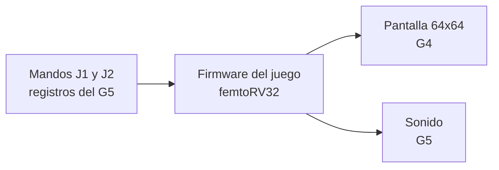
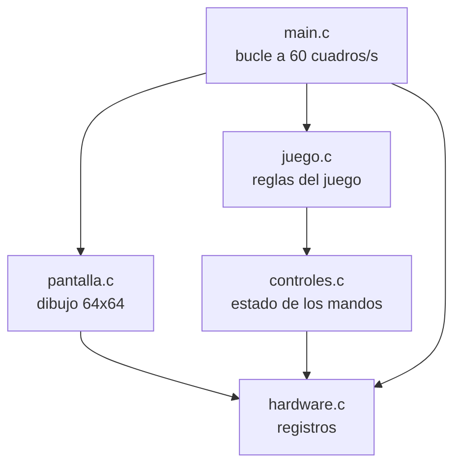
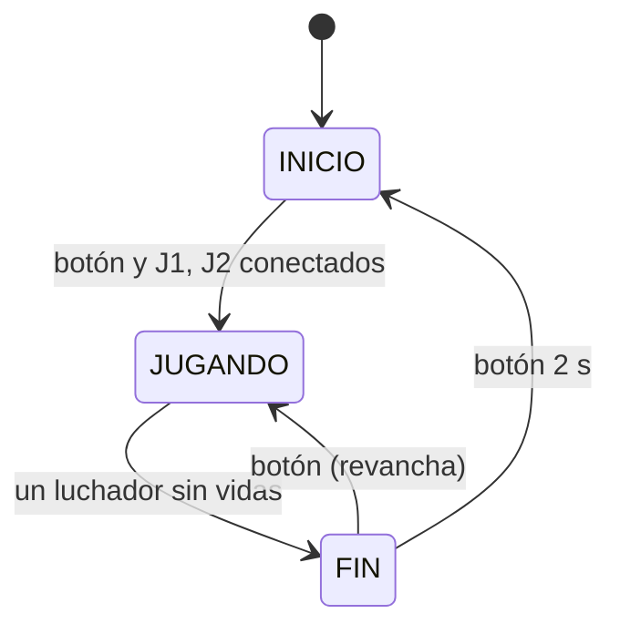
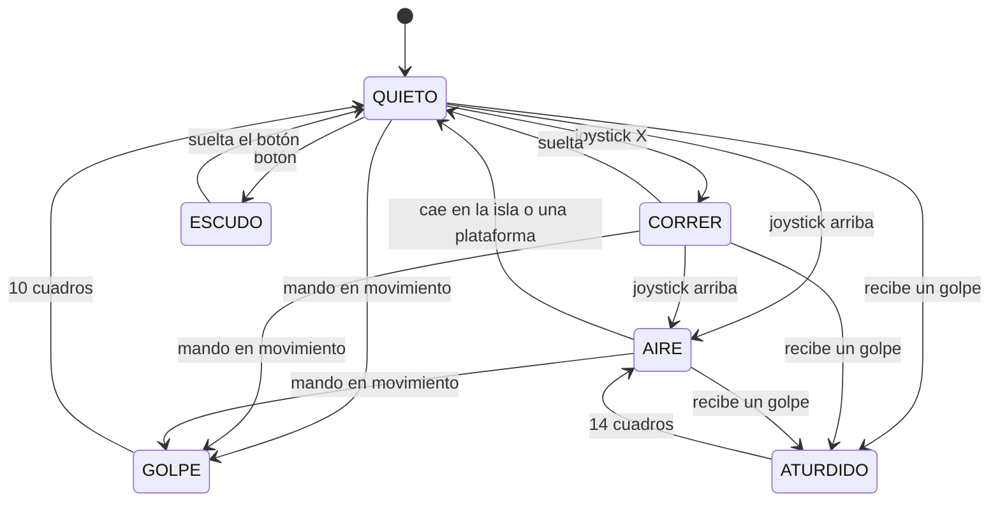

# G6: Arquitectura del juego

El juego es una pelea 1 contra 1 parecida a Smash. Partimos de una beta que el grupo ya tenía (Smash 8-bit) y la pasamos a C para que corra en la FPGA.

Integrantes: Juan Esteban Salazar Cabra, Juan Diego Vega Ramírez y Andrés Camilo Bermúdez Molina.

## Contenido de la carpeta

```
G6/
├── README.md
├── diagramas/    diagramas de flujo (draw.io y PNG)
├── firmware/     código en C del juego y su Makefile
├── pruebas/      programa para probar entradas y salidas en la FPGA
└── web/          beta para probar el juego en el navegador
```

## 1. Marco teórico

Estos son los conceptos que usamos para hacer el juego:

- Periféricos mapeados en memoria: el procesador se comunica con los mandos, la pantalla y el sonido leyendo y escribiendo direcciones de memoria, igual que en el ejemplo `femtoriscv` del curso.
- femtoRV32 Quark (RV32I): este procesador no tiene instrucciones para multiplicar ni dividir. Por eso en el código usamos desplazamientos, por ejemplo `y << 6` en vez de `y * 64`.
- Bucle de juego: el programa repite lo mismo 60 veces por segundo (leer, actualizar, dibujar) y espera a que se cumpla el tiempo de cada cuadro, así el juego siempre va a la misma velocidad ([Game Loop](https://gameprogrammingpatterns.com/game-loop.html)).
- Máquinas de estado: el juego y cada luchador están siempre en un solo estado. Así evitamos casos raros como que un luchador golpee mientras está aturdido ([State](https://gameprogrammingpatterns.com/state.html)).
- Punto fijo Q8.8: guardamos las posiciones y velocidades multiplicadas por 256, para poder mover fracciones de píxel usando solo números enteros.
- Colisión AABB: el golpe y el cuerpo de cada luchador son rectángulos, y hay impacto cuando los dos se cruzan.

## 2. Fundamento

Los mandos solo miden y envían; todas las decisiones las toma la consola.

El juego empieza en una pantalla que dice PELEA. Cuando los dos mandos están conectados y alguien oprime el botón del joystick, empieza la pelea entre un robot (J1) y un caballero (J2), sobre una isla con tres plataformas encima.

Cada jugador corre y salta con el joystick (tiene doble salto) y se baja de una plataforma empujándolo hacia abajo. Para golpear se mueve el mando: el giroscopio manda un 1 mientras hay movimiento. Mientras se mantiene el botón del joystick, el luchador se cubre con un escudo.

Cada golpe le sube el daño al rival, y entre más daño tiene, más lejos sale volando. Salirse de la isla no es perder de una vez, porque hay espacio para volver con el doble salto. Solo pierde una vida el que se va muy lejos de la pantalla. Cada uno tiene 3 vidas y gana el que deje al otro sin ninguna. Al final, con el botón se juega la revancha, y si se mantiene 2 segundos se vuelve al inicio.

## 3. Etapa de diseño

### 3.1 Diagrama de caja negra



### 3.2 Características de la interfaz

Las direcciones salen de los README de cada grupo (26 de noviembre). Están todas en `firmware/hardware.h`, así que si alguna cambia solo se toca ese archivo.

**Mandos (G5, región `0x0047`).** La ESP32 de cada mando manda 30 tramas por segundo de 8 bytes a 115 200 baudios:

| Byte | 0 | 1 | 2 | 3 | 4 | 5 | 6 | 7 |
|---|---|---|---|---|---|---|---|---|
| Campo | Inicio | Jugador | Secuencia | Joystick X | Joystick Y | Botones | Ataque | Checksum |
| Valor | `0xAA` | 1 o 2 | 0 a 255 | −127 a 127 | −127 a 127 | bit 0: botón | bit 0: movimiento | XOR de los bytes 1 a 6 |

El periférico de mandos del G5 recibe esas tramas, revisa el checksum y guarda la última válida de cada jugador. Nosotros solo leemos sus registros una vez por cuadro:

| Dirección | Registro | Qué tiene |
|---|---|---|
| `0x0047_0000` | `JOY1_DATA` | J1: `[7:0]` X, `[15:8]` Y, `[16]` botón, `[17]` ataque, `[31:24]` secuencia |
| `0x0047_0004` | `JOY2_DATA` | J2, con los mismos campos |
| `0x0047_0008` | `STATUS` | bit 0 llegó algo de J1, bit 1 de J2, bit 2 error de UART, bit 3 error de checksum |

- El joystick X sirve para correr. En el Y, hacia arriba es saltar y hacia abajo es bajarse de una plataforma.
- El botón del joystick sirve para empezar la partida y, durante la pelea, para el escudo.
- El bit de ataque lo calcula el G3 con el giroscopio: vale 1 mientras el mando se mueve. Si se queda en 1, el luchador golpea cada 0,3 s.
- Un mando cuenta como conectado si su secuencia cambió en el último segundo.

**Pantalla (G4, región `0x0044`).**

| Dirección | Registro | Para qué lo usamos |
|---|---|---|
| `0x0044_0000` | `CONTROL` | Escribir 1 al iniciar para encenderla |
| `0x0044_0010` | `FRAME` | Esperar a que cambie antes de escribir el cuadro (máximo 1/60 s) |
| `0x0044_4000` a `0x0044_7FFC` | píxeles | El píxel (x, y) va en `0x0044_4000 + 4·(64·y + x)`, con el color `{R, G, B}` |

**Sonido (G5, región `0x0043`).** El periférico genera tonos con `FREQ` (`0x0043_0000`), `VOL` (`0x0043_0004`) y `CONTROL` (`0x0043_0008`, bit 0 = suena). Con el reloj de 27 MHz, `FREQ = f · 65536 / 46875`. Cada efecto del juego es un tono:

| Efecto | Tono | `FREQ` | Duración |
|---|---|---|---|
| Empezar | 880 Hz | 1230 | 0,1 s |
| Golpe | 220 Hz | 308 | 0,07 s |
| Caída (pierde una vida) | 110 Hz | 154 | 0,3 s |
| Fin | 523 Hz | 732 | 0,5 s |

**Botones de la consola (GPIO del SoC, `0x0041_0008`).** El botón 1 también sirve para empezar, pero es opcional: todo se puede hacer con el botón del joystick.

### 3.3 Diagrama de bloques



Separamos el código así para que solo `hardware.c` tenga direcciones de memoria. Si otro grupo cambia un registro, solo hay que tocar ese archivo.

### 3.4 Diagramas de flujo

Hicimos los diagramas con los símbolos de la norma ISO 5807.

Diagrama 1, el juego completo. No tiene terminal de fin porque el programa nunca termina: después del ganador viene la revancha o se vuelve al inicio.


Diagrama 2, lo que hace cada luchador en un cuadro. Es el proceso "Actualizar a J1 y a J2" del diagrama 1. El orden de las preguntas es la prioridad: si está aturdido o golpeando no hace nada más; si no, primero va el escudo, después el golpe y después el salto.


### 3.5 Clasificación del flujo

| Unidad de control | Ruta de datos |
|---|---|
| Estado del juego (INICIO, JUGANDO, FIN) | Posición, velocidad, daño y vidas de cada luchador |
| Estado de cada luchador y sus contadores de tiempo | Bytes de la trama recibida |
| Las decisiones de los dos diagramas de flujo | Coordenadas de la isla y las plataformas, y los 4 096 píxeles |

### 3.6 Máquinas de estado

Juego:



Cada luchador:



Valores que usamos (en punto fijo, 256 = 1 píxel):

| Regla | Valor |
|---|---|
| Isla | Y = 48, de X = 5 a 59 |
| Plataformas | Dos en Y = 36 y una en Y = 24; se atraviesan desde abajo |
| Correr | Aceleración 46, velocidad máxima 333 |
| Salto | −691, unos 24 píxeles de alto |
| Gravedad | +38 por cuadro, caída máxima 512 |
| Golpe | Dura 10 cuadros y pega del cuadro 3 al 7 |
| Al recibir un golpe | +7 % de daño y sale empujado con 150 + 4 × daño |
| Escudo | No sube el daño; solo empuja un poco (120) |
| Pierde una vida | Si se va más allá de X < −36, X > 90, Y > 120 o Y < −40 |
| Vidas | 3 por jugador; al reaparecer es invulnerable 100 cuadros |

## 4. Implementación en C

| Archivo | Qué hace |
|---|---|
| `main.c` | El bucle: lee los mandos, actualiza el juego, manda el sonido, dibuja, envía la imagen y espera 1/60 s |
| `juego.c` | Las reglas: estados, física, golpes, escudo, plataformas, vidas y revancha |
| `controles.c` | Saca X, Y, botón y ataque del registro de cada mando y sabe si está conectado. Para la beta también arma la trama byte por byte |
| `pantalla.c` | Dibuja la isla, las plataformas, el robot, el caballero, el daño, las vidas y los textos |
| `hardware.c` | Lee y escribe los registros de los periféricos: mandos, pantalla, sonido y botones |
| `crt0.S`, `linker.ld` | Los del ejemplo del curso; al `linker.ld` le alineamos la pila |

Para compilar, con el entorno del curso:

```
cd firmware
make        # firmware.hex
make web    # la beta
```

## 5. Pruebas

- El programa compila con `riscv64-unknown-elf-gcc -march=rv32i`. Ocupa unos 7,6 KB y no usa multiplicación ni división.
- Probamos el juego completo en la beta: inicio, pelea, escudo, golpes, caídas, ganador, revancha y volver al inicio.
- Comprobamos que los dos luchadores alcanzan las plataformas y que alguien que se sale de la isla puede volver con el doble salto.
- También corrimos `firmware.hex` en una simulación del procesador del curso (`femtorv32_quark.v`, con Icarus Verilog), con modelos de los periféricos según el mapa de cada grupo: arranca, ve conectados los dos mandos, empieza con el botón del joystick, dibuja en la memoria de video del G4 y prende y apaga el tono del G5. Cada cuadro cabe en los 450 000 ciclos que hay a 27 MHz.
- Para probar en la placa hicimos un programa aparte que prueba la pantalla, los mandos, los botones y el sonido sin PC: está en [`pruebas/`](pruebas/README.md).

La beta está en `web/pelea-beta.html` y se abre en el navegador. Usa el mismo código del juego y la página hace de los dos mandos:

- J1: `A` `D` correr, `W` saltar, `S` bajar, `G` mover el mando (golpe), `F` botón (escudo).
- J2: `←` `→` correr, `↑` saltar, `↓` bajar, `L` mover el mando, `K` botón.

## 6. Implementación en placa

Pendiente. El SoC (`projecto/consola`) ya tiene el procesador, la UART del PC, el multiplicador y el lugar del GPIO. Falta conectar la pantalla del G4 (`0x0044`), el sonido del G5 (`0x0043`) y el periférico de mandos del G5 (`0x0047`). Cuando estén, primero cargamos el programa de [`pruebas/`](pruebas/README.md) y después el juego.

