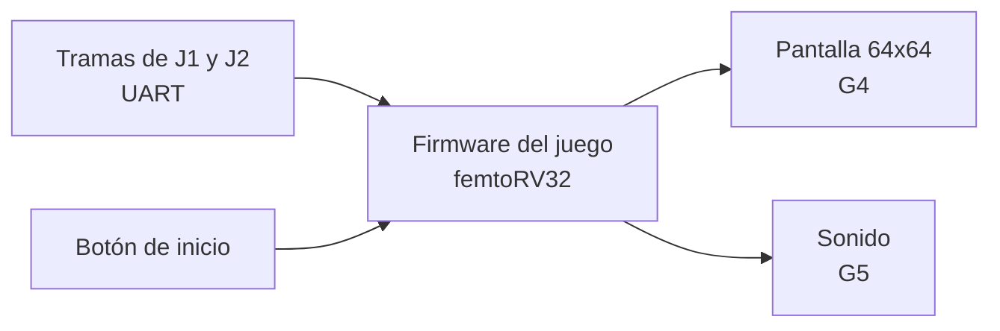
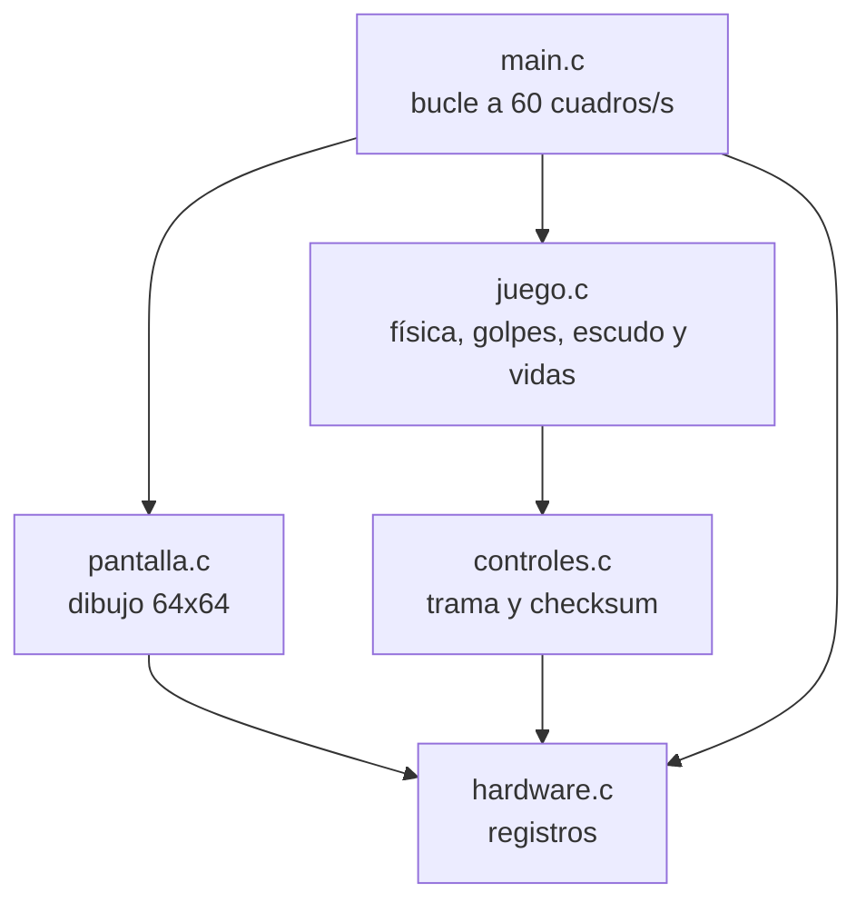
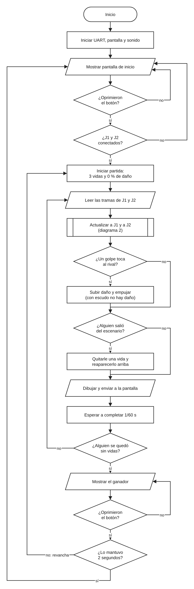
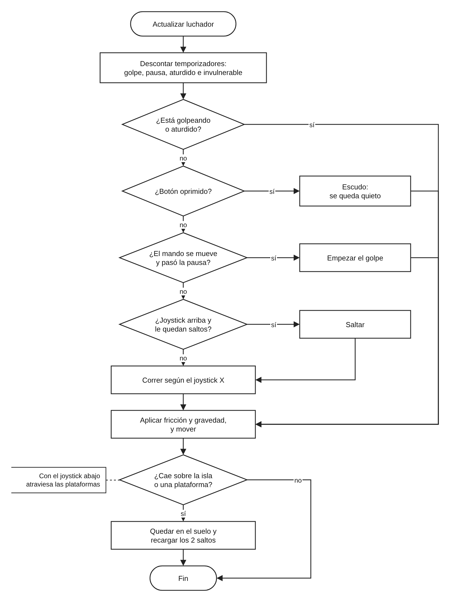
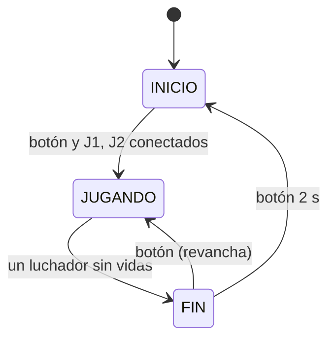
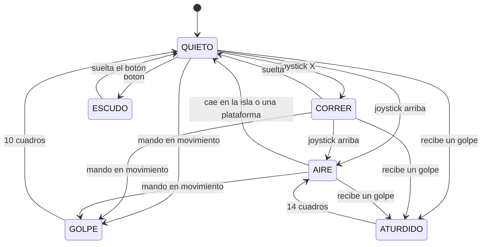

# G6: Arquitectura del Juego

Carpeta del equipo G6 dentro del proyecto **Consola de videojuegos sobre FPGA** (Diseño Digital 1, UNAL). El equipo escribe el **firmware del juego**: el programa en C que corre en el procesador femtoRV32 de la consola, lee las tramas de los dos mandos, ejecuta la pelea y escribe en la pantalla y en el sonido. El juego es tipo Smash: la física y las reglas vienen de la beta previa del grupo (Smash 8-bit, punto fijo Q8.8) y aquí están pasadas a C.

| Integrantes |
|---|
| Juan Esteban Salazar Cabra |
| Juan Diego Vega Ramírez |
| Andrés Camilo Bermúdez Molina |

## Contenido de la carpeta

```
G6/
├── README.md        Este archivo
├── diagramas/       Diagramas de flujo: el juego y la actualización de cada luchador (draw.io y PNG)
├── firmware/        Programa en C para el femtoRV32 y su Makefile
└── web/             Beta: el mismo juego compilado para probar en el navegador
```

## 1. Marco teórico

- **Periféricos mapeados en memoria.** El procesador no ve cables: lee y escribe direcciones. Cada periférico (UART, pantalla, sonido) ocupa una ventana del mapa de memoria, como en el ejemplo `femtoriscv` del repositorio del curso.
- **femtoRV32 Quark (RV32I).** No tiene multiplicación, división ni interrupciones. El juego no multiplica (usa desplazamientos, `y << 6` = y × 64) y revisa los periféricos por sondeo.
- **Bucle de juego de paso fijo.** Cada cuadro hace siempre lo mismo (leer entradas, actualizar, dibujar) y espera a completar su tiempo, para que el juego vaya a la misma velocidad ([Game Programming Patterns, Game Loop](https://gameprogrammingpatterns.com/game-loop.html)).
- **Máquinas de estado.** El juego y cada luchador están siempre en un solo estado, lo que evita combinaciones imposibles como moverse mientras está aturdido ([Game Programming Patterns, State](https://gameprogrammingpatterns.com/state.html)).
- **Punto fijo Q8.8.** Posiciones y velocidades se guardan multiplicadas por 256 (8 bits de fracción). Así la física usa solo sumas y desplazamientos: la gravedad es +38 (0,15 px por cuadro) y la fricción `vx - (vx >> 2)` (× 0,75).
- **Colisión AABB.** El golpe y el cuerpo del rival son rectángulos; hay impacto si se cruzan en X y en Y. Son 4 comparaciones.

## 2. Fundamento

La consola es la única que decide: los mandos solo miden y envían. El juego abre con la pantalla de inicio (PELEA) y, con el botón, empieza la pelea entre el robot (J1) y el caballero (J2) en un escenario con una isla y tres plataformas encima. Cada jugador se mueve con el joystick: a los lados corre, arriba salta (con doble salto) y abajo se baja de una plataforma. Mientras mueve el mando, el giroscopio manda un 1 y el luchador golpea; con el mando quieto manda un 0 y no golpea. El botón del joystick es el escudo: mientras lo mantiene, el luchador se queda quieto y los golpes no le suben el daño. Cada golpe le sube el daño al rival y lo empuja; entre más daño tiene, más lejos sale volando. Como en Smash, salir de la isla no es perder: hay espacio fuera de la pantalla y se puede volver con el doble salto; un cuadrito en el borde muestra por dónde va el luchador. Solo quien pasa los límites de afuera pierde una de sus 3 vidas y reaparece arriba. 60 veces por segundo, el firmware toma la última trama válida de J1 y de J2, mueve a los luchadores, revisa golpes y caídas, dibuja el cuadro de 64×64 en la RAM y lo pasa a la pantalla, y le indica al módulo de sonido qué efecto tocar. Gana quien deje al otro sin vidas. En la pantalla final, el botón da la revancha; mantenerlo 2 s vuelve al inicio.

## 3. Etapa de diseño

### 3.1 Diagrama de caja negra



### 3.2 Características de la interfaz

**Trama de cada mando** (la arma la FPGA del mando y llega por Bluetooth a la UART de la consola, una cada 33 ms):

| Byte | 0 | 1 | 2 | 3 | 4 | 5 | 6 | 7 |
|---|---|---|---|---|---|---|---|---|
| Campo | Inicio | Jugador | Secuencia | Joystick X | Joystick Y | Botones | Ataque | Checksum |
| Valor | `0xAA` | 1 o 2 | 0 a 255 | −127 a 127 (correr) | −127 a 127 (+ = saltar, − = bajar de una plataforma) | bit 0 = botón del joystick (escudo) | bit 0 = movimiento del mando (golpe) | XOR de los bytes 1 a 6 |

- El bit de ataque es lo que manda el G3 desde el giroscopio: 1 mientras el mando se mueve, 0 cuando está quieto. Con 1 el luchador golpea; si sigue en 1, da un golpe cada 18 cuadros (0,3 s).
- El botón del joystick es el escudo durante la pelea. En las pantallas de inicio y fin sirve para empezar.
- Una trama cada 33 ms por mando son 2 × 8 × 30 × 10 = 4 800 bits/s: cabe en la UART a 9 600 baudios que probó el G1. El juego corre a 60 cuadros/s y usa cada trama durante 2 cuadros.
- Si el XOR no coincide, la trama se descarta y se usa la anterior.

**Registros que usa el firmware:**

| Periférico | Registro | Uso en el juego |
|---|---|---|
| UART (G1) | `+0x10` control, `+0x08` dato | Bit 8 = llegó un byte (mismos registros que `getChar()` del curso) |
| Pantalla (G4) | `CONTROL` `0x00` | Escribe 1 al iniciar (EN) |
| Pantalla (G4) | `PIXEL_ADDR` `0x08` | Escribe 0 antes de cada cuadro |
| Pantalla (G4) | `PIXEL_DATA` `0x0C` | 4 096 escrituras por cuadro, color `{R,G,B}` |
| Pantalla (G4) | `FRAME` `0x10` | Espera a que cambie antes de escribir |
| Sonido (G5) | `+0x00` | Código del efecto: 1 empezar, 4 golpe, 8 caída (pierde una vida), 9 fin |
| Botón de inicio | `+0x00` | Bit 0 |

Las direcciones base están en `firmware/hardware.h` y son una propuesta hasta que exista `memory_map.yml` (G2).

### 3.3 Diagrama de bloques



Solo `hardware.c` conoce direcciones. Si otro grupo cambia un registro, se cambia ese archivo y el resto queda igual.

### 3.4 Diagramas de flujo

Símbolos de la norma ISO 5807: terminal (óvalo), proceso (rectángulo), entrada o salida de datos (paralelogramo), proceso predefinido (rectángulo con doble lado), decisión (rombo) y anotación (corchete).

**Diagrama 1: el juego.** Es cíclico, así que no tiene terminal de fin: después del ganador viene la revancha o se vuelve a la pantalla de inicio. Cada vuelta de "Leer las tramas" a "Esperar a completar 1/60 s" es un cuadro.



**Diagrama 2: actualizar un luchador.** Es el proceso predefinido "Actualizar a J1 y a J2" del diagrama 1; se hace una vez por luchador en cada cuadro. El orden de las decisiones da la prioridad: aturdido o golpeando no hace nada, luego escudo, luego golpe, luego salto.



### 3.5 Clasificación del flujo

| Unidad de control | Ruta de datos |
|---|---|
| Estado del juego (INICIO, JUGANDO, FIN) | Posición y velocidad Q8.8, daño y vidas de cada luchador |
| Estado de cada luchador y sus temporizadores (golpe, pausa, aturdido, invulnerable) | Bytes de la trama recibida |
| Decisiones del diagrama 1: ¿botón?, ¿mandos conectados?, ¿un golpe toca al rival?, ¿salió del escenario?, ¿sin vidas?, ¿mantuvo 2 s? | Isla y plataformas (coordenadas fijas) |
| Decisiones del diagrama 2: ¿golpeando o aturdido?, ¿botón?, ¿mando en movimiento?, ¿joystick arriba con saltos?, ¿cae sobre la isla o una plataforma? | Arreglo de 4 096 píxeles |

### 3.6 Máquinas de estado

**Juego:**



**Cada luchador:**



| Regla | Valor |
|---|---|
| Escenario | Isla en Y = 48, de X = 5 a X = 59. Plataformas: dos en Y = 36 (X 11 a 25 y X 39 a 53) y una en Y = 24 (X 24 a 40). Las plataformas se atraviesan desde abajo y con el joystick abajo |
| Luchadores | Robot (J1) y caballero (J2), dibujos de 10 × 14 píxeles; la caja del cuerpo tiene ese mismo tamaño |
| Correr | Aceleración 46, velocidad máxima 333 (1,3 px por cuadro) |
| Salto | −691 (sube unos 24 px); doble salto, se recarga al pisar la isla o una plataforma |
| Gravedad | +38 por cuadro, caída máxima 512 (2 px por cuadro) |
| Golpe | Dura 10 cuadros; solo toca al rival en los cuadros 3 a 7. Caja de 8 × 5 píxeles delante del luchador, a la altura del brazo. Si el mando sigue en movimiento, espera 8 cuadros y golpea otra vez |
| Al recibir un golpe | +7 % de daño, aturdido 14 cuadros. Sale hacia el lado con 150 + 4 × daño y hacia arriba con 350 + 2 × daño (máximo 900) |
| Escudo | Mientras mantiene el botón: quieto, sin daño ni aturdido; el golpe solo lo corre un poco (120) |
| En el aire | El empuje se frena: vx × 0,94 por cuadro |
| Fuera de la pantalla | Un cuadrito del color del jugador en el borde muestra por dónde va |
| Pierde una vida | Si pasa X < −36, X > 90, Y > 120 o Y < −40. El daño vuelve a 0 % y reaparece en (27, 14) |
| Al reaparecer | 100 cuadros invulnerable (parpadea) |
| Vidas | 3 por jugador |

## 4. Implementación en C

| Archivo | Qué hace |
|---|---|
| `firmware/main.c` | Bucle: leer UART, actualizar, sonido, dibujar, enviar y esperar 16,7 ms (`rdcycle`) |
| `firmware/juego.c` | Estados, física Q8.8, isla y plataformas, golpe con cajas AABB, escudo, empuje, caídas, vidas y revancha |
| `firmware/controles.c` | Arma la trama byte por byte y revisa el XOR |
| `firmware/pantalla.c` | Isla y plataformas, dibujos de 10 × 14 del robot y el caballero (se voltean según hacia dónde miran), escudo, golpe, cuadrito de quien está fuera de la pantalla, daño en % y vidas; pantallas de inicio y fin; letras de 3×5 |
| `firmware/hardware.c` | Registros de la UART, la pantalla, el sonido y el botón |
| `firmware/crt0.S`, `linker.ld` | Los del ejemplo del curso; al `linker.ld` se le agregó `ALIGN(4)` y `ALIGN(16)` para alinear la pila |

Compilar (con el entorno del curso):

```
cd firmware
make        # genera firmware.hex
make web    # genera web/juego.wasm para la beta
```

## 5. Pruebas

- Compila con `riscv64-unknown-elf-gcc -march=rv32i`: unos 7,6 KB de programa y 12,8 KB de RAM en total (de 32 KB), sin multiplicación ni división por software (el `× 4` del empuje es `daño << 2`).
- Prueba de todo el recorrido con la beta: inicio → pelea → mando quieto (no golpea) → golpe contra el escudo (daño en 0 %) → 1 s de movimiento (4 golpes) → fin → revancha → fin → mantener 2 s → inicio.
- Escenario: los dos luchadores suben a las plataformas de los lados con un salto y bajan con el joystick abajo. Un luchador que sale caminando por el borde de la isla vuelve con el doble salto si salta en el primer tercio de segundo.
- **Beta:** abrir `web/pelea-beta.html` en el navegador. Usa los mismos `juego.c`, `controles.c` y `pantalla.c`; la página hace de los dos mandos y envía las mismas tramas de 8 bytes.
  - J1: `A` `D` correr, `W` saltar (doble), `S` bajar de una plataforma, `G` mover el mando (golpe, mientras se mantiene), `F` botón (escudo).
  - J2: `←` `→` correr, `↑` saltar (doble), `↓` bajar de una plataforma, `L` mover el mando, `K` botón (escudo).

## 6. Implementación en placa

**Pendiente.** Falta el mapa de memoria del SoC (G2) y los periféricos de pantalla (G4), UART (G1) y sonido (G5) integrados.

## Preguntas abiertas

- [ ] **G2:** direcciones base de la UART, la pantalla, el sonido y el botón de inicio; frecuencia del reloj del SoC (el firmware asume 50 MHz, como el G4).
- [ ] **G1:** ¿una sola UART recibe las tramas de los dos mandos? ¿Se puede subir a 57 600 baudios?
- [ ] **G3:** ¿el bit de movimiento (1 moviéndose, 0 quieto) va en el byte 6 de la trama? ¿Cuánto dura en 1 un movimiento normal?
- [ ] **G4:** ¿se puede leer `FRAME` para sincronizar y escribir los 4 096 píxeles seguidos con `PIXEL_DATA`?
- [ ] **G5:** ¿el joystick llega dentro de la trama de 8 bytes o como registros propios? ¿Qué suena con cada código de efecto?

## Registro de avances y aportes

| Fecha | Integrante | Descripción del aporte | Estado |
|---|---|---|---|
| 2026-11-10 | Juan Esteban Salazar Cabra | README del G6 y diagrama de flujo | Hecho |
| 2026-11-10 | Juan Diego Vega Ramírez | Lógica del juego (reglas Smash en C), recepción de la trama y bucle principal | Hecho |
| 2026-11-10 | Andrés Camilo Bermúdez Molina | Dibujo de la pantalla, registros de hardware y beta web | Hecho |
| 2026-11-11 | Juan Diego Vega Ramírez | Golpe con la señal de movimiento del G3 (1 = golpe), escudo con el botón, pantalla de inicio y revancha | Hecho |
| 2026-11-11 | Andrés Camilo Bermúdez Molina | Dibujo del escudo, pantallas de inicio y fin; beta actualizada | Hecho |
| 2026-11-11 | Juan Esteban Salazar Cabra | README y diagrama de flujo con el escudo y la revancha | Hecho |
| 2026-11-19 | Juan Diego Vega Ramírez | Isla más grande, tres plataformas, caída más lenta, empuje según el daño y límites fuera de la pantalla; archivos del juego movidos a `firmware/` | Hecho |
| 2026-11-19 | Andrés Camilo Bermúdez Molina | Dibujos del robot y el caballero, plataformas y cuadrito de quien está fuera de la pantalla; beta final y `.gitignore` | Hecho |
| 2026-11-19 | Juan Esteban Salazar Cabra | README final y diagramas de flujo del juego y de cada luchador (ISO 5807) | Hecho |
