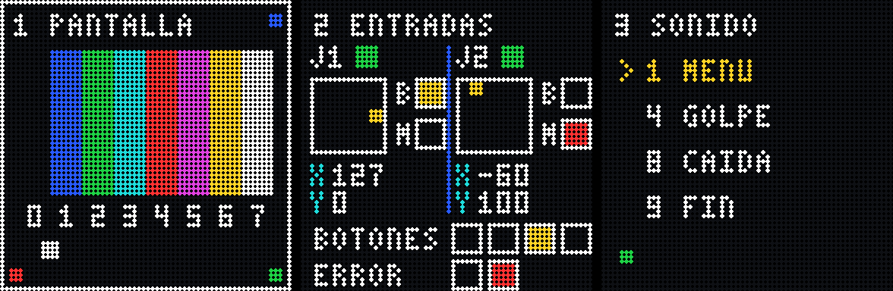

# Pruebas de la consola en la FPGA

Es un programa aparte que se carga en el femtoRV32 de la consola en lugar del juego. Con él probamos las entradas (mandos y botones) y las salidas (pantalla, sonido y LEDs) con el hardware real, sin usar el PC: el resultado se ve en el panel, se oye en el parlante y se ve en los LEDs.

Usa los mismos registros que el juego (`../firmware/hardware.h`) y la misma lectura de los mandos (`../firmware/controles.c`). Si una prueba pasa aquí, esa parte del juego también va a funcionar.

## Las tres pruebas

Con el botón 1 de la consola (GPIO) se pasa a la siguiente prueba. Si los botones no están conectados, se mantiene 2 s el botón del joystick de J1.



| Prueba | Qué se debe ver u oír | Si falla, revisar |
|---|---|---|
| **1 Pantalla** | Marco blanco en los 4 bordes; 8 barras con los colores 0 a 7 (0 es negro y no se ve); cuadrito azul arriba a la derecha, rojo abajo a la izquierda y verde abajo a la derecha; un cuadro blanco que va y vuelve | Falta un color: un bit R, G o B del G4. Imagen corrida o al revés: cómo se arma la dirección del píxel. El cuadro salta o se parte: la sincronización con `FRAME` |
| **2 Entradas** | Al lado de J1 y J2, cuadrito verde si llegan tramas nuevas (rojo si no). El punto amarillo sigue al joystick (arriba es arriba). B se llena de amarillo con el botón del joystick y M de rojo al mover el mando. Salen X y Y en números. Abajo, BOTONES muestra los 4 botones de la consola y ERROR se pone rojo si el periférico de mandos vio un error de UART (izquierda) o de checksum (derecha) | Rojo: no llegan tramas (ESP32, cable o baudios distintos). ERROR en rojo: la trama llega mal. El punto va al revés: el signo de X o Y en el mando. M nunca se llena: el bit de movimiento del G3 |
| **3 Sonido** | Suena un tono por segundo, medio segundo cada uno: 880 Hz (empezar), 220 Hz (golpe), 110 Hz (caída) y 523 Hz (fin), y vuelve a empezar. El que suena sale en amarillo. El botón de un mando repite el actual | No suena nada: el periférico de sonido del G5 o su dirección. Si los tonos duran el doble, el procesador va más lento de lo que dice `CPU_HZ` |

**LEDs** (sirven aunque no haya pantalla):
- El LED de la placa parpadea más o menos una vez por segundo: el procesador está corriendo. Se queda prendido mientras se oprime cualquier botón.
- Los LEDs del GPIO repiten los 4 botones de la consola: así se prueban las entradas y las salidas del GPIO a la vez.
- Si el LED de la placa no parpadea, el programa no arrancó: revisar que se cargó el `.hex`, el reloj y la memoria.

## Qué necesita del SoC

| Periférico | Dirección | Quién lo hace |
|---|---|---|
| LED de la placa | bit 2 del control de la UART del SoC (`0x0040_0010`) | SoC (ya está) |
| Botones y LEDs | GPIO: botones en `0x0041_0008`, LEDs en `0x0041_0004` | SoC (pendiente) |
| Sonido | `0x0043_0000` (`FREQ`, `VOL`, `CONTROL`) | G5 |
| Pantalla | `0x0044_0000` (`CONTROL`, `FRAME`) y píxeles desde `0x0044_4000` | G4 |
| Mandos | `0x0047_0000` (`JOY1_DATA`, `JOY2_DATA`, `STATUS`) | G5 |

Con el SoC como está hoy solo se puede ver el LED de la placa. Cada periférico que el G2 vaya conectando se puede probar de una vez, sin esperar a los demás: si la pantalla no responde, el programa no se queda esperando `FRAME` y sigue corriendo.

## Cómo cargarlo en la FPGA

1. Compilar (con el entorno del curso):
   ```
   cd Grupos/G6/pruebas
   make                     # genera pruebas.hex para el reloj de 27 MHz del SoC (Tang Nano 9K)
   make CPU_HZ=25000000     # si el SoC corre a otra frecuencia
   ```
2. En la carpeta del SoC (la que tiene `SOC.v` y su `Makefile`, como el ejemplo `femtoriscv` del curso), poner el programa como `firmware.hex` y sintetizar:
   ```
   cp RUTA_DEL_REPO/Grupos/G6/pruebas/pruebas.hex ./firmware.hex
   make clean syn
   make config
   ```
   `make config` lo carga en la SRAM de la FPGA y se borra al apagar. Para que quede guardado: `make config-flash`.
3. Para volver al juego, se copia `Grupos/G6/firmware/firmware.hex` como `firmware.hex` y se repite el paso 2.

## Simulación previa

Antes de llevarlo a la placa, corrimos `pruebas.hex` en el procesador del curso (`femtorv32_quark.v`) con Icarus Verilog (`simulacion/tb_consola.v`). El banco de prueba tiene modelos de los periféricos con el mapa de cada grupo: mandos, pantalla, sonido, GPIO y LED. Resultado:
- Las tres pruebas dibujan lo que se ve en la imagen de arriba (sale de la simulación).
- Los tonos prenden y apagan en orden: 880, 220, 110 y 523 Hz.
- El LED se prende con el botón de J1, los LEDs del GPIO repiten los botones y la prueba cambia con el botón 1 y con J1 mantenido.
- Un cuadro de la prueba toma unos 129 000 ciclos, menos de los 450 000 que hay a 27 MHz.

Para repetirla (necesita `iverilog`): `cd simulacion && sh correr.sh RUTA/femtorv32_quark.v`. Con `juego` al final simula el juego completo en vez de las pruebas.

## Registro de resultados en la placa

Para llenar en el laboratorio, con foto o video de cada prueba como evidencia.

| Prueba | Qué se revisa | Resultado | Evidencia |
|---|---|---|---|
| LED | Parpadea al encender | | |
| Pantalla | Se ven los 4 bordes del marco | | |
| Pantalla | Se ven los 7 colores en orden (1 azul a 7 blanco) | | |
| Pantalla | Azul arriba a la derecha, rojo abajo a la izquierda, verde abajo a la derecha | | |
| Pantalla | El cuadro blanco se mueve sin saltos | | |
| Entradas | J1 y J2 en verde (llegan tramas) | | |
| Entradas | El punto sigue al joystick en las 4 direcciones (J1 y J2) | | |
| Entradas | B se llena con el botón del joystick (J1 y J2) | | |
| Entradas | M se llena al mover el mando (J1 y J2) | | |
| Entradas | BOTONES muestra los 4 botones de la consola y los LEDs del GPIO los repiten | | |
| Entradas | ERROR queda apagado con los mandos funcionando | | |
| Entradas | El LED de la placa se prende con cualquier botón | | |
| Sonido | Suenan los 4 tonos en orden, medio segundo cada uno | | |
